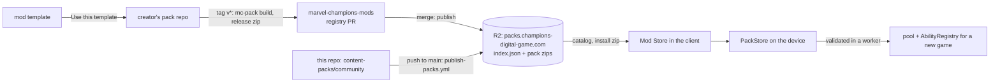

# Architecture

[README](../../README.md) · [Current status](current-status.md) · [Architecture](architecture.md) · [Downloads](downloads.md) · [Contributing](../../CONTRIBUTING.md)

This monorepo is organized with **pnpm workspaces** under `packages/`. The dependency graph is strictly
`client → cards → engine → content`.

```
marvel-champions-digital-game/
├── packages/
│   ├── content/     # (@mc/content) Card data schema, normalization & MarvelCDB ingestion
│   ├── engine/      # (@mc/engine) Headless rules engine, state machine, timing windows, legal actions
│   ├── cards/       # (@mc/cards) Card ability DSL, card scripts, scenarios, campaigns
│   ├── client/      # (@mc/client) 2D tabletop game UI built with Phaser 4 & rexUI
│   ├── mod-sdk/     # (@mc/mod-sdk) Pack schema, ability DSL and the mc-pack CLI for community packs
│   └── sync-worker/ # (@mc/sync-worker) Cloudflare Worker that moves saves between devices
├── content-packs/   # The sample packs and the community packs this repo publishes to the Mod Store
├── assets/          # manifest.json: the media bundles `pnpm assets:fetch` downloads
├── docs/            # Specifications, per-wave plans and rules QA reports
├── CLAUDE.md        # Engineering conventions & specialist agent roles
├── CONTRIBUTING.md  # How to set up, test and contribute
├── PLAN.md          # Master roadmap and phase tracking
└── package.json     # Monorepo scripts and root dependencies
```

| Package                                             | Purpose                                                                                                                                                                                                                                                                                             |
| --------------------------------------------------- | --------------------------------------------------------------------------------------------------------------------------------------------------------------------------------------------------------------------------------------------------------------------------------------------------- |
| **[`@mc/content`](../../packages/content)**         | Typed card schemas, normalized card data for every ingested pack, starter decks, and the ingestion scripts that curate card text and stats from MarvelCDB. Stores artwork references rather than image bytes.                                                                                       |
| **[`@mc/engine`](../../packages/engine)**           | The authoritative rules engine: game state, phase loops, interrupt/response timing, keyword resolution, the villain phase, deck legality (`validateDeck`), legal action generation (`legalActions`) and replayable command logs.                                                                    |
| **[`@mc/cards`](../../packages/cards)**             | The ability DSL that turns printed card text into engine `AbilityDefinition`s, one module per hero kit, aspect and encounter set, plus scenario and campaign builders.                                                                                                                              |
| **[`@mc/client`](../../packages/client)**           | A 2D tabletop client in the mold of _Sentinels of the Multiverse_, built with **Phaser 4**, **rexUI** and **Vite**, running the engine in a Web Worker. Packaged for desktop with Tauri and for Android with Capacitor.                                                                             |
| **[`@mc/mod-sdk`](../../packages/mod-sdk)**         | What a community pack is built with: the `pack.json` schema, the `@mc/cards` ability DSL re-exported, and the `mc-pack` CLI (`validate`, `build`, `test`, `import-marvelcdb`). Bundled with the engine and published to npm as `@champions-digital-game/mod-sdk`, and as a tarball on each release. |
| **[`@mc/sync-worker`](../../packages/sync-worker)** | A Cloudflare Worker with Durable Objects that moves saves between devices through one-time, end-to-end encrypted rooms. It never sees a save in the clear.                                                                                                                                          |

## The other repositories, and how their content gets in

The game is this repo, but its media and its community content live in three more. None of them is a build
dependency of the engine: the client reads what they publish, as data, at run time or at build time.

| Repository                                                                                                | What it holds                                                                                                                                                                                | How it reaches the game                                                                                                                                                                                                                                                                                                                                                             |
| --------------------------------------------------------------------------------------------------------- | -------------------------------------------------------------------------------------------------------------------------------------------------------------------------------------------- | ----------------------------------------------------------------------------------------------------------------------------------------------------------------------------------------------------------------------------------------------------------------------------------------------------------------------------------------------------------------------------------- |
| [`quincarter/marvel-champions-content`](https://github.com/quincarter/marvel-champions-content)           | Card scans (English and Spanish), music and art, as versioned zip bundles on its releases. They are kept out of git here because of their size.                                              | `assets/manifest.json` in this repo names each bundle's release, size and sha256. `pnpm assets:fetch` downloads and checks them into a cache shared by every checkout, and the client build serves them. `pnpm assets:pack <bundle>` uploads a changed bundle.                                                                                                                      |
| [`quincarter/marvel-champions-mod-template`](https://github.com/quincarter/marvel-champions-mod-template) | A GitHub template repository for making a community pack: `pack.json`, cards, abilities written with the DSL, scenarios, decks, art, `CREDITS.md`, `PERMISSION.md`, a sample hero and tests. | A creator makes their own repo from it. That repo's CI runs `mc-pack validate` and `mc-pack test` from the mod SDK on every push. A `v*` tag runs `mc-pack build` and attaches the pack's zip and `pack.json` to a release.                                                                                                                                                         |
| [`quincarter/marvel-champions-mods`](https://github.com/quincarter/marvel-champions-mods)                 | The Mod Store registry: one `packs/<id>.yaml` entry per approved pack, naming the creator's repo, the tag, the exact commit and the creator's permission.                                    | A creator opens a pull request adding their entry. The registry's CI rebuilds the pack at that commit with the SDK version the pack's lockfile pins and checks the result byte for byte against the released zip. Merging the PR approves the pack, and the registry's publish workflow uploads it to R2 (and to a release of the registry, as a fallback) and updates the catalog. |

The Mod Store's catalog and packs are on Cloudflare R2 at `packs.champions-digital-game.com`:



- **Two publishers, one catalog.** The registry publishes the packs creators submit (`source: "registry"` in
  `index.json`). This repo's `.github/workflows/publish-packs.yml` publishes the packs in `content-packs/community/`
  that the owner imported with their creators' permission (`source: "game"`). Each pack id belongs to one publisher,
  a published version is never overwritten, and older versions stay so saves that used them still load. Both refuse
  a pack whose permission isn't recorded (`mc-pack validate --publish`).
- **In the client**, `packs/catalog.ts` reads `index.json` and keeps the last good copy for offline use. The Mod Store
  installs a pack's zip into the `PackStore` (`packs/pack-store.ts`) on every platform. At boot and after each
  install, `packs/active-packs.ts` validates every installed pack in a worker and adds the ones that pass to the card
  pool and to a new game's abilities. A pack's abilities are plain data, so the engine runs them like the base game's.
  A pack that fails, or needs a newer app, is skipped with a reason the store shows.
- The full design, schema and review process are in [custom content packs](../custom-content-packs.md), and the
  steps for publishing are in [CONTRIBUTING.md](../../CONTRIBUTING.md).

## Running it locally

You need [Node.js](https://nodejs.org/) (>= 24) and [pnpm](https://pnpm.io/) (>= 11.24).

```bash
git clone https://github.com/quincarter/marvel-champions-digital-game.git
cd marvel-champions-digital-game
pnpm install
pnpm assets:fetch    # card art, music and art from the content repo (about 2 GB, once per machine)
pnpm dev
```

Then open [http://localhost:5173](http://localhost:5173). Tests, the e2e suite, card data ingestion and the release
flow are covered in [CONTRIBUTING.md](../../CONTRIBUTING.md).
