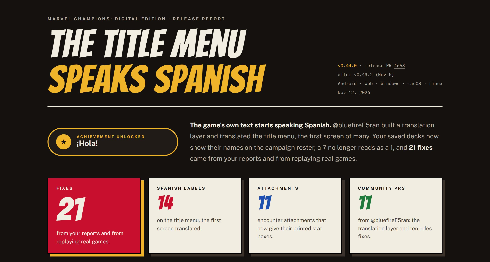
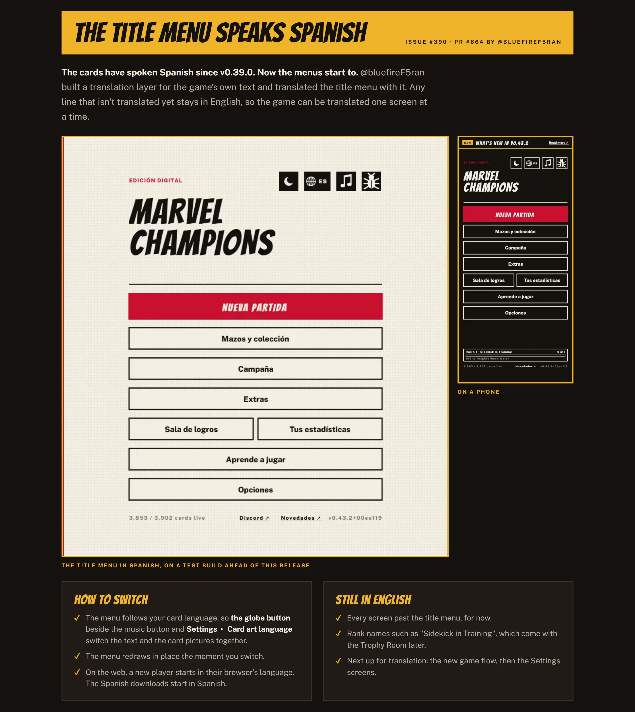
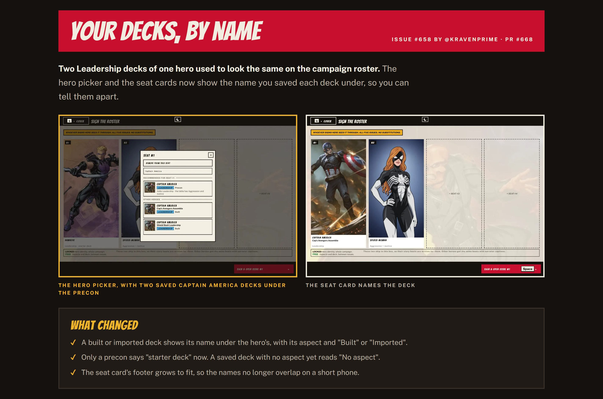
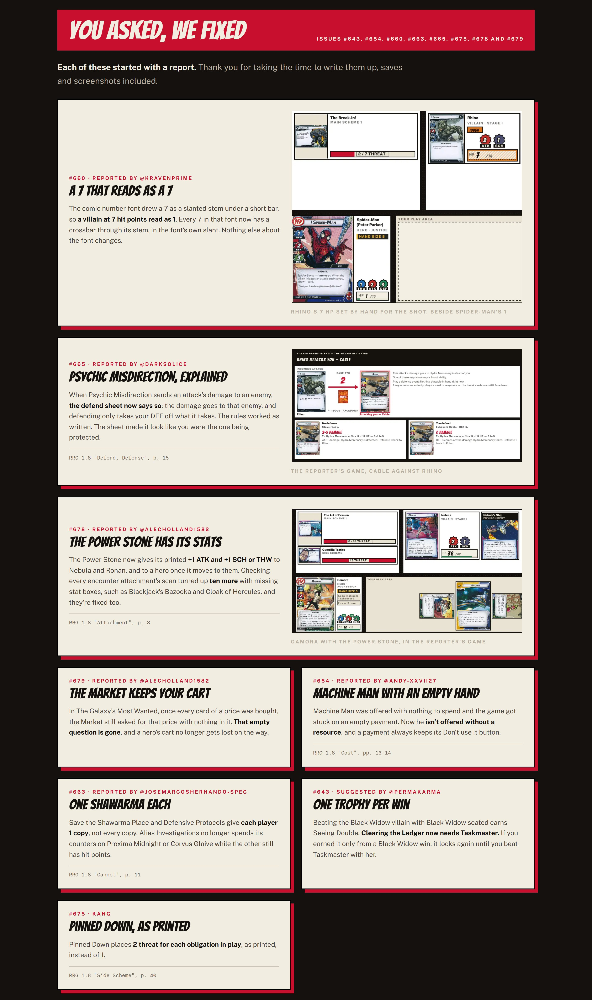
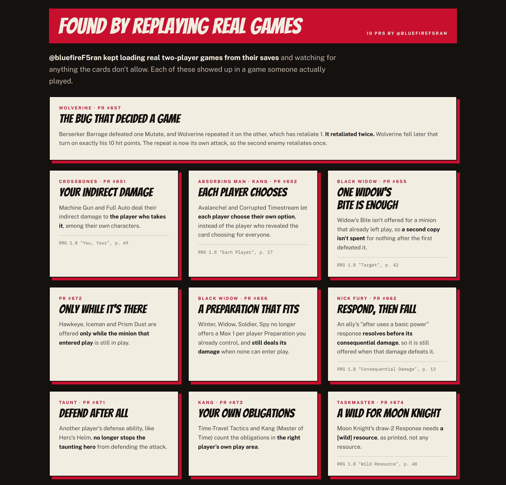
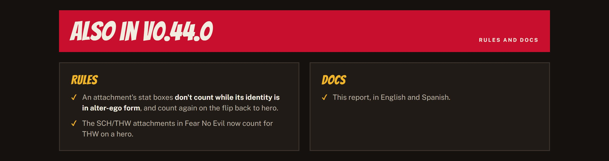
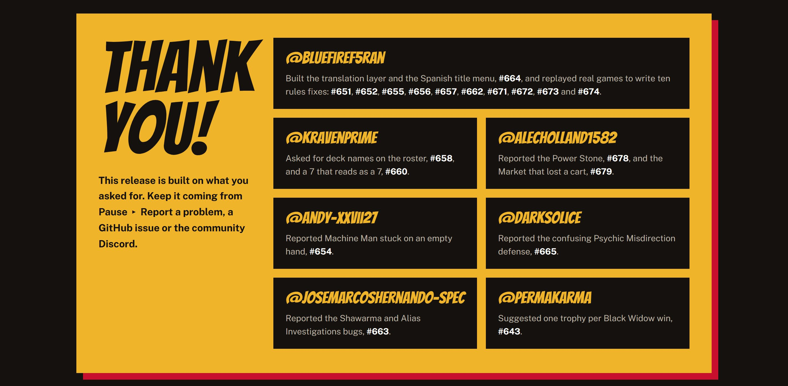
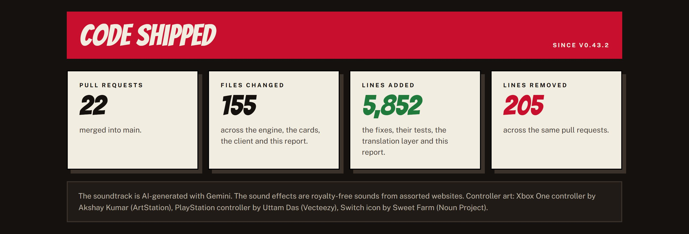

## El menú principal habla español

El texto propio del juego empieza a hablar español: @bluefireF5ran construyó una capa de traducción y tradujo con ella el menú principal (#390, #664). Tus mazos guardados muestran su nombre en la lista de la campaña (#658) y un 7 ya no se lee como un 1 (#660), las dos cosas pedidas por @Kravenprime. Veintiuna correcciones salieron de los reportes de @AlecHolland1582, @andy-xxvii27, @Darksolice, @josemarcoshernando-spec y @PermaKarma, y de @bluefireF5ran repitiendo partidas reales. ¡Gracias!

## [v0.44.0] - 2026-11-12

### Added

- El menú principal se traduce al español, la primera pantalla de una nueva capa de traducción que usa el inglés para el texto que aún no está traducido (#390).
- La lista de héroes y las tarjetas de los asientos de la campaña muestran el nombre con el que guardaste el mazo, para distinguir dos mazos del mismo héroe y aspecto (#658)
- El informe de la versión v0.44.0 tiene su propia página en el sitio, en /releases/v0.44.0/

### Fixed

- Machine Gun y Full Auto de Crossbones hacen su daño indirecto al jugador que lo recibe, entre sus propios personajes, en lugar de dejar que el jugador inicial lo reparta entre todos los héroes.
- Avalanche! y Corrupted Timestream dejan que cada jugador elija su propia opción, en lugar de que el jugador que reveló la carta elija por todos.
- Widow's Bite ya no se ofrece para un esbirro que ya salió del juego, así que no se gasta una segunda copia para nada después de que la primera lo derrotara.
- Winter, Widow, Soldier, Spy ya no ofrece una Preparation de "Max 1 per player" que ya controlas, y sigue haciendo su daño cuando ninguna Preparation de tu pila de descartes puede entrar en juego.
- La respuesta de robar 2 cartas de Moon Knight (cautivos de Taskmaster) ahora necesita un recurso [wild], como está impreso, no cualquier recurso
- Hawkeye, Iceman y Prism Dust se ofrecen solo mientras el esbirro que entró en juego sigue en juego
- Time-Travel Tactics (daño y potenciación) y Kang (Master of Time) cuentan las obligaciones en el área de juego propia del jugador correcto
- Machine Man ya no se ofrece sin nada que gastar, y un pago sin nada que elegir siempre conserva su botón Don't use it, así que el juego no puede quedarse atascado ahí (#654).
- Un 7 en la fuente de los números de cómic ahora tiene una barra que lo cruza, así que un villano con 7 puntos de vida ya no parece tener 1 (#660, reportado por @Kravenprime).
- Save the Shawarma Place y Defensive Protocols dan a cada jugador 1 copia de Shawarma o System Shock, no todas las copias (#663)
- Alias Investigations ya no gasta sus contadores de evidencia en un villano que no puede ser derrotado, como Proxima Midnight o Corvus Glaive mientras el otro todavía tiene puntos de vida (#663)
- Después de Psychic Misdirection, la hoja de defensa muestra que el daño del ataque va al enemigo elegido, y que defender solo resta tu DEF del daño que recibe (#665).
- Pinned Down ahora coloca 2 de amenaza por cada obligación en juego, como está impreso, en lugar de 1 (#675)
- Vencer a la villana Black Widow con Black Widow en la mesa ahora da solo su logro Seeing Double; Clearing the Ledger es para vencer a Taskmaster (#643)
- La Power Stone ahora da a quien la tenga su +1 ATK y +1 SCH o THW impresos: a Nebula y Ronan cuando está sobre ellos, y a un héroe cuando pasa a él (#678).
- El Market de The Galaxy's Most Wanted ya no se detiene en una pregunta vacía con solo Decline cuando ya se compraron todas las cartas de un precio, así que el carrito de un héroe ya no se pierde por el camino (#679).
- Diez cartas vinculadas de encuentro más ahora dan los atributos impresos en su recuadro, que faltaban: Blackjack's Bazooka, Drang's Spear, Universal Weapon, Cloak of Hercules, Challenge Accepted, Corvus's Glaive, Lethal Weapon, Humongous Hallucination, Masterful Mirage, Cyborg Tech y Pull of Power, y las vinculadas SCH/THW de Fear No Evil ahora cuentan para THW en un héroe (#678).

### Engine

- La repetición de Berserker Barrage es su propio ataque: el enemigo al que golpea ya no cuenta también como atacado por el primero, así que responde con Retaliate una vez, no dos
- Las respuestas "after uses a basic power" de un aliado (Nick Fury) se resuelven antes de su daño consecuente, así que se siguen ofreciendo cuando ese daño lo derrota
- Una capacidad (defense) de un jugador cuyo héroe no puede defender el ataque (Taunt) ya no impide que el héroe atacado defienda
- Los atributos de una carta vinculada ya no cuentan mientras su identidad está en forma de álter ego (un álter ego no tiene ATK, THW ni DEF), y vuelven a contar al voltear a héroe (RRG v1.8 "Attachment", p. 8).
