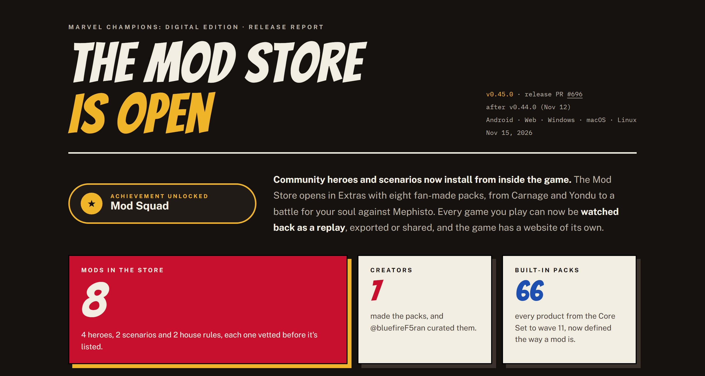
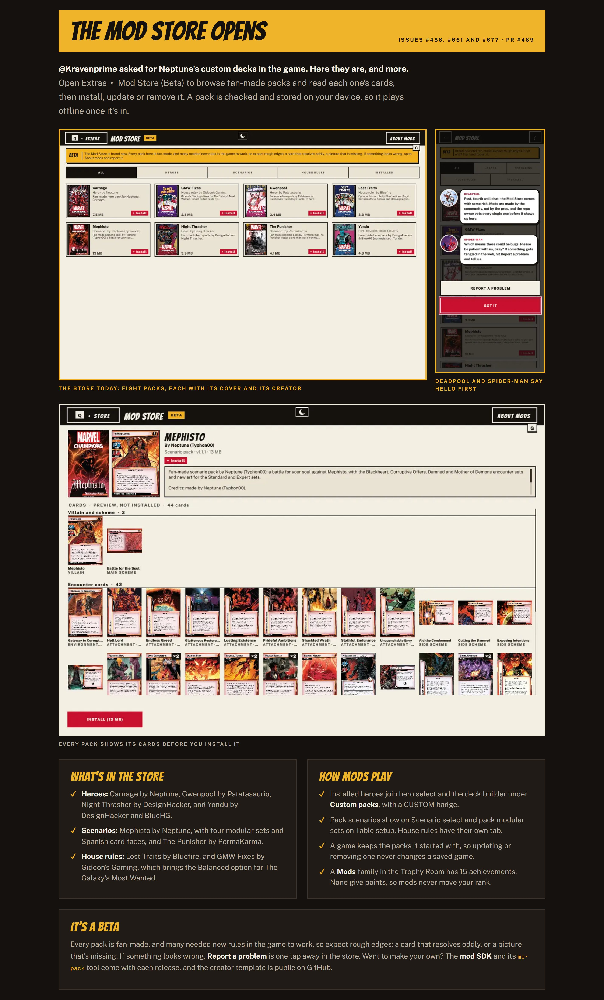
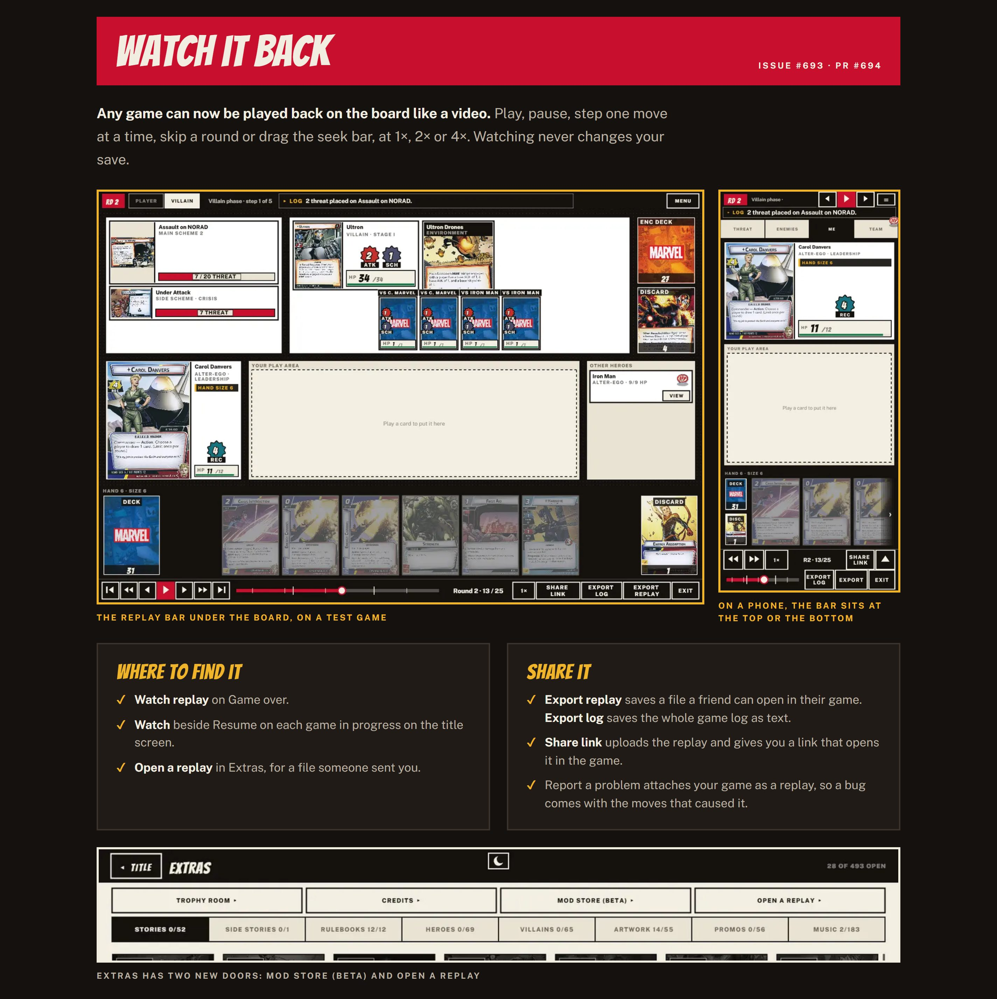
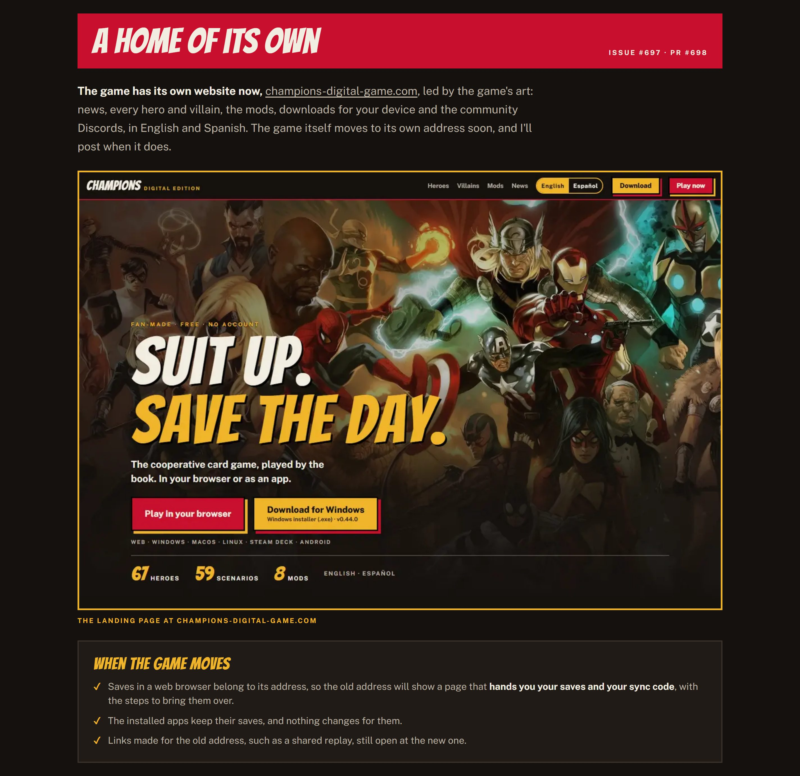
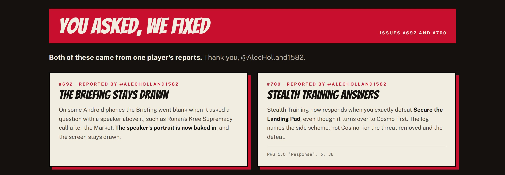
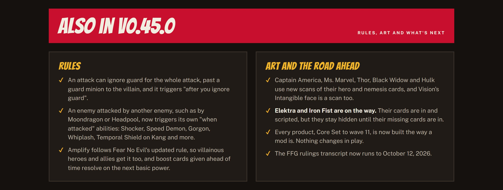
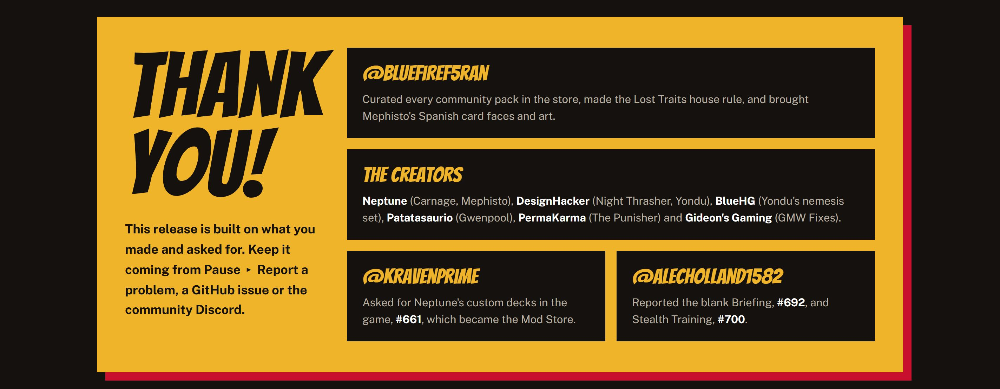
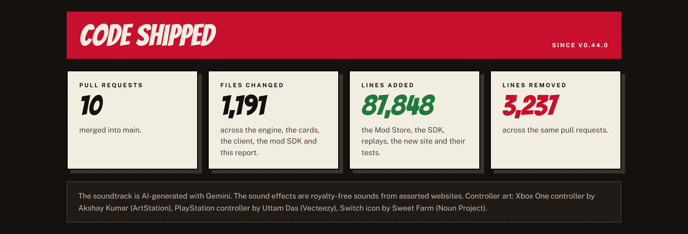

## La Mod Store abre sus puertas

Los héroes y escenarios de la comunidad ahora se instalan desde el propio juego: la Mod Store abre en Extras con ocho packs hechos por fans de Neptune, DesignHacker, BlueHG, Patatasaurio, PermaKarma, Gideon's Gaming y Bluefire, seleccionados y revisados por @bluefireF5ran y pedidos primero por @Kravenprime (#661, #677). Ahora puedes volver a ver cualquier partida como una repetición, exportarla o compartirla (#693), y el juego ya tiene su propio sitio web, [champions-digital-game.com](https://champions-digital-game.com/) (#697). @AlecHolland1582 reportó las dos correcciones, el Briefing en blanco en Android (#692) y Stealth Training (#700). Elektra e Iron Fist están en camino. ¡Gracias!

## [v0.45.0] - 2026-11-15

### Added

- Mod Store en Extras: explora, instala, actualiza y quita packs de contenido aprobados de la comunidad, verificados y guardados en el dispositivo, y juega con los héroes de los packs instalados (#677)
- El Mod SDK y la herramienta de línea de comandos mc-pack (validate, build, test, import-marvelcdb) para crear packs personalizados, publicados en npm como `@champions-digital-game/mod-sdk` y adjuntos a cada versión (#677)
- Los packs personalizados pueden añadir escenarios, sets modulares y planes secundarios, jugables desde Scenario select y Table setup, y campañas lineales de escenarios de packs (#677)
- La Mod Store abre con un aviso de Deadpool y Spider-Man: los mods los hace la comunidad y están revisados, puede haber errores, y Report a problem está a un toque
- Portadas de los packs de la Mod Store: una portada opcional en pack.json se convierte en la miniatura de la tienda, en todos los idiomas y sin conexión una vez instalado; cada pack de la comunidad tiene una
- Logros de mods: una familia Mods en la Trophy Room con 15 logros integrados (instalar mods, héroes, villanos y campañas de la comunidad, reglas de la casa) y logros definidos por cada pack en una lista de datos en pack.json; ninguno da puntos, así que los mods nunca cambian el rango
- Vuelve a ver una partida como una repetición, con reproducir, pausar, avanzar paso a paso, saltar y una barra de avance, y expórtala, o el registro de la partida, como un archivo para compartir (#693).
- Una página de mudanza para la dirección web anterior que entrega a los jugadores sus partidas guardadas y su código de sincronización, y una página de inicio para champions-digital-game.com con noticias, héroes, mods, descargas y enlaces de la comunidad, en inglés y en español
- Un pack de héroe se puede marcar como no listo: su héroe no se puede elegir ni sentar (los mazos muestran "Not ready yet"), y sus cartas quedan fuera de la construcción e importación de mazos
- Imágenes de los héroes Elektra e Iron Fist y una imagen de equipo de Iron Fist y Luke Cage
- El informe de la versión v0.45.0 tiene su propia página en el sitio, en /releases/v0.45.0/

### Changed

- La Mod Store está marcada como Beta: una etiqueta junto a su título, un recuadro encima de sus packs que explica por qué, y Mod Store (Beta) en el botón de Extras
- Publicación en la Mod Store: un pack de la comunidad solo se publica con un permiso concedido registrado en su pack.json (mc-pack validate --publish)
- Publicación en la Mod Store: un solo publicador por id de pack (source en index.json); el repositorio del juego rechaza los ids que son del registro
- Captain America, Ms. Marvel, Thor, Black Widow y Hulk usan los escaneos nuevos del dueño de sus cartas de héroe y de némesis, y la cara Intangible de Vision muestra el escaneo del dueño en lugar de una foto
- Publicación en la Mod Store: las subidas versionadas a R2 son inmutables (cada objeto se revisa primero, con escrituras condicionales con metadatos sha256), así que una carrera con el publicador del registro nunca mezcla archivos
- La página de inicio retiene las noticias y las capturas del informe de una versión hasta que GitHub la publica, y se vuelve a desplegar cuando se publica una versión para que sus descargas y noticias estén al día
- La barra de la página de inicio nombra el juego completo, Marvel Champions, con Digital Edition al lado, y sus enlaces de sección y los nombres de los idiomas dejan espacio en pantallas más pequeñas

### Fixed

- Jugar con un héroe de la Mod Store ya no deja una pantalla en blanco en la preparación de la mesa, y una pantalla que no se puede dibujar ahora lo dice, con Back y Reload
- Los héroes de la Mod Store muestran la imagen de la cara que está boca arriba: álter ego al empezar, héroe después de cambiar de forma
- La Mod Store muestra las cartas destacadas y la imagen del recuadro de un pack en el idioma del juego cuando el pack lo tiene (Gwenpool se mostraba en español a jugadores en inglés)
- Publicación en la Mod Store: una publicación ya no vuelve a listar un pack retirado, latest sigue el orden SemVer (beta.10 después de beta.2), el index.json compartido se escribe con una comprobación de ETag y se reintenta si el registro escribió entre medio, y el código de los packs (mc-pack build, la prueba rápida del SDK) se ejecuta en trabajos sin secretos
- Los recuadros de los packs y las imágenes de las cartas de la Mod Store, y los recuadros de Extras, muestran el cursor de mano al pasar por encima
- El Briefing ya no se queda en blanco en algunos teléfonos Android cuando hace una pregunta con un personaje hablando encima, como la decisión de Kree Supremacy de Ronan después del Market (#692)
- Stealth Training ahora responde cuando derrotas exactamente Secure the Landing Pad, y el registro nombra el plan secundario en lugar de a Cosmo para la amenaza quitada y la derrota (#700)

### Engine

- Primitivas del motor para contenido personalizado: reducción de daño limitada a ataques del villano o villanos sin defender (Agile), la última carta jugada en esta ronda, y anular el recuadro de texto por jugador
- Primitivas del motor para contenido personalizado: capacidades con etiqueta que se resuelven, cuentan y filtran por etiqueta, otra fase de jugador en lugar de la siguiente fase de villano dentro de la misma ronda, y una palabra clave o rasgo que una carta pierde hasta el final de la ronda
- Una elección al azar entre cartas en juego, usada por el Hello Again actualizado del pack de la comunidad Gwenpool
- Primitivas del motor para el pack de escenario Mephisto: áreas de escenario boca abajo con elecciones al azar y una redirección a cartas apartadas, duplicar atributos, un daño mínimo por ataque, generación de recursos solo comodín, esbirros boca abajo desde la pila de descartes
- Un disparador para una carta puesta en un área de escenario, una carta aplicada como carta de potenciación de una sola activación, y el daño mínimo que se mantiene ante una prevención parcial
- Una capacidad Boost puede cancelar la activación que potencia (cancelBoostedActivation); el Blackheart de Mephisto ahora cancela el ataque o el plan como está impreso (pack 1.0.1)
- Piezas del motor para el pack de Yondu: mejoras que se vinculan solo mientras están en juego, un evento "quitada de su anfitrión", "la siguiente carta que gastes cuenta doble", "las mejoras no se pueden quitar de esta carta", y una búsqueda en todas partes
- Las capacidades Boost se pueden ignorar mientras sus iconos cuentan, los iconos de potenciación pueden contar varias veces, los esbirros pueden activarse antes que el villano, y "cannot be stunned" puede nombrar la fuente. El ataque de un enemigo contra otro enemigo (Moondragon, Headpool, The Punisher) ahora activa las propias capacidades "when/after this card is attacked" de ese enemigo que no nombran a un atacante: Shocker, Speed Demon (que contraataca), Gorgon, Sebastian Shaw, Sidewinder (no se reparte: no hay un jugador atacante), Whiplash, Temporal Shield sobre Kang, y un villano bajo Krahllak's Blessing ataca al esbirro que lo dañó. Las cartas que nombran al atacante ("a character you control" de Black Widow) lo siguen ignorando, y una capacidad de encuentro forzada que nadie resuelve ahora paga un coste de descartarse a sí misma o de contadores en lugar de resolverse gratis
- El Core Set y los ocho productos de la oleada 1 se definen como packs integrados con la forma del mod SDK, todavía compilados dentro de la app, y el CI los revisa con la propia validación del SDK. Nada cambia al jugar.
- Un ataque puede ignorar Guard durante todo el ataque, así que el Hammer Throw de Throg golpea al villano pasando de un esbirro con Guard; el ataque de una capacidad (attack) ahora activa "after you ignore guard"
- Tipo de pack de reglas de la casa para la Mod Store: reglas solo de datos que añaden rasgos a cartas oficiales o activan un modo programado, con su propia pestaña House rules
- Los doce productos de las oleadas 2 y 3 también se definen como packs integrados, con los scripts de reimpresión de cada oleada en el pack que tiene la carta. Nada cambia al jugar.
- El index.ts de cada producto de las oleadas 1 a 3 se integra en su pack.ts integrado, y los constructores de alias de reimpresión de las tres oleadas son un solo constructor compartido.
- Las oleadas 4 a 11 también son packs integrados, así que cada producto del juego base se define igual que un pack de mod. Nada cambia al jugar.
- Amplify se suma a la carta de potenciación de cualquier personaje resuelta durante un poder básico (la regla actualizada de Fear No Evil), así que los héroes y aliados villanos también lo reciben
- Las cartas de potenciación boca abajo dadas por adelantado a un personaje se resuelven en su siguiente poder básico, y un héroe que defiende elige de quién se revelan primero las cartas de potenciación
- Momento de las cartas de potenciación para héroes y aliados villanos: primero las interrupciones "would" a un ataque o frustración básicos, luego se da la carta villana, luego las demás interrupciones "uses a basic power"; la defensa de un aliado ya no cuenta como usar un poder básico
- Efectos nuevos para las cartas de Elektra e Iron Fist: barajar en el mazo de encuentros el mazo lateral de cartas de encuentro de un héroe, cancelar el Boost de una carta de potenciación, descartar las cartas de potenciación boca abajo de un enemigo, barajar entre las N primeras cartas del mazo de encuentros, defender exactamente, y recursos que se pueden gastar para otro jugador según una condición; las reducciones al daño de una capacidad de ataque reducen cada instancia

### Content

- Packs de la comunidad programados para la Mod Store: Carnage (Neptune), Night Thrasher (DesignHacker) y Gwenpool (PatataSaurio), seleccionados y revisados por BluefireF5ran
- El mazo de inicio sugerido de Gwenpool ahora usa el aspecto 'Pool (Gwenpool 0.2.0)
- Escenario de la comunidad Mephisto de Neptune: cada carta programada con sus cuatro sets modulares, y las vinculadas Damnation y Bargain
- The Punisher, un escenario de la comunidad de PermaKarma (seleccionado y revisado por BluefireF5ran), importado como borrador hasta que su autor confirme las correcciones de los revisores
- Yondu, un pack de héroe de la comunidad de DesignHacker y BlueHG (seleccionado y revisado por BluefireF5ran), programado con su Yaka Arrow
- Throg, un pack de héroe de la comunidad de Patatasaurio y Caurel (seleccionado y revisado por BluefireF5ran), importado como borrador hasta que los autores confirmen las correcciones de los revisores
- Mephisto 1.1.0: cartas en español y arte en español de Standard/Expert de la revisión de BluefireF5ran; Lilin Remaking no es único
- Packs de reglas de la casa Lost Traits y GMW Fixes; la opción Balanced para Galaxy's Most Wanted ahora viene con el pack GMW Fixes
- Mephisto 1.1.1 sigue las resoluciones de su autor: Slothful Endurance impide los ataques por debajo de la DEF duplicada, y Alter the Deal solo vuelve a barajar cuando no controlas ningún Bargain
- Gwenpool 0.2.2: la cara corregida de That's Not How the Game Ends (los dos recursos comodín, el retrato completo de la esquina)
- Las cartas de los packs de héroe de Elektra (MC63) e Iron Fist (MC64) están en el conjunto de cartas, transcritas de Hall of Heroes y de los adelantos de FFG, con cartas de obligación y de némesis provisionales; los dos héroes están marcados como no listos

### Docs

- Propuesta de diseño para packs de contenido personalizado descargables (héroes y escenarios de fans fuera de la compilación de la app)
- La transcripción de resoluciones posteriores a la 1.7 ahora llega hasta el 12 de octubre de 2026
- Se quitaron de docs/pr-screenshots las capturas de PR que quedaban de la Mod Store.
