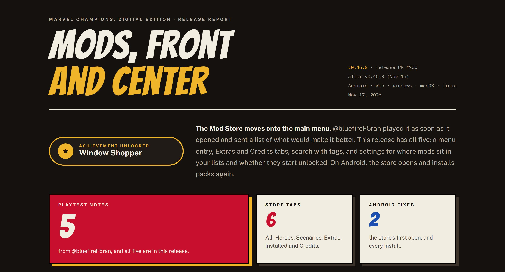
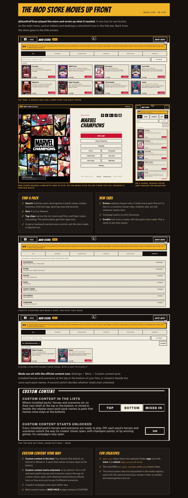
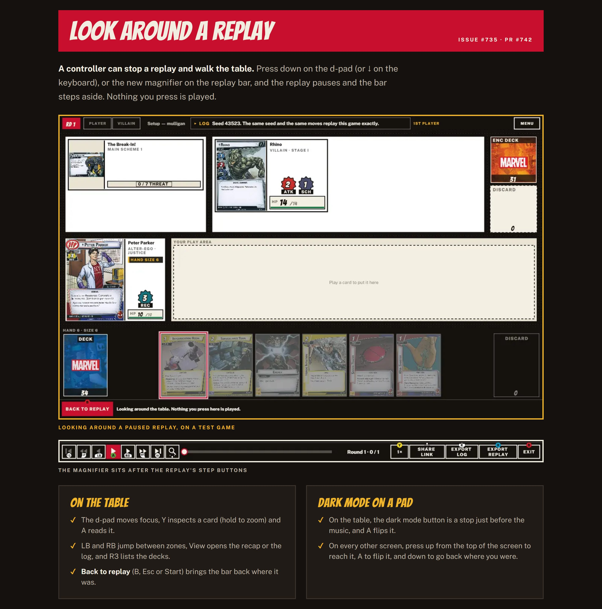
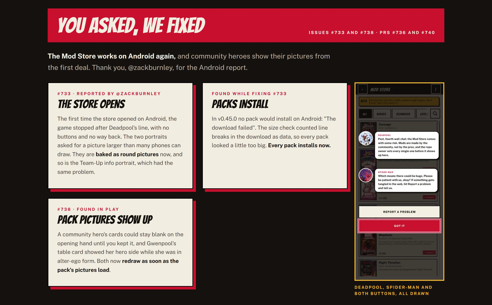
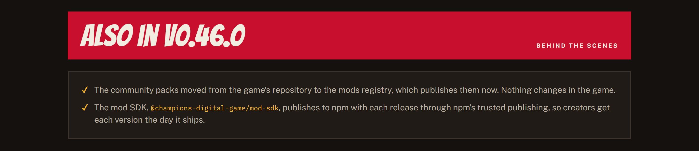
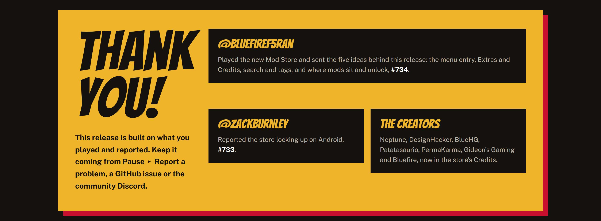
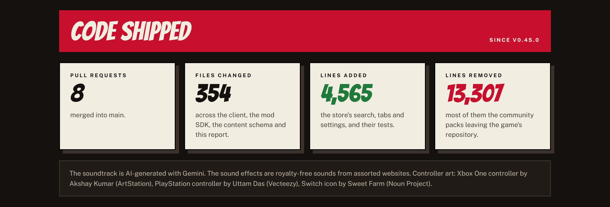

## Los mods, en primera fila

La Mod Store pasa al menú principal, con todo lo que pidió @bluefireF5ran después de probarla (#734): un botón de tienda en la pantalla de inicio, las pestañas Extras y Credits, un buscador con etiquetas y un orden, y ajustes que ponen los mods junto a los héroes y escenarios oficiales y eligen si empiezan desbloqueados. Los creadores tienen tres campos opcionales nuevos en pack.json, tags, wave y unlock, y los packs de la tienda ahora se publican desde el registro de mods con sus ids y versiones intactos. En Android, la tienda vuelve a abrirse y los packs vuelven a instalarse, gracias al reporte de @zackburnley (#733), y las cartas de un héroe de la comunidad muestran sus imágenes desde el primer reparto en lugar de quedarse en blanco en la mano inicial (#738). Ahora un mando puede pausar una repetición y recorrer la mesa, y llegar al botón del modo oscuro en todas las pantallas (#735). ¡Gracias!

## [v0.46.0] - 2026-11-16

### Added

- La Mod Store está en el menú principal (y hay un botón de tienda junto a la música en tabletas y escritorio), con una pestaña Extras para reglas de la casa y otros complementos, una pestaña Credits para los creadores, y un buscador, un orden y etiquetas. Gracias a bluefireF5ran por sus notas de prueba (#734).
- Settings > More > Custom content: pon los héroes y escenarios de los packs instalados arriba, abajo o mezclados junto a la oleada que nombra un pack, y elige si el contenido personalizado empieza desbloqueado o se desbloquea como eligió su creador (puntos de campeón o victorias). El contenido personalizado ahora lleva la insignia MOD PACK (#734).
- Un mando llega al botón del modo oscuro en todas las pantallas, también en la mesa (#735).
- Mientras ves una repetición, abajo en la cruceta (o la flecha abajo) la pausa y oculta la barra para que un mando pueda recorrer la mesa e inspeccionar cartas, solo para leer; B devuelve la barra (#735).
- El informe de la versión v0.46.0 tiene su propia página en el sitio, en /releases/v0.46.0/

### Changed

- El mod SDK se publica en npm mediante la publicación de confianza de npm en lugar de un token de npm
- Los packs de contenido de la comunidad (Carnage, Gwenpool, Mephisto, Night Thrasher, The Punisher, Yondu, Lost Traits, GMW Fixes y el borrador de Throg) pasaron al repositorio del registro de la Mod Store, que ahora los publica; el repositorio del juego los descarga para sus pruebas con pnpm packs:fetch.

### Fixed

- La Mod Store ya no se bloquea en teléfonos Android la primera vez que se abre: los retratos redondos de Deadpool y Spider-Man del aviso se preparan como discos en lugar de dibujarse con una máscara circular, que hacía que el juego dejara de dibujar tras la frase de Deadpool (#733). Los retratos de la información de Team-Up reciben la misma corrección.
- Las instalaciones de la Mod Store vuelven a funcionar en Android: la comprobación de tamaño de la descarga contaba los saltos de línea del cuerpo en base64 de Android como datos, así que cada pack parecía un 1% más grande que su tamaño en el catálogo y se rechazaba.
- Las cartas de un héroe de la comunidad en la pantalla de manos iniciales muestran sus imágenes en cuanto cargan, en lugar de quedarse en blanco hasta aceptar la mano, y el álter ego de un héroe de la comunidad muestra su propia imagen en la mesa en lugar de la del lado de héroe (#738).
- La prueba e2e de PageDown en Take your seats vuelve a pulsar RB cuando la primera pulsación cae en los fotogramas que descarta la protección del mando, en lugar de fallar con la suite cargada.

### Content

- Los packs de mods pueden definir sus propias etiquetas de búsqueda en la tienda, la oleada junto a la que van sus héroes y escenarios, y cómo se desbloquean cuando el contenido personalizado no empieza desbloqueado (#734).

### Docs

- Las notas de la versión v0.45.0 en español incluyen las doce líneas del registro de cambios que llegaron después de escribirlas
