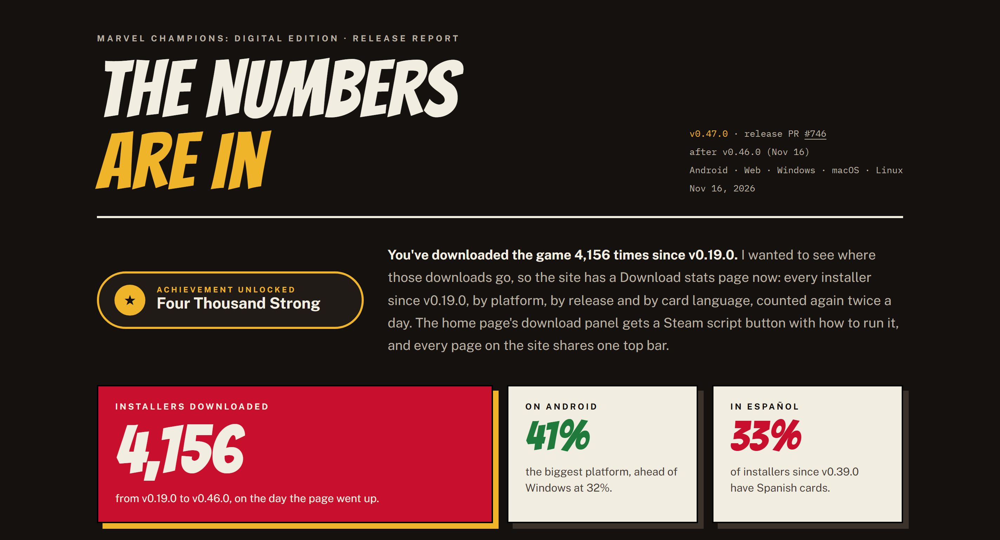
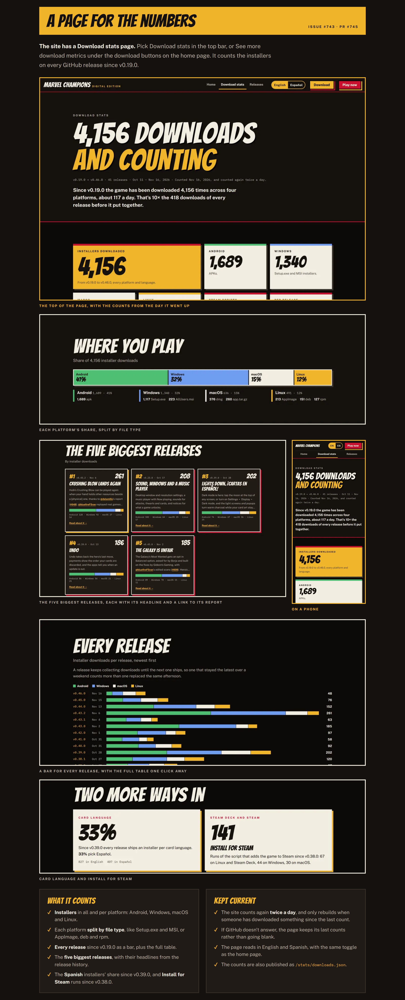
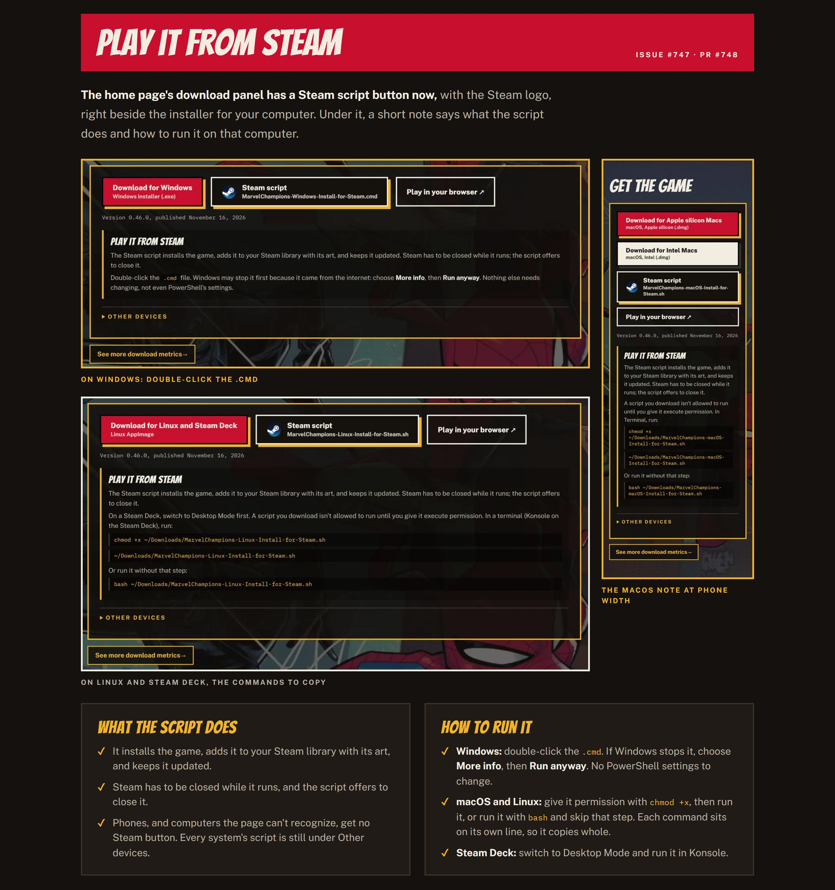
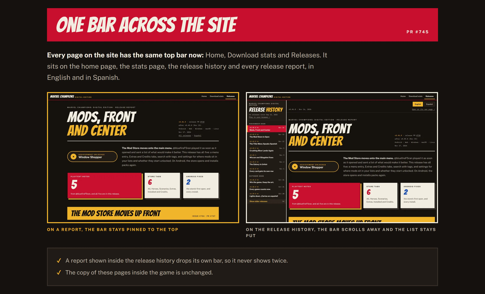
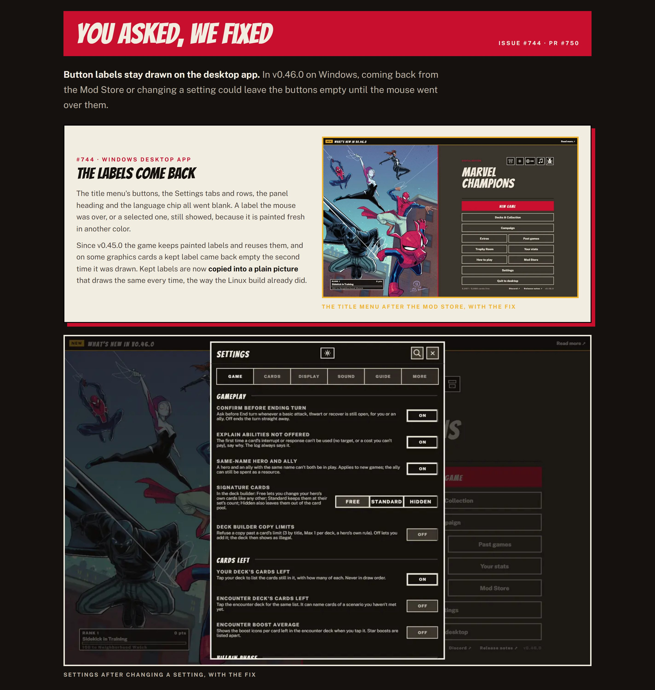
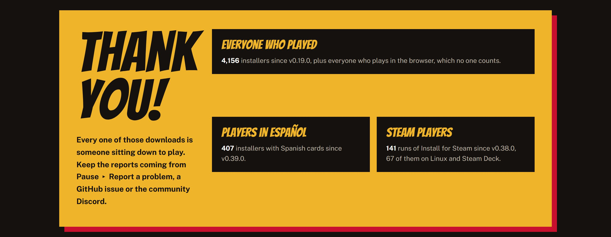
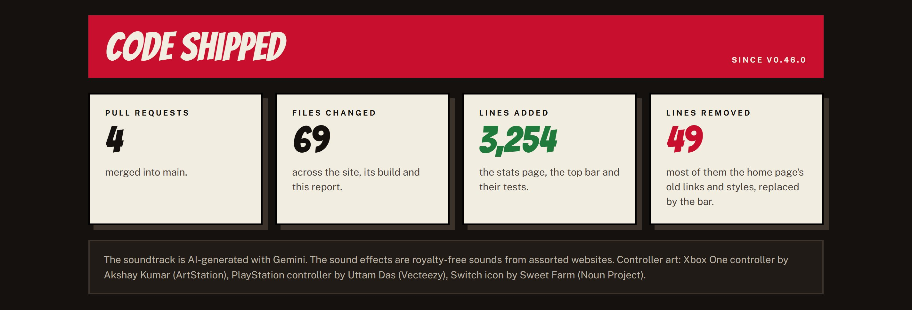

## Ya están los números

Has descargado el juego 4,156 veces desde v0.19.0, así que el sitio ahora tiene una página de estadísticas de descargas (#743, #745): cada instalador por plataforma, por versión y por idioma de las cartas, las cinco versiones más descargadas con sus titulares y las ejecuciones de Install for Steam, contado de nuevo dos veces al día cuando cambian las cifras. Android va primero con un 41%, y un tercio de los instaladores desde v0.39.0 traen las cartas en español. El panel de descarga de la página de inicio tiene un botón Steam script junto al instalador, con cómo ejecutarlo en Windows, macOS, Linux y Steam Deck (#747, #748). Todas las páginas del sitio, desde la de inicio hasta el historial de versiones y cada informe, comparten una barra superior con Home, Download stats y Releases. En la app de escritorio de Windows, los textos de los botones ya no desaparecen al volver de la Mod Store o cambiar un ajuste, como reportó Stay Humble Eh en Discord (#744, #750). ¡Gracias por jugar!

## [v0.47.0] - 2026-11-16

### Added

- Una página de estadísticas de descargas en el sitio, actualizada dos veces al día cuando cambian las cifras, y una barra superior (Home, Download stats, Releases) en la página de inicio, la de estadísticas y las de versiones.
- El informe de la versión v0.47.0 tiene su propia página en el sitio, en /releases/v0.47.0/
- El panel de descarga de la página de inicio tiene un botón Steam script junto al instalador, con cómo ejecutarlo en Windows, macOS y Linux.

### Fixed

- Los textos de los botones ya no desaparecen en el menú principal al volver de la Mod Store, ni en Settings al cambiar un ajuste, en la app de escritorio (#744)
