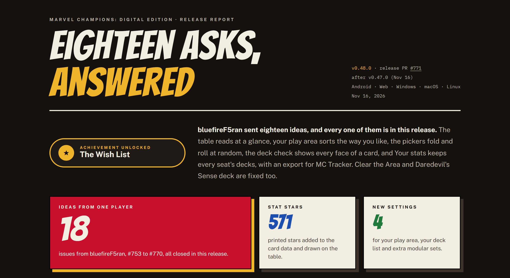
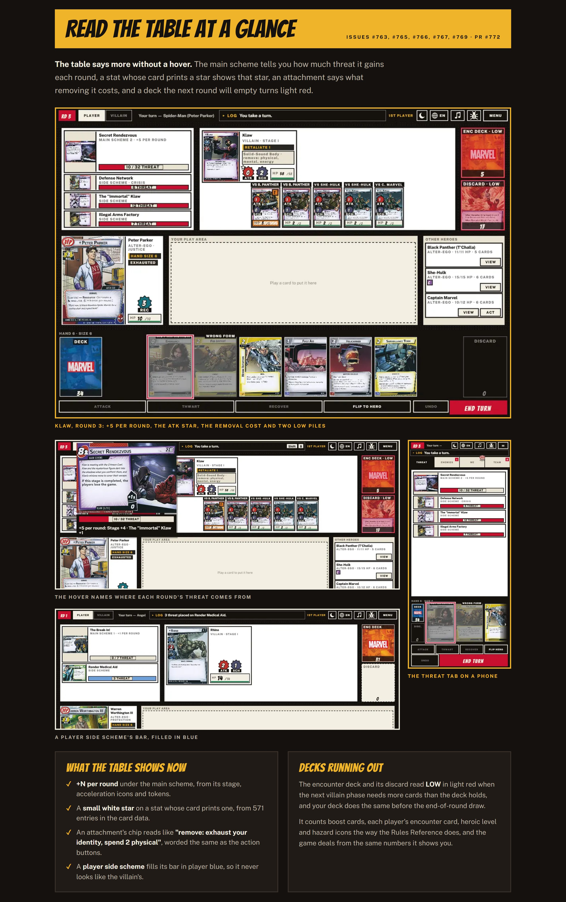
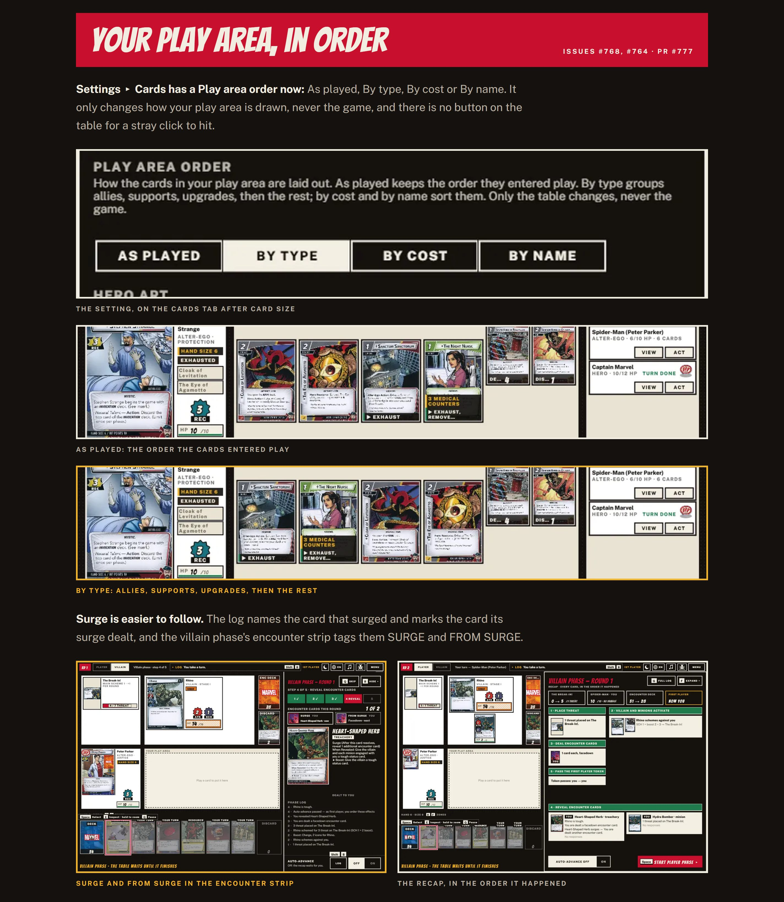
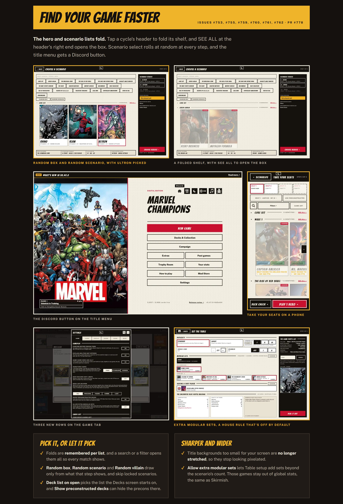
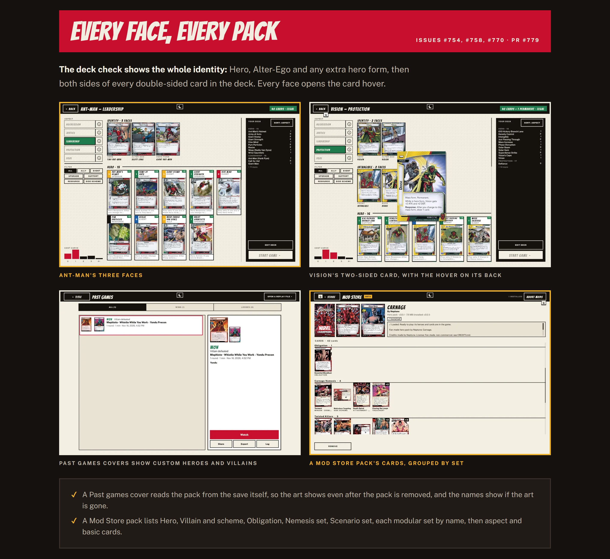
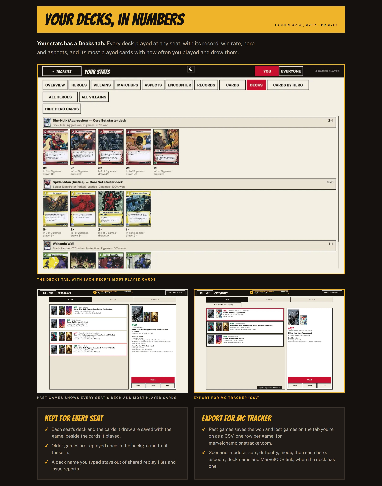
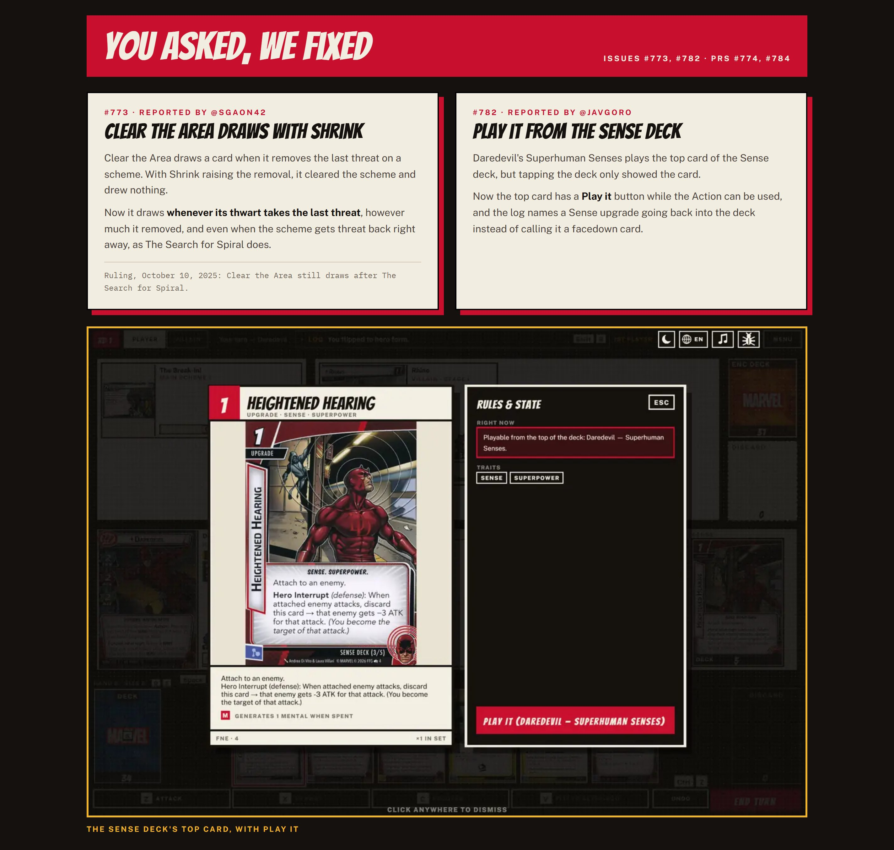
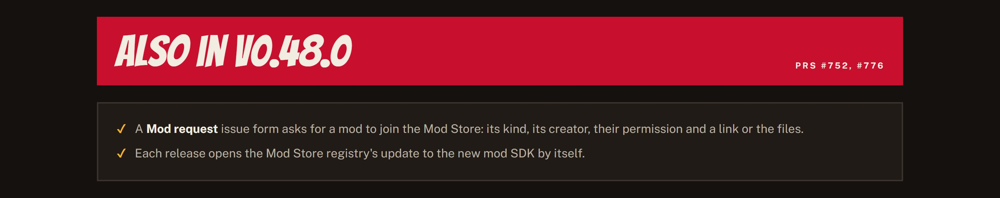
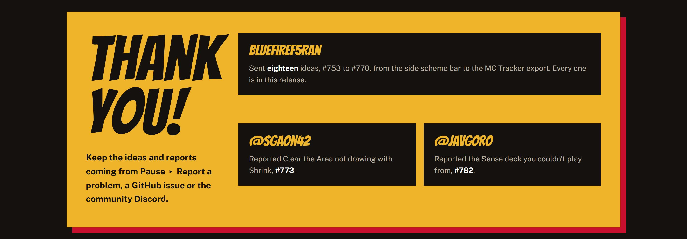
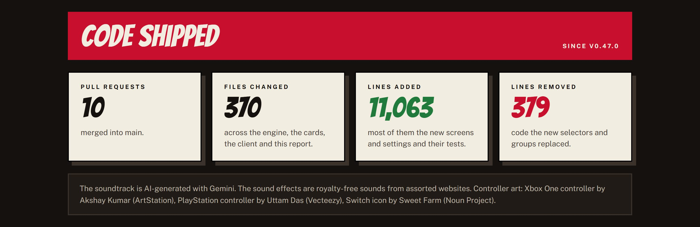

## Grandes reportes conllevan grandes parches

bluefireF5ran envió dieciocho ideas, de #753 a #770, y todas están en esta versión. La mesa se lee de un vistazo: el plan principal dice cuánta amenaza gana cada ronda, las estadísticas muestran su estrella impresa, una vinculada dice lo que cuesta quitarla y un mazo a punto de acabarse se tiñe de rojo (#772). Play area order ordena tu zona de juego y Surge se marca en el registro y en el resumen (#777). Las listas de héroes y escenarios se pliegan y eligen al azar, el menú principal tiene un botón de Discord y hay tres ajustes nuevos para los mazos y los sets modulares extra (#778). La revisión del mazo muestra cada cara de una carta, las portadas de Past games muestran los packs personalizados y la Mod Store agrupa las cartas por set (#779). Your stats tiene una pestaña Decks para cada asiento, y Past games exporta tus partidas para MC Tracker (#781). Clear the Area roba con Shrink, gracias al reporte de @sgaon42 (#773), y el mazo Sense de Daredevil tiene un botón Play it, gracias al reporte de @javgoro (#782), y los escenarios de la Mod Store tienen todas las dificultades, gracias a @zackburnley (#786). ¡Gracias por jugar!

## [v0.48.0] - 2026-11-17

### Added

- Cada versión abre ahora el pull request del registro de la Mod Store que actualiza su SDK de mods a la versión recién publicada en npm, o mueve a ella el que ya está abierto.
- El plan principal muestra cuánta amenaza gana cada ronda, con sus orígenes al pasar el ratón (#765)
- La mesa dibuja la estrella impresa junto a una estadística cuya carta la imprime (#766)
- El chip de una vinculada de encuentro dice lo que cuesta quitarla (#767)
- El mazo de encuentros y el mazo de un jugador se tiñen de rojo claro cuando la próxima ronda los va a vaciar (#769)
- Un ajuste Play area order (as played, by type, by cost o by name) ordena las cartas de tu zona de juego sin mover nada en la mesa (#768)
- Un formulario de issue Mod request pide que se añada un mod a la Mod Store: su tipo, su creador, su permiso y un enlace de descarga o los archivos adjuntos.
- Listas de héroes y escenarios: toca la cabecera de un ciclo para plegar o desplegar su estante, y se recuerda en cada lista; SEE ALL al final de la cabecera abre la caja (#753)
- Scenario select: Random box, Random scenario y Random villain en cada paso de elegir un escenario (#762)
- Menú principal: un icono de Discord junto al botón de la Mod Store abre el servidor de la comunidad (#759)
- Los ajustes Deck list on open y Show preconstructed decks eligen qué lista de Decks se abre primero y pueden ocultar los mazos preconstruidos (#755)
- Una regla de la casa Allow extra modular sets deja que Table setup añada sets modulares más allá de los que pide un escenario; desactivada por defecto (#761)
- Revisión del mazo (y Review del constructor de mazos): muestra el héroe, el álter ego y las formas de héroe extra de la identidad, y cada cara de una carta de doble cara, cada una con el popover de la carta (#754)
- Mod Store: la página de un pack agrupa sus cartas por set: héroe, obligación, set de némesis y cada set modular con su nombre (#770)
- Your stats tiene una pestaña Decks con cada mazo jugado en cualquier asiento (récord, cartas más jugadas, robos), y Past games muestra el mazo, los aspectos y las cartas más jugadas de cada asiento (#756)
- Past games: Export for MC Tracker (CSV) guarda tus partidas terminadas como una hoja de cálculo para marvelchampionstracker.com (#757)
- El informe de la versión v0.48.0 tiene su propia página en el sitio, en /releases/v0.48.0/
- Los chips de las vinculadas muestran el coste de quitarlas con iconos de recurso y de héroe, con las palabras en el popover (#767)

### Fixed

- La barra de amenaza de un plan secundario de jugador se rellena en azul de jugador en vez de dibujarse vacía (#763)
- Clear the Area roba su carta cuando un frustrar aumentado por Shrink quita la última amenaza de un plan (#773)
- El registro y el resumen de la fase de villano nombran la carta que hizo surge y marcan la carta que repartió su surge (#764)
- Ya no se eligen fondos del menú demasiado pequeños para la pantalla, así que dejan de verse pixelados (#760)
- Past games: una partida jugada con un pack personalizado de héroe o de escenario muestra el héroe y el villano del pack en su portada, con sus nombres si el pack se quitó después (#758)
- La carta superior del mazo Sense de Daredevil ofrece ahora Play it, que usa Superhuman Senses, así que una mejora Sense se puede jugar desde el mazo (#782, reportado por @javgoro).
- El registro nombra la mejora Sense que vuelve al mazo Sense de Daredevil en vez de llamarla una carta boca abajo (#782).
- Los escenarios de los packs de la Mod Store ofrecen ahora todas las opciones de dificultad que tienen los escenarios oficiales en Set the Table (Standard II y III, Expert II en experto y el modo skirmish) (#786).

### Content

- Los datos de las cartas registran la estrella impresa junto a una estadística (#766)
