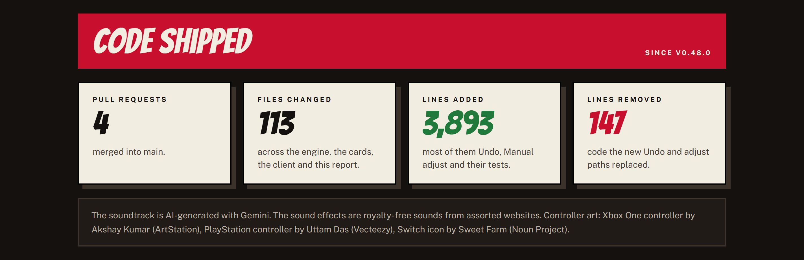

## Deshazlo, arréglalo

Un clic equivocado o un error ya no tienen por qué costarte la partida. Undo ahora llega más allá del inicio de tu turno, un robo, una revelación y la fase de villano, una jugada por pulsación, y Settings ▸ Gameplay ▸ Undo past your turn elige entre Allow, Warn u Off. Pause ▸ Manual adjust corrige la mesa a mano: daño, amenaza, contadores, estados, agotar y preparar, descartes, un robo y la forma de tu héroe. Las dos funciones nacen de la petición de @sgaon42 (#791, #793), y una partida que cambias así deja de contar para las estadísticas y los logros. Giant Strength ahora espera a la forma de héroe Giant, gracias a GarethMagis en Discord (#794), y One Way or Another solo roba cuando su búsqueda encuentra un plan secundario, gracias al reporte de @javgoro (#795). ¡Gracias por jugar!

## [v0.49.0] - 2026-11-17

### Added

- Undo ahora llega más allá del inicio de tu turno, un robo, una revelación o la fase de villano, una jugada cada vez. Settings ▸ Gameplay ▸ Undo past your turn elige entre Allow, Warn (por defecto: un aviso que confirmas primero) u Off. Una partida que deshaces hasta ahí deja de contar para las estadísticas y los logros (#791).
- Pause ▸ Manual adjust: corrige la mesa a mano después de un error o un clic equivocado (robar o descartar una carta, añadir o quitar daño, amenaza, contadores o un estado, agotar o preparar una carta, girar a tu héroe). Una partida ajustada deja de contar para los logros y las estadísticas (#791).
- Un registro de partida exportado, una repetición compartida y un reporte de problema dicen cuándo la partida se ajustó a mano o se deshizo más allá de una revelación (#791).
- El informe de la versión v0.49.0 tiene su propia página en el sitio, en /releases/v0.49.0/

### Fixed

- Giant Strength de Ant-Man solo se ofrece después de cambiar a la forma de héroe Giant, y Ant-Man's Helmet solo ofrece la respuesta que corresponde a la nueva forma (#794).

### Engine

- Un nuevo comando adjust lleva las correcciones de Manual adjust por el registro de la partida, así que las partidas guardadas, los retrocesos y las repeticiones las conservan (#791).
