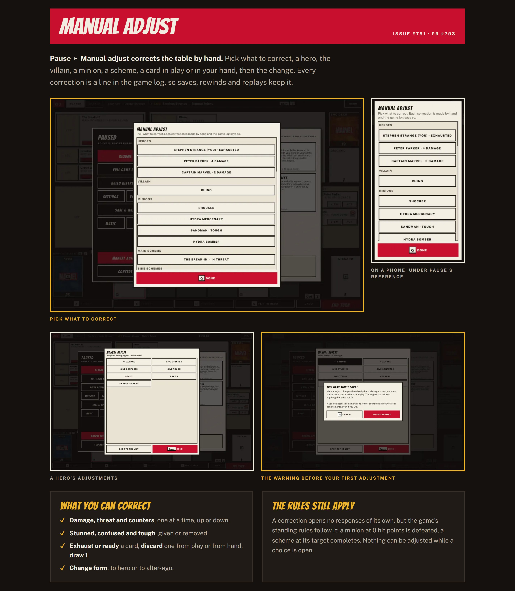
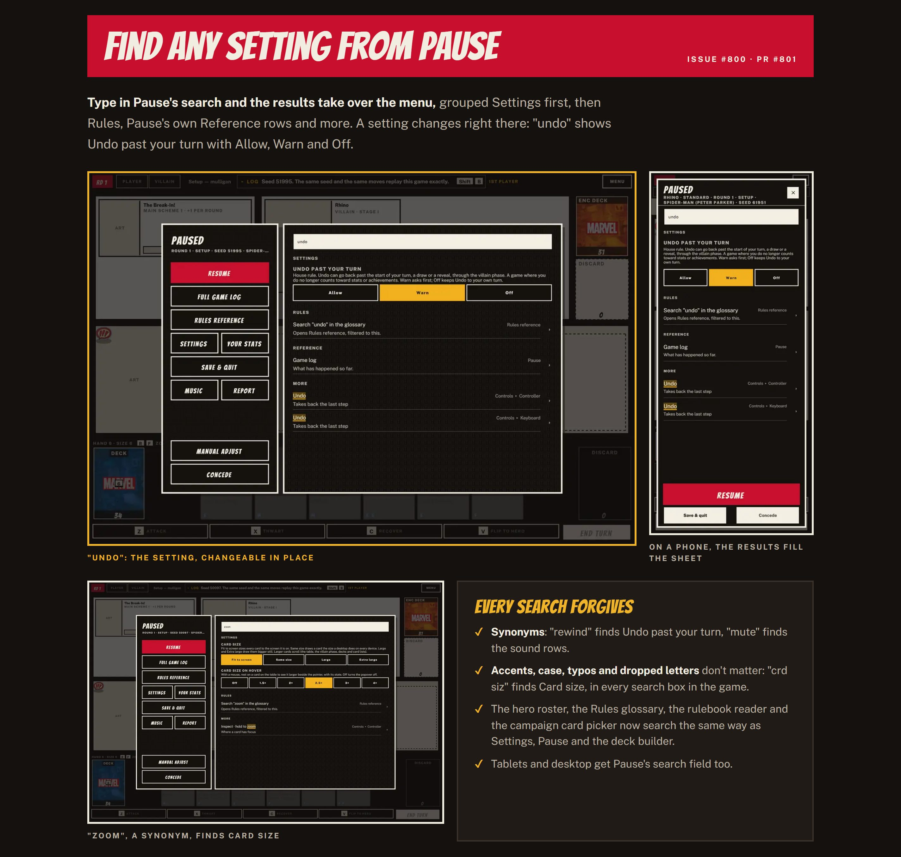
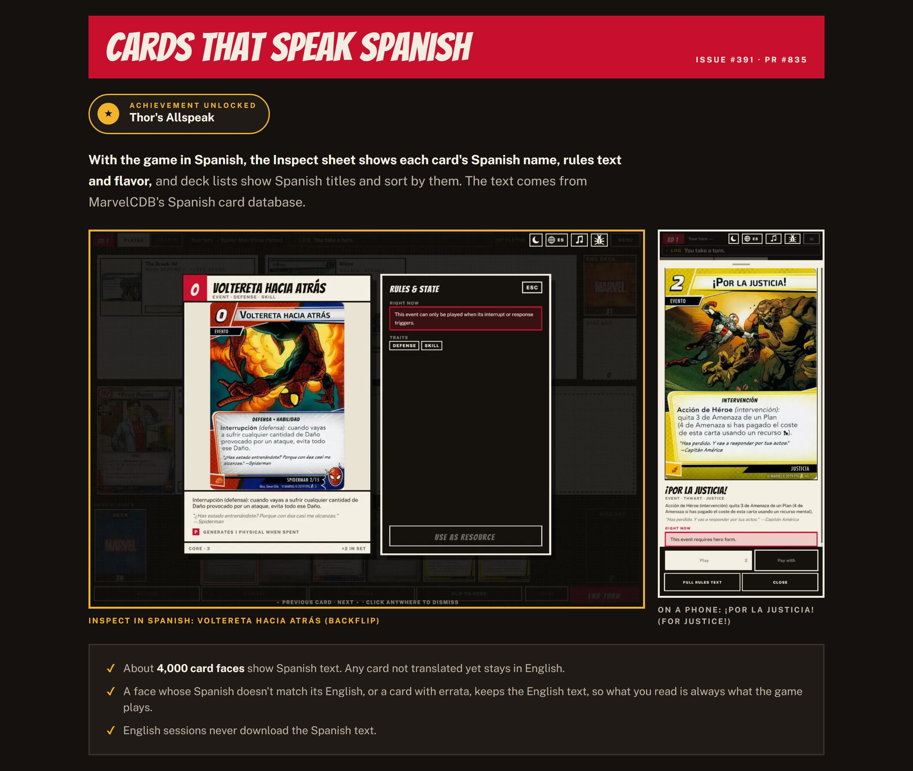
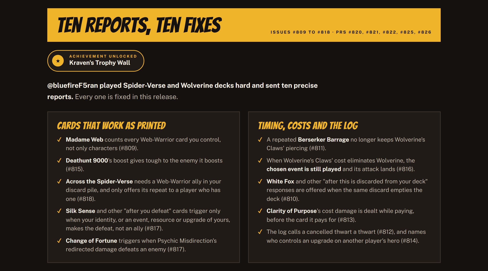

## El parche más poderoso de la Tierra

Un clic equivocado o un error ya no tienen por qué costarte la partida. Undo ahora llega más allá del inicio de tu turno, un robo, una revelación y la fase de villano, una jugada por pulsación, y Settings ▸ Gameplay ▸ Undo past your turn elige entre Allow, Warn u Off. Pause ▸ Manual adjust corrige la mesa a mano: daño, amenaza, contadores, estados, agotar y preparar, descartes, un robo y la forma de tu héroe. Las dos funciones nacen de la petición de @sgaon42 (#791, #793), y una partida que cambias así deja de contar para las estadísticas y los logros. La búsqueda de Pause ahora encuentra cualquier ajuste y lo cambia ahí mismo, con sinónimos como "rewind" y "zoom", y todas las búsquedas del juego perdonan acentos, erratas y letras que faltan (#800, #801). Large schemes y Stack schemes, dos ajustes nuevos, dibujan los planes en grande sin que la mesa se desplace, y Stack schemes puede extenderlos todos (#808, #831). Con el juego en español, las cartas muestran su nombre, su texto de reglas y su ambientación en español, de MarvelCDB (#391, #835). @bluefireF5ran envió diez reportes, de #809 a #818, y todos están corregidos: Madame Web, Deathunt 9000, Across the Spider-Verse, White Fox, Clarity of Purpose, Silk Sense, Change of Fortune, Wolverine's Claws y dos líneas del registro. La búsqueda de cartas del constructor de mazos encuentra los nombres en español, como pidió @andy-xxvii27 (#806). Giant Strength ahora espera a la forma de héroe Giant, gracias a GarethMagis en Discord (#794), One Way or Another solo roba cuando su búsqueda encuentra un plan secundario, gracias al reporte de @javgoro (#795), y un evento que Morphogenetics de Ms. Marvel devuelve a la mano puede jugarse otra vez con el mismo disparador, gracias a Gooffrey [KRBY] en Discord (#804). Crossbones empieza con un Experimental Weapon y los Experimental Weapons de la campaña de Red Skull se conservan (#805), y Shawarma muestra su Max 1 per deck (#807). Public Support (High) de Kingpin ahora necesita todos sus contadores, 1 por héroe, como resolvió FFG (#829). ¡Gracias por jugar!

![Lo pediste, lo corregimos: Giant Strength espera a la forma Giant, reportado por GarethMagis, One Way or Another necesita un plan secundario, reportado por @javgoro, Morphogenetics vuelve a jugar Turn the Tide, reportado por Gooffrey [KRBY], y los nombres de cartas en español en la búsqueda, pedido por @andy-xxvii27](https://raw.githubusercontent.com/quincarter/marvel-champions-digital-game/80debf5eedfe24af960db3eb99d650169742ad5d/docs/screenshots/releases/v0.49.0/v0-49-0-release-08-you-asked-we-fixed.jpg)

![Gracias a @sgaon42, GarethMagis, @javgoro, @bluefireF5ran, @andy-xxvii27 y Gooffrey [KRBY]](https://raw.githubusercontent.com/quincarter/marvel-champions-digital-game/80debf5eedfe24af960db3eb99d650169742ad5d/docs/screenshots/releases/v0.49.0/v0-49-0-release-11-thank-you.jpg)

## [v0.49.0] - 2026-11-17

### Added

- Undo ahora llega más allá del inicio de tu turno, un robo, una revelación o la fase de villano, una jugada cada vez. Settings ▸ Gameplay ▸ Undo past your turn elige entre Allow, Warn (por defecto: un aviso que confirmas primero) u Off. Una partida que deshaces hasta ahí deja de contar para las estadísticas y los logros (#791).
- Pause ▸ Manual adjust: corrige la mesa a mano después de un error o un clic equivocado (robar o descartar una carta, añadir o quitar daño, amenaza, contadores o un estado, agotar o preparar una carta, girar a tu héroe). Una partida ajustada deja de contar para los logros y las estadísticas (#791).
- Un registro de partida exportado, una repetición compartida y un reporte de problema dicen cuándo la partida se ajustó a mano o se deshizo más allá de una revelación (#791).
- El informe de la versión v0.49.0 tiene su propia página en el sitio, en /releases/v0.49.0/
- La búsqueda de Pause también encuentra ajustes: con algo escrito, los resultados agrupados (Settings primero, luego Rules, Reference y más) ocupan el menú, los ajustes se cambian ahí mismo, funcionan sinónimos como "rewind" o "zoom", y las tabletas y el escritorio tienen el campo de búsqueda (#800).
- Ajuste Large schemes (Settings > Cards, y Pause): muestra el plan principal y los planes secundarios como cartas grandes en la mesa, y solo se desplaza dentro del panel de planes (#808).
- La búsqueda de cartas del constructor de mazos también encuentra los nombres de las cartas en español cuando el juego está en español (#806).
- Ajuste Stack schemes (Settings > Cards, y Pause): los planes apilados como un mazo con sus nombres a la vista; desliza o toca para traer uno al frente, y toca la carta delantera para extenderlos todos (#808).
- La versión en español muestra el nombre, el texto de reglas y el texto de ambientación de cada carta en español (de MarvelCDB) en la ficha Inspect y en las listas de mazos, con el inglés como respaldo para cualquier carta aún sin traducir (#391).

### Changed

- Todas las búsquedas perdonan ahora de la misma manera: ignoran acentos y mayúsculas, una errata en una palabra larga y una o dos letras que faltan en una corta ("crd siz" encuentra Card size); la lista de héroes, el glosario de Rules, el lector del reglamento y el selector de cartas de campaña se suman a Settings, Pause y las búsquedas de mazos y cartas.

### Fixed

- Giant Strength de Ant-Man solo se ofrece después de cambiar a la forma de héroe Giant, y Ant-Man's Helmet solo ofrece la respuesta que corresponde a la nueva forma (#794).
- One Way or Another ya no roba 3 cartas cuando la búsqueda no encuentra ningún plan secundario en el mazo de encuentros, y toma el plan secundario que encuentra (#795).
- Las pruebas e2e del historial de versiones eligen la versión y el informe más recientes en lugar de v0.40.0, así que una versión nueva ya no las rompe (#802).
- Crossbones ahora empieza con un Experimental Weapon de Attack on Mount Athena 1B, y en la campaña de Red Skull cada Experimental Weapon anotado se baraja en los escenarios 2 a 5 (#805).
- Morphogenetics de Ms. Marvel: un evento que devuelve a su mano (Turn the Tide, Wiggle Room) puede jugarse otra vez con el mismo disparador, como resolvió FFG (#804)
- Madame Web ahora cuenta todas las cartas Web-Warrior que controlas (identidad, aliados, apoyos, mejoras), no solo los personajes (#809).
- La potenciación de Deathunt 9000 ahora da la carta de estado tough al enemigo que recibe la potenciación (#815).
- Across the Spider-Verse necesita un aliado Web-Warrior en tu pila de descartes para usarse, y solo ofrece su repetición a un jugador que tenga uno (#818).
- White Fox y otras respuestas "after this is discarded from your deck" se ofrecen cuando el mismo descarte vacía el mazo; se resuelven desde el mazo nuevo que dejó el reinicio (#810).
- El daño de coste de Clarity of Purpose, y un coste de preparar o de daño indirecto en cualquier capacidad de recurso, se aplica al pagar, antes de que se resuelva la carta que paga (#813).
- El registro dice que la frustración cancelada de un héroe era una frustración, no un plan (#812).
- Una mejora vinculada al héroe de otro jugador ahora indica en el registro quién la controla en lugar de "follows the first player" (#814).
- Silk Sense y otras cartas "after you defeat" (Interrogation Room, Hall of Heroes, Improved Attack y Thwart Upgrades, Rescue Captives, Change of Fortune) solo se activan cuando la derrota la hace tu identidad, o un evento, recurso o mejora tuyo, no un aliado o apoyo que controlas (#817).
- Wolverine's Claws: un Berserker Barrage repetido ya no conserva la perforación; solo el primer ataque la gana (#811).
- Change of Fortune ahora se activa cuando el daño redirigido de Psychic Misdirection derrota a un enemigo, como resolvió FFG el 24 de enero de 2025 (#817).
- Public Support (High) de Kingpin ahora reemplaza una carta de potenciación solo cuando puede quitar todos los contadores de apoyo, 1 por héroe, como resolvió FFG (#829).
- Stack schemes: cuando una elección puede apuntar a un plan escondido detrás de la pila, el panel muestra todos los planes para que un mando o el teclado lo alcancen (#808).

### Engine

- Un nuevo comando adjust lleva las correcciones de Manual adjust por el registro de la partida, así que las partidas guardadas, los retrocesos y las repeticiones las conservan (#791).
- Un jugador eliminado a mitad de una capacidad la sigue resolviendo entera: Wolverine's Claws juega el evento elegido y su ataque llega, y la repetición de Berserker Barrage se resuelve, cuando el daño elimina a Wolverine; solo termina un ataque que ya estaba en curso (#816).
- Las pruebas fijan la resolución de FFG del 8 de abril de 2025: Clarity of Purpose puede pagar Noble Sacrifice o "You Got This!" que descarta al aliado al que está vinculada, incluso con 1 punto de vida, porque los dos costes se pagan en el mismo paso (#827).

### Content

- Shawarma (campaña The Mad Titan's Shadow) ahora muestra su texto impreso "Max 1 per deck." y permite una copia, no tres (#807).
