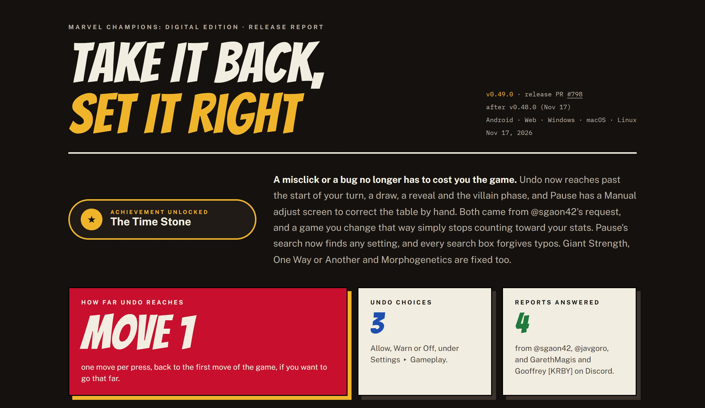
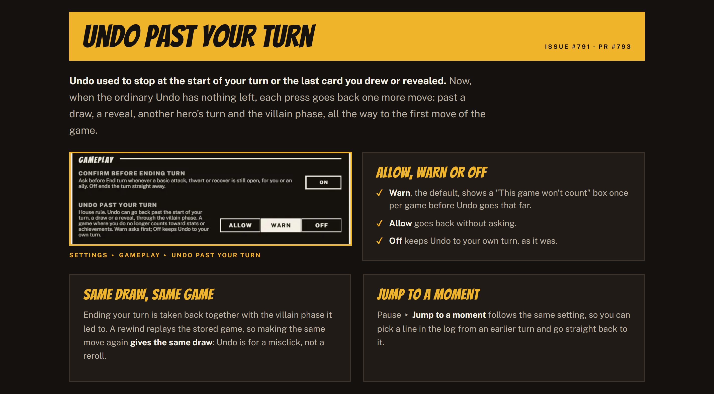
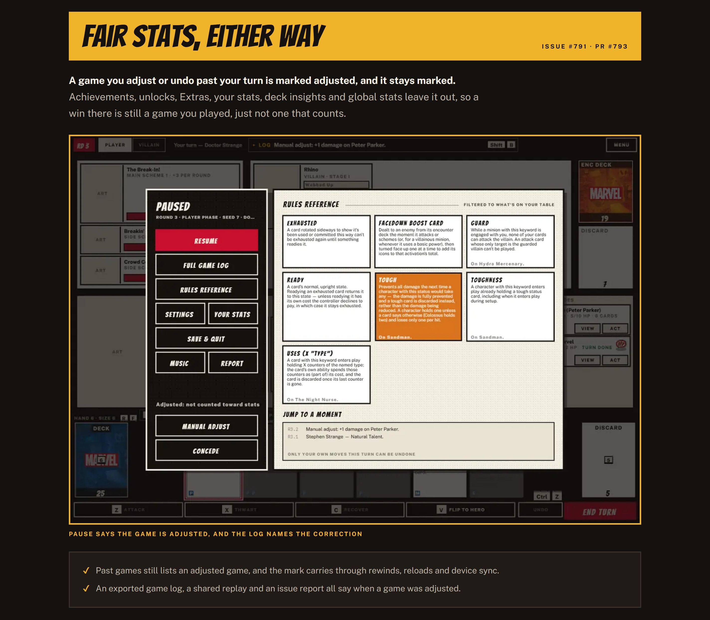
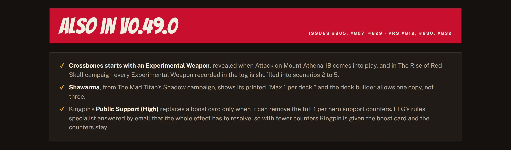
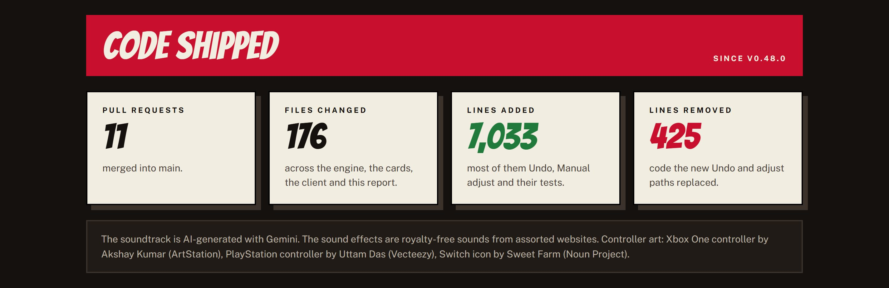

## Deshazlo, arréglalo

Un clic equivocado o un error ya no tienen por qué costarte la partida. Undo ahora llega más allá del inicio de tu turno, un robo, una revelación y la fase de villano, una jugada por pulsación, y Settings ▸ Gameplay ▸ Undo past your turn elige entre Allow, Warn u Off. Pause ▸ Manual adjust corrige la mesa a mano: daño, amenaza, contadores, estados, agotar y preparar, descartes, un robo y la forma de tu héroe. Las dos funciones nacen de la petición de @sgaon42 (#791, #793), y una partida que cambias así deja de contar para las estadísticas y los logros. La búsqueda de Pause ahora encuentra cualquier ajuste y lo cambia ahí mismo, con sinónimos como "rewind" y "zoom", y todas las búsquedas del juego perdonan acentos, erratas y letras que faltan (#800, #801). Giant Strength ahora espera a la forma de héroe Giant, gracias a GarethMagis en Discord (#794), One Way or Another solo roba cuando su búsqueda encuentra un plan secundario, gracias al reporte de @javgoro (#795), y un evento que Morphogenetics de Ms. Marvel devuelve a la mano puede jugarse otra vez con el mismo disparador, gracias a Gooffrey [KRBY] en Discord (#804). Crossbones empieza con un Experimental Weapon y los Experimental Weapons de la campaña de Red Skull se conservan (#805), y Shawarma muestra su Max 1 per deck (#807). Public Support (High) de Kingpin ahora necesita todos sus contadores, 1 por héroe, como resolvió FFG (#829). ¡Gracias por jugar!

![Lo pediste, lo corregimos: Giant Strength espera a la forma Giant, reportado por GarethMagis, One Way or Another necesita un plan secundario, reportado por @javgoro, y Morphogenetics vuelve a jugar Turn the Tide, reportado por Gooffrey [KRBY]](https://raw.githubusercontent.com/quincarter/marvel-champions-digital-game/0161e5d0976ce3a3da575cea4a90ea9bd2fa5cba/docs/screenshots/releases/v0.49.0/v0-49-0-release-06-you-asked-we-fixed.jpg)

![Gracias a @sgaon42, GarethMagis, @javgoro y Gooffrey [KRBY]](https://raw.githubusercontent.com/quincarter/marvel-champions-digital-game/0161e5d0976ce3a3da575cea4a90ea9bd2fa5cba/docs/screenshots/releases/v0.49.0/v0-49-0-release-08-thank-you.jpg)

## [v0.49.0] - 2026-11-17

### Added

- Undo ahora llega más allá del inicio de tu turno, un robo, una revelación o la fase de villano, una jugada cada vez. Settings ▸ Gameplay ▸ Undo past your turn elige entre Allow, Warn (por defecto: un aviso que confirmas primero) u Off. Una partida que deshaces hasta ahí deja de contar para las estadísticas y los logros (#791).
- Pause ▸ Manual adjust: corrige la mesa a mano después de un error o un clic equivocado (robar o descartar una carta, añadir o quitar daño, amenaza, contadores o un estado, agotar o preparar una carta, girar a tu héroe). Una partida ajustada deja de contar para los logros y las estadísticas (#791).
- Un registro de partida exportado, una repetición compartida y un reporte de problema dicen cuándo la partida se ajustó a mano o se deshizo más allá de una revelación (#791).
- El informe de la versión v0.49.0 tiene su propia página en el sitio, en /releases/v0.49.0/
- La búsqueda de Pause también encuentra ajustes: con algo escrito, los resultados agrupados (Settings primero, luego Rules, Reference y más) ocupan el menú, los ajustes se cambian ahí mismo, funcionan sinónimos como "rewind" o "zoom", y las tabletas y el escritorio tienen el campo de búsqueda (#800).

### Changed

- Todas las búsquedas perdonan ahora de la misma manera: ignoran acentos y mayúsculas, una errata en una palabra larga y una o dos letras que faltan en una corta ("crd siz" encuentra Card size); la lista de héroes, el glosario de Rules, el lector del reglamento y el selector de cartas de campaña se suman a Settings, Pause y las búsquedas de mazos y cartas.

### Fixed

- Giant Strength de Ant-Man solo se ofrece después de cambiar a la forma de héroe Giant, y Ant-Man's Helmet solo ofrece la respuesta que corresponde a la nueva forma (#794).
- One Way or Another ya no roba 3 cartas cuando la búsqueda no encuentra ningún plan secundario en el mazo de encuentros, y toma el plan secundario que encuentra (#795).
- Las pruebas e2e del historial de versiones eligen la versión y el informe más recientes en lugar de v0.40.0, así que una versión nueva ya no las rompe (#802).
- Crossbones ahora empieza con un Experimental Weapon de Attack on Mount Athena 1B, y en la campaña de Red Skull cada Experimental Weapon anotado se baraja en los escenarios 2 a 5 (#805).
- Morphogenetics de Ms. Marvel: un evento que devuelve a su mano (Turn the Tide, Wiggle Room) puede jugarse otra vez con el mismo disparador, como resolvió FFG (#804)
- Public Support (High) de Kingpin ahora reemplaza una carta de potenciación solo cuando puede quitar todos los contadores de apoyo, 1 por héroe, como resolvió FFG (#829).

### Engine

- Un nuevo comando adjust lleva las correcciones de Manual adjust por el registro de la partida, así que las partidas guardadas, los retrocesos y las repeticiones las conservan (#791).

### Content

- Shawarma (campaña The Mad Titan's Shadow) ahora muestra su texto impreso "Max 1 per deck." y permite una copia, no tres (#807).
