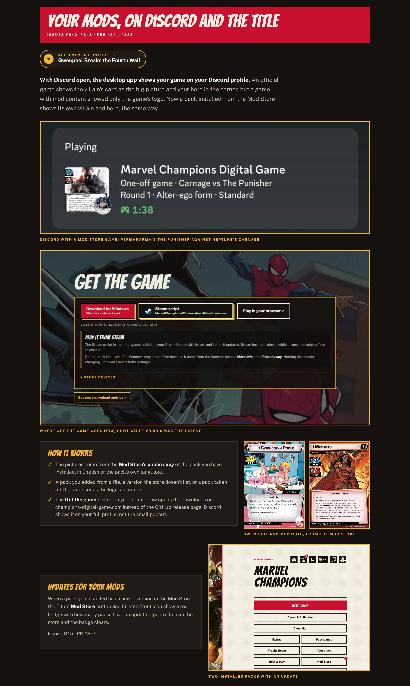
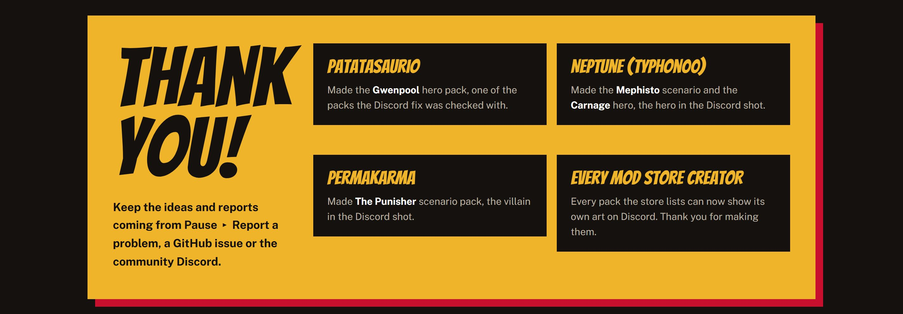
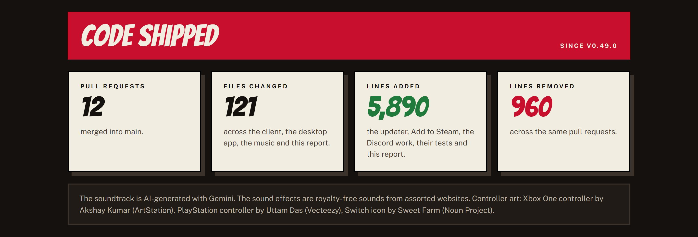

## Awesome Mix, sonando ahora

Cada escenario jugable tiene ahora su propia música. Kingpin, los tres escenarios de Shadowland (Shadows in the Night, Shadow Labyrinth y Heart of Shadow), Breakout, Kang, Absorbing Man, Zola, y Captain Marvel, She-Hulk y Vision de Civil War tienen su propia música de batalla, de victoria y de derrota, Fear No Evil y Shadowland tienen un interludio y un final de campaña, y Stop the Presses! y Crossbones estrenan nuevas versiones: 43 temas en total, 38 de ellos nuevos (#848, #849, #852, #854). El juego de escritorio ahora se actualiza solo desde el propio juego, sea cual sea el instalador que usaste: Update descarga la versión nueva en segundo plano y Restart te pone en ella, a partir de la versión siguiente a esta (#843, #847). Settings ▸ More ▸ Add to Steam pone el juego en tu biblioteca de Steam con su arte (#844, #850). En la app de escritorio, la Rich Presence de Discord muestra ahora el villano y el héroe del propio paquete de la Mod Store en vez de solo el logo del juego, y su botón Get the game abre las descargas en el sitio web (#840, #841), y el botón Mod Store del Title cuenta los paquetes instalados que tienen una actualización (#845, #855). En una computadora, la parte superior del sitio web ofrece ahora el script de Steam junto a la descarga (#842, #846). Gracias a Patatasaurio, a Neptune (Typhon00) y a PermaKarma, con cuyos paquetes de Gwenpool, Mephisto, Carnage y The Punisher se comprobó, y a cada creador de la Mod Store. ¡Gracias por jugar!

## [v0.50.0] - 2026-11-18

### Added

- El botón Mod Store del Title y su icono de tienda muestran cuántos paquetes de mods instalados tienen una actualización (#845).
- La portada del sitio web ofrece el script Install for Steam junto a la descarga en una computadora para la que la versión tiene uno, y la barra superior también en pantallas anchas (#842).
- Un juego de escritorio instalado desde el .exe o .msi de Windows, la app de Mac o el AppImage de Linux de la versión se actualiza solo desde el aviso de actualización: descarga en segundo plano, dice que el juego se ha actualizado y se reinicia en la versión nueva (#843).
- El juego de escritorio tiene un botón Add to Steam en Settings ▸ More: ejecuta el script Install for Steam sobre el juego tal como está y lo pone en tu biblioteca de Steam con su arte, y solo aparece cuando Steam está instalado y el juego aún no está en él (#844).
- El informe de la versión v0.50.0 tiene su propia página en el sitio, en /releases/v0.50.0/

### Changed

- El botón Get the game de la presencia de Discord abre la sección de descargas del sitio web en vez de la página de la versión en GitHub.

### Fixed

- La presencia de Discord muestra el arte de las cartas de los villanos y héroes de los mods desde la Mod Store en vez de solo el logo (#840).

### Content

- Música para Kingpin, Shadowland (sus tres escenarios y su campaña), Breakout, Kang, Absorbing Man y Zola, el tema de victoria de los héroes de Stop the Presses! y el interludio y el final de la campaña Fear No Evil; nuevas versiones de los temas de batalla y de victoria del villano de Stop the Presses! y de Crossbones
- Música para Captain Marvel (Registration), She-Hulk (Registration) y Vision (Resistance), así que cada escenario jugable tiene ya sus propios temas; una nueva versión del tema de victoria de los héroes de Crossbones

### Docs

- Las notas y el informe en español de la versión v0.49.0 llevan la fecha de la versión, 18 de noviembre
- Las publicaciones de las versiones en Discord enlazan a la sección de descargas de champions-digital-game.com en vez de a la página de la versión en GitHub.
