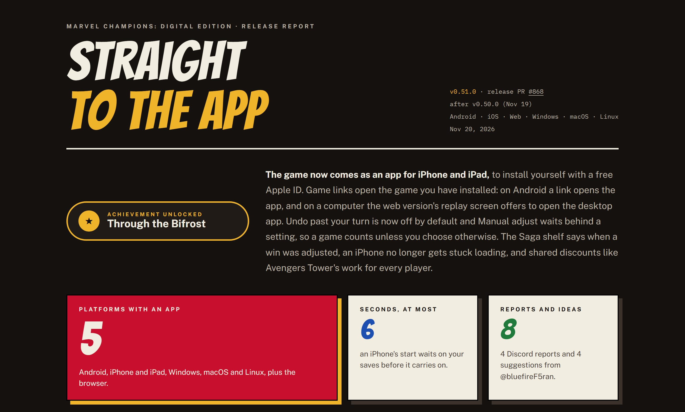
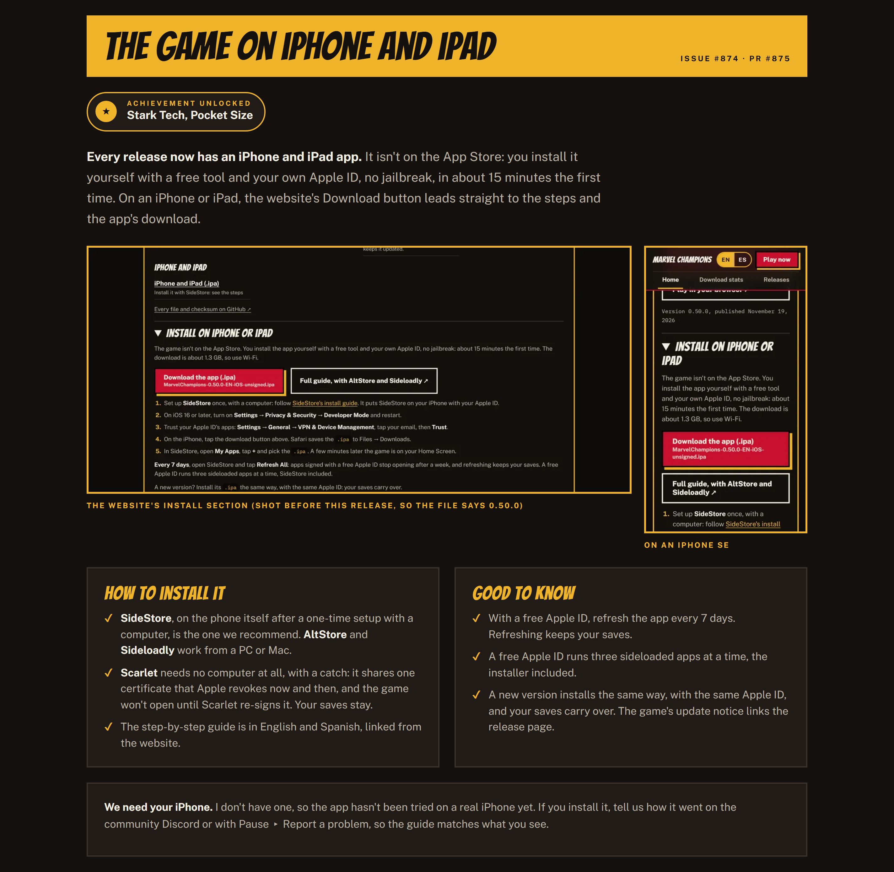
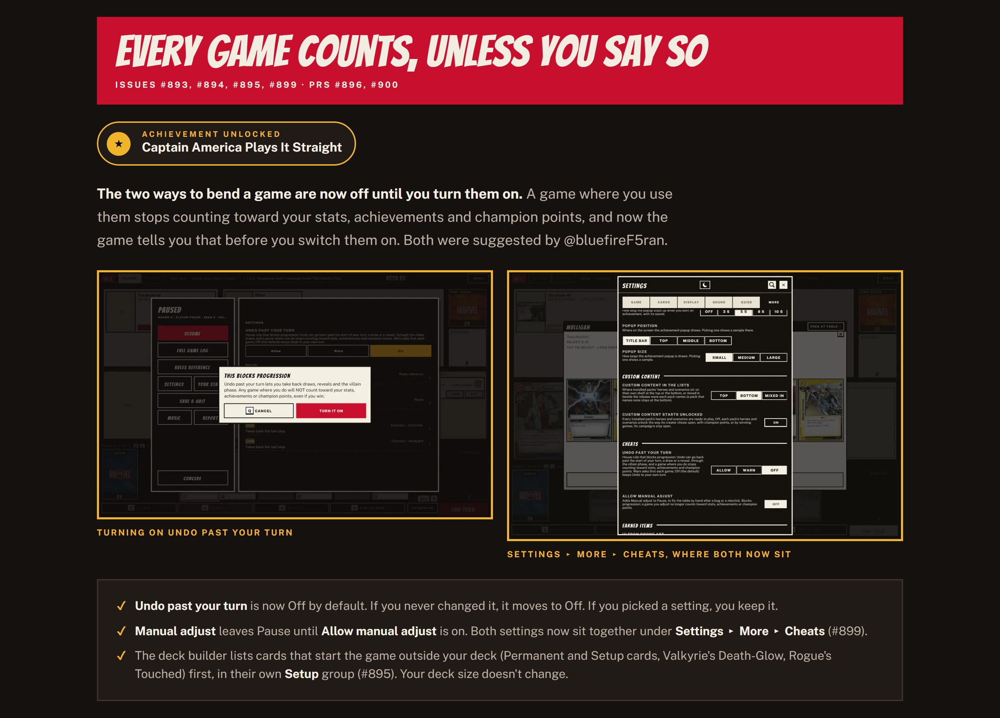
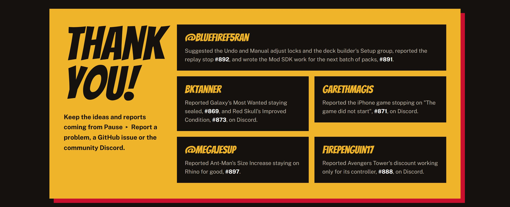
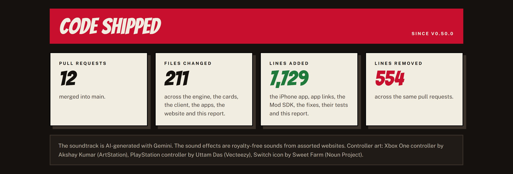

## Directo a la app

Cada versión tiene ahora una app para iPhone y iPad, para instalarla tú mismo con un Apple ID gratuito mediante SideStore, AltStore o Sideloadly, con guías paso a paso en inglés y en español y una sección de instalación en el sitio web (#874, #875). Los enlaces del juego ahora abren el juego que tienes instalado: en Android un enlace a marvel.champions-digital-game.com abre la app, y en una computadora la pantalla de carga de una repetición en la versión web tiene Open in the desktop app (#862, #863). Undo past your turn ahora viene desactivado por defecto, Manual adjust espera detrás de Allow manual adjust, los dos están ahora en Settings ▸ More ▸ Cheats y avisan de que una partida en la que los uses deja de contar, y el constructor de mazos muestra las cartas de preparación en su propio grupo, todo sugerido por @bluefireF5ran (#893, #894, #895, #896, #899, #900). El estante de la Saga pone el sello ADJUSTED cuando una campaña se ganó con una partida ajustada y dice por qué el siguiente volumen sigue sellado (#869, #870), y la Condition Improved de Red Skull ahora entra por su cara Improved (#873, #877), las dos cosas por reportes de bktanner. En iPhone, el juego ya no se queda cargando después de que iOS recarga la pestaña, gracias a GarethMagis (#871, #872). Avengers Tower y otros descuentos de cartas "jugadas" ahora funcionan para cualquier jugador, gracias a FirePenguin17 (#888, #889), las repeticiones pasan la fase de villano con Reduced motion activado (#892), y Size Increase de Ant-Man ya pierde sus contadores de tamaño, gracias a @MegaJesup (#897, #898). Para quienes crean paquetes, @bluefireF5ran escribió el trabajo del Mod SDK para el próximo lote de paquetes (#890, #891). ¡Gracias por jugar!

## [v0.51.0] - 2026-11-20

### Added

- Los enlaces del juego abren la app instalada: Android abre los enlaces de marvel.champions-digital-game.com en la app (App Links), y la app de escritorio registra los enlaces marvelchampions://, con "Open in the desktop app" en la pantalla de carga de una repetición en la versión web (#862).
- Una app para iPhone y iPad con cada versión, para instalar con un Apple ID gratuito mediante SideStore, AltStore o Sideloadly, con guías de instalación paso a paso en inglés y en español; en iOS el aviso de actualización enlaza la página de la versión (#874).
- La sección de descargas de la portada tiene una sección de instalación para iPhone y iPad: en un iPhone o iPad el botón de descarga lleva a los pasos de SideStore con la descarga del .ipa al lado, y cualquier otro dispositivo la lista en Other devices (#874).
- El informe de la versión v0.51.0 tiene su propia página en el sitio, en /releases/v0.51.0/
- Un pull request que cambia el juego publica su .ipa sin firmar como pre-versión de vista previa y lo enlaza en un comentario del PR, como el APK de Android; se borra cuando se cierra el pull request.
- Las vistas previas de los pull requests también incluyen una compilación para el iOS Simulator, enlazada en el mismo comentario, para poder revisar el juego en una Mac sin iPhone.
- El constructor de mazos muestra las cartas que empiezan la partida fuera del mazo (cartas Permanent y Setup, Death-Glow de Valkyrie, Touched de Rogue) en su propio grupo Setup (#895). Sugerido por @bluefireF5ran.

### Changed

- La página de estadísticas de descargas ya no compara su cuenta con las versiones anteriores a v0.19.0.
- Las páginas de inicio, de estadísticas de descargas y de versiones del sitio web comparten una sola barra superior (navegación, English/Español, Steam, Download, Play now), y las páginas de estadísticas y de versiones se abren sobre arte de héroes como la de inicio.
- Undo past your turn ahora está en Off por defecto, y activarlo avisa de que las partidas en las que lo uses dejan de contar; Manual adjust sale de Pause hasta que se active Settings > More > Misc gameplay > Allow manual adjust (#893, #894). Sugerido por @bluefireF5ran.
- Settings: Undo past your turn y Allow manual adjust, los dos ajustes que hacen que una partida deje de contar para estadísticas, logros y puntos de campeón, ahora están juntos en Settings > More > Cheats (#899).

### Fixed

- El estante de la Saga ahora pone el sello ADJUSTED junto a COMPLETE y dice cuándo una campaña terminada se ganó con una partida ajustada (Manual adjust o un Undo más allá de una carta revelada), que no abre el siguiente volumen, y el siguiente volumen dice por qué sigue sellado (#869).
- El sello COMPLETE del estante de la Saga es verde sólido con texto blanco, queda sobre la carta y mantiene su texto dentro del recuadro.
- En iPhone, el juego ya no se queda en LOADING (ni en la pantalla 'The game did not start') después de que iOS recarga la pestaña, y guarda menos imágenes de cartas en memoria para que la pestaña se recargue menos a menudo (#871).
- Las mejoras de campaña ahora entran en juego por la cara que indica el registro de campaña (#873). The Rise of Red Skull: una mejora Condition "Basic" que cambiaste por su cara "Improved" después de Zola entra en la partida contra Red Skull por su cara Improved. Sinister Motives: una vez marcado el nodo de reputación 13, la preparación de cada escenario posterior gira tu mejora S.H.I.E.L.D. Tech a su cara Enhanced.
- Avengers Tower, Sure Gamble, Welcome Aboard y Soup Kitchen rebajan la siguiente carta que encaje que juegue cualquier jugador, y Living Legend de Steve Rogers rebaja el primer aliado que juegue cualquier jugador en cada ronda, no solo los de su propio controlador (#888).
- El aliado Spider-Man (Peter Parker) puede preparar a un personaje Web-Warrior de otro jugador después de atacar o frustrar, no solo a uno tuyo.
- Las repeticiones pasan solas la fase de villano con Reduced motion activado, en vez de pararse en Start player phase (#892). Reportado por @bluefireF5ran.
- La vinculada de némesis de Ant-Man Size Increase ahora entra con sus 3 contadores de tamaño, pierde uno cada vez que se activa el enemigo al que está vinculada, y se descarta con el último (#897).
- La guía de instalación para iPhone y la portada ya no recomiendan Scarlet, cuyo sitio llevó a un jugador a un sitio para adultos que no tenía nada que ver; en su lugar advierten contra los sitios que instalan sin computadora (#906).

### Engine

- Mod SDK: un escenario de un paquete puede apartar sets modulares con setAsideModularSetCount (los elige el asiento o salen al azar), para que las propias cartas del escenario los usen, como el set del mini jefe de The Rose (#890).
- Mod SDK: el generatesFor de una habilidad de recurso puede nombrar un aspecto ("genera un recurso [wild] para una carta 'Pool"), para que una carta de un paquete pueda usarlo (#890).
- Un efecto puede jugar una carta desde la pila de descartes de su jugador, pagando sus costes (playFromHand desde "discard", DSL playFromDiscard), para cartas de paquetes como Warzone de Punisher; no cuenta como jugada desde la mano (#890).
- Mod SDK: un coste puede girar otra carta que controlas (AbilityCost.flipCards, DSL flipCardsCost), y un coste adicional para jugar una carta puede ser una elección de una cosa u otra que se escoge con el costSelection de la jugada, para "agota o destruye un Component" de Sentinel (#890).
- Mod SDK: un coste de "recibe N de daño" puede ser imprevenible (AbilityCost.damageSelfUnpreventable, takeDamageCost(n, { unpreventable: true })), así que el coste de destruir de Sentinel se paga a través de tough, prevención y reducción; legalActions y los selectores de costes juzgan y preguntan cada rama de un coste de una cosa u otra con las cartas en juego de esa rama, y nombran el coste adicional para jugar en las etiquetas de las ramas; los sets modulares apartados de un escenario de un paquete se comprueban como sus elecciones modulares (#891 review).
