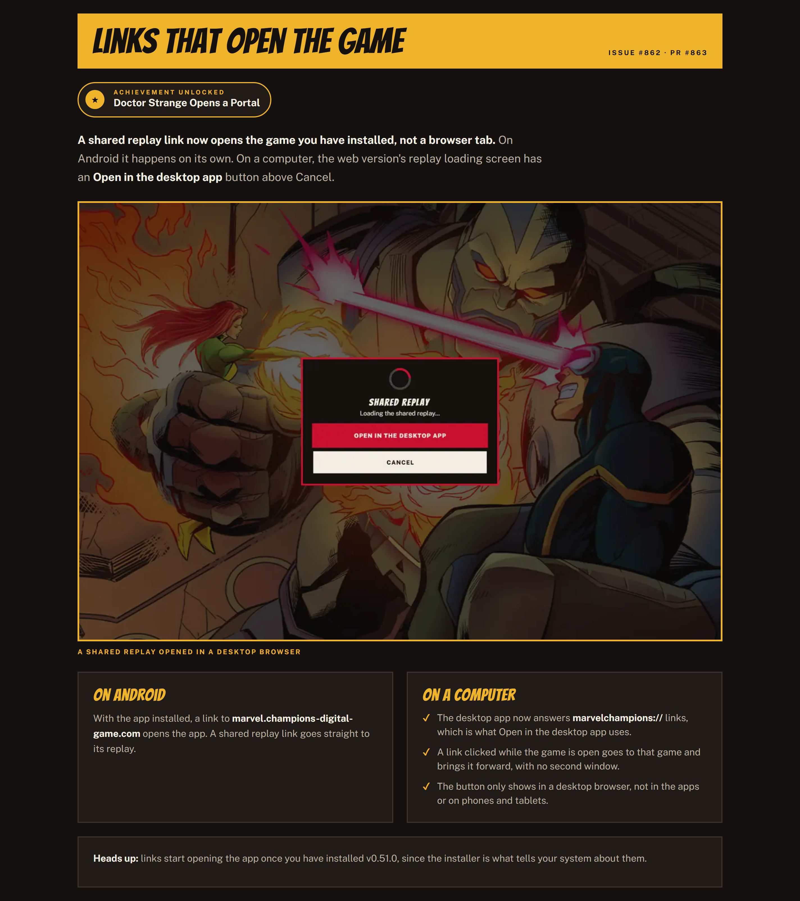
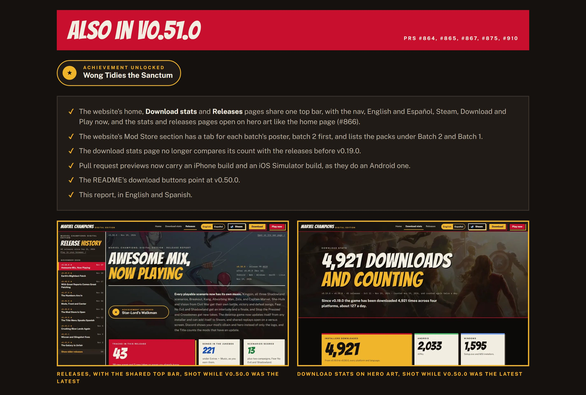
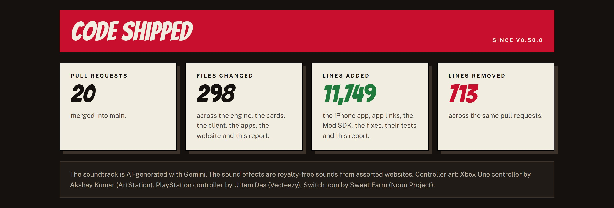

## J.A.R.V.I.S., ponlo en mi teléfono

Cada versión tiene ahora una app para iPhone y iPad, para instalarla tú mismo con un Apple ID gratuito mediante SideStore, AltStore o Sideloadly, con guías paso a paso en inglés y en español y una sección de instalación en el sitio web (#874, #875). Los enlaces del juego ahora abren el juego que tienes instalado: en Android un enlace a marvel.champions-digital-game.com abre la app, y en una computadora la pantalla de carga de una repetición en la versión web tiene Open in the desktop app (#862, #863). Undo past your turn ahora viene desactivado por defecto, Manual adjust espera detrás de Allow manual adjust, los dos están ahora en Settings ▸ More ▸ Cheats y avisan de que una partida en la que los uses deja de contar, y el constructor de mazos muestra las cartas de preparación en su propio grupo, todo sugerido por @bluefireF5ran (#893, #894, #895, #896, #899, #900). El estante de la Saga pone el sello ADJUSTED cuando una campaña se ganó con una partida ajustada y dice por qué el siguiente volumen sigue sellado (#869, #870), y la Condition Improved de Red Skull ahora entra por su cara Improved (#873, #877), las dos cosas por reportes de bktanner. En iPhone, el juego ya no se queda cargando después de que iOS recarga la pestaña, gracias a GarethMagis (#871, #872). Avengers Tower y otros descuentos de cartas "jugadas" ahora funcionan para cualquier jugador, gracias a FirePenguin17 (#888, #889), las repeticiones pasan la fase de villano con Reduced motion activado (#892), y Size Increase de Ant-Man ya pierde sus contadores de tamaño, gracias a @MegaJesup (#897, #898). El lote 2 de la Mod Store, seis paquetes hechos por fans con 113 cartas nuevas en inglés y en español, llega cuando salga v0.51.0: los paquetes de héroe The Punisher (MissSugarPink), Spider-Punisher y Sentinel (T-Wrecks) y un mazo preconstruido de Throg (PatataSaurio & Caurel), el escenario The Rose (BigDarsh & Bluefire) y la regla de la casa "Don't Make Me Angry!" para Hulk (Abis Mal & Bluefire), construidos sobre el trabajo del Mod SDK que escribió @bluefireF5ran (#890, #891, #903). ¡Gracias por jugar!

## [v0.51.0] - 2026-11-20

### Added

- Los enlaces del juego abren la app instalada: Android abre los enlaces de marvel.champions-digital-game.com en la app (App Links), y la app de escritorio registra los enlaces marvelchampions://, con "Open in the desktop app" en la pantalla de carga de una repetición en la versión web (#862).
- Una app para iPhone y iPad con cada versión, para instalar con un Apple ID gratuito mediante SideStore, AltStore o Sideloadly, con guías de instalación paso a paso en inglés y en español; en iOS el aviso de actualización enlaza la página de la versión (#874).
- La sección de descargas de la portada tiene una sección de instalación para iPhone y iPad: en un iPhone o iPad el botón de descarga lleva a los pasos de SideStore con la descarga del .ipa al lado, y cualquier otro dispositivo la lista en Other devices (#874).
- El informe de la versión v0.51.0 tiene su propia página en el sitio, en /releases/v0.51.0/
- Un pull request que cambia el juego publica su .ipa sin firmar como pre-versión de vista previa y lo enlaza en un comentario del PR, como el APK de Android; se borra cuando se cierra el pull request.
- Las vistas previas de los pull requests también incluyen una compilación para el iOS Simulator, enlazada en el mismo comentario, para poder revisar el juego en una Mac sin iPhone.
- El constructor de mazos muestra las cartas que empiezan la partida fuera del mazo (cartas Permanent y Setup, Death-Glow de Valkyrie, Touched de Rogue) en su propio grupo Setup (#895). Sugerido por @bluefireF5ran.
- Mod Store: la página de un paquete muestra su descripción completa antes de instalarlo (la lleva preview.json), donde el catálogo solo tiene el resumen de una línea (#890 item 18).
- La sección Mod Store de la portada tiene una pestaña para el póster de cada lote, primero el lote 2, y lista los paquetes bajo Lote 2 y Lote 1, con los paquetes del lote 2 mostrados desde su anuncio hasta que la tienda los liste.

### Changed

- La página de estadísticas de descargas ya no compara su cuenta con las versiones anteriores a v0.19.0.
- Las páginas de inicio, de estadísticas de descargas y de versiones del sitio web comparten una sola barra superior (navegación, English/Español, Steam, Download, Play now), y las páginas de estadísticas y de versiones se abren sobre arte de héroes como la de inicio.
- Undo past your turn ahora está en Off por defecto, y activarlo avisa de que las partidas en las que lo uses dejan de contar; Manual adjust sale de Pause hasta que se active Settings > More > Misc gameplay > Allow manual adjust (#893, #894). Sugerido por @bluefireF5ran.
- Settings: Undo past your turn y Allow manual adjust, los dos ajustes que hacen que una partida deje de contar para estadísticas, logros y puntos de campeón, ahora están juntos en Settings > More > Cheats (#899).

### Fixed

- El estante de la Saga ahora pone el sello ADJUSTED junto a COMPLETE y dice cuándo una campaña terminada se ganó con una partida ajustada (Manual adjust o un Undo más allá de una carta revelada), que no abre el siguiente volumen, y el siguiente volumen dice por qué sigue sellado (#869).
- El sello COMPLETE del estante de la Saga es verde sólido con texto blanco, queda sobre la carta y mantiene su texto dentro del recuadro.
- En iPhone, el juego ya no se queda en LOADING (ni en la pantalla 'The game did not start') después de que iOS recarga la pestaña, y guarda menos imágenes de cartas en memoria para que la pestaña se recargue menos a menudo (#871).
- Las mejoras de campaña ahora entran en juego por la cara que indica el registro de campaña (#873). The Rise of Red Skull: una mejora Condition "Basic" que cambiaste por su cara "Improved" después de Zola entra en la partida contra Red Skull por su cara Improved. Sinister Motives: una vez marcado el nodo de reputación 13, la preparación de cada escenario posterior gira tu mejora S.H.I.E.L.D. Tech a su cara Enhanced.
- Avengers Tower, Sure Gamble, Welcome Aboard y Soup Kitchen rebajan la siguiente carta que encaje que juegue cualquier jugador, y Living Legend de Steve Rogers rebaja el primer aliado que juegue cualquier jugador en cada ronda, no solo los de su propio controlador (#888).
- El aliado Spider-Man (Peter Parker) puede preparar a un personaje Web-Warrior de otro jugador después de atacar o frustrar, no solo a uno tuyo.
- Las repeticiones pasan solas la fase de villano con Reduced motion activado, en vez de pararse en Start player phase (#892). Reportado por @bluefireF5ran.
- Importador del Mod SDK: la cara trasera anidada de otro tipo de una carta de dos caras (un entorno que se gira a una vinculada) también se marca como su cara oculta, así que el normalizador emite las dos caras como cartas que se nombran entre sí en otherFaceId, como hace con Chief Medical Officer / Medical Officer's Aid (#890 item 17).
- La vinculada de némesis de Ant-Man Size Increase ahora entra con sus 3 contadores de tamaño, pierde uno cada vez que se activa el enemigo al que está vinculada, y se descarta con el último (#897).
- El flujo de publicación de versiones vuelve a arrancar: su trabajo de compilación de iOS concede el permiso pull-requests que pide el trabajo preview de ios-build.yml, así que release-on-merge.yml ya no falla antes de ejecutarse (desde #875).

### Engine

- Mod SDK: un escenario de un paquete puede apartar sets modulares con setAsideModularSetCount (los elige el asiento o salen al azar), para que las propias cartas del escenario los usen, como el set del mini jefe de The Rose (#890).
- Mod SDK: el generatesFor de una habilidad de recurso puede nombrar un aspecto ("genera un recurso [wild] para una carta 'Pool"), para que una carta de un paquete pueda usarlo (#890).
- Un efecto puede jugar una carta desde la pila de descartes de su jugador, pagando sus costes (playFromHand desde "discard", DSL playFromDiscard), para cartas de paquetes como Warzone de Punisher; no cuenta como jugada desde la mano (#890).
- Mod SDK: un coste puede girar otra carta que controlas (AbilityCost.flipCards, DSL flipCardsCost), y un coste adicional para jugar una carta puede ser una elección de una cosa u otra que se escoge con el costSelection de la jugada, para "agota o destruye un Component" de Sentinel (#890).
- Mod SDK: un coste de "recibe N de daño" puede ser imprevenible (AbilityCost.damageSelfUnpreventable, takeDamageCost(n, { unpreventable: true })), así que el coste de destruir de Sentinel se paga a través de tough, prevención y reducción; legalActions y los selectores de costes juzgan y preguntan cada rama de un coste de una cosa u otra con las cartas en juego de esa rama, y nombran el coste adicional para jugar en las etiquetas de las ramas; los sets modulares apartados de un escenario de un paquete se comprueban como sus elecciones modulares (#891 review).
- Mod SDK: ValueSpec defeatExcessThreat (DSL defeatExcessThreat / overdefeated), la amenaza que la retirada al derrotar un plan secundario intentó quitar por encima de la que tenía, para "después de que un plan secundario sea sobrederrotado" (#890 item 8).
- Mod SDK: TargetQuery.keywordNotFromSelf, para comprobaciones de "si ya tiene steady o stalwart" que dejan fuera la palabra clave que concede la propia carta (Greenhouse de Rose, #890 item 9).
- Mod SDK: TriggerEvent endPhaseCardsReadied (DSL on.yourCardsReadiedAtPhaseEnd), las cartas de cada jugador que preparó el paso de preparar al final de la fase de jugador, como slot readied.cards, para "después de que prepares tus cartas al final de la fase de jugador" (Web-Sling, #890 item 1).
- Mod SDK: una habilidad de recurso que solo se puede usar para el coste de una habilidad de una carta que encaje (AbilityDefinition.generatesForAbility, DSL resource(..., { generatesFor, forAbility: true })), para "genera un recurso [wild] para una habilidad de mejora" (With Great Firepower, #890 item 3).
- Mod SDK: EffectSpec useActionAbility (DSL useActionAbility), usar una habilidad Action de una carta en juego que controlas en el momento del efecto, fuera de turno, pagando su coste, para "resuelve una habilidad 'Action' de una carta que controlas" (War Machine Armor, #890 item 6).
- Mod SDK: una habilidad de recurso de una carta en la mano que paga solo esa carta (activeIn: "hand", DSL resource(..., { inHand: true })), lo que generó se lee como paid.ability.<id>; legalActions prueba una opción por cada habilidad de recurso cuyo coste elige cartas en juego, la más amplia (Enhanced Combat Sense, #890 item 2).
- Mod SDK: PlayerCard.optionalForIdentity, una carta específica de identidad fuera del set de la identidad que un mazo para ella puede incluir y ninguno tiene que incluir; un paquete de regla de la casa puede añadir esas cartas a un héroe oficial, con sus habilidades y mazos iniciales ("Don't Make Me Angry!" para Hulk, #890 item 13).
- Mod SDK: attacksDealExtraDamage.perCounterOnTarget (DSL attacksDealAdditionalDamage(n, { perCounterOnTarget })), n por cada contador de un tipo en el personaje atacado, para el Exposed de Sentinel llevado como contadores exposed; la mesa muestra los contadores exposed como un estado Exposed ("EXPOSED ×N", en el rojo de su carta) (#890 item 10).
- Mod SDK: una carta de jugador que se vincula sola con su propio efecto (un apoyo movido a un plan secundario, bajo el control de su jugador) y cuyo texto la conserva cuando su anfitrión es derrotado (staysWhenHostLeaves) vuelve sin vincular a la zona de juego de su controlador, sea permanente o no; el importador ya no lee "Action: Attach to …" como la regla de vinculación de la carta (Juston Seyfert, #890 items 12 y 17).
- Mod SDK (PR #903 review): useActionAbility ofrece solo Actions impresas (una Action, Hero Action o Alter-Ego Action, cada una en su forma), pregunta la rama y las elecciones de cartas en juego del coste de la Action elegida, y valora sus recursos como el pago de una habilidad; un recurso cuyo coste elige cualquier número de cartas siempre ofrece una opción de cada tamaño, la mayor incluida.
- Mod SDK (PR #903 review): useActionAbility también prueba cada habilidad de recurso por separado al juzgar si una Action se puede usar, y pregunta cuántos contadores quita un coste de "hasta N" contadores; el aviso de cartas preparadas al final de la fase se prepara para cualquier habilidad que lo escuche, sea cual sea su condición, que luego se juzga con las cartas preparadas.
- Mod SDK (PR #903 review 3): useActionAbility juzga una Action con cada subconjunto de habilidades de recurso hasta su coste, pregunta el descarte de la mano del coste y sus otras elecciones como lo haría un uso normal (la Action de Captain America), conserva la propia carta de una elección "incluida esta carta" (The Elephant's Trunk), y vuelve a preguntar los recursos si el motor los rechaza.
- Mod SDK (PR #903 review 4): useActionAbility gasta una carta de la mano una sola vez en una prueba (sin más, o con su habilidad "al gastarse"), construye los subconjuntos de recursos de forma perezosa dentro de su límite, juzga una rama de una cosa u otra con las elecciones de esa rama, y pregunta cuántas cartas toma un coste de "descarta X" o "descarta 1 o más".
- Mod SDK (PR #903 review 5): useActionAbility prueba cada forma de usar la habilidad "al gastarse" de una carta de la mano (cada cantidad de daño que puede tomar Energy Siphon) al juzgar una Action, y pregunta qué cartas toma un descarte de la mano de valor combinado (Advanced Glider), volviendo a preguntar si no llegan.
- Mod SDK (PR #903 review 6): useActionAbility juzga una Action con la propia evaluación de legalActions, como en el momento de actuar del jugador (abilityUsableAsTheirMoment), con sus ramas y su rango de contadores; una carta de la mano que el coste descarta no se ofrece para pagar de ninguna de sus formas. La búsqueda de pago compartida gana una cartera con una habilidad de recurso por carta, otra con cada recurso de cantidad elegida al máximo, y el propio descarte de la mano de una rama de una cosa u otra, así que las Actions que esas hacen asequibles también se ofrecen en el turno del propio jugador; resourcePickChoices construye sus combinaciones de forma perezosa.
- Mod SDK (PR #903 review 7): una carta optionalForIdentity sigue las reglas de copias (tres por título, su propio límite de mazo) como cualquier carta fuera de las cartas obligatorias del set de la identidad, en validateDeck y copiesUpToLimit. useActionAbility en una carta cuyos costes puede ayudar a pagar cualquier jugador pregunta quién paga cada parte delegable (CostSelection.paidBy; sin pregunta cuando solo puede un jugador) y ofrece las cartas de la mano de los otros jugadores para un coste de descarte de la mano, como lo hace un uso normal; el cliente titula esa pregunta por parte.

### Docs

- Los recuentos de Código publicado del informe de la versión v0.51.0 incluyen la corrección del flujo de publicación.
