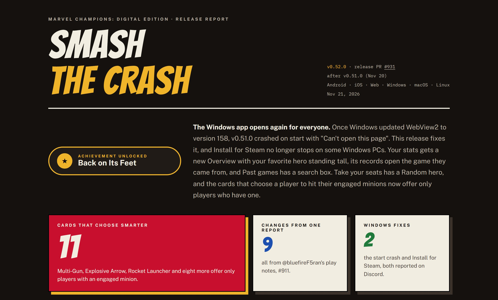
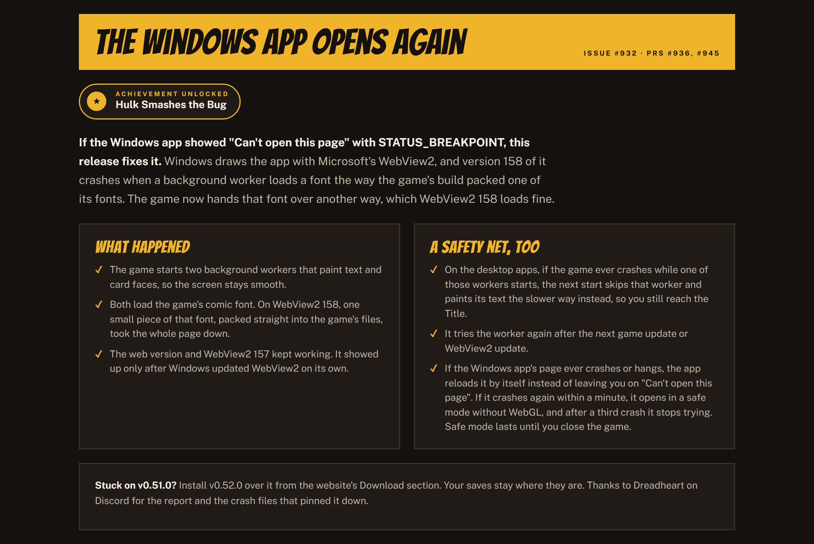
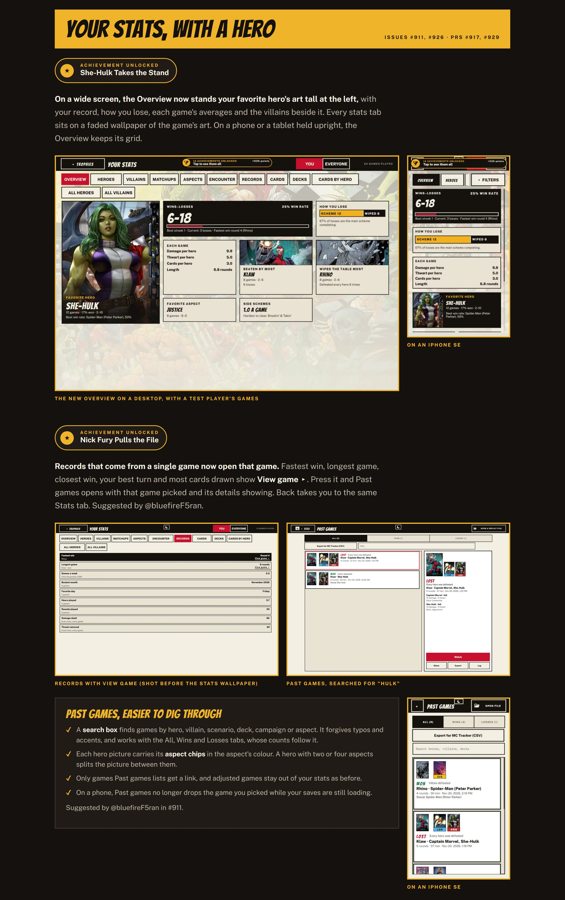
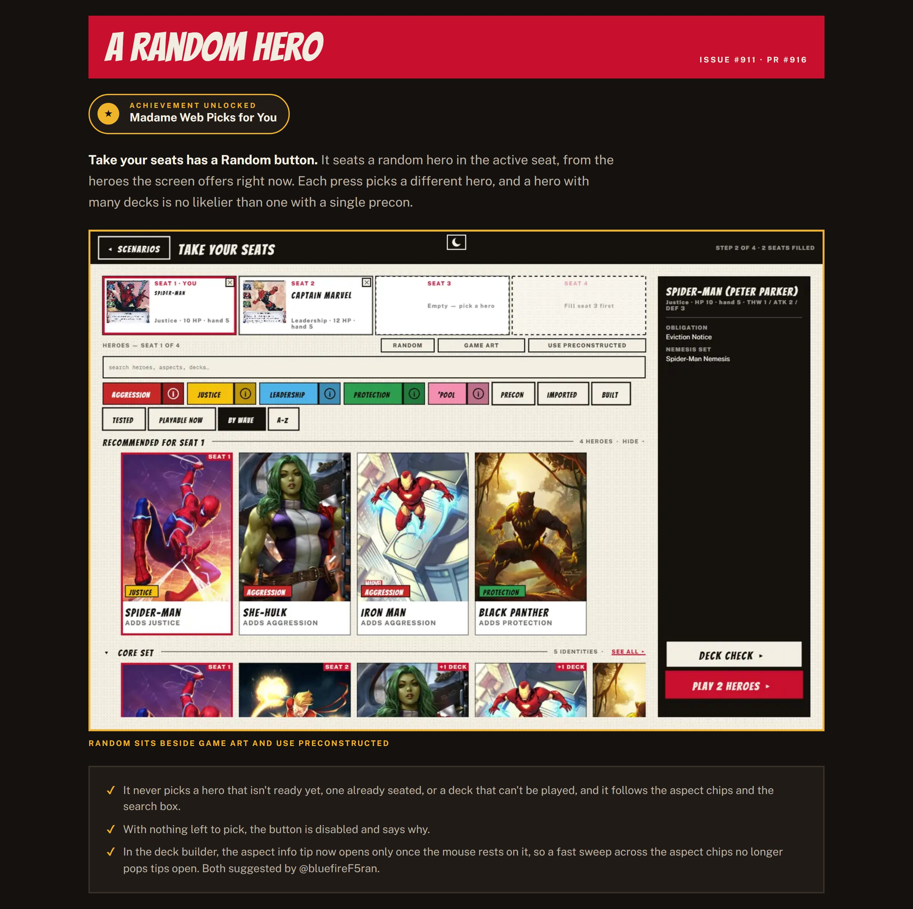
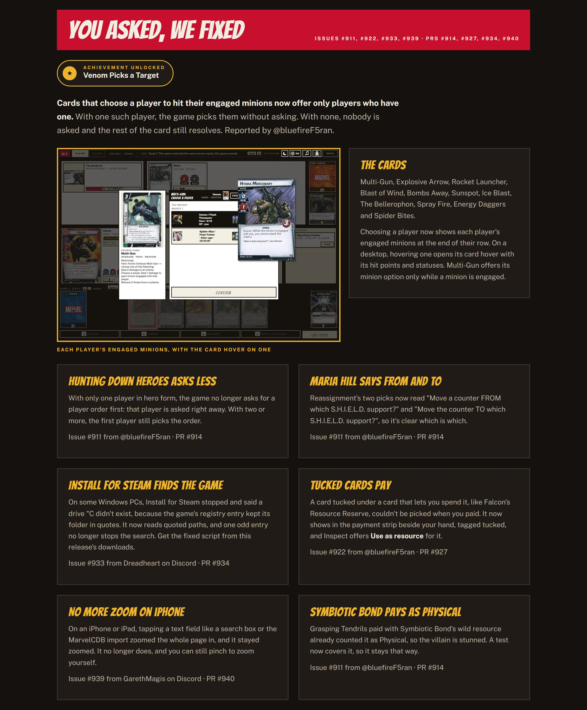
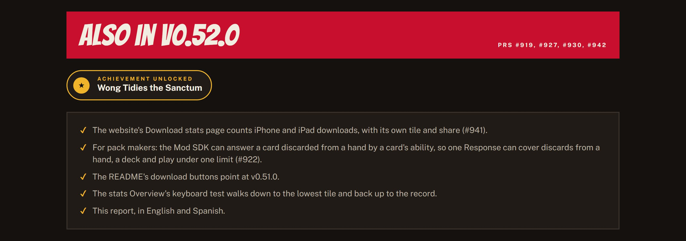
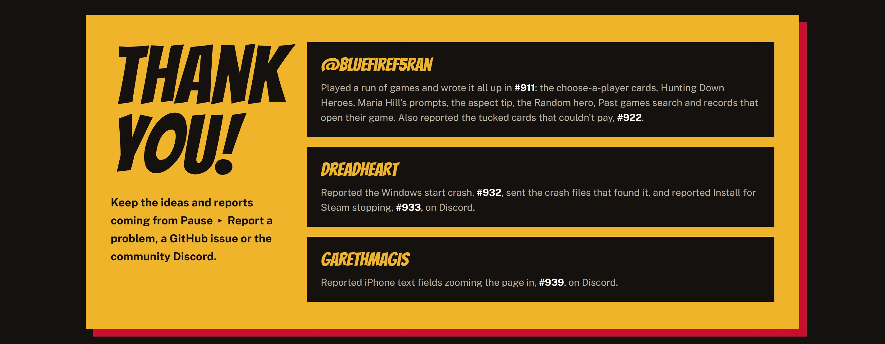
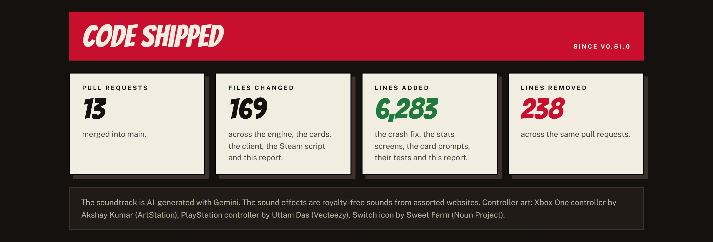

## Aplasta el fallo

La app de Windows vuelve a abrir: cuando Windows actualizó WebView2 a la versión 158, v0.51.0 fallaba al iniciar con "Can't open this page" (STATUS_BREAKPOINT), y esta versión lo corrige, con una red de seguridad que se salta un proceso de pintado en segundo plano si alguna vez tumba la página (#932, #936), y si la página llega a fallar, la app la recarga sola y luego prueba un modo seguro (#945). Install for Steam ya no se detiene en las PC cuyo registro guarda la carpeta del juego entre comillas (#933, #934), las dos cosas reportadas por Dreadheart en Discord. Your stats tiene un nuevo Overview que pone el arte de tu héroe favorito de cuerpo entero en una pantalla ancha, con un tapiz difuminado detrás de cada pestaña (#926, #929). De las notas de juego de @bluefireF5ran en #911: los récords de las estadísticas abren la partida de la que salen, Past games tiene un cuadro de búsqueda y etiquetas de aspecto, Take your seats tiene un héroe al azar, la ayuda del aspecto espera a que el ratón se detenga, y once cartas que eligen a un jugador para golpear a sus esbirros enfrentados ahora solo ofrecen a los jugadores que tienen alguno, con preguntas más claras en Hunting Down Heroes y en Reassignment de Maria Hill (#914, #916, #917). Las cartas guardadas debajo de Resource Reserve de Falcon ahora se pueden gastar al pagar, también por un reporte de @bluefireF5ran (#922, #927). En iPhone y iPad, tocar un campo de texto ya no acerca la página, gracias a GarethMagis (#939, #940). Las estadísticas de descargas del sitio web ahora cuentan las descargas para iPhone y iPad (#941, #942). ¡Gracias por jugar!

## [v0.52.0] - 2026-11-21

### Added

- Al elegir un jugador se ven los esbirros enfrentados con cada jugador, con la vista previa de la carta para sus puntos de vida y estados (#911).
- Take your seats tiene un botón Random que sienta un héroe al azar en el asiento activo, entre los héroes que ofrece la lista en ese momento (nunca un héroe que no está listo, uno ya sentado ni un mazo ilegal) (#911).
- Past games tiene un cuadro de búsqueda por héroes, villanos y mazos (tolerante a errores y a acentos, combinado con las pestañas All/Won/Lost), y etiquetas de aspecto en la imagen de cada héroe; sugerido por @bluefireF5ran (#911).
- Los récords de las estadísticas que salen de una sola partida (victoria más rápida, partida más larga, victoria más ajustada, mejor turno, más cartas robadas) enlazan a esa partida en Past games (#911).
- El informe de la versión v0.52.0 tiene su propia página en el sitio, en /releases/v0.52.0/
- La página de estadísticas de descargas cuenta las descargas de iOS (los IPA sin firmar) y muestra iOS en el reparto por plataforma.

### Changed

- Your stats: en una pantalla ancha, el Overview pone el arte de tu héroe favorito de cuerpo entero a la izquierda con las demás casillas al lado, y cada pestaña de estadísticas tiene de fondo un tapiz difuminado (#926).

### Fixed

- La opción de elegir un jugador de Multi-Gun solo se ofrece con un esbirro enfrentado, y solo se puede elegir a los jugadores que tienen uno; reportado por @bluefireF5ran (#911).
- Hunting Down Heroes ya no pide un orden de jugadores cuando solo un jugador está en forma de héroe, y Reassignment de Maria Hill pregunta de qué apoyo sale el contador (FROM) y luego a cuál va (TO) (#911).
- Las cartas que eligen a un jugador para golpear a los esbirros enfrentados con él (Explosive Arrow, Rocket Launcher, Blast of Wind, Bombs Away, Sunspot, Ice Blast, The Bellerophon, Spray Fire, Energy Daggers, Spider Bites, Multi-Gun) solo ofrecen a jugadores con un esbirro enfrentado y eligen al único sin preguntar (#911).
- La ayuda del aspecto del constructor de mazos se abre solo cuando el ratón se detiene sobre ella, así que pasar rápido sobre las etiquetas ya no la abre; reportado por @bluefireF5ran (#911).
- Una carta guardada debajo de una carta que te deja gastarla (Resource Reserve, el anfitrión de un paquete) ahora se puede gastar al jugar una carta: aparece en la tira de pago junto a tu mano, e Inspect ofrece Use as resource para ella (#922).
- Install for Steam en Windows ya no se detiene con 'drive "C does not exist' cuando el registro del juego guarda su ruta de instalación entre comillas (#933)
- Windows: el juego ya no abre en "Can't open this page" (STATUS_BREAKPOINT) después de que WebView2 se actualiza a la 158. Sus procesos de texto y de cartas ahora reciben la fuente incrustada como bytes, y un proceso de fuentes que alguna vez tumbe la página se salta en el siguiente inicio (#932)
- En un iPhone o iPad, tocar un campo de texto (un cuadro de búsqueda, la importación de MarvelCDB) ya no acerca la página ni la deja acercada (#939).
- Windows: si la página del juego falla, la app la recarga sola y luego prueba un modo seguro sin WebGL, en vez de dejarte en 'Can't open this page' (#932)

### Engine

- Un efecto ordenado de "cada jugador" se salta la pregunta de orden al primer jugador cuando como mucho la pasada de un jugador puede hacer algo (#911).
- Nuevo evento de respuesta para una carta descartada de una mano por la capacidad de una carta (cardDiscardedFromHand, con el lado de la carta que descarta y si fue efecto o coste), y on.cardDiscardedFromHand en el DSL de cartas, para que una sola capacidad responda a descartes de una mano, de un mazo y del juego con un solo límite (#922).
- Una carta descartada del mazo de un jugador ahora dice de qué lado era la carta que la descartó y si fue como efecto o como coste (by y how en cardDiscardedFromDeck), como ya lo hacía el descarte de un mazo de encuentros (#922).
