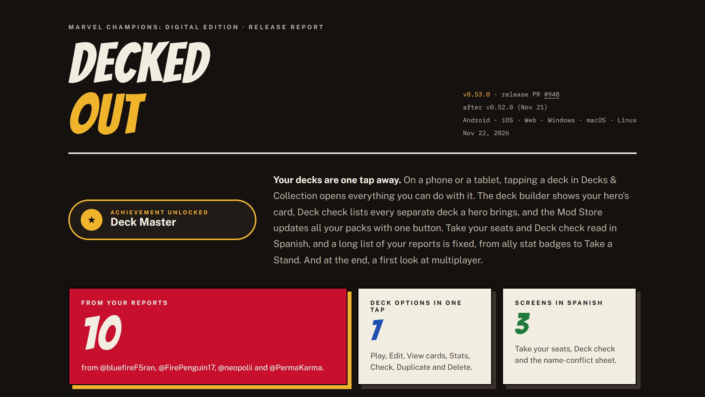
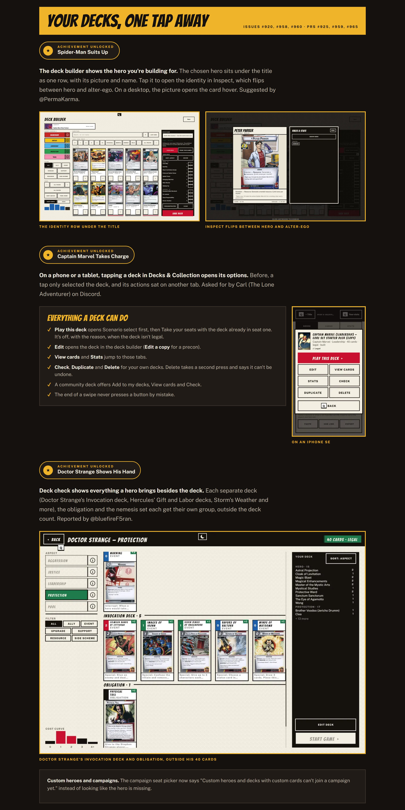
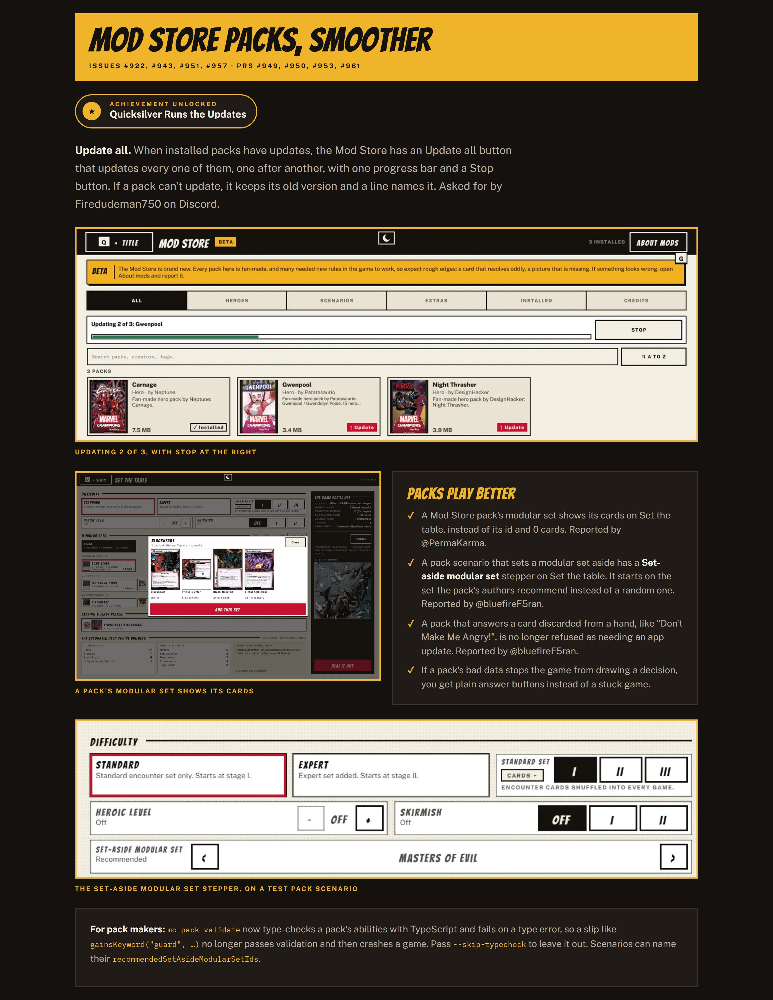
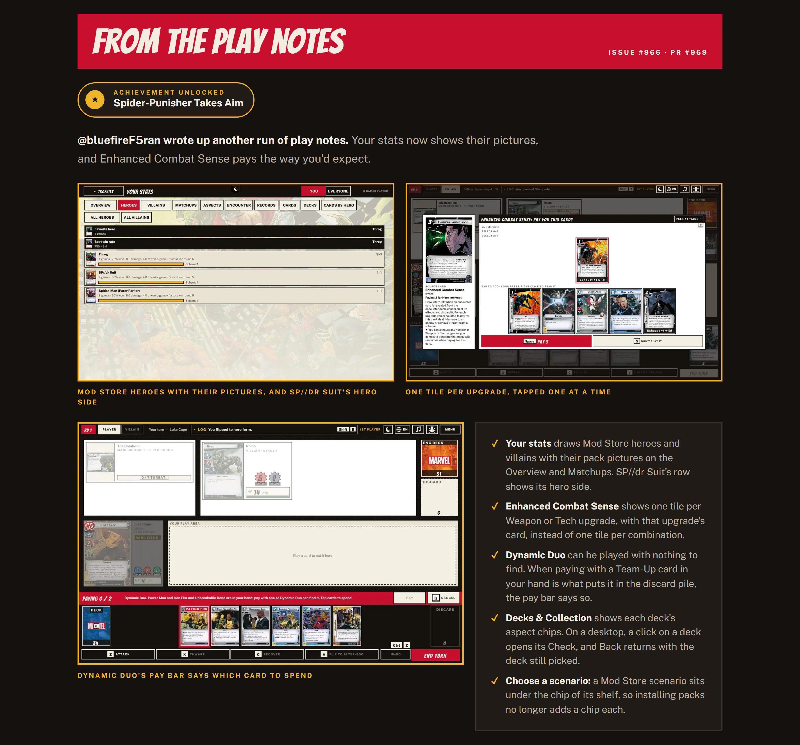
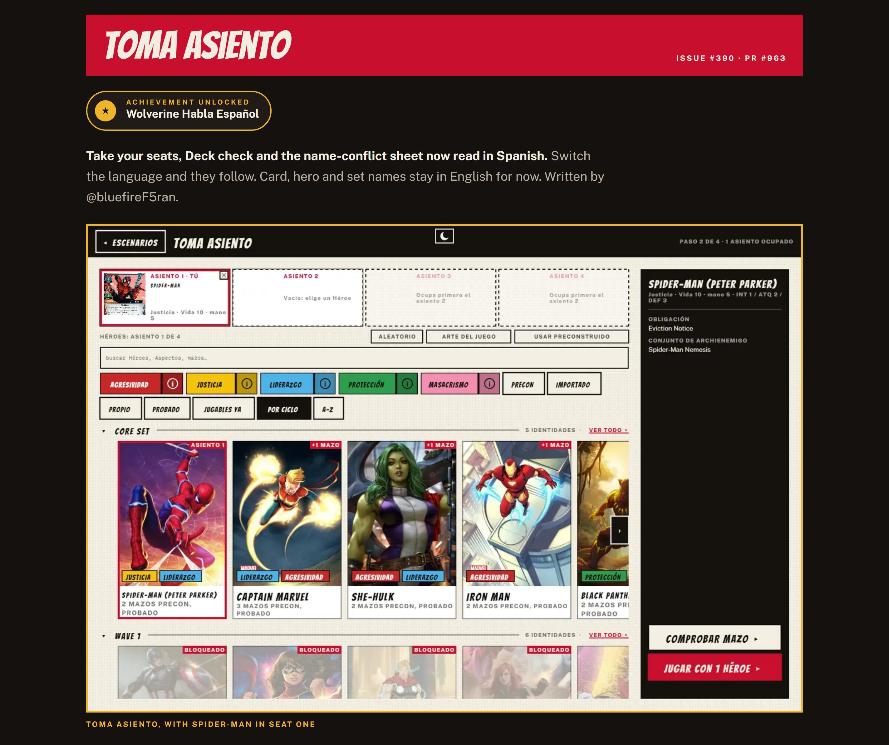
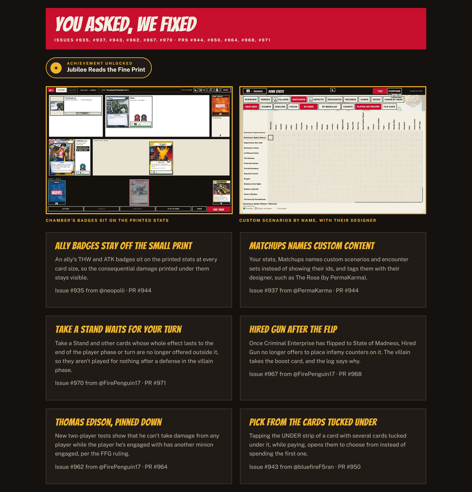
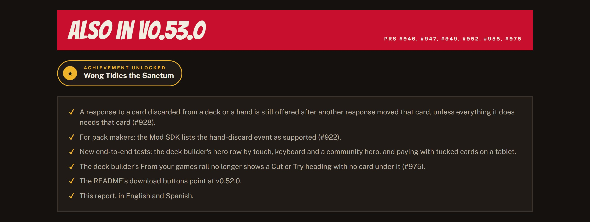
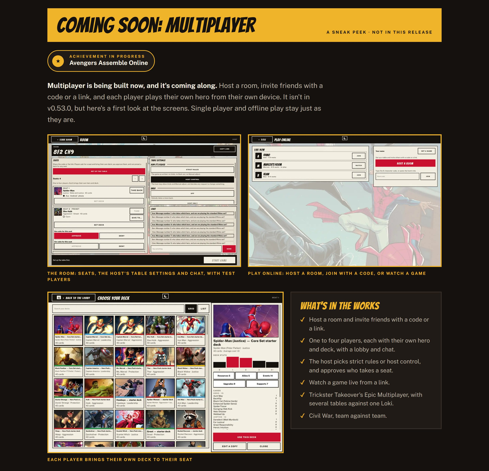
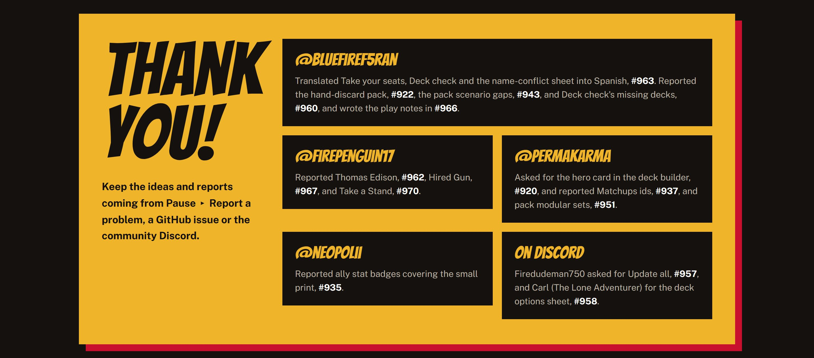
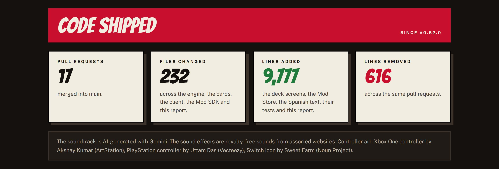

## Mazos a punto

En un teléfono o una tableta, tocar un mazo en Decks & Collection ahora abre todo lo que puedes hacer con él, y Play this deck va primero a Scenario select (#958, #959). El constructor de mazos muestra la carta de tu héroe, como pidió @PermaKarma (#920, #925), y Deck check muestra cada mazo aparte, la obligación y el conjunto de némesis que trae un héroe, por un reporte de @bluefireF5ran (#960, #965). La Mod Store tiene un botón Update all (#957, #961), el set modular de un paquete muestra sus cartas en Set the table (#951, #953), y los escenarios de paquetes tienen un selector Set-aside modular set mientras `mc-pack validate` ahora revisa los tipos de las habilidades (#943, #950). De las notas de juego de @bluefireF5ran, Your stats muestra los héroes de la Mod Store con sus imágenes, Enhanced Combat Sense se paga mejora a mejora y la lista de mazos tiene etiquetas de aspecto (#966, #969). Take your seats y Deck check se leen en español, traducidos por @bluefireF5ran (#390, #963). Las insignias de estadísticas de los aliados ya no tapan la letra pequeña, reportado por @neopolii (#935, #944), Matchups nombra el contenido personalizado (#937), y Take a Stand, Hired Gun y Thomas Edison siguen mejor las reglas, los tres reportados por @FirePenguin17 (#962, #967, #970). Y el informe termina con un primer vistazo al multijugador, que se está construyendo ahora. ¡Gracias por jugar!

## [v0.53.0] - 2026-11-22

### Added

- Constructor de mazos: el héroe elegido ahora aparece bajo el título en una sola fila con su imagen y su nombre; tocarlo abre la identidad en Inspect, que pasa de héroe a álter ego, y en escritorio la imagen abre la vista previa de la carta (#920).
- Un escenario de paquete que deja aparte un set modular ofrece un selector Set-aside modular set en la pantalla de preparación, que empieza en el nuevo recommendedSetAsideModularSetIds de sus autores en lugar de un set al azar (#943)
- Mod Store: un botón Update all actualiza cada paquete instalado que tiene una versión más nueva, uno tras otro, con una sola barra de progreso, un botón Stop y una línea que nombra cualquier paquete que no se pudo actualizar (#957).
- Decks & Collection en un teléfono o una tableta: tocar un mazo abre sus opciones (Play, Edit, View cards, Stats, Check, Duplicate, Delete) (#958).
- El informe de la versión v0.53.0 tiene su propia página en el sitio, en /releases/v0.53.0/
- La página de inicio del sitio web tiene una sección Multiplayer, coming soon con un primer vistazo al juego en línea

### Changed

- Take your seats, Deck check y la hoja de conflicto de nombres se leen en español (#390)
- Play this deck (Decks & Collection) ahora abre primero Scenario select y luego Take your seats con el mazo ya en el asiento uno (#958).

### Fixed

- Las insignias de estadísticas de los aliados quedan sobre el THW y el ATK impresos en cualquier tamaño de carta, así que el daño consecuente impreso debajo sigue visible y la estrella de la estadística queda junto al número (#935)
- Stats > Match-ups nombra los escenarios y sets de encuentro personalizados en lugar de mostrar sus ids, y marca el contenido personalizado con su diseñador, como The Rose (by PermaKarma) (#937)
- Mod Store: un paquete que responde a una carta descartada de una mano ("Don't Make Me Angry!") ya no se rechaza como si necesitara una actualización de la app (#922).
- mc-pack validate revisa los tipos de las habilidades de un paquete con TypeScript y falla ante un error de tipos (usa --skip-typecheck para omitirlo), así que un error como gainsKeyword("guard", …) ya no pasa la validación para luego romper una partida (#943)
- Una decisión que el juego no puede dibujar (datos erróneos de un paquete) muestra botones de respuesta sencillos en lugar de dejar la partida atascada, y una palabra clave suelta como texto en un paquete ya no rompe la hoja de la carta (#943)
- Tocar la tira UNDER n de un anfitrión con varias cartas guardadas debajo mientras pagas las abre para elegir, en lugar de gastar la primera (#943)
- El set modular de un paquete de la Mod Store muestra sus cartas en Set the table en lugar de su id y 0 cartas (#951)
- Deck check muestra los mazos aparte de la identidad (Invocation, Gift, Labor), su obligación y su conjunto de némesis como grupos propios, fuera de la cuenta del mazo; el selector de asientos de la campaña dice que los héroes personalizados aún no pueden unirse a una campaña (#960).
- Hired Gun ya no ofrece poner contadores de infamia sobre Criminal Enterprise cuando ya ha girado a State of Madness; el villano toma la carta de potenciación y el registro dice por qué (#967)
- Take a Stand y otras cartas cuyo efecto entero dura hasta el final de la fase de jugador (o del turno) ya no se ofrecen fuera de ella, así que no se juegan para nada tras defender en la fase de villano (#970).

### Engine

- Una respuesta a un descarte de un mazo o de una mano se sigue ofreciendo después de que otra respuesta haya movido la carta descartada, salvo que cada parte de ella necesite esa carta (#928).

### Content

- Thomas Edison: pruebas a dos jugadores fijan que no puede recibir daño de ningún jugador mientras el jugador con el que está enfrentado tenga otro esbirro enfrentado, según la resolución de FFG (#962).
