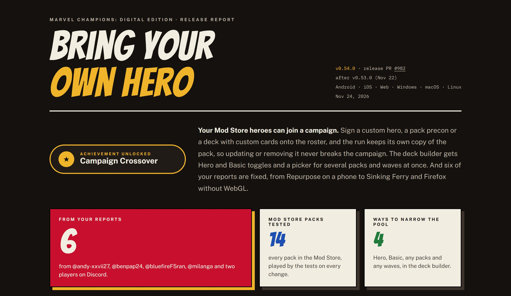
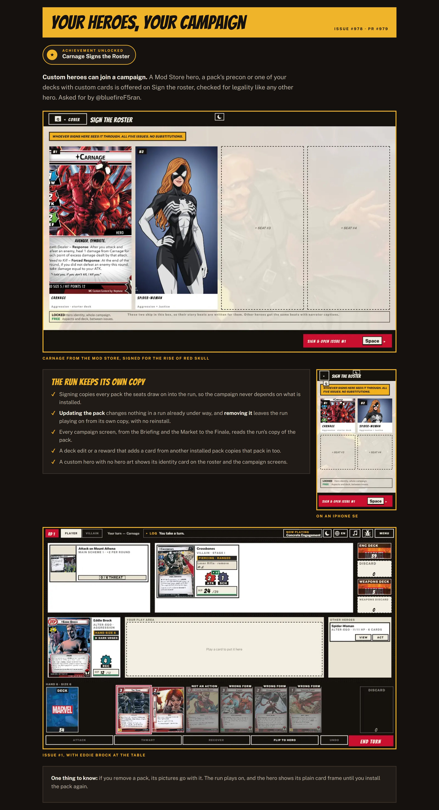
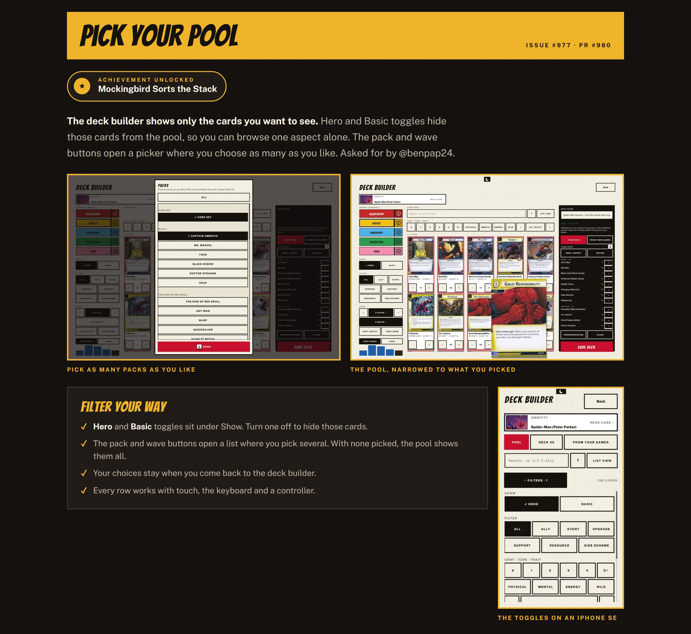
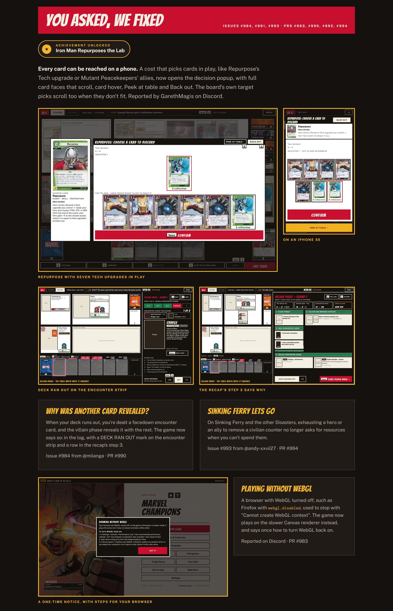
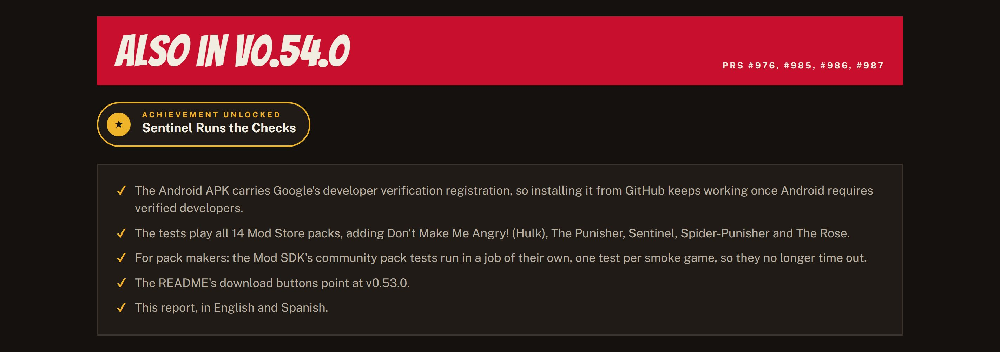
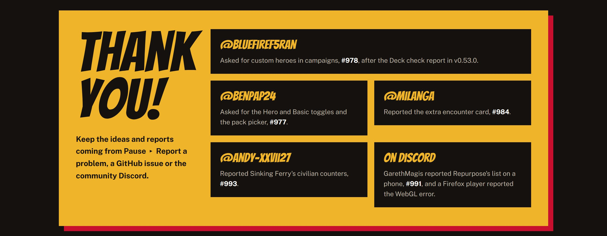
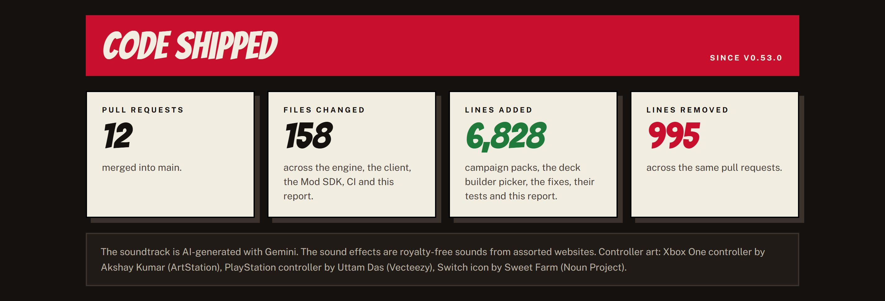

## Trae tu propio héroe

Tus héroes de la Mod Store pueden unirse a una campaña: un héroe personalizado, el mazo preconstruido de un paquete o un mazo con cartas personalizadas firma en la plantilla, y la partida guarda su propia copia de cada paquete, así que actualizarlo o quitarlo nunca rompe la campaña, como pidió @bluefireF5ran (#978, #979). El constructor de mazos tiene los interruptores Hero y Basic, y sus botones de paquete y de oleada abren un selector donde eliges varios a la vez, a pedido de @benpap24 (#977, #980). Repurpose y otros costes que eligen cartas en juego abren la ventana de decisión, así que todas las cartas se pueden alcanzar en un teléfono, como reportó GarethMagis en Discord (#991, #992). La fase de villano dice cuándo se repartió una carta porque se acabó tu mazo, por el reporte de @milanga (#984, #990), los contadores de civil de Sinking Ferry se quitan cuando agotas un personaje, como reportó @andy-xxvii27 (#993, #994), y un navegador sin WebGL ahora juega con Canvas en vez de detenerse (#983). ¡Gracias por jugar!

## [v0.54.0] - 2026-11-24

### Added

- Los héroes personalizados (de la Mod Store), los mazos preconstruidos de paquetes y los mazos con cartas personalizadas pueden unirse a una campaña. La partida guarda su propia copia de cada paquete, así que actualizar o quitar el paquete nunca la rompe (#978, reportado por @bluefireF5ran).
- Constructor de mazos: los interruptores Hero y Basic ocultan esas cartas, y los botones de paquete y de oleada abren un selector donde eliges varios a la vez (#977, gracias a benpap24).
- El informe de la versión v0.54.0 tiene su propia página en el sitio, en /releases/v0.54.0/

### Changed

- El APK de Android lleva el registro de verificación de desarrollador de Google, así que las instalaciones desde GitHub seguirán funcionando cuando Android exija desarrolladores verificados.

### Fixed

- Un navegador con WebGL desactivado (como Firefox con webgl.disabled) ahora juega con el renderizador Canvas, más lento, en vez de detenerse con "Cannot create WebGL context", y dice una vez cómo volver a activar WebGL.
- Las pruebas de paquetes de la comunidad del Mod SDK corren en un job de CI propio, una prueba por partida de humo y cada paquete construido una vez por ejecución, así que ya no se quedan sin tiempo.
- La fase de villano ahora dice cuándo se repartió una carta de encuentro porque se acabó tu mazo: la línea del registro, la marca DECK RAN OUT en la tira de encuentros y una fila en el paso 3 del resumen (#984).
- Un coste que elige cartas en juego (la mejora Tech de Repurpose, los aliados de Mutant Peacekeepers) se pregunta en la ventana de decisión, con las cartas completas en una lista que se desplaza, así que todas las cartas se pueden alcanzar en un teléfono; las selecciones de objetivo del tablero también se desplazan cuando no caben (#991, reportado por GarethMagis en Discord).
- Sinking Ferry y los demás Disasters: agotar un héroe o un aliado para quitar un contador de civil ya no pide recursos cuando no puedes gastarlos (#993)

### Content

- Las pruebas de paquetes de la comunidad cubren los 14 paquetes de la Mod Store, y suman Don't Make Me Angry! (Hulk), The Punisher, Sentinel, Spider-Punisher y The Rose.
