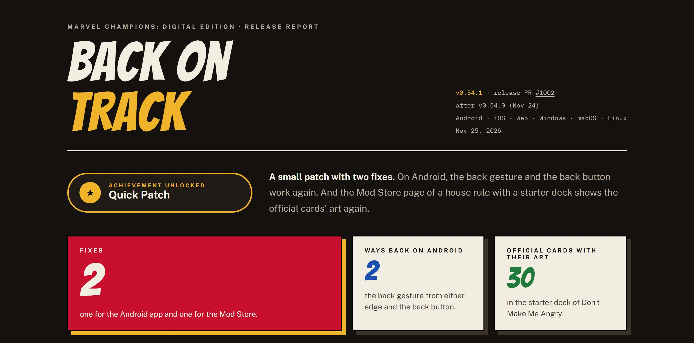
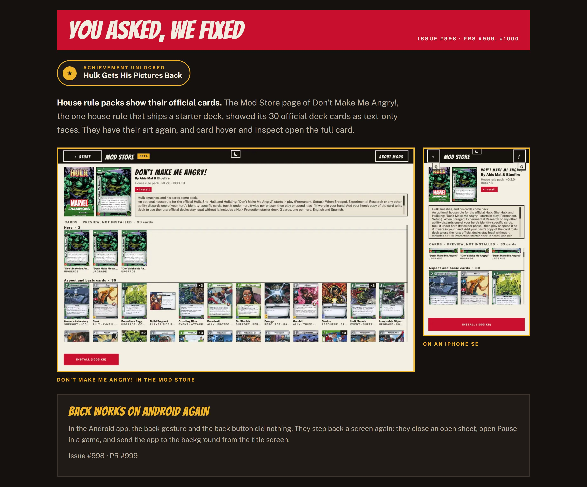
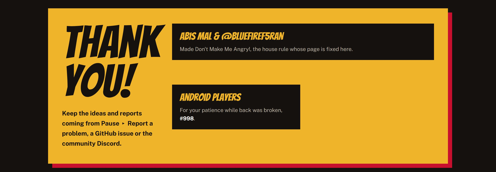
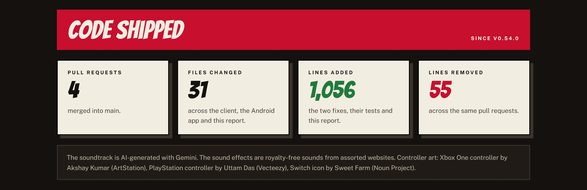

## De vuelta en camino

Un parche pequeño con dos correcciones. En Android, el gesto de volver y el botón atrás vuelven a retroceder una pantalla (#998, #999). Y la página de la Mod Store de "Don't Make Me Angry!", la regla de la casa con mazo inicial, vuelve a mostrar el arte de sus 30 cartas oficiales (#1000). Gracias, Abis Mal y @bluefireF5ran, por el paquete.

## [v0.54.1] - 2026-11-25

### Added

- El informe de la versión v0.54.1 tiene su propia página en el sitio, en /releases/v0.54.1/

### Fixed

- Android: el gesto de volver y el botón atrás vuelven a retroceder una pantalla, en vez de no hacer nada (#998)
- La página de la Mod Store de una regla de la casa con mazo inicial vuelve a mostrar el arte de las cartas oficiales, no caras solo con texto
