## Reúnanse en línea

Marvel Champions ahora es un juego para jugar juntos. Crea una sala o únete a una con un código de 6 caracteres, y cada jugador juega su propio héroe desde su propio dispositivo, con sala de espera, chat y sus propios mazos (#880, #881). Comparte un enlace y cualquiera puede ver tu partida en directo, con un botón Watch live en tu tarjeta de Discord (#876). El Epic Multiplayer de Trickster Takeover pone varias mesas contra un solo Loki (#882), Civil War Competitive enfrenta a dos equipos, líder contra líder (#883), y llegan con ellos 49 logros nuevos, con hazañas de mesa de la lista de @bluefireF5ran (#909). El juego en línea es totalmente nuevo, así que seguramente encontrarás errores: repórtalos desde Pause ▸ Report a problem o un issue de GitHub y los arreglaremos pronto. Gracias a GarethMagis y a todos en Discord que jugaron las versiones de prueba. ¡Esta es la versión 1.0.0!

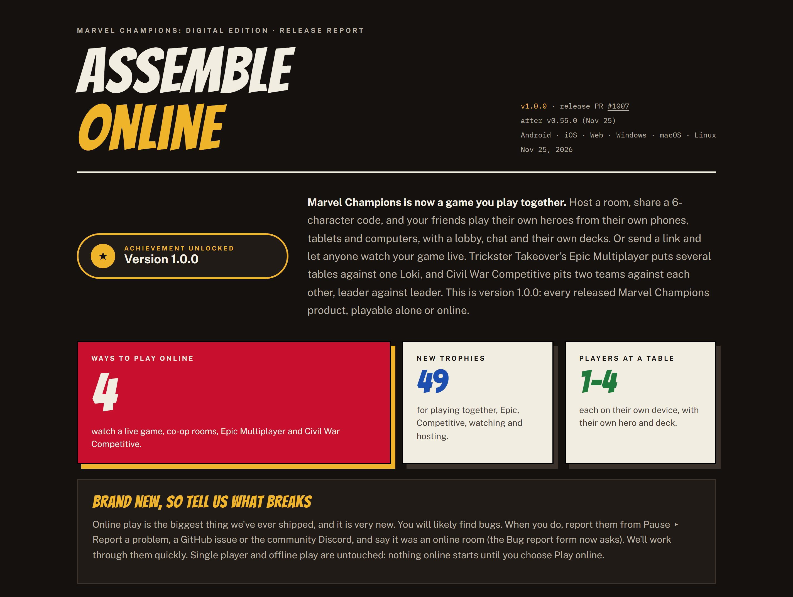

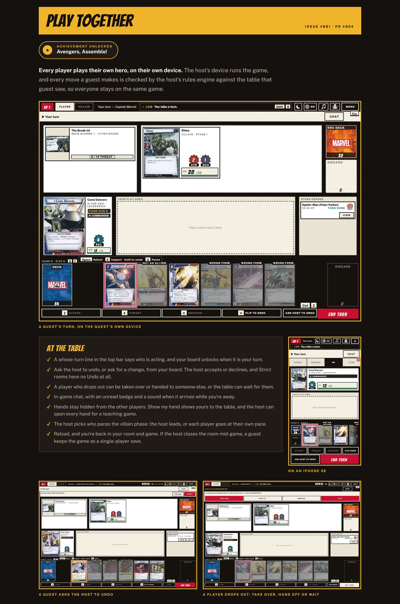

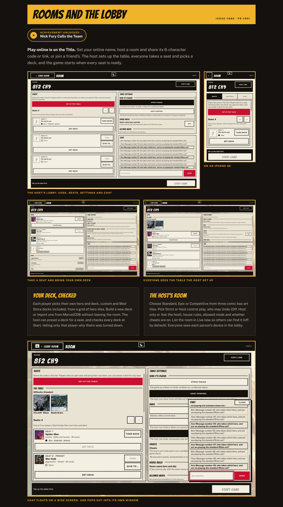

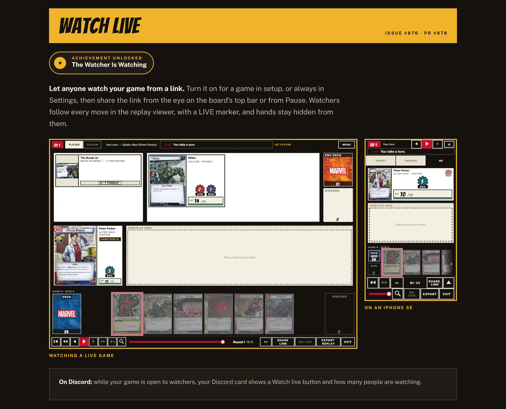

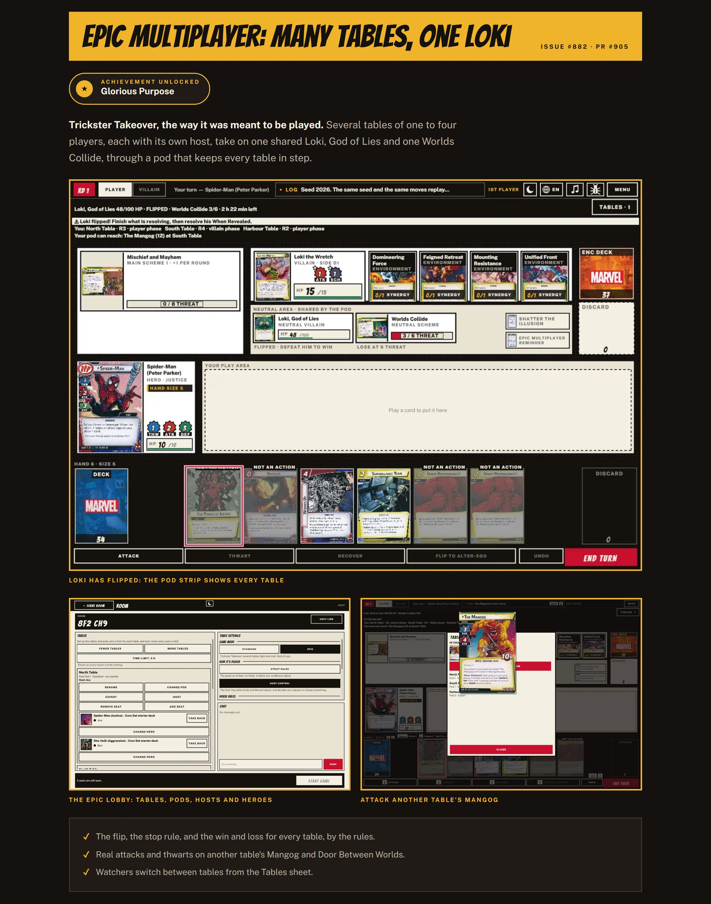

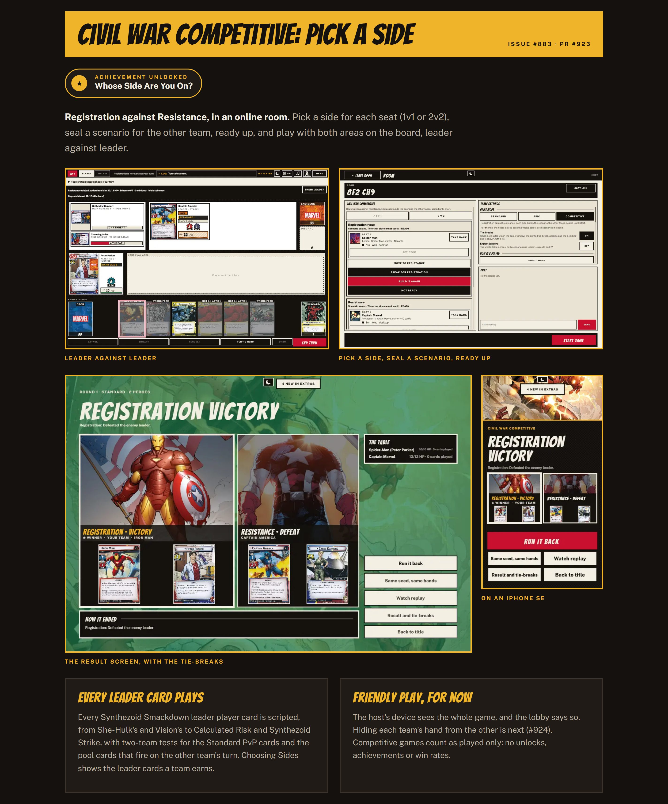

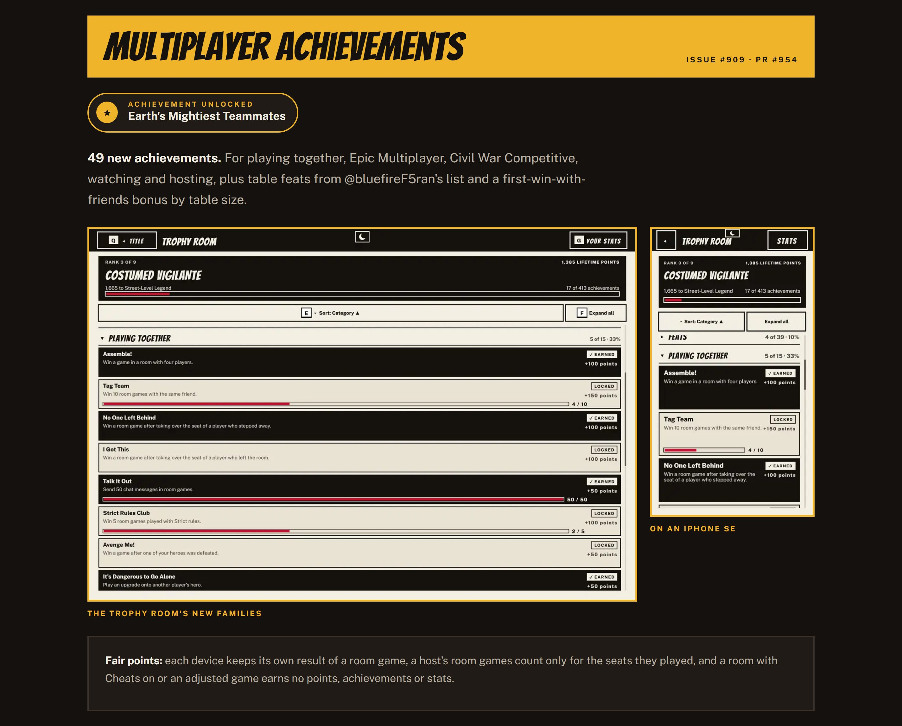

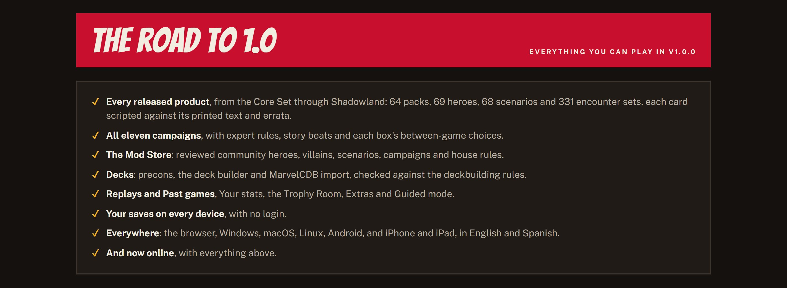

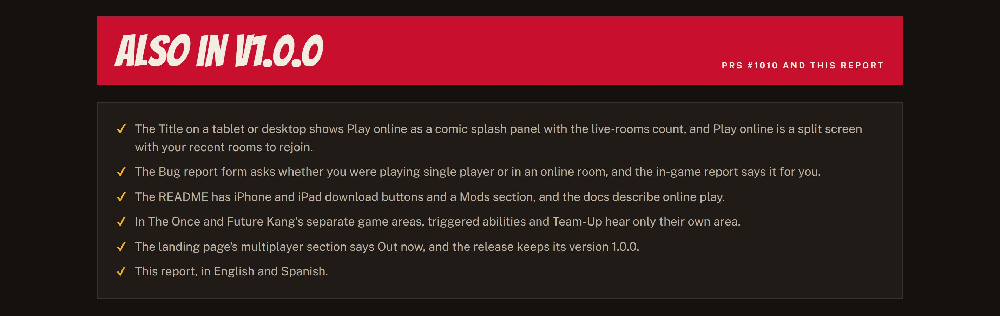

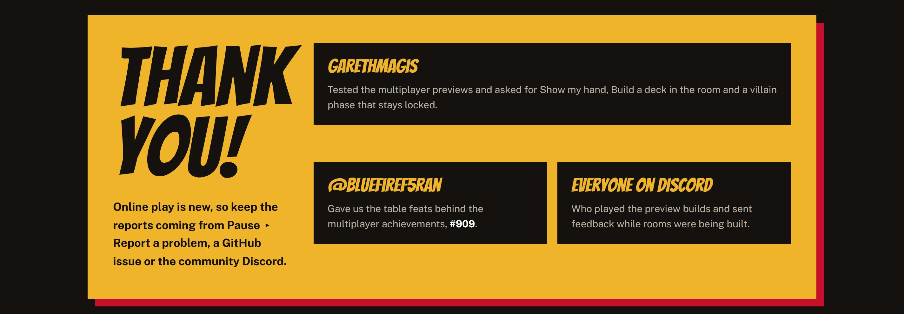

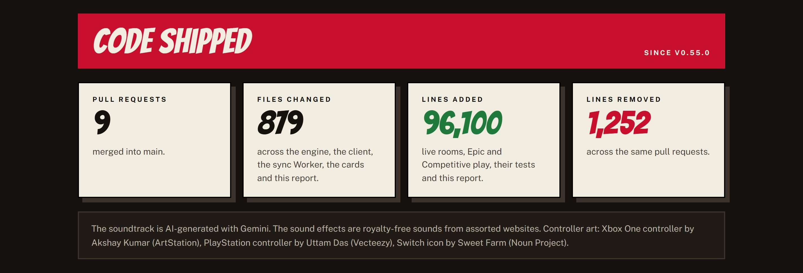

## [v1.0.0] - 2026-11-25

### Added

- Deja que otros vean tu partida en directo desde un enlace: elígelo para cada partida en la preparación o permítelo siempre en Settings, comparte el enlace desde el ojo de la barra superior del tablero o desde Pause, y los espectadores siguen cada jugada en el visor de repeticiones con una marca LIVE (#876)
- Tu tarjeta de Discord muestra un botón Watch live y cuántas personas están mirando mientras una partida está abierta a espectadores (#876)
- Play online: crea una sala o únete a una con un código de 6 caracteres o un enlace, elige tu nombre en línea y usa la sala de espera (asientos, controles del anfitrión, chat) antes de la partida; nada en línea empieza hasta que tú lo eliges (#880)
- Las salas muestran el dispositivo de cada persona (plataforma y teléfono, tableta o escritorio) en la sala de espera (#880)
- Salas de partida en directo: en una sala Strict, el anfitrión no tiene Undo, Back out ni Manual adjust, y el motor los rechaza (#880)
- Jugar juntos en una sala: un invitado sentado juega su héroe desde su propio dispositivo, con una línea de a quién le toca, peticiones al anfitrión, tomar o ceder los asientos de jugadores ausentes y chat durante la partida (#881)
- Epic Multiplayer de Trickster Takeover en línea: una sala de espera Epic para mesas, grupos, anfitriones y héroes, una tira del grupo con Loki, Worlds Collide y el estado de cada mesa, objetivos Mangog y Door Between Worlds de otras mesas, y espectadores que cambian de mesa (#882)
- Salas: cada jugador elige su propio héroe y mazo en su dispositivo, incluidos los mazos personalizados; el anfitrión puede fijar un mazo para un asiento y revisa todos los mazos al pulsar Start, y solo le dice a ese jugador por qué se rechazó el suyo (#880)
- Salas: el anfitrión elige quién puede deshacer (Off, Host only, Ask) y si los trucos están activos; una partida con trucos no cuenta para las estadísticas de nadie
- Civil War Competitive en salas en línea (#883): elige un bando por asiento (1v1 o 2v2), sella un escenario para el otro equipo, prepárate y juega con las dos áreas en el tablero; una hoja de resultado muestra los desempates, y Concede ofrece rendir al equipo o, en un 2v2, irte solo (la elección de un invitado pasa por el anfitrión)
- Civil War Competitive: la hoja Choosing Sides muestra las cartas de líder que gana un equipo, y la hoja de resultado se puede volver a abrir desde Game over
- Sala de espera de Civil War Competitive: dice que el dispositivo del anfitrión ve toda la partida (juego amistoso; ocultar por asiento es #924)
- Logros multijugador: 49 logros nuevos por jugar juntos, Epic Multiplayer, Civil War Competitive, mirar y ser anfitrión, y hazañas de mesa de la lista de bluefireF5ran, más un bono por la primera victoria con amigos según el tamaño de la mesa (#909)
- Salas: un aviso que se puede cerrar y un sonido cuando alguien entra a tu sala, y un sonido cuando llega un mensaje de chat mientras la ventana no está activa (#880)
- Salas: una insignia de no leídos en la pestaña Chat de la sala de espera, y en un teléfono el chat queda sobre el teclado mientras escribes (#880)
- Salas: la sala de espera muestra lo que hace el anfitrión en la preparación (elegir un escenario, preparar la mesa, revisar los mazos), y la sala guarda su historial de chat para quienes llegan tarde después de dormirse (#880)
- Selector de mazos de la sala: una cuadrícula de héroes por defecto (la lista se recuerda como elección), un panel de detalles con las estadísticas del mazo, la lista de cartas, Edit deck y Use this deck (panel lateral en escritorio, hoja en teléfonos), y un selector más rápido en teléfonos lentos (solo se construyen los mosaicos visibles, las imágenes de héroes se preparan fuera del hilo principal, las revisiones de mazo corren en un worker y el worker de mazos se calienta antes de Pick)
- Play online: los anfitriones pueden incluir una sala en una lista pública Live now (desactivada por defecto), y el panel Live now muestra esas salas con Watch y Join
- Los anfitriones eligen el modo de juego entre tres portadas de cómic (Standard, Epic, Competitive), con un panel de información en escritorio y una franja de información en tableta y teléfono.
- Cuando el anfitrión cierra una sala a mitad de partida, el dispositivo de un invitado sentado guarda la partida como partida guardada de un jugador, y el aviso Room closed ofrece Continue in single player (#904)
- Jugar juntos: el anfitrión elige quién marca el ritmo de la fase de villano en las pantallas de los invitados (Host leads por defecto, o cada jugador a su ritmo), la pantalla de un invitado sigue la revelación del anfitrión y se cierra con ella, y el botón de un invitado ahora dice Back to the table (#881)
- Recargar la página mantiene tu lugar: una sala en la que estás (anfitrión o invitado, sala de espera o partida), una partida en directo que estás mirando y una partida de un jugador en el navegador vuelven enseguida, con un aviso Rejoining mientras se reconecta
- Partidas en sala: Show my hand permite a un jugador mostrar su mano a la mesa, y el anfitrión puede abrir todas las manos para una partida de enseñanza
- Partidas en sala: el selector de mazos puede construir un mazo nuevo o importar uno de MarvelCDB sin salir de la sala
- El informe de la versión v1.0.0 tiene su propia página en el sitio, en /releases/v1.0.0/

### Changed

- Las salas de Civil War Competitive usan el mismo flujo de mazos que las salas normales y Epic: cada jugador elige su propio héroe y mazo, Start del anfitrión los juzga, y un héroe que comparte título con el líder de su propio equipo se rechaza solo para ese jugador
- Las partidas de Civil War Competitive cuentan solo como jugadas: sin desbloqueos, logros, puntos de campeón, porcentajes de victoria por escenario o héroe, ni estadísticas globales; el resultado competitivo se guarda aparte para seguir el JcJ, y Past games las lista solo en All
- Civil War Competitive: las pantallas de resultado ahora se ven como las pantallas Victory y Defeat de campaña, con el arte y las cartas del líder de cada equipo, el ganador destacado y los desempates en pantalla
- Partidas en sala: el dispositivo de un invitado ahora guarda su propio resultado de una partida en sala terminada, las partidas en sala de un anfitrión cuentan solo para los asientos que jugó, y las partidas en sala con Cheats o ajustadas no dan puntos, logros ni estadísticas (#909)
- En una partida en sala, el tablero y la pantalla de preparación del anfitrión muestran boca abajo las manos de los demás jugadores, como las de un invitado; la opción de sala Host sees every hand las vuelve a mostrar solo al anfitrión, y los espectadores en directo nunca ven las manos (#887)
- Play online es una pantalla dividida en pantallas anchas (salas recientes para volver a la izquierda; nombre, Host y Join a la derecha) sobre un fondo tenue de arte de héroes, que ahora comparte la sala de espera
- Salas en línea: un invitado cuyo anfitrión cerró la sala vuelve a Play online con un aviso Room closed; el chat mantiene el foco después de Send; el campo del chat queda sobre el teclado en la app de Android
- Play online en la pantalla de título de una tableta o un escritorio es un panel de cómic con Host a room y Join a room y el número de salas en directo, en vez de un botón de menú; los teléfonos conservan el botón
- Sala de espera: el interruptor Show in Live now del anfitrión está junto a Copy link en pantallas más anchas, y encabeza los ajustes en un teléfono
- El formulario Bug report pregunta cómo jugabas (un jugador o una sala en línea, y tu papel en la sala), y el registro de Report an issue del juego y sus Game details lo dicen por ti (#1008)
- El pull request de la versión conserva un aumento de versión elegido a mano (como bump=major) cuando lo regeneran merges posteriores a main, en vez de volver a la versión automática
- La sección de multijugador de la página principal dice Out now in v1.0.0, con un sello OUT NOW en el cartel Assemble online en vez de Coming soon

### Fixed

- Civil War Competitive: un empate tiene una pantalla de fin de partida neutral, una victoria suena con música de victoria, una rendición en el mismo dispositivo se lee como rendida, el constructor de escenarios rechaza sets de otros productos, y un héroe que comparte título con su propio líder se rechaza
- Game over: la cinta de noticias ya no queda debajo del botón de modo oscuro
- Una sala en directo conserva la cola sin terminar de un registro reemplazado cuando se despierta, y ya no deja una fila de cola vieja después de un lote que termina en un límite de 100 bloques (#876)
- Play online: pulsar Enter en el campo del nombre continúa, como el botón Continue
- Un invitado en una partida en sala ahora prepara la mesa en la misma pantalla Setting up the table que el anfitrión, y una respuesta de mulligan rechazada dice por qué en vez de que la pregunta vuelva sin aviso (#881)
- Salas en directo: el selector de mazos ya no se queda en Sending your deck después de Esc, la línea de estado del anfitrión ya no se queda vieja, Play online deja de ofrecer salas cerradas, y desactivar el chat borra su historial.
- Las salas en directo ahora comparan una huella del código de las reglas además de la versión, así que a un invitado con otra compilación (una vista previa frente a una versión) se le pide actualizar en vez de dejarlo sentarse y rechazar cada jugada
- Salas en directo: una escritura de bloque que falla ya no cuenta como guardada, y un lote que llena un hueco después del final vuelve a anunciar el final; un banco de pruebas de fallos cubre reconexiones, escrituras interrumpidas, partidas nuevas y confirmaciones finales perdidas
- La preparación de Civil War Competitive rechaza mesas 1v2 y 2v1 en todas partes (motor, cartas, mismo dispositivo y preparación de repeticiones), según el 1v1 o 2v2 de MC56 p. 14.
- Una sala Competitive guarda el nuevo escenario sellado de un equipo y la preparación que borra en una sola escritura, así que al despertarse nunca empareja un escenario nuevo con la aprobación anterior.
- Logros multijugador: la fila de sala terminada de un invitado se escribe solo al final de la sala (con su marca de ajustada), y una partida que el anfitrión rebobina y vuelve a terminar reemplaza esa fila en vez de quedarse con el primer resultado
- Salas Competitive: un cambio de equipo ya no puede llegar mientras empieza una partida, y un guardado fallido en una revelación, un inicio o el fin de una partida ahora se rechaza limpiamente en vez de dejar la sala a medio reiniciar.
- Las mesas Epic recuperan un evento del coordinador perdido mientras estaban inactivas, y el organizador espera a que se resuelva una reparación del registro o una apertura de la base de datos fallida en vez de empezar de nuevo (#882)
- Partidas en sala: la escritura del resultado de un invitado se reintenta después de un error de almacenamiento, una mesa reabierta deja de contar una victoria vieja al reconectarse, y el registro de una partida en sala va solo a su propia partida guardada (#909)
- Logros de sala: se reintenta apartar un resultado reabierto que falló, los datos de sala nunca llegan a una partida guardada sin conexión ni a otra partida de la misma sala, y un asiento liberado antes de Start no cuenta como jugado (#909)
- Partidas en sala: la mesa sigue bloqueada mientras la fase de villano está abierta, así que ya no se puede jugar una carta de la mano junto a ella después de una decisión, un mensaje de chat o un cambio de asiento
- Recargar durante la fase de villano la devuelve donde estaba, en vez de perderla (#989)

### Engine

- Salas de partida en directo en el Worker de sincronización: un Durable Object por sala transmite el registro de la partida del anfitrión a los espectadores por WebSockets, guardado en bloques congelados, y preparado para chat, asientos de jugadores y varias mesas (#876)
- Salas de espera en el Worker de sincronización: códigos de 6 caracteres, nombres, asientos con fichas de asiento, ajustes del anfitrión, chat y comprobación de compilación (#880)
- Salas de partida en directo: el motor del anfitrión juzga las jugadas de cada asiento frente a la mesa que vio el jugador, Concede desde un asiento deja el asiento, y el anfitrión puede desactivar el traspaso de asientos (#881)
- Epic Multiplayer: un Loki, God of Lies y un Worlds Collide compartidos por todos los grupos mediante un coordinador de grupo, con el volteo, la regla de parada, la victoria y la derrota para todos, y ataques y frustraciones reales sobre Mangog y Door Between Worlds de otro grupo (#882)
- Las salas en directo pueden tener varias mesas, cada una con su propio anfitrión y registro, y un canal de grupo de los anfitriones de mesa al organizador (#882)
- Civil War Competitive: un mazo de encuentros vacío se baraja con una ficha de aceleración en el plan principal de ese equipo, y un equipo cuyo mazo de encuentros y pila de descartes están vacíos pierde (RRG v1.8 p. 17)
- Civil War Competitive: solo el equipo del líder atacado oye el ataque de un líder como 'an enemy attacks'; las interrupciones 'when attached enemy would attack' (Webbed Up) detienen el ataque de un líder; las habilidades 'any player may trigger' (High-Tech Suit) funcionan para cualquier equipo en su propia fase de héroe
- Un ataque de líder contra líder puede llevar un bono de ATK y palabras clave solo para ese ataque, barajar un mazo de encuentros puede nombrar el mazo de otro villano, se puede referir al primer jugador del equipo enemigo, y el alcance de área de juego de una consulta ahora llega a sus alternativas y exclusiones
- Civil War Competitive: Now It's Personal va al primer jugador cuando se voltea, y una habilidad disparada ignora un evento que ocurre por completo del otro lado de la mesa, según dónde ocurrió el evento (Black Widow ya no cancela una carta revelada en el área del otro equipo)
- En las áreas de juego separadas de The Once and Future Kang, una habilidad disparada solo oye los eventos de su propia área
- Civil War Competitive: Team-Up cuenta solo los héroes y aliados de tu propio equipo; las cartas (attack/defense) no se pueden usar contra un líder que ataca a un líder
- En las áreas de juego separadas de The Once and Future Kang, Team-Up cuenta solo los personajes amigos de tu propia área de juego
- Eventos de la partida: una curación nombra la carta que curó, un golpe letal registra su daño sobrante, y Epic Multiplayer registra qué mesa derrotó a Loki y si un ataque o una frustración desde otra mesa derrotó a su objetivo (#909)
- Civil War Competitive: saltarse una fase de villano, jugar una fase de jugador en su lugar y los efectos que duran hasta que empiece la siguiente fase de villano ahora pertenecen al equipo que los creó (#883)
- Un salto, reemplazo o efecto hasta la siguiente fase de villano creado cuando empieza una fase de villano ahora se aplica a la siguiente fase de villano, no a la que ya empezó (#883)

### Content

- Cartas de líder de Civil War Competitive: Raw Power, Alpha Flight Recruit y Secret Contact encuentran Energy Channel o Finesse de tu líder en el área del otro equipo; Energy Channel con 4 contadores ataca a un líder como un líder ataca a otro; cada carta de jugador de líder de Civil War ahora tiene una prueba de dos equipos
- Civil War Competitive: las cartas de jugador de líder de She-Hulk y Vision (You're Out of Order!, She-Hulk Smash, Make Me Angry, Legal Counsel, Phased Out, Android Assistance) están programadas
- Civil War Competitive: Calculated Risk y Synthezoid Strike están programadas, así que ahora se juegan todas las cartas de jugador de líder de Synthezoid Smackdown (una Vision Intangible se voltea a Dense antes del ataque de Synthezoid Strike pero no recibe bono extra, según la resolución de FFG frase por frase)
- Auditoría de cartas de Civil War Competitive: pruebas de dos equipos para las cartas JcJ estándar en sus cuatro impresiones y para doce cartas del conjunto cuyas respuestas se disparan en el turno del otro equipo

### Docs

- README: botones de descarga para iPhone y iPad (inglés y español) con la guía de instalación manual, una sección Mods sobre cómo crear, enviar y pedir paquetes, y la hoja de ruta, el estado actual, la arquitectura y PLAN actualizados para el multijugador en línea de v1.0.0
