## El chi fluye más rápido

Elektra e Iron Fist ya se pueden jugar, con sus mazos preconstruidos, sus sets de obligación y némesis, y escaneos de las cartas en inglés y en español de @bluefireF5ran (#699). Las pantallas de menú se están mudando del lienzo del juego a páginas web normales dibujadas encima: el mismo aspecto, pero más rápidas y ligeras, y cada una se lee en español al mudarse. Las salas en línea traen el Undo Each player, un sonido para el anfitrión y los ajustes del anfitrión guardados, gracias a GarethMagis; los escenarios de Fear No Evil traen Skirmish (#995, @andy-xxvii27); las partidas largas usan mucha menos memoria; y se corrigió lo que reportaste, desde la auditoría de reglas de 26 partidas de @bluefireF5ran (#1012, #1006) hasta Crushing Blow (#1028) y los esbirros enfrentados (#1001) de @FirePenguin17.

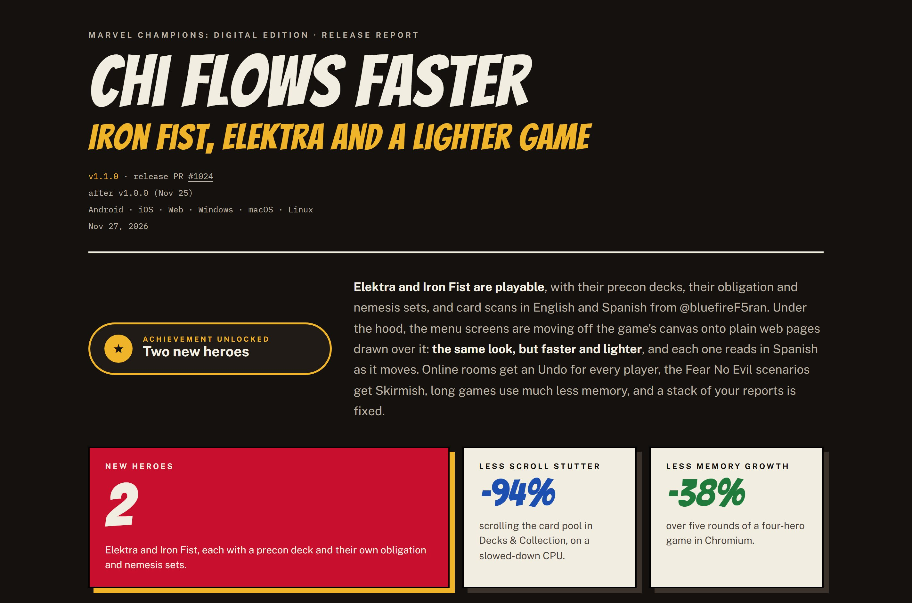

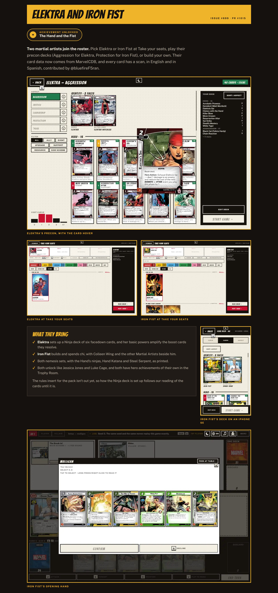

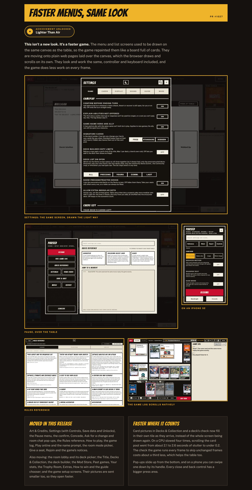

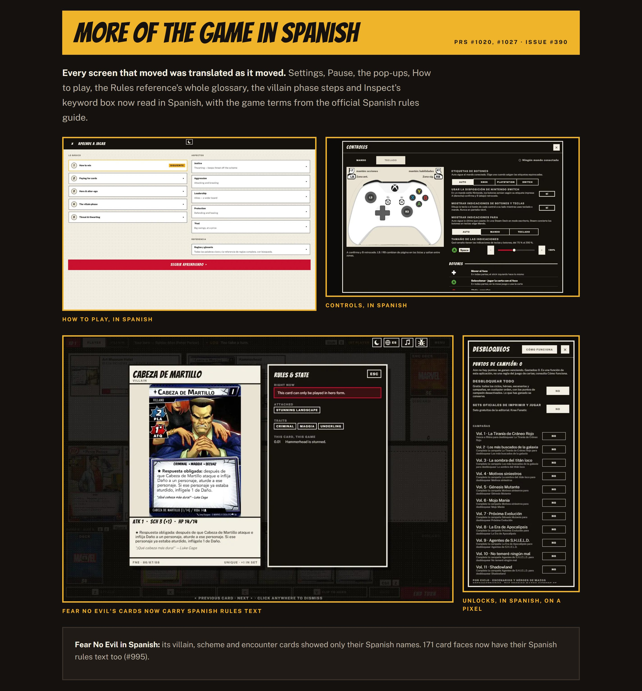

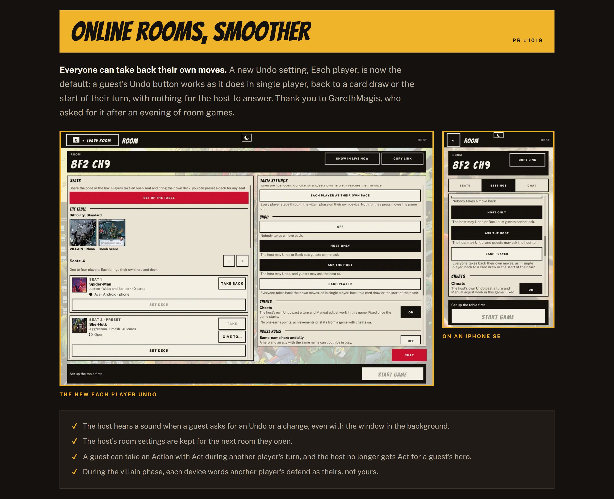

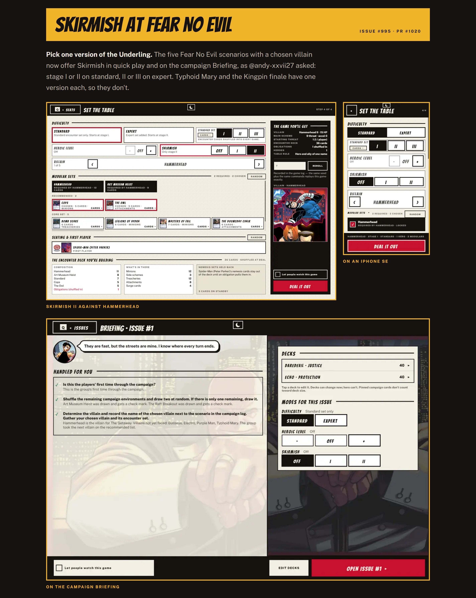

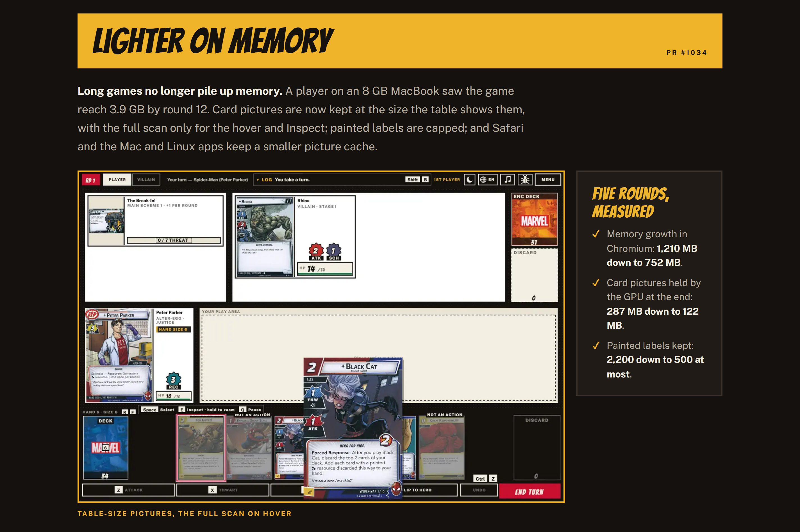

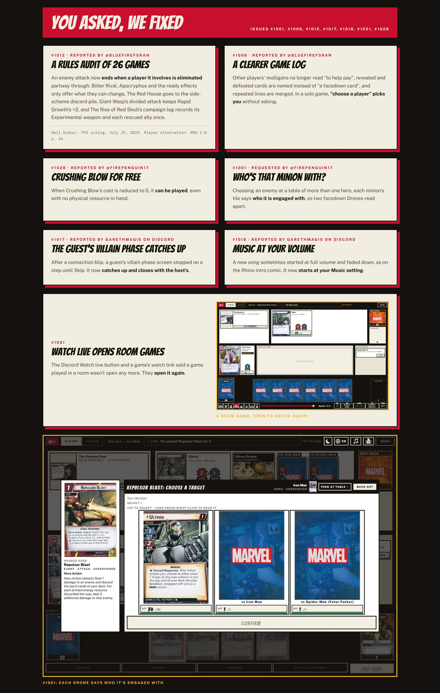

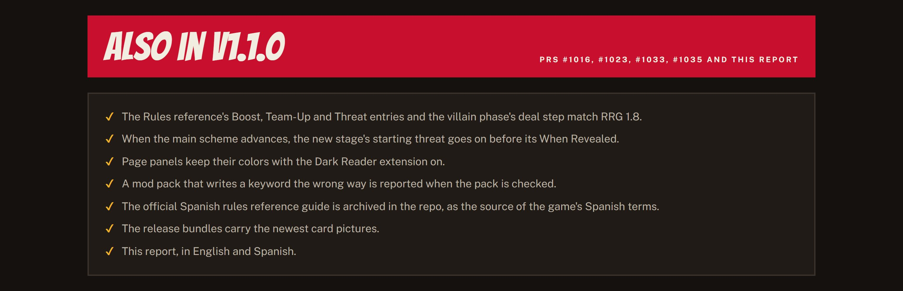

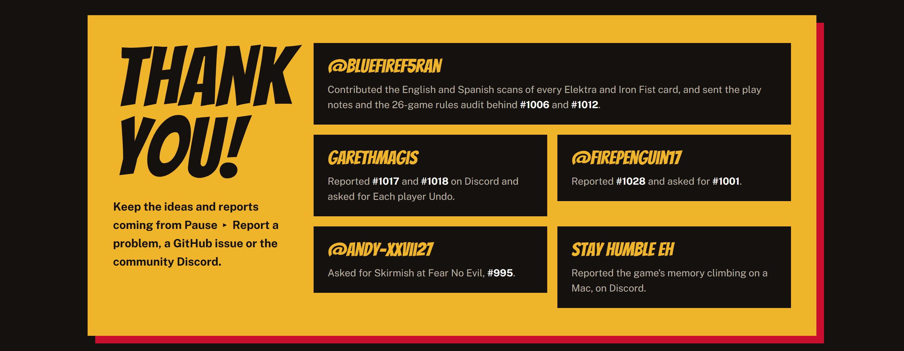

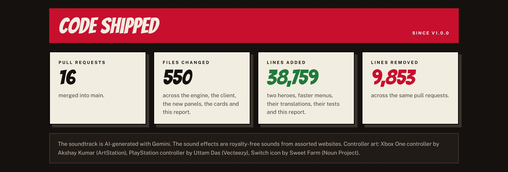

## [v1.1.0] - 2026-11-27

### Added

- Al elegir un enemigo para un efecto en una partida de más de un asiento, la casilla de cada esbirro dice con quién está enfrentado ("vs Iron Man"), así que dos Drones boca abajo se distinguen (issue #1001, reportado por @FirePenguin17).
- Elektra e Iron Fist ya se pueden jugar: los dos héroes, sus mazos preconstruidos (Aggression y Protection) y sus sets de obligación y némesis, con escaneos de las cartas en inglés y en español aportados por bluefireF5ran.
- Modo Skirmish en los escenarios de Fear No Evil, en partida rápida y en el Briefing de campaña: elige una versión del villano Underling elegido (no Typhoid Mary ni Kingpin, que tienen una sola versión) (#995).
- Salas en línea: un nuevo ajuste de Undo predeterminado, Each player, deja que cada uno deshaga sus propias jugadas como en un jugador (hasta robar una carta o el inicio de su turno), sin que el anfitrión tenga que responder nada (GarethMagis)
- Salas en línea: el anfitrión oye un sonido cuando un invitado pide un Undo o un cambio, y los ajustes de sala del anfitrión se guardan para la próxima sala (GarethMagis)
- Indicaciones de botones de mando y teclado en los paneles Lit, como un único componente compartido dibujado en SVG en línea, que se pliegan mientras se mueve el ratón, como antes.
- El informe de la versión v1.1.0 tiene su propia página en el sitio, en /releases/v1.1.0/

### Changed

- En una partida en solitario, "choose a player" te elige sin preguntar, y "discard your hand" (Enraged de Hulk) descarta sin pedir que elijas (#1006)
- El juego pasa menos tiempo en cada fotograma comprobando si la pantalla cambió, sobre todo en las pantallas de menú más cargadas.
- Art & Credits es la primera pantalla dibujada con componentes web Lit sobre la mesa de juego: texto y desplazamiento nativos, el mismo aspecto, y ahora se lee en español.
- Settings se dibuja con componentes web Lit sobre la mesa, con el mismo aspecto y la misma navegación con mando y teclado, y ahora se lee en español.
- El menú Pause de la partida se dibuja con componentes web Lit sobre la mesa, con el mismo aspecto y la misma navegación con mando y teclado, y ahora se lee en español.
- Las ventanas de confirmar, rendirse, pedir un cambio y el chat de la sala se dibujan con componentes web Lit, así que el menú Pause sigue a la vista debajo; su texto se lee en español.
- Rules reference y How to play se dibujan con componentes web Lit sobre la mesa, con el mismo aspecto y la misma navegación con mando y teclado, y el texto de sus pantallas se lee en español.
- El registro de la partida ahora se dibuja como un panel de página sobre la mesa (mismo aspecto), así que se desplaza de forma nativa, y su encabezado, botón de cerrar, aviso de líneas nuevas y etiquetas de estado también están en español.
- La pantalla Play online y la ventana del nombre en línea son paneles de página sobre el lienzo (mismo aspecto); Enter o A sobre un control desactivado mientras se conecta no hace nada, como un toque.
- El selector de modo de la sala, Give a seat, Rejoin y los avisos del juego son paneles de página sobre el lienzo (mismo aspecto), y los avisos y los motivos por los que una habilidad no está disponible se leen en español.
- Las filas de aspectos de How to play llevan la etiqueta de color del aspecto, ahora un componente compartido mc-aspect-chip
- Controls, Save data y Unlocks (con sus textos de sincronización, transferencia y cómo funciona) ahora se muestran en español
- Settings ▸ Unlocks ahora es un panel Lit sobre el lienzo, como Pause y Settings
- Settings ▸ Save data ahora es un panel Lit sobre el lienzo, con su código QR dibujado en el panel
- Settings ▸ Controls ahora es un panel Lit sobre el lienzo: el dibujo del mando es un SVG en línea y el control deslizante Hint size es parte de la hoja
- Las ventanas emergentes suben desde abajo y bajan al cerrarse, y en un teléfono se cierran deslizando hacia abajo desde su asa.
- La sala de espera (asientos, ajustes, chat, Start) es un panel Lit sobre el lienzo, con el mismo aspecto, listas con desplazamiento nativo y las paradas de mando y teclado de siempre
- El selector de mazos de la sala es un panel Lit sobre el lienzo, con los detalles del mazo como un panel que se desliza, y sus estadísticas y cantidades ahora se leen en español

### Fixed

- Un ataque enemigo ahora termina cuando un jugador involucrado queda eliminado a mitad de camino: no hace daño y no se le pregunta nada a ningún eliminado (#1012)
- El registro de campaña de The Rise of Red Skull anota un arma Experimental revelada en la preparación, y cada aliado rescatado una sola vez, incluido uno rescatado a la mano y nunca jugado (#1012)
- Registro de la partida: los mulligans y descartes por efecto de otros jugadores ya no dicen "to help pay"; las cartas reveladas y derrotadas se nombran en lugar de "a facedown card"; se añadieron líneas que faltaban, se unieron las repetidas (dureza, oleada, Temporary, contadores) y se dan motivos para el daño bloqueado y las cartas de encuentro repartidas por efectos (#1006)
- Packs de mods: una habilidad que escribe una palabra clave como texto suelto ("villainous" en lugar de { "name": "villainous" }) ahora se reporta al revisar el pack, en lugar de ignorar lo que otorga (#1012)
- Hail Hydra!: un jugador que defiende el ataque de Hydra contra otro jugador fue atacado y se salta la búsqueda; busca el jugador contra el que se hizo (resolución de FFG del 25 de julio de 2024; #1012)
- El ataque básico dividido de Giant Wasp se reparte a partir de su ATK final, así que el +2 de Rapid Growth ya no se pierde; un reparto parejo de Bombshell sigue siendo parejo (#1012)
- Salas en línea: la pantalla de la fase de villano de un invitado ya no se queda en un paso hasta pulsar Skip tras un corte de conexión; se pone al día, se cierra con la del anfitrión y describe la defensa de otro jugador como suya (#1017, reportado por GarethMagis)
- La música ya no empieza una canción nueva a todo volumen antes de bajar a tu ajuste de volumen, como en el cómic de introducción de Rhino (#1018, reportado por GarethMagis)
- La versión en español ahora muestra el texto de reglas en español en las cartas de villano, plan y encuentro de Fear No Evil, no solo sus nombres en español (#995).
- Salas en línea: un invitado puede hacer una acción con Act durante el turno de otro jugador; el anfitrión ya no recibe Act para el héroe de un invitado (GarethMagis)
- Watch live (el botón de Discord y el enlace para ver una partida) vuelve a abrir una partida jugada en una sala; decía que la partida ya no estaba abierta (#1021).
- Desplazar Decks & Collection y la revisión de un mazo ya no da tirones mientras cargan las imágenes de las cartas: cada imagen aparece en su propia casilla en lugar de volver a dibujar toda la pantalla.
- Menos crecimiento de memoria en partidas largas: las imágenes de las cartas se guardan al tamaño que muestra la mesa (tamaño completo solo para la vista ampliada e Inspect), las etiquetas pintadas tienen un límite de cantidad, y Safari y las apps de Mac y Linux guardan una caché de imágenes más pequeña.
- Crushing Blow se puede jugar gratis cuando su coste se reduce a 0, aunque no tengas un recurso [physical] en la mano (#1028).
- La entrada Boost de Rules reference ya no dice que los esbirros nunca reciben cartas de potenciación: un esbirro Villainous recibe una cada vez que usa un poder básico.
- Las entradas Team-Up y Threat de Rules reference y el paso de repartir de la fase de villano ahora coinciden con la RRG 1.8: un aliado cuenta para Team-Up, la amenaza completa una etapa del plan principal, y los iconos de peligro añaden una carta cada uno en orden de jugadores.
- Pulsar un interruptor en las listas Settings, Seats o Chat de la sala ya no devuelve la lista al principio.
- Los botones de esquina que se ocultan en un teléfono ya no recortan huecos transparentes en los paneles
- Los paneles de página conservan sus colores con la extensión Dark Reader activada (el juego se excluye de ella; usa el modo oscuro propio del juego).
- Rules reference se cierra con su propio Escape en lugar de salir también de How to play, el anillo del aviso se queda en el botón al que se movió, y el botón de cerrar del registro de la partida se encuentra en su primer dibujo
- Cada control de cerrar y volver de las hojas Lit ahora tiene un área de toque de 44px alrededor del control dibujado, así que los botones de cerrar de Pause, Settings, Rules reference, How to play, Controls, Save data, Unlocks y el registro de la partida son fáciles de pulsar en un teléfono

### Engine

- Cuando el plan principal avanza, la amenaza inicial de la nueva etapa se pone antes del When Revealed de su cara B; una elección que una carta de encuentro da cuando nadie la está resolviendo va al jugador inicial (#1012)
- Un ataque enemigo termina cuando cualquier jugador queda eliminado a mitad de camino, en sus ventanas de interrupción, su daño en cola y su daño indirecto o repartido en partes iguales; a un héroe eliminado nunca se le pide repartir ni asignar daño (#1012)

### Content

- Los datos de cartas de Elektra e Iron Fist ahora vienen de MarvelCDB: los números reales de las cartas de obligación y némesis, las cantidades de aspecto, la nueva Hand Katana, y el texto impreso de Hand Blademaster, Hand Archer, Steel Serpent, Crane Daughter y Lack of Chi.
- Bitter Rival y Apocryphus solo ofrecen personajes preparados para agotar; Friction Resistance y Always Be Running necesitan algo que preparar; Into the Fray necesita un esbirro; la interrupción de Starhawk solo se ofrece cuando aplica; el descarte de Tombstone es un descarte de verdad (#1012)
- The Red House va a la pila de descartes de planes secundarios; los entornos de Absorbing Man y Corvus Glaive ahora se resuelven después de un ataque sin defender hecho por una traición (#1012)
- El glosario de Rules reference, los pasos de la fase de villano, las lecciones, aspectos y páginas de cajas de How to play, y el cuadro de palabras clave de Inspect se leen en español, con los términos oficiales del juego en español.

### Docs

- Se quitan del repositorio las capturas del PR de Elektra e Iron Fist.
- La guía de referencia de reglas oficial en español (Asmodee España, 2019) está archivada en docs/rules/es con una copia de texto buscable, como fuente de los términos en español de la app.
- La copia en markdown de la guía de referencia de reglas en español ahora se hace con el mismo script de PDF a markdown que las inglesas.
