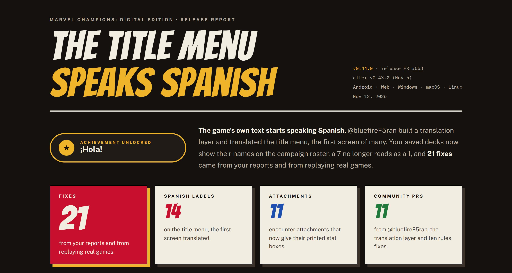
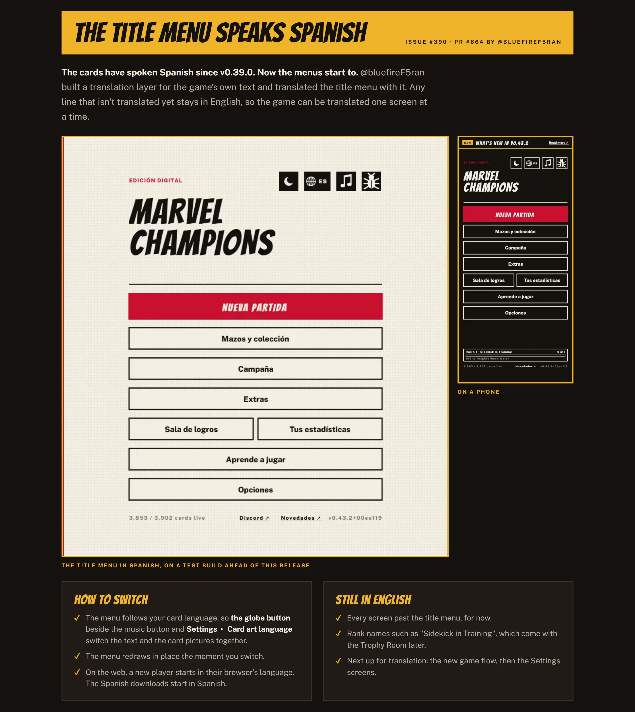
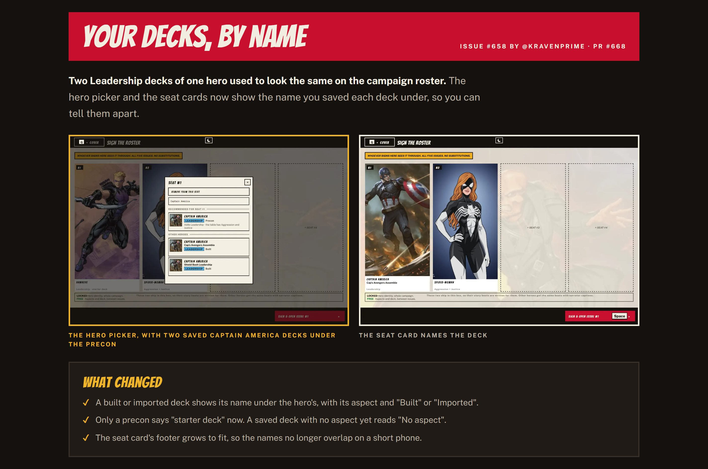
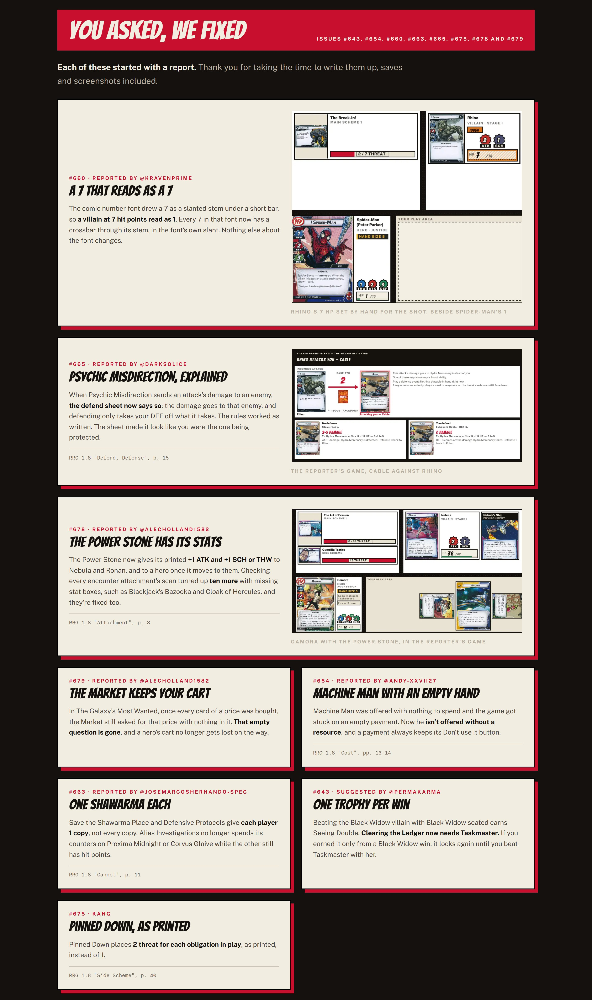
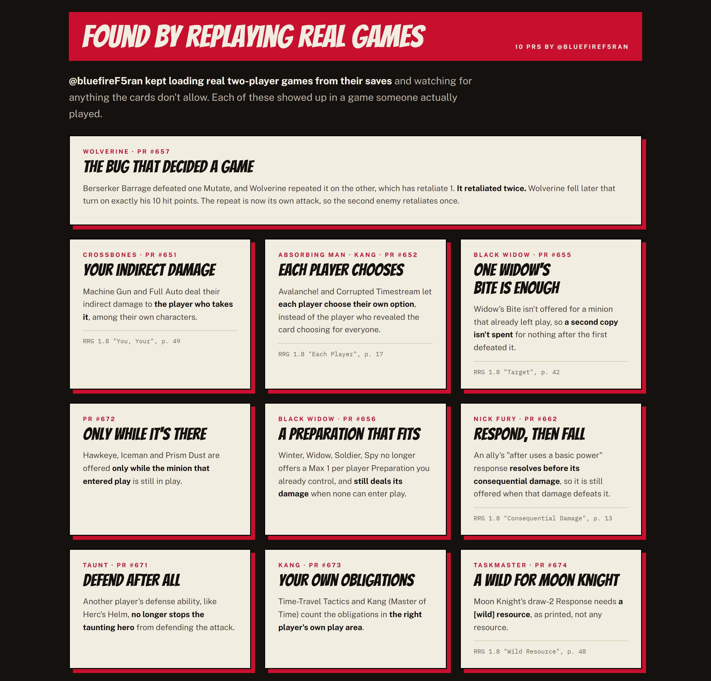
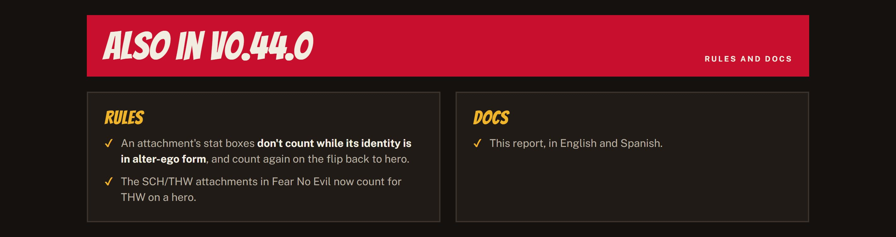
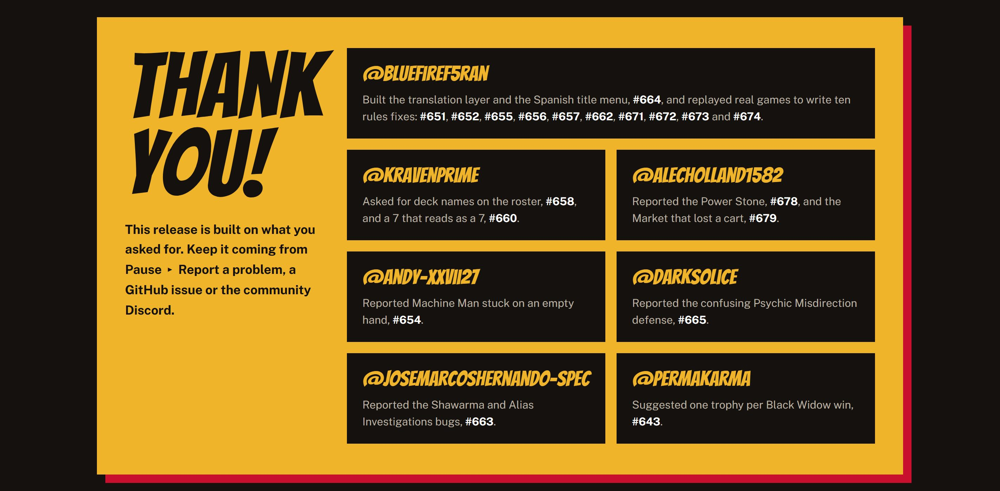
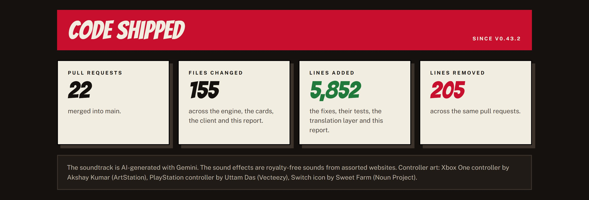

## The Title Menu Speaks Spanish

The game's own text starts speaking Spanish: @bluefireF5ran built a translation layer and translated the title menu with it (#390, #664). Your saved decks show their names on the campaign roster (#658) and a 7 no longer reads as a 1 (#660), both asked for by @Kravenprime. Twenty-one fixes came from reports by @AlecHolland1582, @andy-xxvii27, @Darksolice, @josemarcoshernando-spec and @PermaKarma, and from @bluefireF5ran replaying real games. Thank you!

**[Read the full v0.44.0 report on the site ↗](https://marvel-champions-digital-game.netlify.app/releases/v0.44.0/)**: the Spanish title menu, deck names on the roster, the fixes from your reports and from replayed games, and the thank-you wall.

**[Lee el informe completo en español ↗](https://marvel-champions-digital-game.netlify.app/releases/v0.44.0/index.es.html)**

