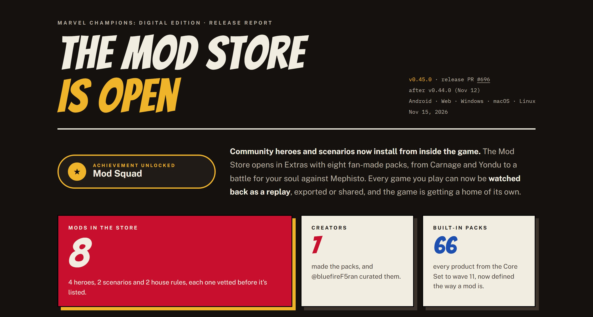
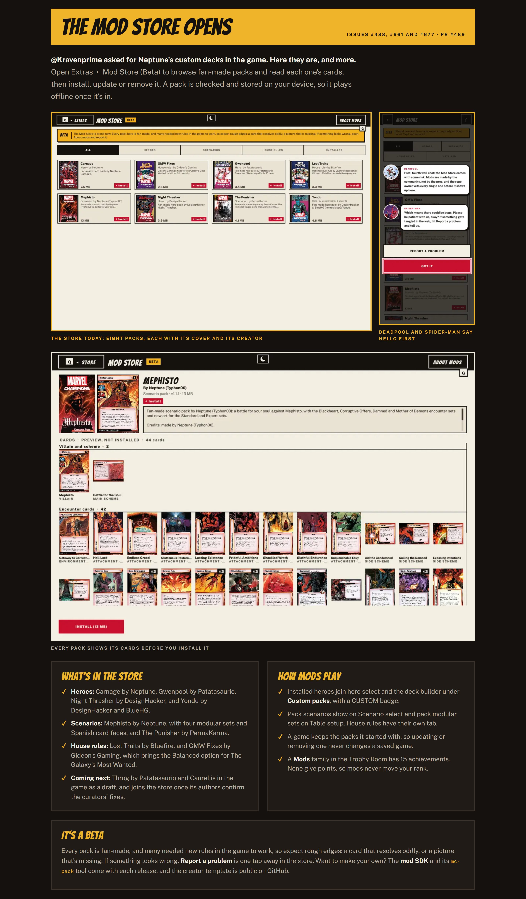
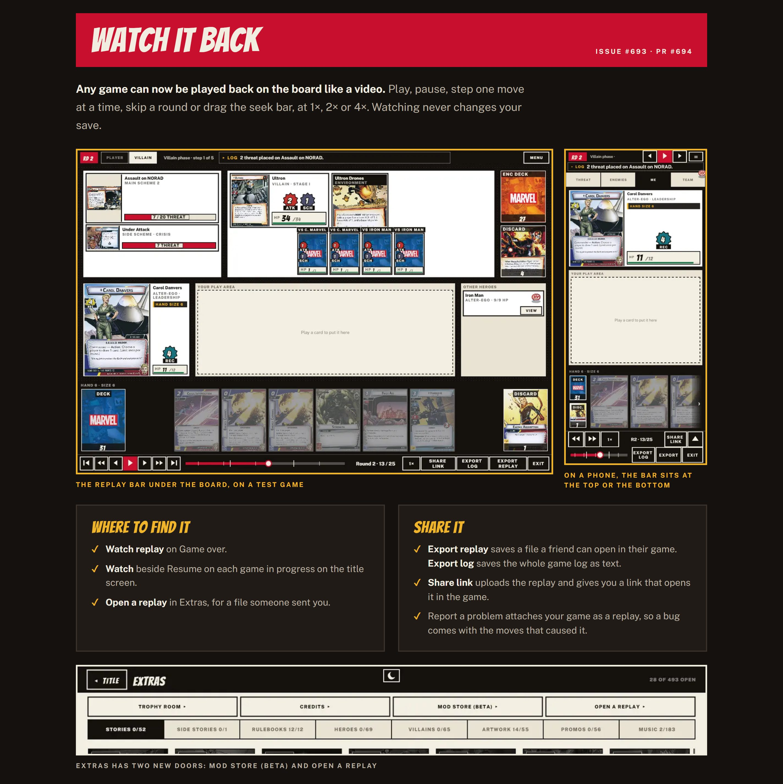
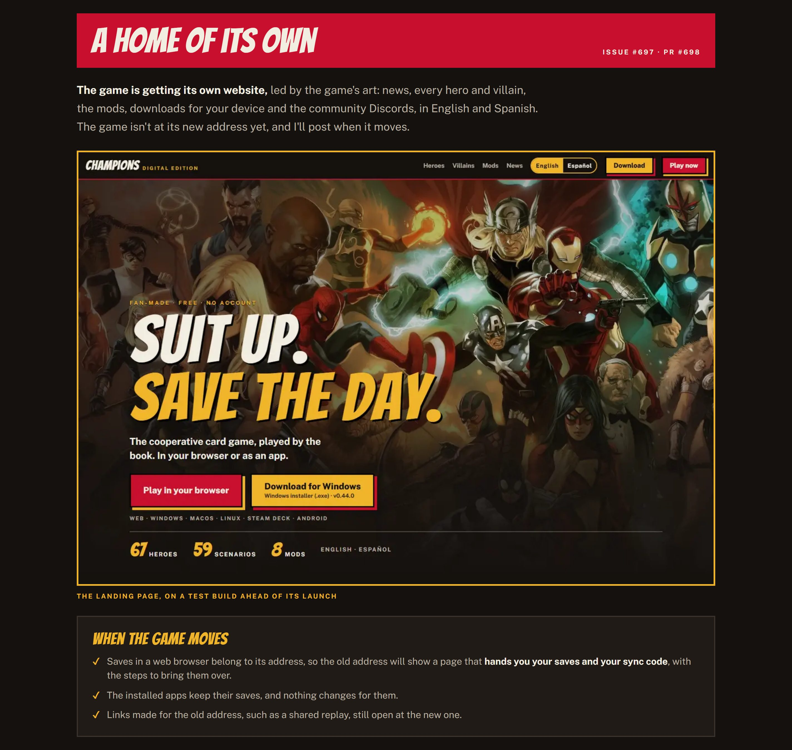
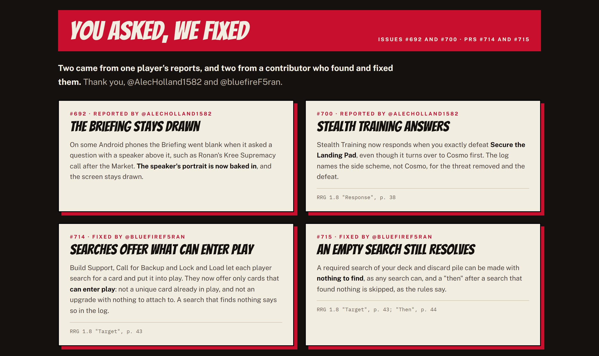
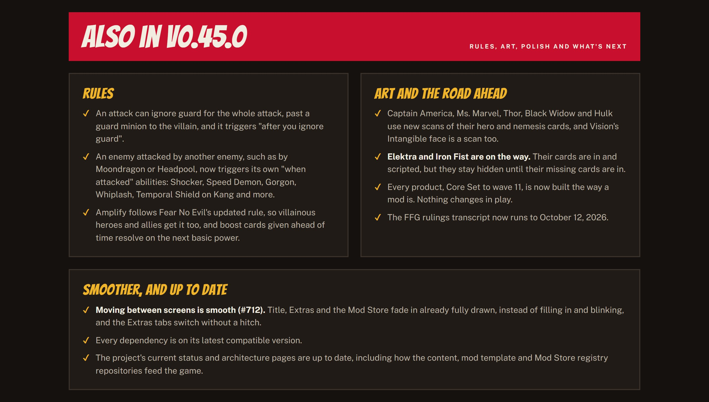
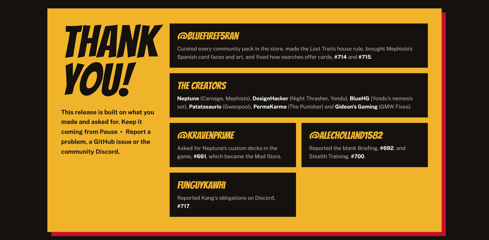
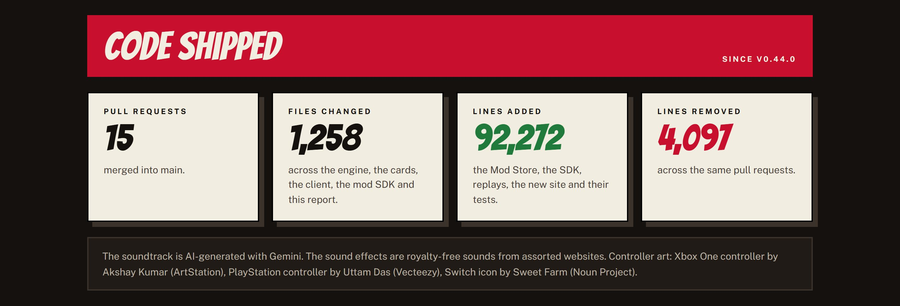

## The Mod Store Is Open

Community heroes and scenarios now install from inside the game: the Mod Store opens in Extras with eight fan-made packs by Neptune, DesignHacker, BlueHG, Patatasaurio, PermaKarma, Gideon's Gaming and Bluefire, curated by @bluefireF5ran and first asked for by @Kravenprime (#661, #677). Every game can now be watched back as a replay, exported or shared, and Past games lists every finished game to watch again (#693, #706), and the game has a website of its own, [champions-digital-game.com](https://champions-digital-game.com/) (#697). @AlecHolland1582 reported both fixes, the blank Briefing on Android (#692) and Stealth Training (#700). Elektra and Iron Fist are on the way. Thank you!

**[Read the full v0.45.0 report on the site ↗](https://champions-digital-game.com/releases/v0.45.0/)**: the Mod Store and its eight packs, replays and Past games, the new website, the fixes from your reports and the thank-you wall.

**[Lee el informe completo en español ↗](https://champions-digital-game.com/releases/v0.45.0/index.es.html)**

---

## [v0.45.0] - 2026-11-15

### Added

- Mod Store under Extras: browse, install, update and remove approved community content packs, verified and stored on the device, with installed pack heroes playable in games (#677)
- Mod SDK and the mc-pack CLI (validate, build, test, import-marvelcdb) for making custom packs, published to npm as @champions-digital-game/mod-sdk and attached to each release (#677)
- Custom packs can add scenarios, modular sets and side schemes, playable from Scenario select and Table setup, and linear campaigns of pack scenarios (#677)
- The Mod Store opens with a heads-up from Deadpool and Spider-Man: mods are community-made and vetted, bugs may happen, and Report a problem is one tap away
- Mod Store pack covers: an optional pack.json cover becomes the store thumbnail, in every language and offline once installed; every community pack has one
- Mod achievements: a Mods Trophy Room family with 15 built-in achievements (installing mods, community heroes, villains and campaigns, house rules) and pack-defined achievements from a data-only pack.json list; none give points, so mods never move rank
- Watch a game back as a replay, with play, pause, step, skip and a seek bar, and export it, or the game's log, as a file to share (#693).
- A moved page for the old web address that hands players their saves and sync code, and a landing page for champions-digital-game.com with news, heroes, mods, downloads and community links, in English and Spanish
- A hero pack can be marked not ready: its hero can't be picked or seated (decks show "Not ready yet"), and its cards stay out of deck building and import
- Elektra and Iron Fist hero pictures and an Iron Fist and Luke Cage team-up picture
- The v0.45.0 release report has its own page on the site, at /releases/v0.45.0/
- Past games: every finished game, listed from the Title with its villain, heroes and how it went, to watch again, share as a link or export (#706)

### Changed

- The Mod Store is marked Beta: a tag by its title, a caption box saying why above its packs, and Mod Store (Beta) on the Extras button
- Mod Store publishing: a community pack publishes only with a granted permission recorded in its pack.json (mc-pack validate --publish)
- Mod Store publishing: one publisher per pack id (source in index.json); the game repo refuses ids the registry owns
- Captain America, Ms. Marvel, Thor, Black Widow and Hulk use the owner's new scans of their hero and nemesis cards, and Vision's Intangible face shows the owner's scan instead of a photo
- Mod Store publish: versioned R2 uploads are immutable (every object checked first, conditional puts with sha256 metadata), so a race with the registry publisher never mixes files
- The landing page holds back a release's news and report screenshots until GitHub publishes it, and redeploys when a release is published so its downloads and news are current
- The landing page's bar names the game in full, Marvel Champions, with Digital Edition beside it, and its section links and language names make room on smaller screens
- The web game moves to https://marvel.champions-digital-game.com on Cloudflare: the apps' web-version, sync guide and Discord links point there, and the release reports open on the landing site

### Fixed

- Playing a Mod Store hero no longer leaves a blank screen at table setup, and a screen that fails to draw now says so with Back and Reload
- Mod Store heroes show the picture of the face that's up: alter-ego at the start, hero after changing form
- The Mod Store shows a pack's featured cards and tile picture in the game language when the pack has it (Gwenpool showed Spanish to English players)
- Mod Store publishing: a publish no longer lists a withdrawn pack again, latest follows SemVer order (beta.10 after beta.2), the shared index.json is written with an ETag check and retried when the registry wrote in between, and pack code (mc-pack build, the SDK smoke test) runs in jobs without secrets
- The Mod Store's pack tiles and card pictures, and the Extras tiles, show the hand cursor on hover
- The Briefing no longer goes blank on some Android phones when it asks a question with a speaker above it, such as Ronan's Kree Supremacy call after the Market (#692)
- Stealth Training now responds when you exactly defeat Secure the Landing Pad, and the log names the side scheme instead of Cosmo for the threat removed and the defeat (#700)

### Engine

- Engine primitives for custom content: damage reduction limited to undefended villain or villainous attacks (Agile), the last card played this round, and per-player text box blanking
- Engine primitives for custom content: tagged abilities resolved, counted and filtered by tag, another player phase in place of the next villain phase within the same round, and a keyword or trait lost by one card until the end of the round
- A random pick among cards in play, used by the Gwenpool community pack's updated Hello Again
- Engine primitives for the Mephisto scenario pack: facedown scenario areas with random picks and a set-aside redirect, stat doubling, a per-attack damage floor, wild-only resource generation, facedown minions from the discard pile
- A trigger for a card put into a scenario area, a card applied as a boost card of one activation, and the damage floor holding over partial prevention
- A Boost ability can cancel the activation it is boosting (cancelBoostedActivation); Mephisto's Blackheart now cancels the attack or scheme as printed (pack 1.0.1)
- Engine pieces for the Yondu pack: upgrades that attach only while in play, a 'removed from a host' event, 'the next card you spend counts double', 'upgrades cannot be removed from this card', and a find that searches everywhere
- Boost abilities can be ignored while their icons count, boost icons can count multiple times, minions can activate before the villain, and 'cannot be stunned' can name the source. An enemy's attack on another enemy (Moondragon, Headpool, The Punisher) now triggers that enemy's own 'when/after this card is attacked' abilities that name no attacker: Shocker, Speed Demon (who attacks back), Gorgon, Sebastian Shaw, Sidewinder (not dealt away: there is no attacking player), Whiplash, Temporal Shield on Kang, and a villain under Krahllak's Blessing attacks the minion that damaged it. Cards that name the attacker (Black Widow's 'a character you control') still ignore it, and a forced encounter ability nobody resolves now pays a self-discard or counter cost instead of resolving for free
- The Core Set and wave 1's eight products are defined as built-in packs in the mod SDK's shape, still compiled into the app, and CI checks them with the SDK's own validation. Nothing changes in play.
- An attack can ignore guard for the whole attack, so Throg's Hammer Throw hits the villain past a guard minion; an (attack) ability's attack now triggers 'after you ignore guard'
- House-rule pack kind for the Mod Store: data-only rules that add traits to official cards or enable a scripted mode, with their own House rules tab
- Waves 2 and 3's twelve products are defined as built-in packs too, with each wave's reprint scripts in the pack that holds the card. Nothing changes in play.
- Each wave 1 to 3 product's index.ts is folded into its built-in pack.ts, and the three waves' reprint alias builders are one shared builder.
- Waves 4 to 11 are built-in packs too, so every product of the base game is defined the way a mod pack is. Nothing changes in play.
- Amplify adds to any character's boost card resolved during a basic power (Fear No Evil's updated rule), so villainous heroes and allies get it too
- Facedown boost cards given to a character ahead of time resolve on its next basic power, and a defending hero chooses whose boost cards turn up first
- Boost-card timing for villainous heroes and allies: "would" interrupts to a basic attack or thwart come first, then the villainous card is given, then other "uses a basic power" interrupts; an ally's defense no longer counts as using a basic power
- New effects for the Elektra and Iron Fist cards: shuffle a hero's side deck of encounter cards into the encounter deck, cancel a boost card's Boost, discard an enemy's facedown boost cards, shuffle into the top N of the encounter deck, exactly defend, and resources spendable for another player by a condition; reductions to an attack ability's damage reduce each instance

### Content

- Community packs scripted for the Mod Store: Carnage (Neptune), Night Thrasher (DesignHacker) and Gwenpool (PatataSaurio), curated by BluefireF5ran
- Gwenpool's suggested precon now uses the 'Pool aspect (Gwenpool 0.2.0)
- Community scenario Mephisto by Neptune: every card scripted with its four modular sets, Damnation and Bargain attachments
- The Punisher, a community scenario by PermaKarma (curated by BluefireF5ran), imported as a draft until its author confirms the curators' fixes
- Yondu, a community hero pack by DesignHacker and BlueHG (curated by BluefireF5ran), scripted with its Yaka Arrow
- Throg, a community hero pack by Patatasaurio and Caurel (curated by BluefireF5ran), imported as a draft until the authors confirm the curators' fixes
- Mephisto 1.1.0: Spanish card faces and Spanish Standard/Expert art from BluefireF5ran's curation; Lilin Remaking is not unique
- Lost Traits and GMW Fixes house-rule packs; the Balanced option for Galaxy's Most Wanted now comes with the GMW Fixes pack
- Mephisto 1.1.1 follows its author's rulings: Slothful Endurance prevents attacks below the doubled DEF, and Alter the Deal just shuffles back when you control no Bargain
- Gwenpool 0.2.2: the corrected That's Not How the Game Ends face (both wild resources, the whole corner headshot)
- Elektra (MC63) and Iron Fist (MC64) hero pack cards are in the card pool, transcribed from Hall of Heroes and FFG previews, with provisional obligation and nemesis cards; both heroes are marked not ready
- The Punisher 0.2.0 follows the author's V3.0: Rachel Cole-Alves attaches to War on Crime instead of engaging a player, a star on Frank's War 1B, new flavor and pictures; Mephisto 1.1.2 has two corrected Spanish faces

### Docs

- Design proposal for downloadable custom content packs (fan heroes and scenarios outside the app build)
- The post-1.7 rulings transcript now runs to October 12, 2026
- Removed the mod store's leftover PR screenshots from docs/pr-screenshots.
- The v0.45.0 release report and announcement cover Past games next to replays

### Special thanks

- @AlecHolland1582 reported #692 and #700.
- @Kravenprime reported #661.
