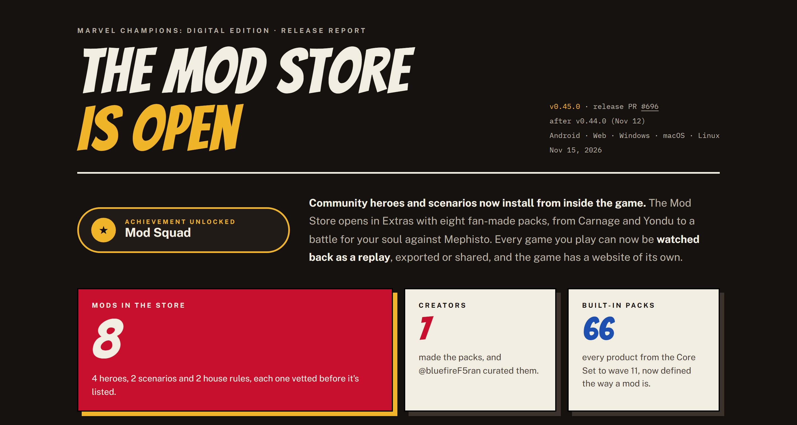
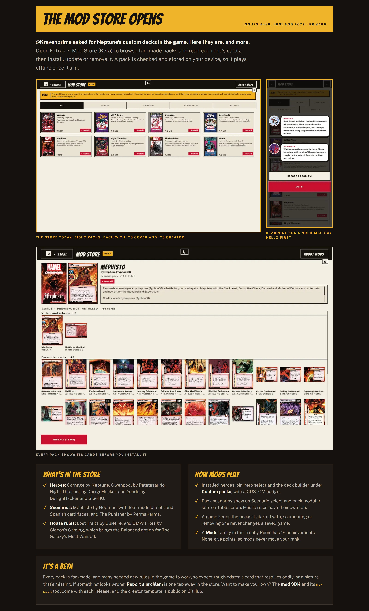
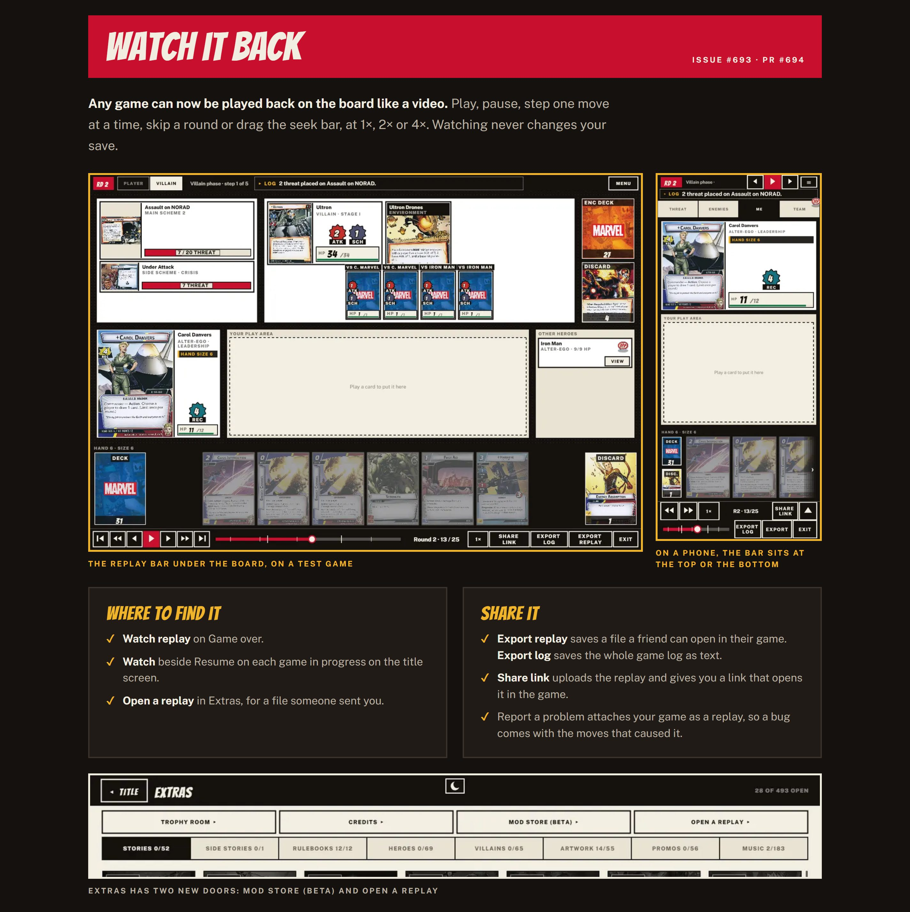
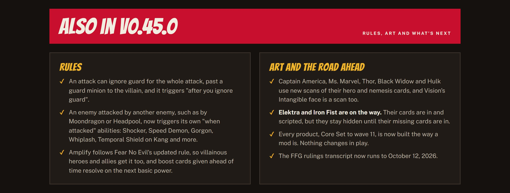
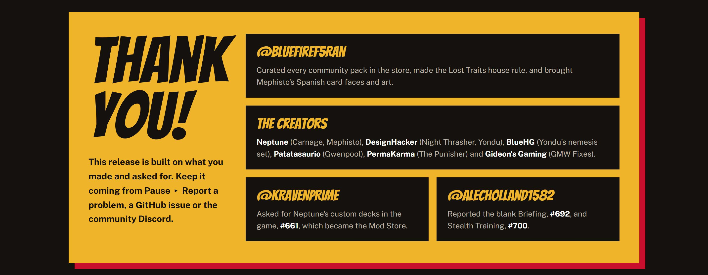
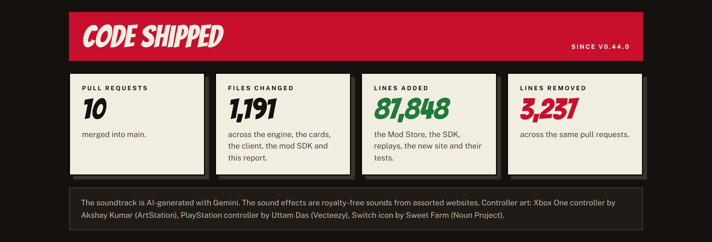

## The Mod Store Is Open

Community heroes and scenarios now install from inside the game: the Mod Store opens in Extras with eight fan-made packs by Neptune, DesignHacker, BlueHG, Patatasaurio, PermaKarma, Gideon's Gaming and Bluefire, curated by @bluefireF5ran and first asked for by @Kravenprime (#661, #677). Every game can now be watched back as a replay, exported or shared (#693), and the game has a website of its own, [champions-digital-game.com](https://champions-digital-game.com/) (#697). @AlecHolland1582 reported both fixes, the blank Briefing on Android (#692) and Stealth Training (#700). Elektra and Iron Fist are on the way. Thank you!

**[Read the full v0.45.0 report on the site ↗](https://champions-digital-game.com/releases/v0.45.0/)**: the Mod Store and its eight packs, replays, the new website, the fixes from your reports and the thank-you wall.

**[Lee el informe completo en español ↗](https://champions-digital-game.com/releases/v0.45.0/index.es.html)**

