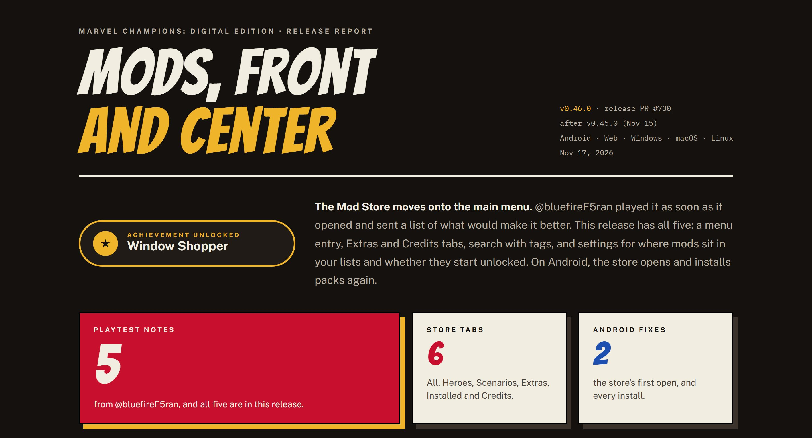
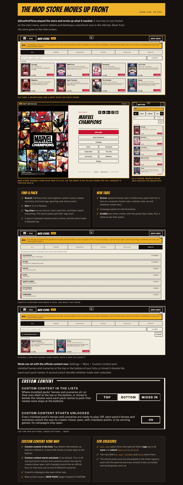
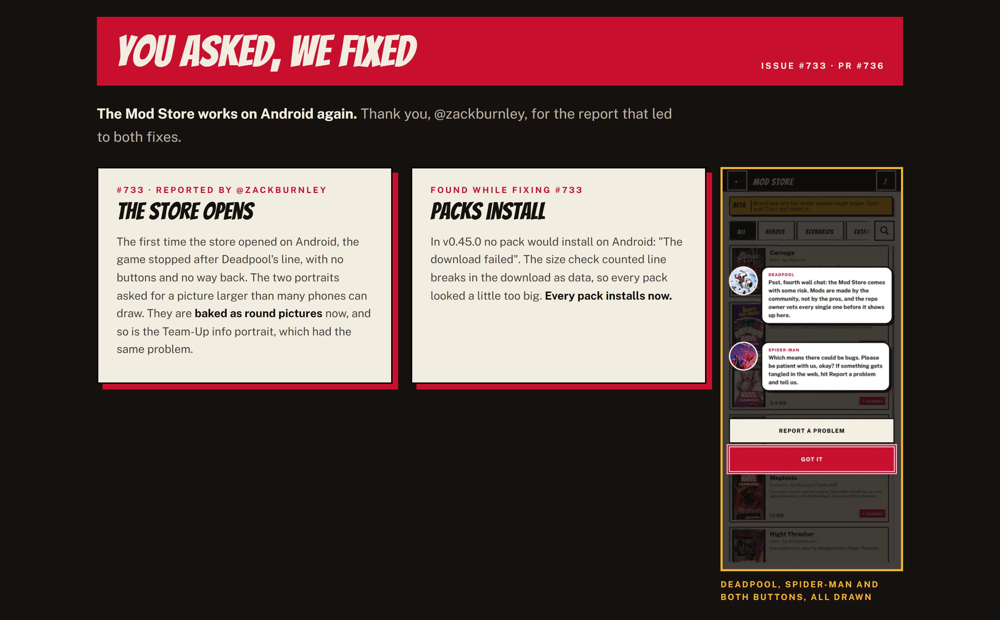
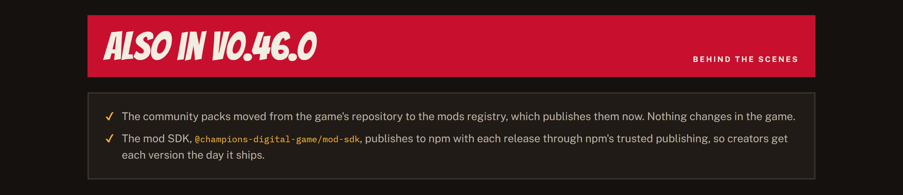
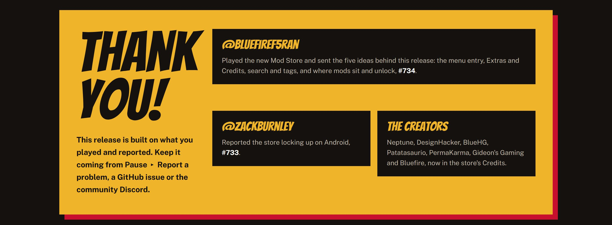
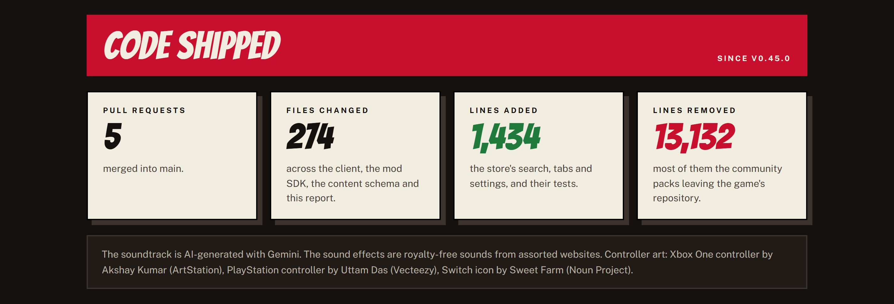

## Mods, Front and Center

The Mod Store moves onto the main menu, with everything @bluefireF5ran asked for after playing it (#734): a storefront button on the title screen, Extras and Credits tabs, a search box with tag chips and a sort, and settings that put mods beside the official heroes and scenarios and choose whether they start unlocked. Creators get three new optional pack.json fields, tags, wave and unlock, and the store's packs now publish from the mods registry with their ids and versions intact. On Android, the store opens again and packs install again, after @zackburnley's report (#733). Thank you!

**[Read the full v0.46.0 report on the site ↗](https://champions-digital-game.com/releases/v0.46.0/)**: the Mod Store on the main menu, search, tags and Credits, the custom content settings, the Android fixes and the thank-you wall.

**[Lee el informe completo en español ↗](https://champions-digital-game.com/releases/v0.46.0/index.es.html)**

---

## [v0.46.0] - 2026-11-16

### Added

- The Mod Store is on the main menu (and a storefront button beside the music on tablets and desktops), with an Extras tab for house rules and other add-ons, a Credits tab for the creators, and a search box, sort and tag chips. Thanks to bluefireF5ran for the playtest notes (#734).
- Settings > More > Custom content: put installed packs' heroes and scenarios at the top, the bottom or mixed in beside the wave a pack names, and choose whether custom content starts unlocked or unlocks the way its creator chose (champion points or wins). Custom content now carries a MOD PACK badge (#734).
- The v0.46.0 release report has its own page on the site, at /releases/v0.46.0/

### Changed

- The mod SDK publishes to npm through npm trusted publishing instead of an npm token
- The community content packs (Carnage, Gwenpool, Mephisto, Night Thrasher, The Punisher, Yondu, Lost Traits, GMW Fixes and the Throg draft) moved to the Mod Store registry repo, which publishes them now; the game repo fetches them for its tests with pnpm packs:fetch.

### Fixed

- The Mod Store no longer locks up on Android phones the first time it opens: the notice's round portraits of Deadpool and Spider-Man are baked as discs instead of drawn through a circular mask, which stopped the game drawing after Deadpool's line (#733). The Team-Up info portraits get the same fix.
- Mod Store installs work on Android again: the download size check counted the line breaks in Android's base64 body as data, so every pack looked about 1% larger than its catalog size and was refused.
- The e2e spec for PageDown on Take your seats presses RB again when the first press lands in the frames the pad guard drops, instead of failing under a loaded suite.

### Content

- Mod packs can set their own store search tags, the release wave their heroes and scenarios sit beside, and how they unlock when custom content does not start unlocked (#734).

### Docs

- The v0.45.0 release notes in Spanish carry the twelve changelog lines that landed after they were written

### Special thanks

- @zackburnley reported #733.
