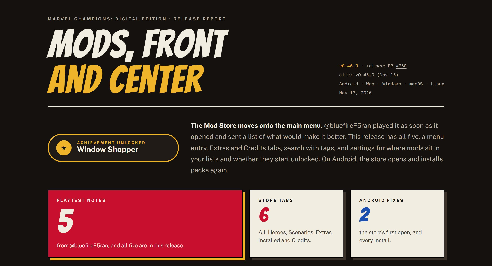
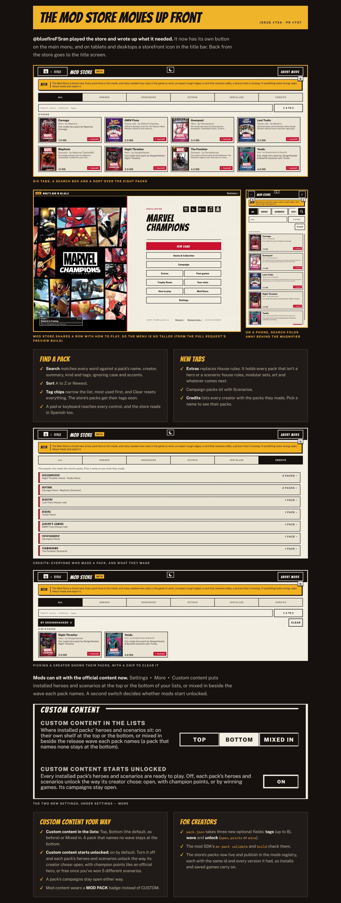
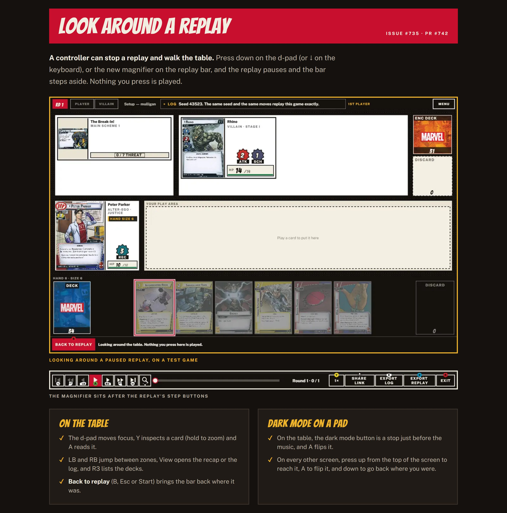
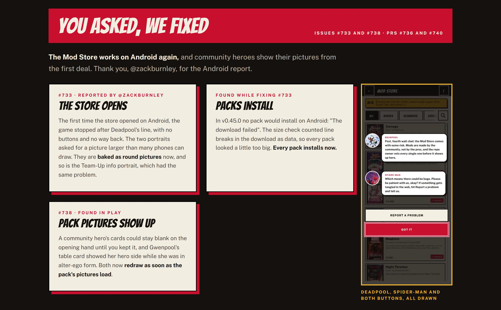
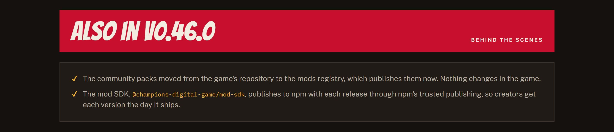
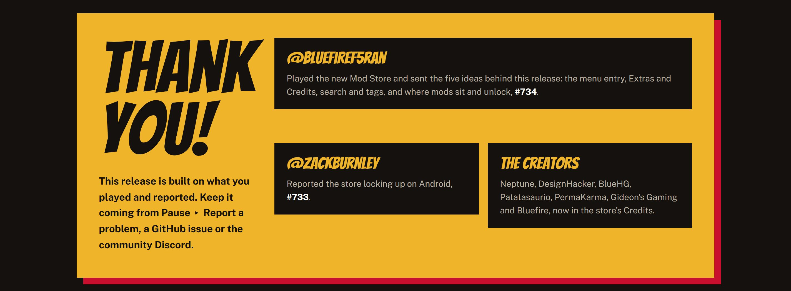
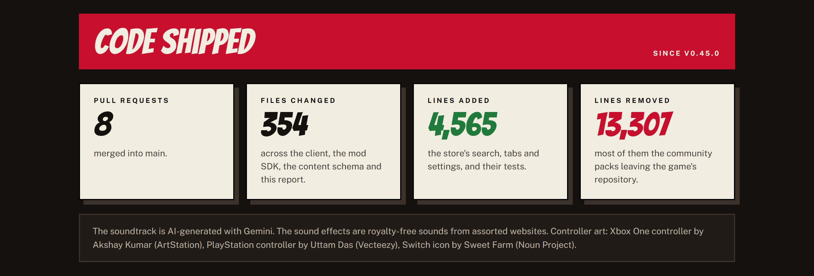

## Mods, Front and Center

The Mod Store moves onto the main menu, with everything @bluefireF5ran asked for after playing it (#734): a storefront button on the title screen, Extras and Credits tabs, a search box with tag chips and a sort, and settings that put mods beside the official heroes and scenarios and choose whether they start unlocked. Creators get three new optional pack.json fields, tags, wave and unlock, and the store's packs now publish from the mods registry with their ids and versions intact. On Android, the store opens again and packs install again, after @zackburnley's report (#733), and a community hero's cards show their pictures from the first deal instead of staying blank on the opening hand (#738). A controller can now pause a replay and look around the table, and reach the dark mode button on every screen (#735). Thank you!

**[Read the full v0.46.0 report on the site ↗](https://champions-digital-game.com/releases/v0.46.0/)**: the Mod Store on the main menu, search, tags and Credits, the custom content settings, looking around a replay with a controller, the Android and pack picture fixes and the thank-you wall.

**[Lee el informe completo en español ↗](https://champions-digital-game.com/releases/v0.46.0/index.es.html)**

