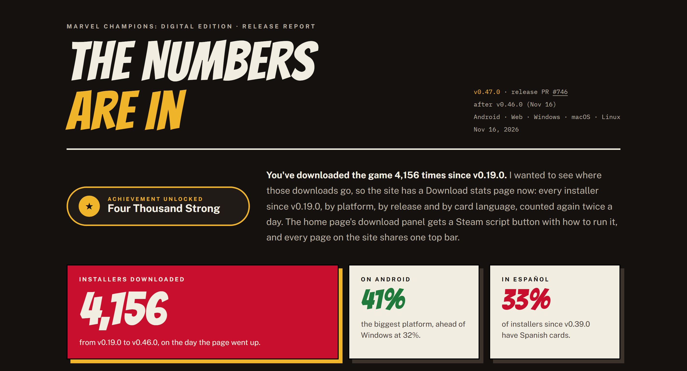
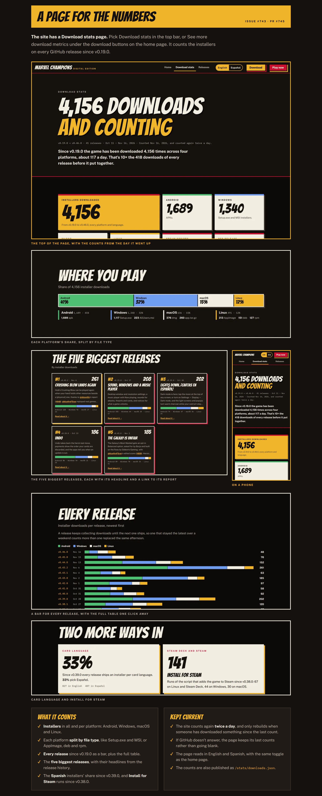
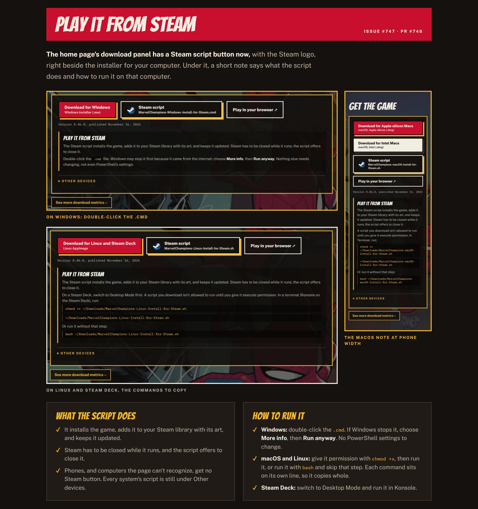
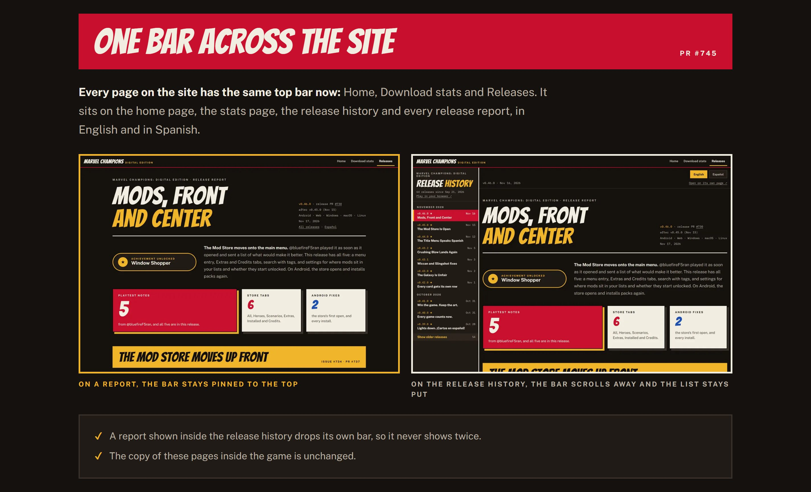
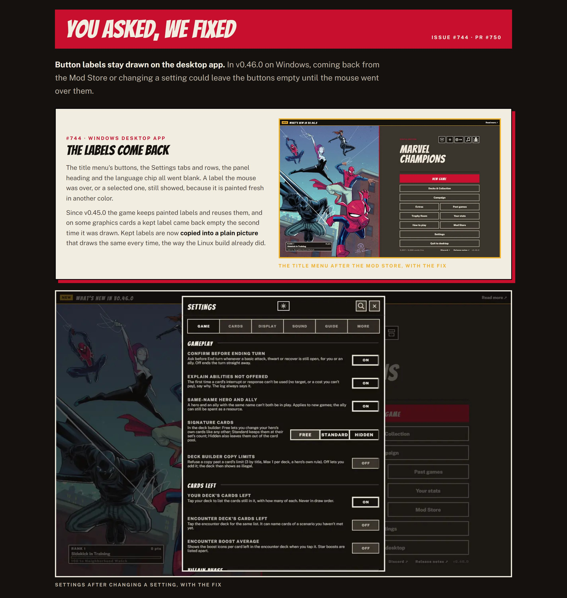
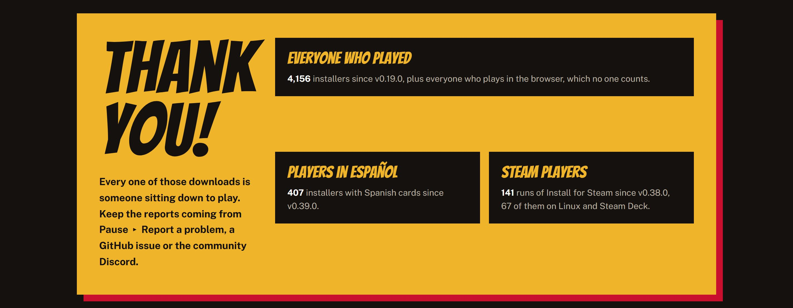
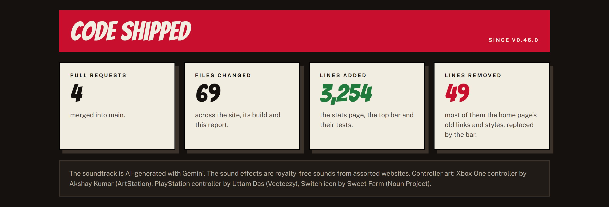

## The Numbers Are In

You've downloaded the game 4,156 times since v0.19.0, so the site has a Download stats page now (#743, #745): every installer by platform, by release and by card language, the five biggest releases with their headlines, and the Install for Steam runs, counted again twice a day whenever the numbers move. Android leads with 41%, and a third of installers since v0.39.0 have Spanish cards. The home page's download panel gets a Steam script button beside the installer, with how to run it on Windows, macOS, Linux and Steam Deck (#747, #748). Every page on the site, from the home page to the release history and each report, shares one top bar with Home, Download stats and Releases. On the Windows desktop app, button labels no longer go blank after the Mod Store or a settings change, which Stay Humble Eh reported on Discord (#744, #750). Thank you for playing!

**[Read the full v0.47.0 report on the site ↗](https://champions-digital-game.com/releases/v0.47.0/)**: the Download stats page, where you play, every release's bar, the top five, the Steam script button, the shared top bar, the blank labels fix and the thank-you wall.

**[Lee el informe completo en español ↗](https://champions-digital-game.com/releases/v0.47.0/index.es.html)**

