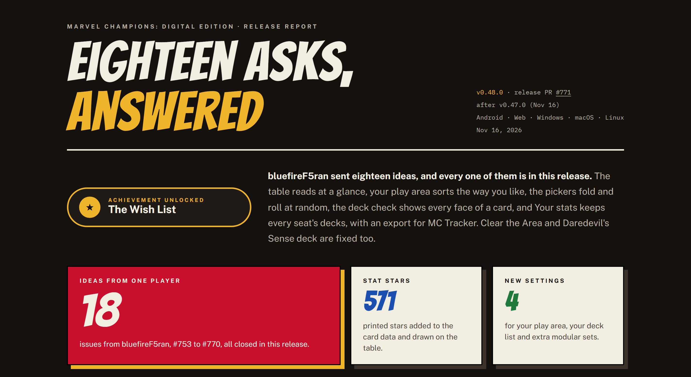
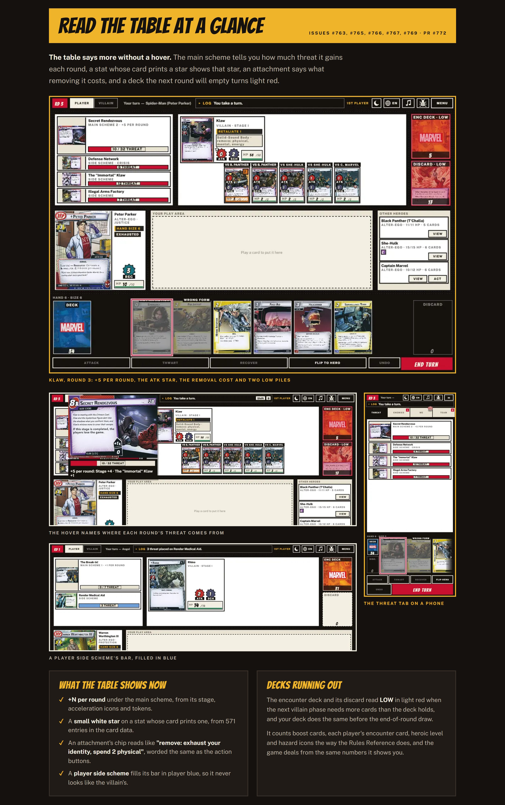
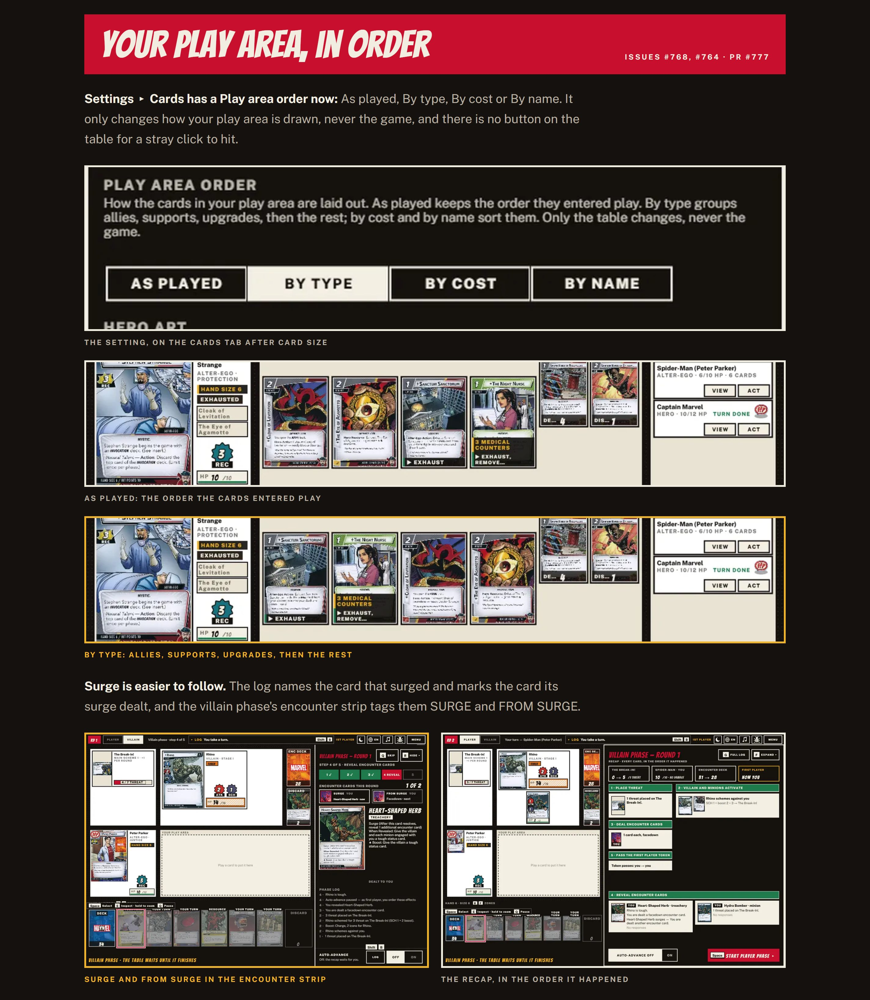
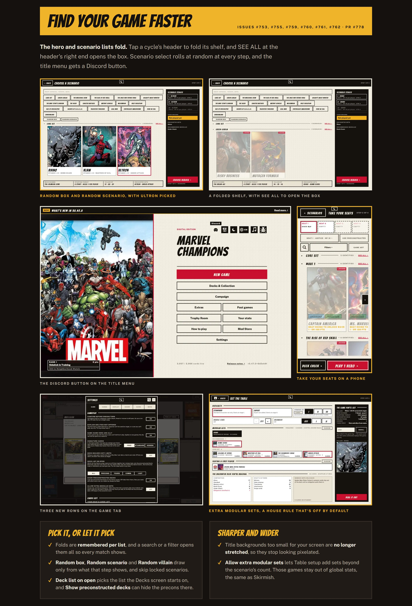
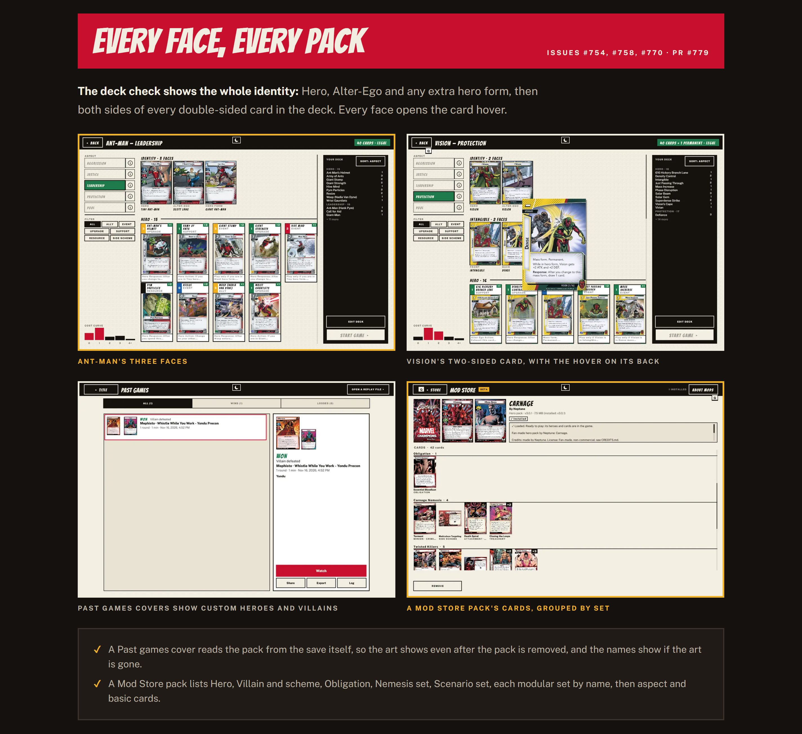
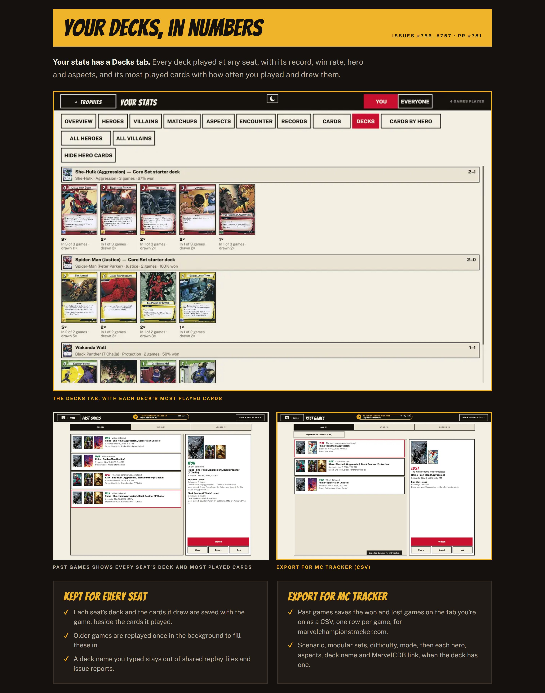
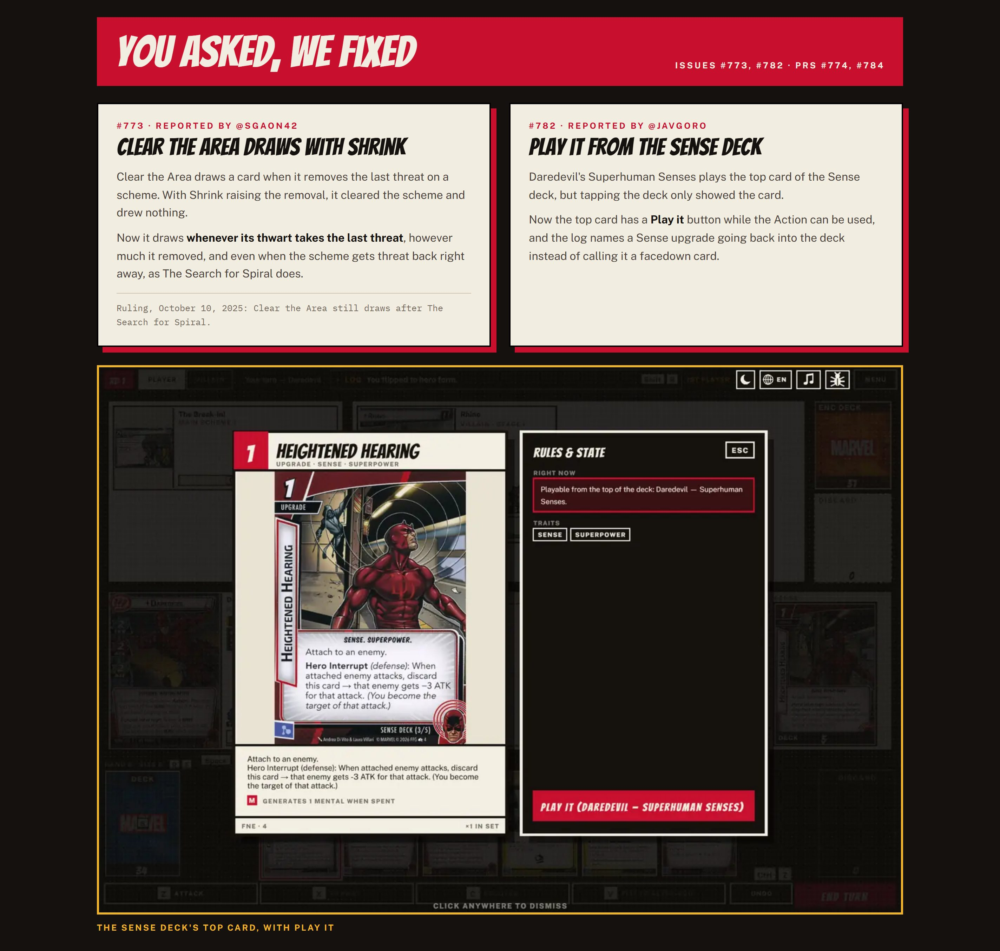
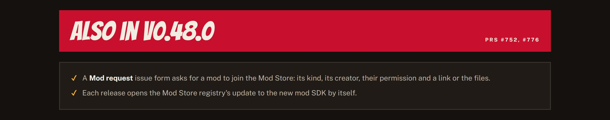
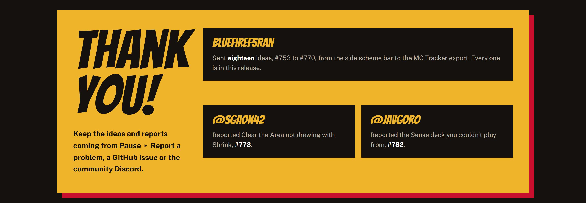
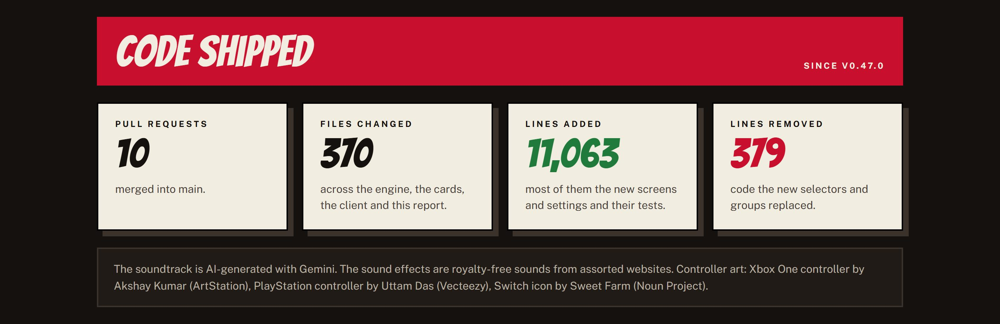

## With Great Reports Comes Great Patching

bluefireF5ran sent eighteen ideas, #753 to #770, and every one of them is in this release. The table reads at a glance: the main scheme says how much threat it gains each round, stats show their printed star, an attachment says what removing it costs and a deck about to run out turns red (#772). Play area order sorts your play area, and surge is marked in the log and the recap (#777). The hero and scenario lists fold and pick at random, the title menu has a Discord button, and three new settings cover deck lists and extra modular sets (#778). The deck check shows every face of a card, Past games covers show custom packs, and the Mod Store groups cards by set (#779). Your stats has a Decks tab for every seat, and Past games exports your games for MC Tracker (#781). Clear the Area draws with Shrink, thanks to @sgaon42's report (#773), and Daredevil's Sense deck has a Play it button, thanks to @javgoro's report (#782), and Mod Store scenarios get every difficulty, thanks to @zackburnley (#786). Thank you for playing!

**[Read the full v0.48.0 report on the site ↗](https://champions-digital-game.com/releases/v0.48.0/)**: the clearer table, play area order and surge marks, folding shelves and Random picks, every card face, the Decks tab and the MC Tracker export, the fixes, including every difficulty for Mod Store scenarios, and the thank-you wall.

**[Lee el informe completo en español ↗](https://champions-digital-game.com/releases/v0.48.0/index.es.html)**

---

## [v0.48.0] - 2026-11-17

### Added

- Each release now opens the Mod Store registry's pull request bumping its mod SDK to the version just published to npm, or moves the open one to it.
- The main scheme shows how much threat it gains each round, with the sources on hover (#765)
- The table draws the printed star beside a stat whose card prints one (#766)
- An encounter attachment's chip says what removing it costs (#767)
- The encounter deck and a player's deck turn light red when the next round will empty them (#769)
- A Play area order setting (as played, by type, by cost or by name) arranges the cards in your play area without moving anything on the table (#768)
- A Mod request issue form asks for a mod to be added to the Mod Store: its kind, its creator, their permission and a download link or attached files.
- Hero and scenario lists: tap a cycle's header to fold or unfold its shelf, remembered per list; SEE ALL at the header's right end opens the box (#753)
- Scenario select: Random box, Random scenario and Random villain choices at each step of picking a scenario (#762)
- Title menu: a Discord icon beside the Mod Store button opens the community server (#759)
- Deck list on open and Show preconstructed decks settings choose which Decks list opens first and can hide the preconstructed decks (#755)
- An Allow extra modular sets house rule lets Table setup add modular sets beyond the number a scenario calls for; off by default (#761)
- Deck check (and the deck builder's Review): shows the identity's hero, alter-ego and extra hero forms, and every face of a double-sided card, each with the card hover (#754)
- Mod Store: a pack's page groups its cards by set: hero, obligation, nemesis set, and each modular set under its own name (#770)
- Your stats has a Decks tab with every deck played at any seat (record, most played cards, draws), and Past games shows each seat's deck, aspects and most played cards (#756)
- Past games: Export for MC Tracker (CSV) saves your finished games as a spreadsheet for marvelchampionstracker.com (#757)
- The v0.48.0 release report has its own page on the site, at /releases/v0.48.0/
- Attachment chips show the removal cost as resource and hero icons, with the words in the hover (#767)

### Fixed

- A player side scheme's threat bar is filled in a player blue instead of drawn blank (#763)
- Clear the Area draws its card when a thwart raised by Shrink removes a scheme's last threat (#773)
- The log and the villain phase recap name the card that surged and mark the card its surge dealt (#764)
- Title backgrounds too small for the screen are no longer picked, so they stop looking pixelated (#760)
- Past games: a game played with a custom hero or scenario pack shows the pack's hero and villain on its cover, with their names if the pack has since been removed (#758)
- Daredevil's Sense deck top card now offers Play it, which runs Superhuman Senses, so a Sense upgrade can be played from the deck (#782, reported by @javgoro).
- The log names a Sense upgrade that goes back into Daredevil's Sense deck instead of calling it a facedown card (#782).
- Mod Store pack scenarios now offer every difficulty choice official scenarios have at Set the Table (Standard II and III, Expert II on expert, and skirmish mode) (#786).

### Content

- Card data records the printed star beside a stat (#766)

### Special thanks

- @bluefireF5ran reported #753, #754, #755, #756, #757, #758, #759, #760, #761, #762, #763, #764, #765, #766, #767, #768, #769 and #770.
- @javgoro reported #782.
- @sgaon42 reported #773.
- @zackburnley reported #786 on Discord.
