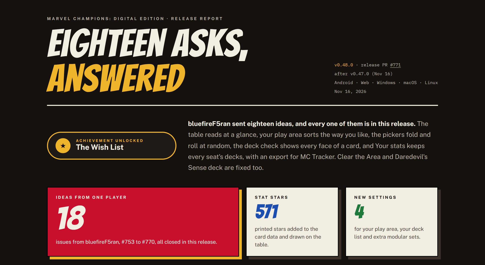
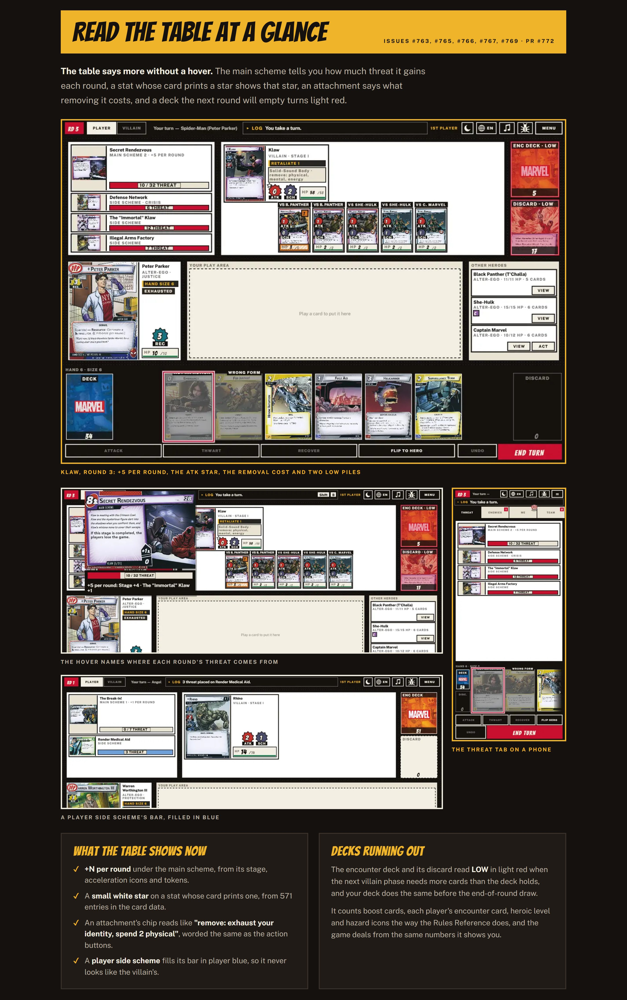
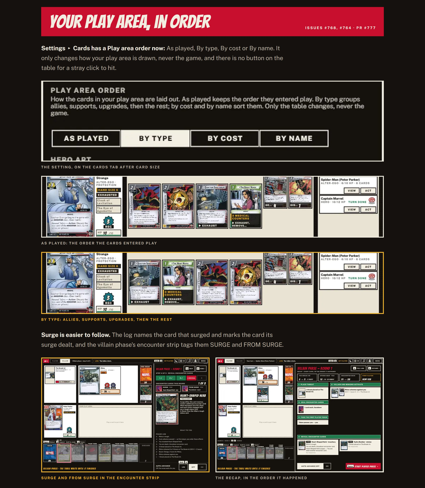
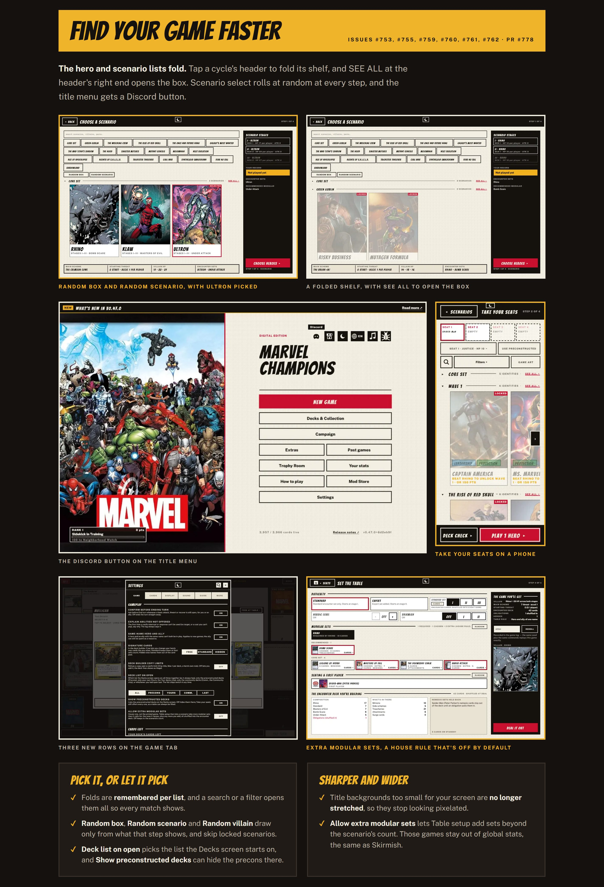
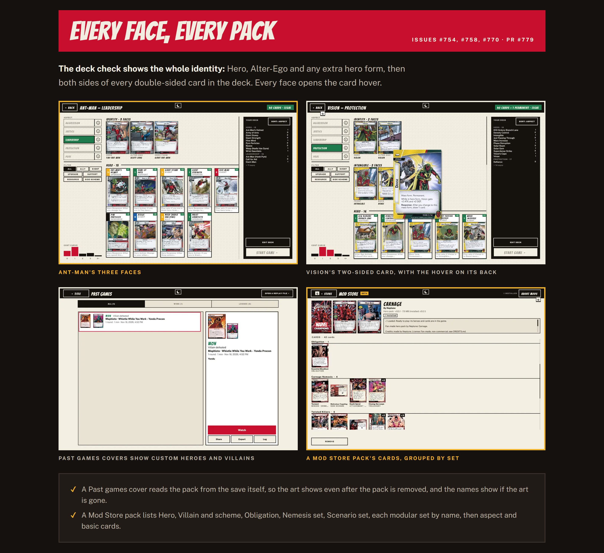
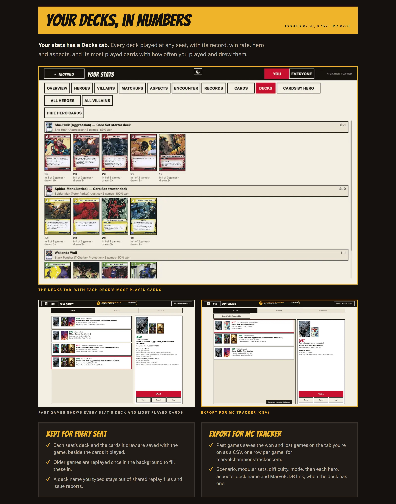
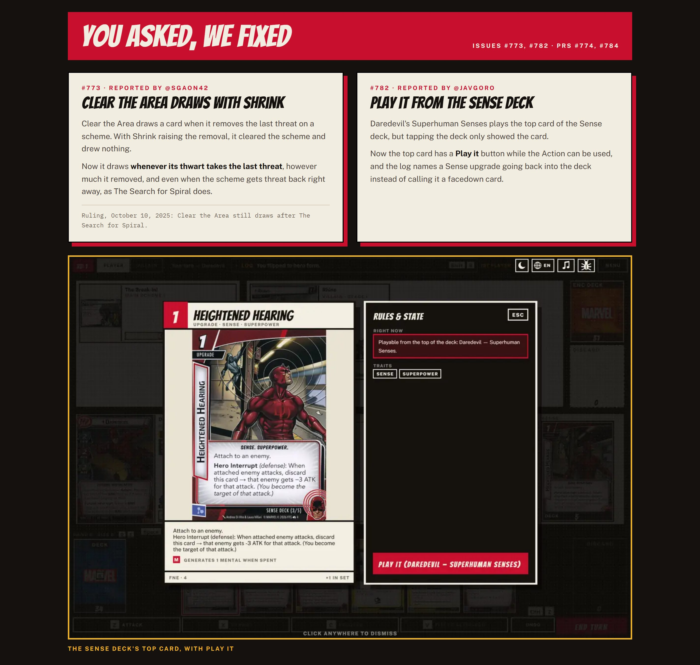
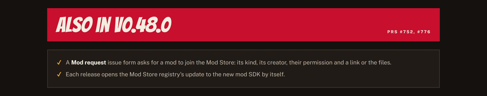
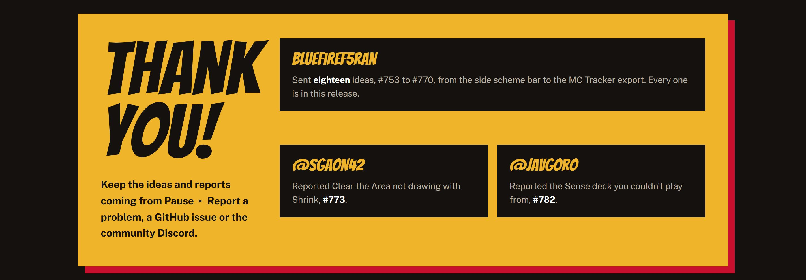
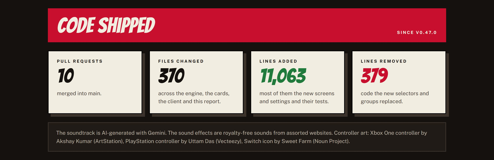

## With Great Reports Comes Great Patching

bluefireF5ran sent eighteen ideas, #753 to #770, and every one of them is in this release. The table reads at a glance: the main scheme says how much threat it gains each round, stats show their printed star, an attachment says what removing it costs and a deck about to run out turns red (#772). Play area order sorts your play area, and surge is marked in the log and the recap (#777). The hero and scenario lists fold and pick at random, the title menu has a Discord button, and three new settings cover deck lists and extra modular sets (#778). The deck check shows every face of a card, Past games covers show custom packs, and the Mod Store groups cards by set (#779). Your stats has a Decks tab for every seat, and Past games exports your games for MC Tracker (#781). Clear the Area draws with Shrink, thanks to @sgaon42's report (#773), and Daredevil's Sense deck has a Play it button, thanks to @javgoro's report (#782), and Mod Store scenarios get every difficulty, thanks to @zackburnley (#786). Thank you for playing!

**[Read the full v0.48.0 report on the site ↗](https://champions-digital-game.com/releases/v0.48.0/)**: the clearer table, play area order and surge marks, folding shelves and Random picks, every card face, the Decks tab and the MC Tracker export, the fixes, including every difficulty for Mod Store scenarios, and the thank-you wall.

**[Lee el informe completo en español ↗](https://champions-digital-game.com/releases/v0.48.0/index.es.html)**

