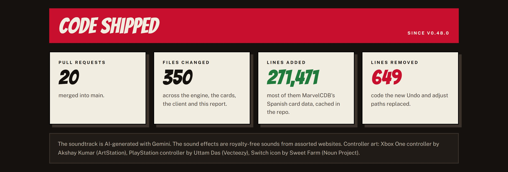

## Earth's Mightiest Patch

A misclick or a bug no longer has to cost you the game. Undo now reaches past the start of your turn, a draw, a reveal and the villain phase, one move per press, and Settings ▸ Gameplay ▸ Undo past your turn picks Allow, Warn or Off. Pause ▸ Manual adjust corrects the table by hand: damage, threat, counters, statuses, exhausting and readying, discards, a draw and your hero's form. Both came from @sgaon42's request (#791, #793), and a game you change that way stops counting toward stats and achievements. Pause's search now finds any setting and changes it in place, with synonyms like "rewind" and "zoom", and every search box in the game forgives accents, typos and dropped letters (#800, #801). Large schemes and Stack schemes, two new settings, draw the schemes big without the table scrolling, and Stack schemes can fan them all out (#808, #831). With the game in Spanish, cards show their Spanish name, rules text and flavor from MarvelCDB (#391, #835). @bluefireF5ran sent ten reports, #809 to #818, and every one is fixed: Madame Web, Deathunt 9000, Across the Spider-Verse, White Fox, Clarity of Purpose, Silk Sense, Change of Fortune, Wolverine's Claws and two log lines. The deck builder's card search finds Spanish card names, as @andy-xxvii27 asked (#806). Giant Strength now waits for Giant hero form, thanks to GarethMagis on Discord (#794), One Way or Another draws only when its search finds a side scheme, thanks to @javgoro's report (#795), and an event Ms. Marvel's Morphogenetics returns to hand can be played again off the same trigger, thanks to Gooffrey [KRBY] on Discord (#804). Crossbones starts with an Experimental Weapon and Red Skull campaign weapons carry over (#805), and Shawarma shows its Max 1 per deck (#807). Kingpin's Public Support (High) now needs its full 1 per hero counters, as FFG ruled (#829). Thank you for playing!

**[Read the full v0.49.0 report on the site ↗](https://champions-digital-game.com/releases/v0.49.0/)**: Undo past your turn and its three settings, Manual adjust, how adjusted games stay out of your stats, Pause search, the new scheme settings, Spanish card text, the fixes, bluefireF5ran's ten reports, Crossbones' weapon, Public Support's ruling and the thank-you wall.

**[Lee el informe completo en español ↗](https://champions-digital-game.com/releases/v0.49.0/index.es.html)**

![You asked, we fixed: Giant Strength waits for Giant form, reported by GarethMagis, One Way or Another needs a side scheme, reported by @javgoro, Morphogenetics replays Turn the Tide, reported by Gooffrey [KRBY], and Spanish card names in search, requested by @andy-xxvii27](https://raw.githubusercontent.com/quincarter/marvel-champions-digital-game/80debf5eedfe24af960db3eb99d650169742ad5d/docs/screenshots/releases/v0.49.0/v0-49-0-release-08-you-asked-we-fixed.jpg)

![Thank you to @sgaon42, GarethMagis, @javgoro, @bluefireF5ran, @andy-xxvii27 and Gooffrey [KRBY]](https://raw.githubusercontent.com/quincarter/marvel-champions-digital-game/80debf5eedfe24af960db3eb99d650169742ad5d/docs/screenshots/releases/v0.49.0/v0-49-0-release-11-thank-you.jpg)

---

## [v0.49.0] - 2026-11-17

### Added

- Undo now reaches past the start of your turn, a draw, a reveal or the villain phase, one move at a time. Settings ▸ Gameplay ▸ Undo past your turn picks Allow, Warn (the default: a warning you acknowledge first) or Off. A game where you undo that far no longer counts toward stats or achievements (#791).
- Pause ▸ Manual adjust: correct the table by hand after a bug or a misclick (draw or discard a card, add or remove damage, threat, counters or a status, exhaust or ready a card, flip your hero). An adjusted game no longer counts toward achievements and stats (#791).
- An exported game log, a shared replay and an issue report say when the game was adjusted by hand or undone past a reveal (#791).
- The v0.49.0 release report has its own page on the site, at /releases/v0.49.0/
- Pause's search finds settings too: with something typed, grouped results (Settings first, then Rules, Reference and more) take over the menu, settings change right there, synonyms like "rewind" or "zoom" work, and tablets and desktop get the search field (#800).
- Large schemes setting (Settings > Cards, and Pause): shows the main scheme and side schemes as large cards on the table, scrolling only inside the schemes panel (#808).
- The deck builder's card search also matches Spanish card names when the game is in Spanish (#806).
- Stack schemes setting (Settings > Cards, and Pause): the schemes stacked like a deck with their names showing; swipe or tap to bring one forward, and tap the front card to fan them all out (#808).
- The Spanish version shows each card's Spanish name, rules text and flavor text (from MarvelCDB) on the Inspect sheet and in deck lists, falling back to English for any card not yet translated (#391).

### Changed

- Every search box now forgives the same way, accents and case ignored, a typo in a longer word and a letter or two left out of a short one ("crd siz" finds Card size); the hero roster, the Rules glossary, the rulebook reader and the campaign card picker join Settings, Pause and the deck and card searches.

### Fixed

- Ant-Man's Giant Strength is only offered after changing to Giant hero form, and Ant-Man's Helmet only offers the response that matches the new form (#794).
- One Way or Another no longer draws 3 cards when the search finds no side scheme in the encounter deck, and takes the side scheme it finds (#795).
- The release history e2e specs pick the newest release and report instead of v0.40.0, so a new release no longer breaks them (#802).
- Crossbones now starts with an Experimental Weapon from Attack on Mount Athena 1B, and in the Red Skull campaign every recorded Experimental Weapon is shuffled into scenarios 2 to 5 (#805).
- Ms. Marvel's Morphogenetics: an event she returns to hand (Turn the Tide, Wiggle Room) can be played again off the same trigger, as FFG ruled (#804)
- Madame Web now counts every Web-Warrior card you control (identity, allies, supports, upgrades), not only characters (#809).
- Deathunt 9000's boost now gives the tough status card to the enemy being boosted (#815).
- Across the Spider-Verse needs a Web-Warrior ally in your discard pile to be used, and only offers its repeat to a player who has one (#818).
- White Fox and other "after this is discarded from your deck" responses are offered when the same discard empties the deck; they resolve from the new deck the reset made (#810).
- Clarity of Purpose's cost damage, and a ready or indirect-damage cost on any resource ability, is dealt while paying, before the card it pays for resolves (#813).
- The log says a hero's cancelled thwart was a thwart, not a scheme (#812).
- An upgrade attached to another player's hero now logs who controls it instead of "follows the first player" (#814).
- Silk Sense and other "after you defeat" cards (Interrogation Room, Hall of Heroes, Improved Attack and Thwart Upgrades, Rescue Captives, Change of Fortune) trigger only when your identity, or an event, resource or upgrade of yours, makes the defeat, not an ally or support you control (#817).
- Wolverine's Claws: a repeated Berserker Barrage no longer keeps the piercing; only the first attack gains it (#811).
- Change of Fortune now triggers when Psychic Misdirection's redirected damage defeats an enemy, as FFG ruled on January 24, 2025 (#817).
- Kingpin's Public Support (High) now replaces a boost card only when it can remove the full 1 per hero support counters, as FFG ruled (#829).
- Stack schemes: while a prompt can pick a scheme hidden behind the stack, the panel lists every scheme so a controller or keyboard can reach it (#808).

### Engine

- A new adjust command carries Manual adjust's table corrections through the game log, so saves, rewinds and replays keep them (#791).
- A player eliminated partway through an ability still resolves it in full: Wolverine's Claws plays its chosen event and its attack lands, and Berserker Barrage's repeat resolves, when the damage eliminates Wolverine; only an attack already under way ends (#816).
- Tests pin FFG's April 8, 2025 ruling: Clarity of Purpose can pay for Noble Sacrifice or "You Got This!" that discards the ally it's attached to, even at 1 hit point, because both costs are paid in the same step (#827).

### Content

- Shawarma (The Mad Titan's Shadow campaign) now shows its printed "Max 1 per deck." and allows one copy, not three (#807).

### Special thanks

- @andy-xxvii27 reported #806.
- @bluefireF5ran reported #809, #810, #811, #812, #813, #814, #815, #816, #817 and #818.
- @javgoro reported #795.
- @sgaon42 reported #791.
- GarethMagis reported #794 on Discord.
- Gooffrey [KRBY] reported #804 on Discord.
