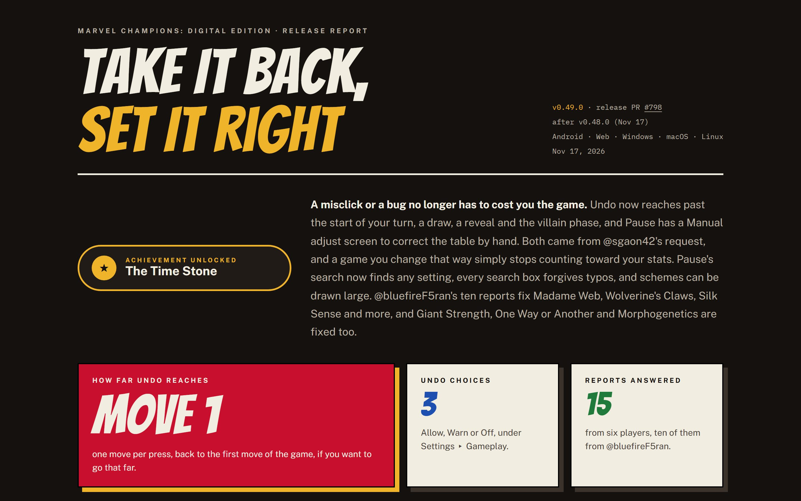
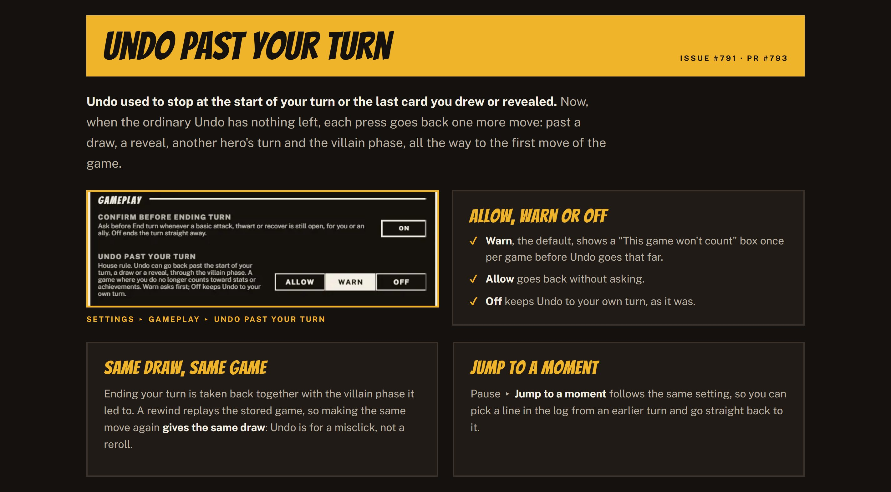
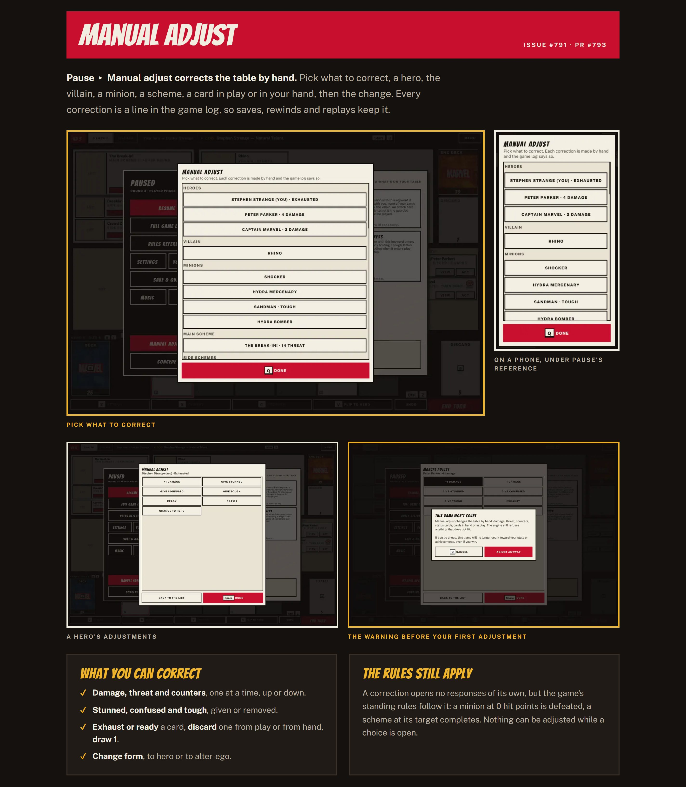
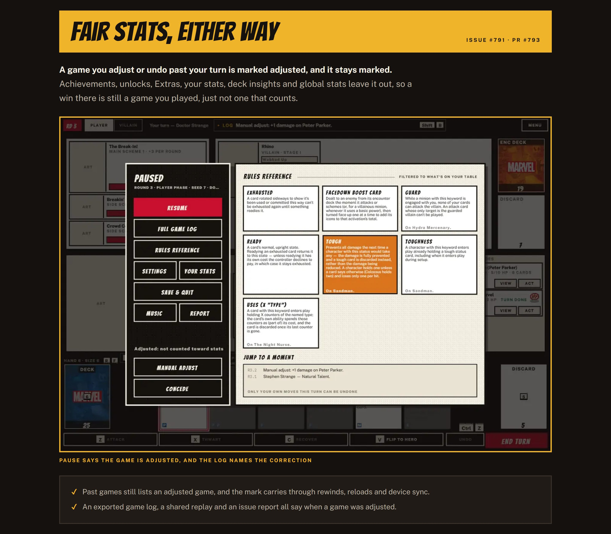
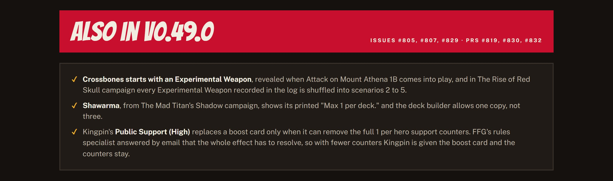
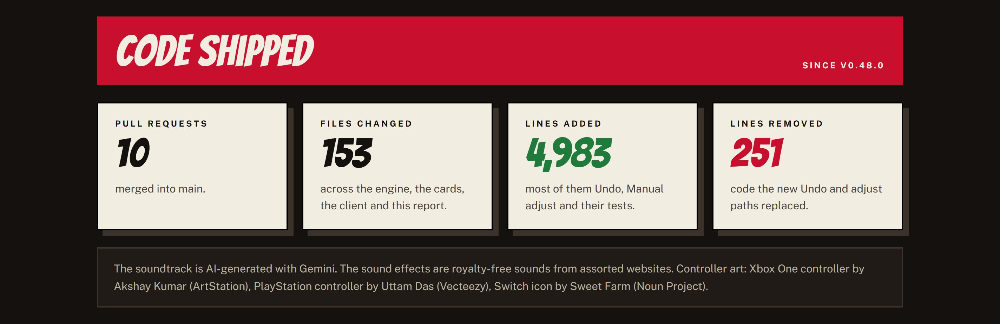

## Take It Back, Set It Right

A misclick or a bug no longer has to cost you the game. Undo now reaches past the start of your turn, a draw, a reveal and the villain phase, one move per press, and Settings ▸ Gameplay ▸ Undo past your turn picks Allow, Warn or Off. Pause ▸ Manual adjust corrects the table by hand: damage, threat, counters, statuses, exhausting and readying, discards, a draw and your hero's form. Both came from @sgaon42's request (#791, #793), and a game you change that way stops counting toward stats and achievements. Giant Strength now waits for Giant hero form, thanks to GarethMagis on Discord (#794), One Way or Another draws only when its search finds a side scheme, thanks to @javgoro's report (#795), and an event Ms. Marvel's Morphogenetics returns to hand can be played again off the same trigger, thanks to Gooffrey [KRBY] on Discord (#804). Crossbones starts with an Experimental Weapon and Red Skull campaign weapons carry over (#805), and Shawarma shows its Max 1 per deck (#807). Kingpin's Public Support (High) now needs its full 1 per hero counters, as FFG ruled (#829). Thank you for playing!

**[Read the full v0.49.0 report on the site ↗](https://champions-digital-game.com/releases/v0.49.0/)**: Undo past your turn and its three settings, Manual adjust, how adjusted games stay out of your stats, the fixes, Crossbones' weapon, Public Support's ruling and the thank-you wall.

**[Lee el informe completo en español ↗](https://champions-digital-game.com/releases/v0.49.0/index.es.html)**

![You asked, we fixed: Giant Strength waits for Giant form, reported by GarethMagis, One Way or Another needs a side scheme, reported by @javgoro, and Morphogenetics replays Turn the Tide, reported by Gooffrey [KRBY]](https://raw.githubusercontent.com/quincarter/marvel-champions-digital-game/39764d21d7aae046d2edbd2e65fb22f948506eae/docs/screenshots/releases/v0.49.0/v0-49-0-release-05-you-asked-we-fixed.jpg)

![Thank you to @sgaon42, GarethMagis, @javgoro and Gooffrey [KRBY]](https://raw.githubusercontent.com/quincarter/marvel-champions-digital-game/39764d21d7aae046d2edbd2e65fb22f948506eae/docs/screenshots/releases/v0.49.0/v0-49-0-release-07-thank-you.jpg)

---

## [v0.49.0] - 2026-11-17

### Added

- Undo now reaches past the start of your turn, a draw, a reveal or the villain phase, one move at a time. Settings ▸ Gameplay ▸ Undo past your turn picks Allow, Warn (the default: a warning you acknowledge first) or Off. A game where you undo that far no longer counts toward stats or achievements (#791).
- Pause ▸ Manual adjust: correct the table by hand after a bug or a misclick (draw or discard a card, add or remove damage, threat, counters or a status, exhaust or ready a card, flip your hero). An adjusted game no longer counts toward achievements and stats (#791).
- An exported game log, a shared replay and an issue report say when the game was adjusted by hand or undone past a reveal (#791).
- The v0.49.0 release report has its own page on the site, at /releases/v0.49.0/

### Fixed

- Ant-Man's Giant Strength is only offered after changing to Giant hero form, and Ant-Man's Helmet only offers the response that matches the new form (#794).
- One Way or Another no longer draws 3 cards when the search finds no side scheme in the encounter deck, and takes the side scheme it finds (#795).
- The release history e2e specs pick the newest release and report instead of v0.40.0, so a new release no longer breaks them (#802).
- Crossbones now starts with an Experimental Weapon from Attack on Mount Athena 1B, and in the Red Skull campaign every recorded Experimental Weapon is shuffled into scenarios 2 to 5 (#805).
- Ms. Marvel's Morphogenetics: an event she returns to hand (Turn the Tide, Wiggle Room) can be played again off the same trigger, as FFG ruled (#804)
- Kingpin's Public Support (High) now replaces a boost card only when it can remove the full 1 per hero support counters, as FFG ruled (#829).

### Engine

- A new adjust command carries Manual adjust's table corrections through the game log, so saves, rewinds and replays keep them (#791).

### Content

- Shawarma (The Mad Titan's Shadow campaign) now shows its printed "Max 1 per deck." and allows one copy, not three (#807).

### Special thanks

- @javgoro reported #795.
- @sgaon42 reported #791.
- GarethMagis reported #794 on Discord.
- Gooffrey [KRBY] reported #804 on Discord.
