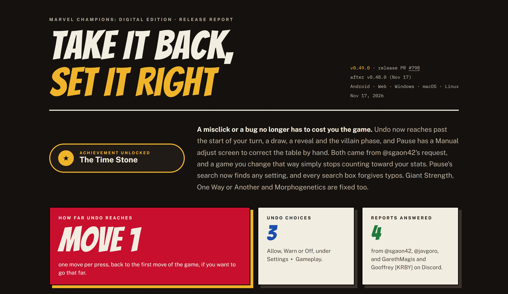
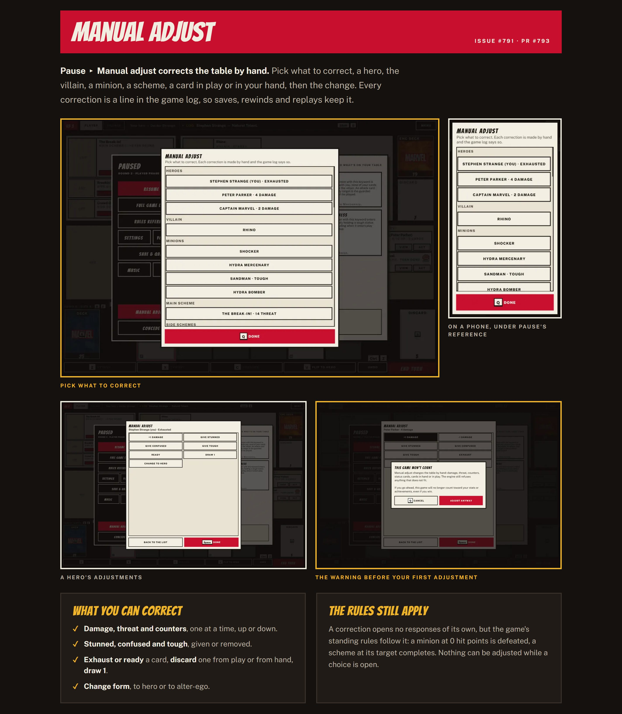
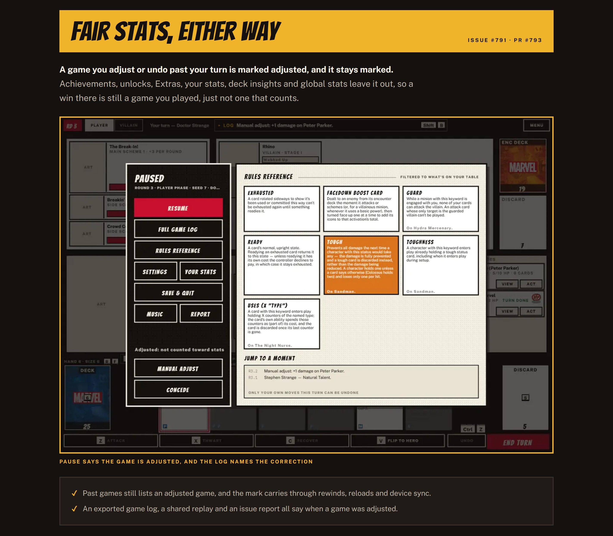
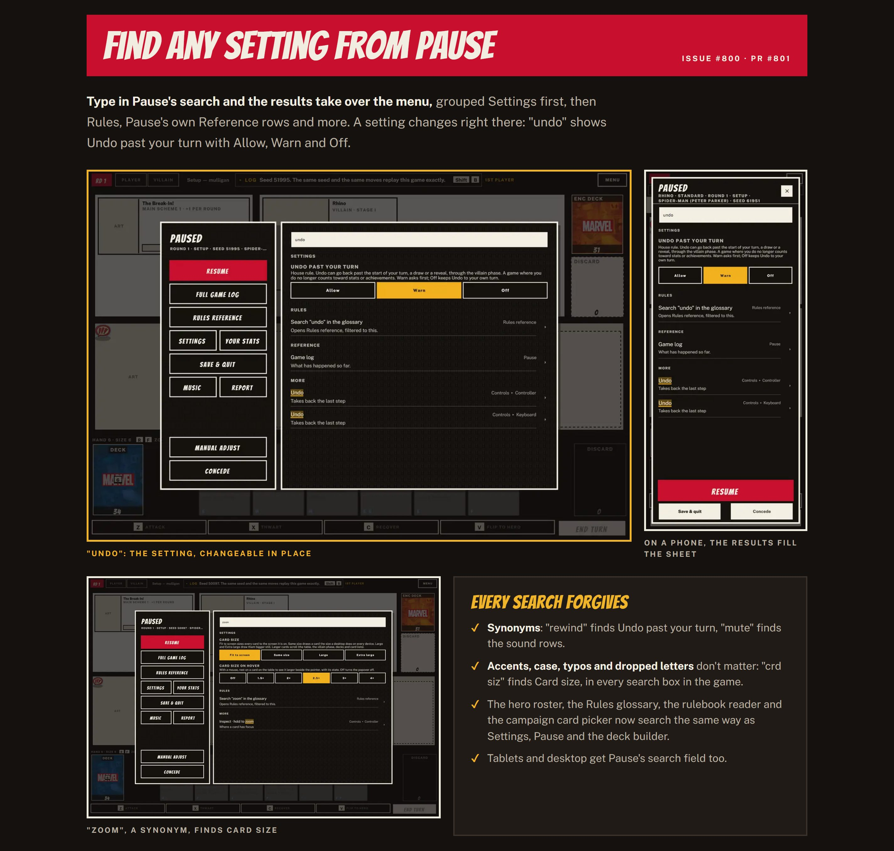
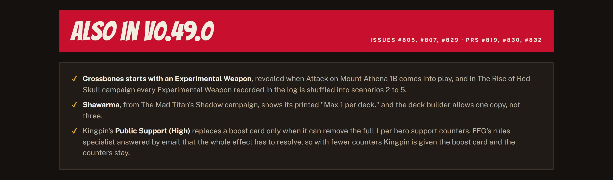
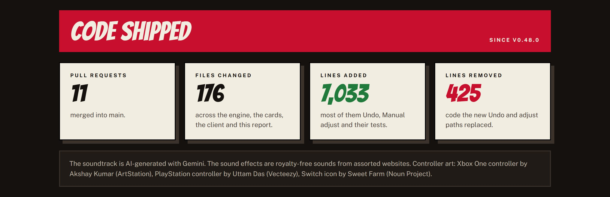

## Take It Back, Set It Right

A misclick or a bug no longer has to cost you the game. Undo now reaches past the start of your turn, a draw, a reveal and the villain phase, one move per press, and Settings ▸ Gameplay ▸ Undo past your turn picks Allow, Warn or Off. Pause ▸ Manual adjust corrects the table by hand: damage, threat, counters, statuses, exhausting and readying, discards, a draw and your hero's form. Both came from @sgaon42's request (#791, #793), and a game you change that way stops counting toward stats and achievements. Pause's search now finds any setting and changes it in place, with synonyms like "rewind" and "zoom", and every search box in the game forgives accents, typos and dropped letters (#800, #801). Giant Strength now waits for Giant hero form, thanks to GarethMagis on Discord (#794), One Way or Another draws only when its search finds a side scheme, thanks to @javgoro's report (#795), and an event Ms. Marvel's Morphogenetics returns to hand can be played again off the same trigger, thanks to Gooffrey [KRBY] on Discord (#804). Crossbones starts with an Experimental Weapon and Red Skull campaign weapons carry over (#805), and Shawarma shows its Max 1 per deck (#807). Kingpin's Public Support (High) now needs its full 1 per hero counters, as FFG ruled (#829). Thank you for playing!

**[Read the full v0.49.0 report on the site ↗](https://champions-digital-game.com/releases/v0.49.0/)**: Undo past your turn and its three settings, Manual adjust, how adjusted games stay out of your stats, Pause search, the fixes, Crossbones' weapon, Public Support's ruling and the thank-you wall.

**[Lee el informe completo en español ↗](https://champions-digital-game.com/releases/v0.49.0/index.es.html)**

![You asked, we fixed: Giant Strength waits for Giant form, reported by GarethMagis, One Way or Another needs a side scheme, reported by @javgoro, and Morphogenetics replays Turn the Tide, reported by Gooffrey [KRBY]](https://raw.githubusercontent.com/quincarter/marvel-champions-digital-game/0161e5d0976ce3a3da575cea4a90ea9bd2fa5cba/docs/screenshots/releases/v0.49.0/v0-49-0-release-06-you-asked-we-fixed.jpg)

![Thank you to @sgaon42, GarethMagis, @javgoro and Gooffrey [KRBY]](https://raw.githubusercontent.com/quincarter/marvel-champions-digital-game/0161e5d0976ce3a3da575cea4a90ea9bd2fa5cba/docs/screenshots/releases/v0.49.0/v0-49-0-release-08-thank-you.jpg)

