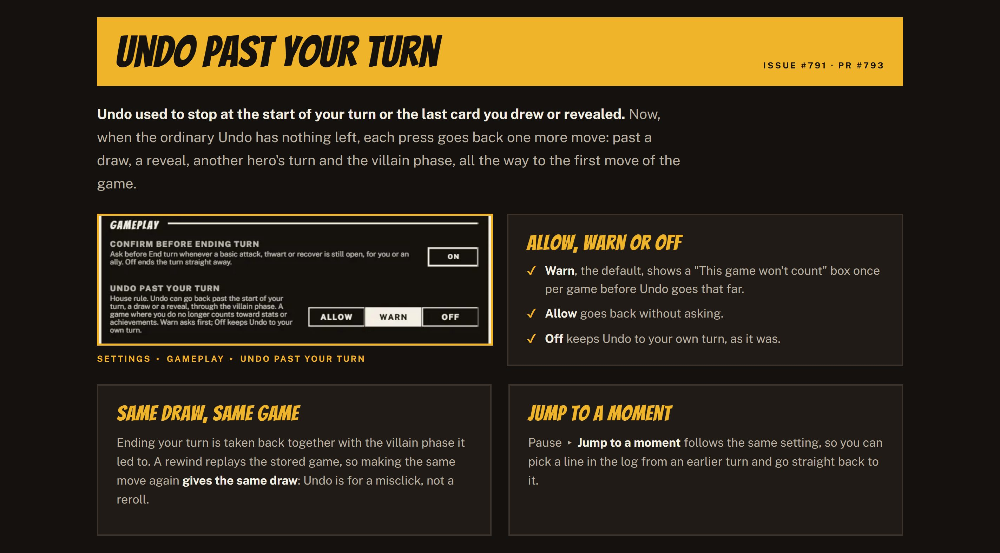
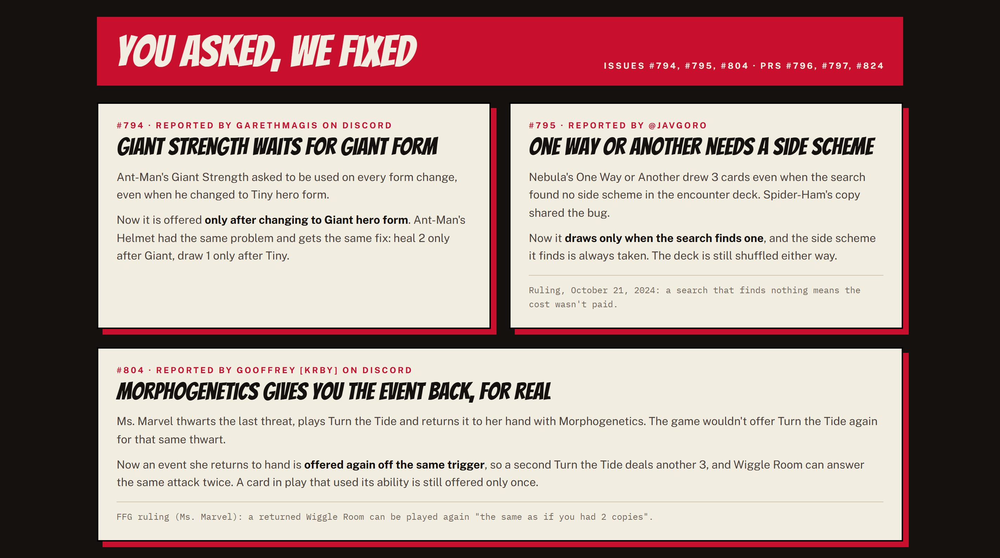
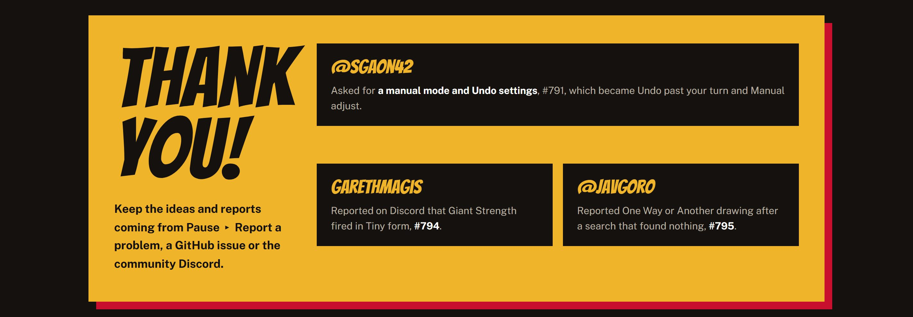

## Take It Back, Set It Right

A misclick or a bug no longer has to cost you the game. Undo now reaches past the start of your turn, a draw, a reveal and the villain phase, one move per press, and Settings ▸ Gameplay ▸ Undo past your turn picks Allow, Warn or Off. Pause ▸ Manual adjust corrects the table by hand: damage, threat, counters, statuses, exhausting and readying, discards, a draw and your hero's form. Both came from @sgaon42's request (#791, #793), and a game you change that way stops counting toward stats and achievements. Giant Strength now waits for Giant hero form, thanks to GarethMagis on Discord (#794), and One Way or Another draws only when its search finds a side scheme, thanks to @javgoro's report (#795). Thank you for playing!

**[Read the full v0.49.0 report on the site ↗](https://champions-digital-game.com/releases/v0.49.0/)**: Undo past your turn and its three settings, Manual adjust, how adjusted games stay out of your stats, the fixes and the thank-you wall.

**[Lee el informe completo en español ↗](https://champions-digital-game.com/releases/v0.49.0/index.es.html)**

