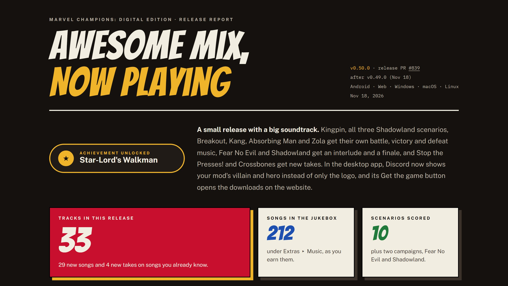
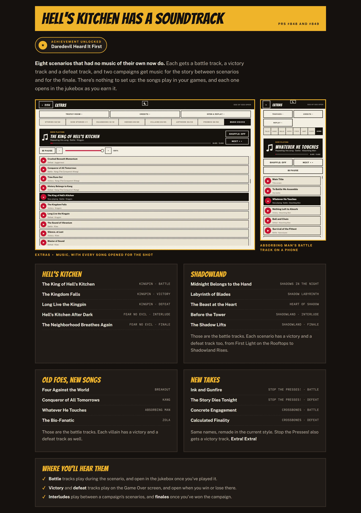
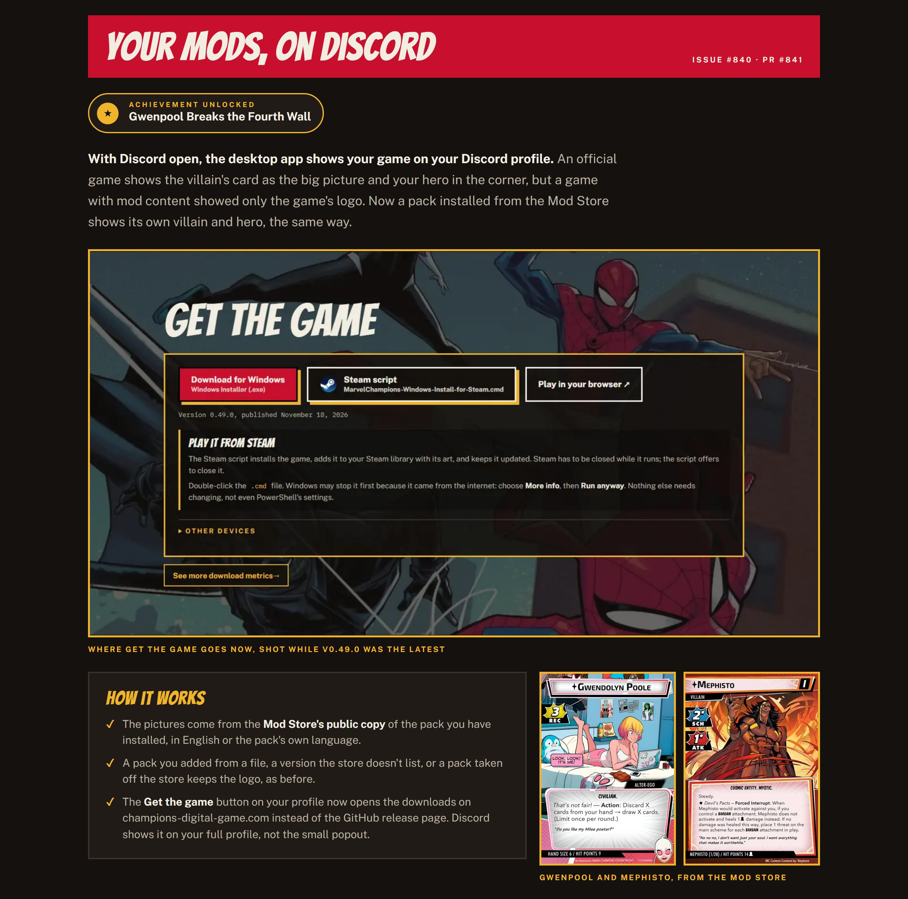
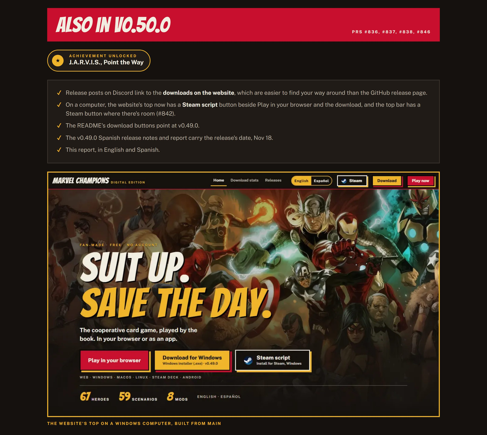
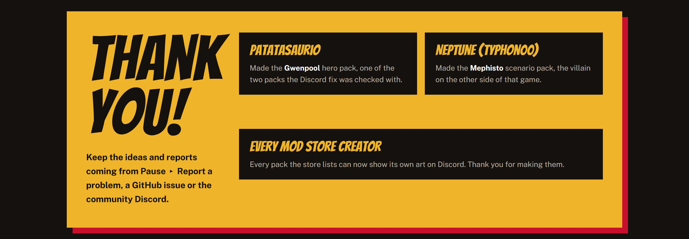
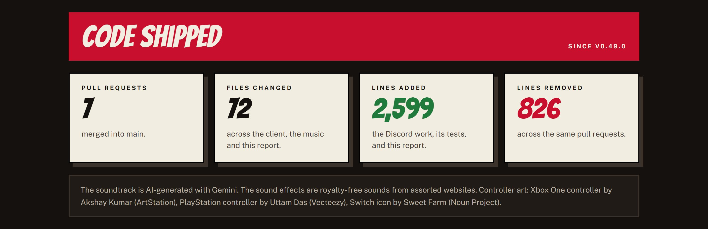

## Awesome Mix, Now Playing

A small release with a big soundtrack. Kingpin, all three Shadowland scenarios (Shadows in the Night, Shadow Labyrinth and Heart of Shadow), Breakout, Kang, Absorbing Man and Zola get their own battle, victory and defeat music, Fear No Evil and Shadowland get a campaign interlude and finale, and Stop the Presses! and Crossbones get new takes on their battle and defeat tracks: 33 tracks in all, 29 of them new (#848, #849). In the desktop app, Discord Rich Presence now shows a Mod Store pack's own villain and hero instead of only the game's logo, and its Get the game button opens the downloads on the website (#840, #841). On a computer, the website's top now offers the Steam script beside the download (#842, #846). Thank you to Patatasaurio and Neptune (Typhon00), whose Gwenpool and Mephisto packs it was checked with, and to every Mod Store creator. Thank you for playing!

**[Read the full v0.50.0 report on the site ↗](https://champions-digital-game.com/releases/v0.50.0/)**: the new music scenario by scenario, where you'll hear it, your mods on Discord, the new downloads link, the Steam script button on the website and the thank-you wall.

**[Lee el informe completo en español ↗](https://champions-digital-game.com/releases/v0.50.0/index.es.html)**

---

## [v0.50.0] - 2026-11-18

### Added

- The landing page's hero offers the Install for Steam script beside the download on a computer the release has one for, and the top bar does too on wide screens (#842).
- The v0.50.0 release report has its own page on the site, at /releases/v0.50.0/

### Changed

- Discord presence's Get the game button opens the website's downloads section instead of the GitHub release page.

### Fixed

- Discord presence shows mod villains' and heroes' card art from the Mod Store instead of only the logo (#840).

### Content

- Music for Kingpin, Shadowland (all three scenarios and its campaign), Breakout, Kang, Absorbing Man and Zola, Stop the Presses!'s heroes-win track and the Fear No Evil campaign interlude and finale; remakes of Stop the Presses!'s and Crossbones's battle and villain-wins tracks

### Docs

- The v0.49.0 Spanish release notes and report carry the release's date, Nov 18
- Release Discord posts link to the downloads section on champions-digital-game.com instead of the GitHub release page.
