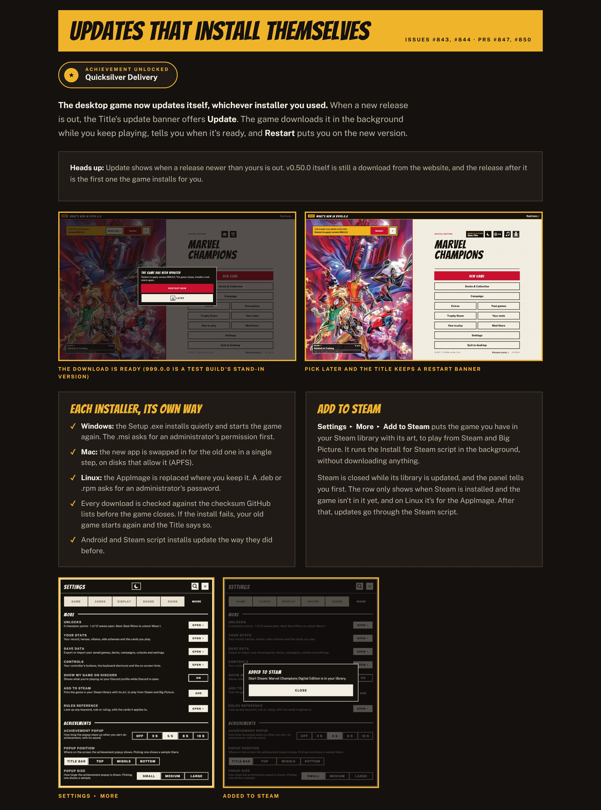
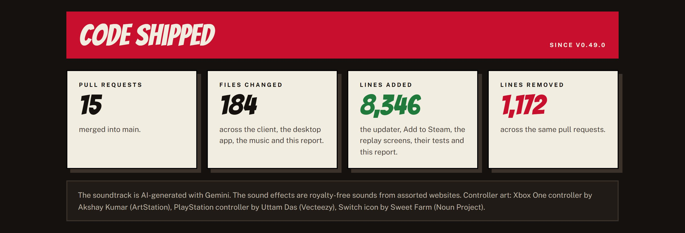

## Awesome Mix, Now Playing

Every playable scenario now has its own music. Kingpin, all three Shadowland scenarios (Shadows in the Night, Shadow Labyrinth and Heart of Shadow), Breakout, Kang, Absorbing Man, Zola, and Civil War's Captain Marvel, She-Hulk and Vision get their own battle, victory and defeat music, Fear No Evil and Shadowland get a campaign interlude and finale, and Stop the Presses! and Crossbones get new takes: 43 tracks in all, 38 of them new (#848, #849, #852, #854). The desktop game now updates itself from inside the game, whichever installer you used: Update downloads the new release in the background and Restart puts you on it, starting with the release after this one (#843, #847). Settings ▸ More ▸ Add to Steam puts the game in your Steam library with its art (#844, #850). A shared replay link opens on its own loading screen and a versus screen of the villain against the heroes, and every replay opens that way (#858, #859). In the desktop app, Discord Rich Presence now shows a Mod Store pack's own villain and hero instead of only the game's logo, and its Get the game button opens the downloads on the website (#840, #841), and the Title's Mod Store button counts the installed packs that have an update (#845, #855). Power Man's chi counters now ask "Remove how many chi counters?" with buttons you can see, thanks to @Merman-Helville's report (#856, #857). On Linux, Mod Store downloads now show their progress instead of looking frozen (#860, #861). On a computer, the website's top now offers the Steam script beside the download (#842, #846). Thank you to Patatasaurio, Neptune (Typhon00) and PermaKarma, whose Gwenpool, Mephisto, Carnage and The Punisher packs it was checked with, and to every Mod Store creator. Thank you for playing!

**[Read the full v0.50.0 report on the site ↗](https://champions-digital-game.com/releases/v0.50.0/)**: the new music scenario by scenario, where you'll hear it, updates that install themselves, Add to Steam, the replay versus screen, your mods on Discord, the mod update badge, Power Man's chi fix, the new downloads link, the Steam script button on the website and the thank-you wall.

**[Lee el informe completo en español ↗](https://champions-digital-game.com/releases/v0.50.0/index.es.html)**

---

## [v0.50.0] - 2026-11-19

### Added

- The title screen's Mod Store button and storefront icon show how many installed mod packs have an update (#845).
- The landing page's hero offers the Install for Steam script beside the download on a computer the release has one for, and the top bar does too on wide screens (#842).
- A desktop game installed from the release's Windows .exe or .msi, Mac app or Linux AppImage updates itself from the update banner: it downloads in the background, says the game has been updated, and restarts into the new version (#843).
- The desktop game has an Add to Steam button under Settings ▸ More: it runs the Install for Steam script on the game as it is and puts it in your Steam library with its art, and only shows when Steam is installed and the game isn't in it yet (#844).
- The v0.50.0 release report has its own page on the site, at /releases/v0.50.0/
- Every replay (Past games, Game over, Title's in-progress games, Extras) now opens on the versus screen, with a whoosh as it comes up (#858).

### Changed

- Discord presence's Get the game button opens the website's downloads section instead of the GitHub release page.
- A shared replay link now opens on its own loading screen and shows a versus screen of the villain against the heroes before the board, skipping the title menu; an expired, invalid or unreachable replay says why there, with a Main menu button (#858).

### Fixed

- Discord presence shows mod villains' and heroes' card art from the Mod Store instead of only the logo (#840).
- Power Man's chi counters (and every other "remove up to N counters" cost) ask "Remove how many chi counters?" with number buttons you can see, instead of a red-on-red "2" under "How many chi?" (#856).
- Mod Store downloads in the desktop app show their progress as the zip arrives, so on Linux an install or update no longer looks frozen at Starting (#860).
- Opening a replay file: Extras no longer has the button (it lives in Past games, now with a folder icon and a clearer label), and in the desktop app it opens the system's own Open dialog, so a controller's A press works on Steam Deck and Bazzite (#858).
- Settings opened from the pause menu no longer draws over the sheets it opens, such as Controls (#858).

### Content

- Music for Kingpin, Shadowland (all three scenarios and its campaign), Breakout, Kang, Absorbing Man and Zola, Stop the Presses!'s heroes-win track and the Fear No Evil campaign interlude and finale; remakes of Stop the Presses!'s and Crossbones's battle and villain-wins tracks
- Music for Captain Marvel (Registration), She-Hulk (Registration) and Vision (Resistance), so every playable scenario now has its own tracks; a remake of Crossbones's heroes-win track

### Docs

- The v0.49.0 Spanish release notes and report carry the release's date, Nov 18
- Release Discord posts link to the downloads section on champions-digital-game.com instead of the GitHub release page.
