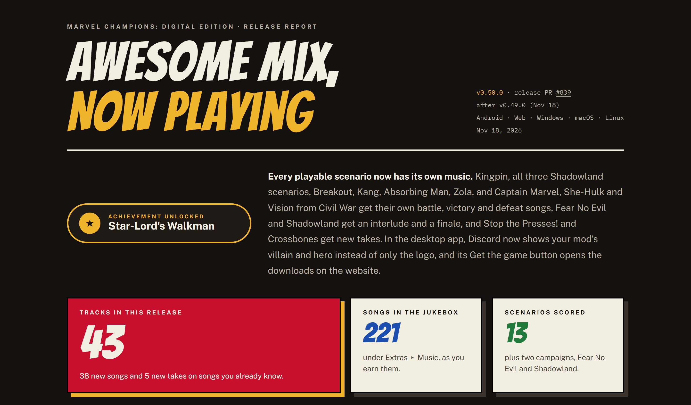
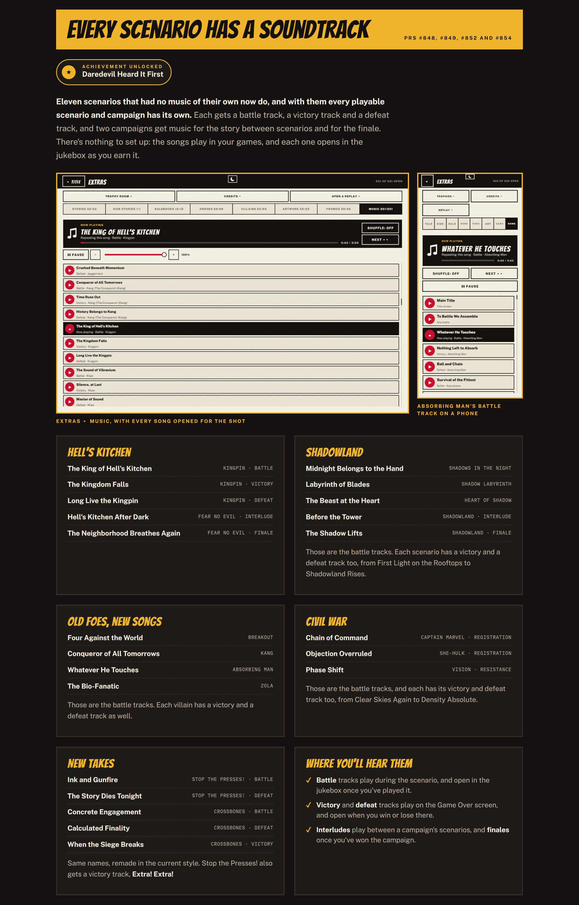
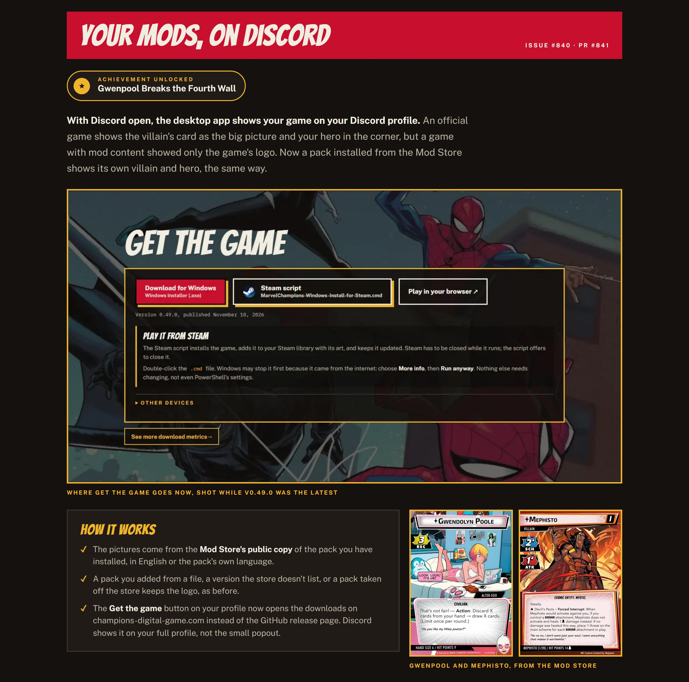
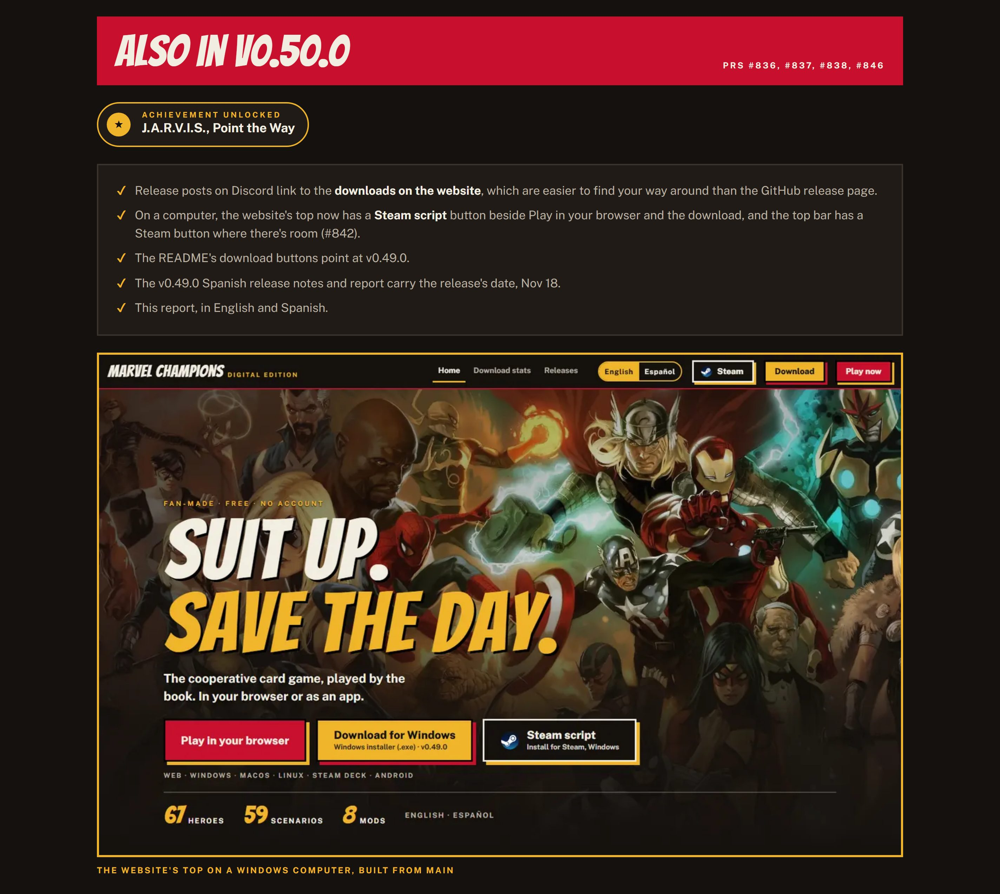
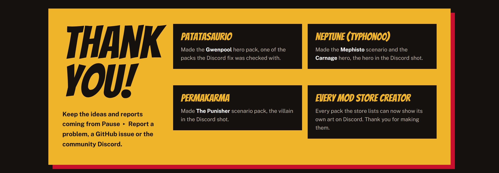
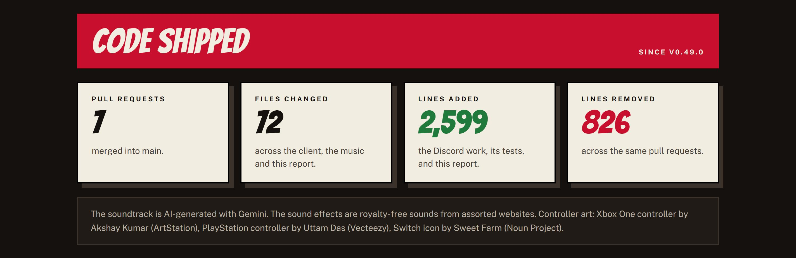

## Awesome Mix, Now Playing

Every playable scenario now has its own music. Kingpin, all three Shadowland scenarios (Shadows in the Night, Shadow Labyrinth and Heart of Shadow), Breakout, Kang, Absorbing Man, Zola, and Civil War's Captain Marvel, She-Hulk and Vision get their own battle, victory and defeat music, Fear No Evil and Shadowland get a campaign interlude and finale, and Stop the Presses! and Crossbones get new takes: 43 tracks in all, 38 of them new (#848, #849, #852, #854). In the desktop app, Discord Rich Presence now shows a Mod Store pack's own villain and hero instead of only the game's logo, and its Get the game button opens the downloads on the website (#840, #841). On a computer, the website's top now offers the Steam script beside the download (#842, #846). Thank you to Patatasaurio, Neptune (Typhon00) and PermaKarma, whose Gwenpool, Mephisto, Carnage and The Punisher packs it was checked with, and to every Mod Store creator. Thank you for playing!

**[Read the full v0.50.0 report on the site ↗](https://champions-digital-game.com/releases/v0.50.0/)**: the new music scenario by scenario, where you'll hear it, your mods on Discord, the new downloads link, the Steam script button on the website and the thank-you wall.

**[Lee el informe completo en español ↗](https://champions-digital-game.com/releases/v0.50.0/index.es.html)**

