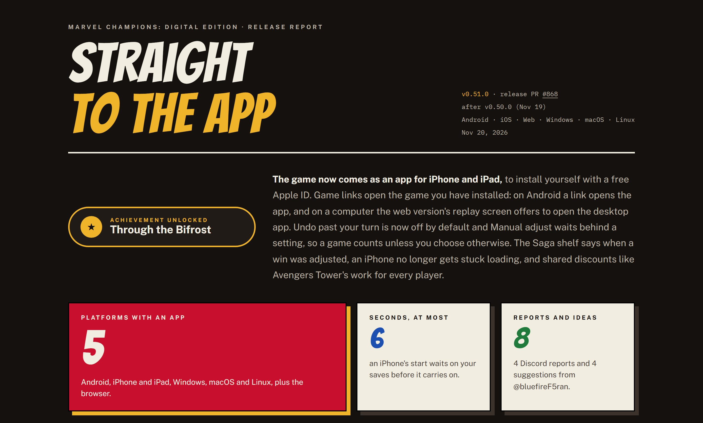
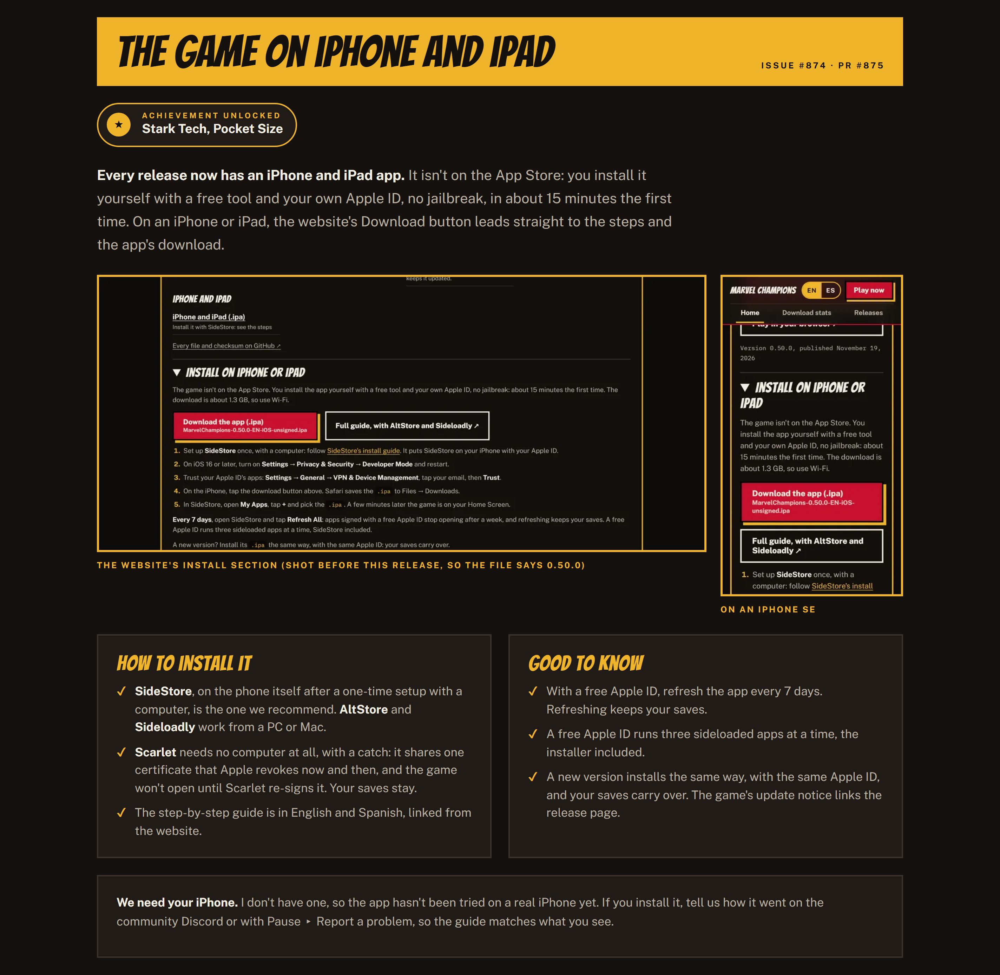
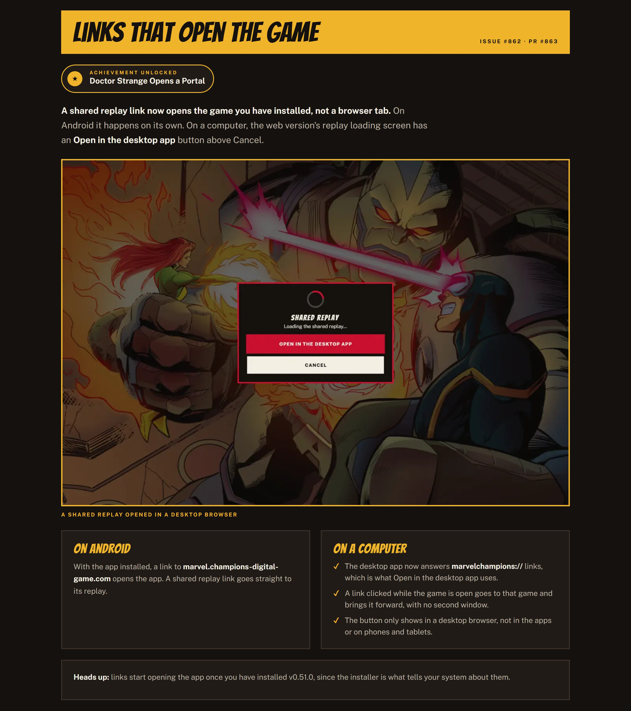
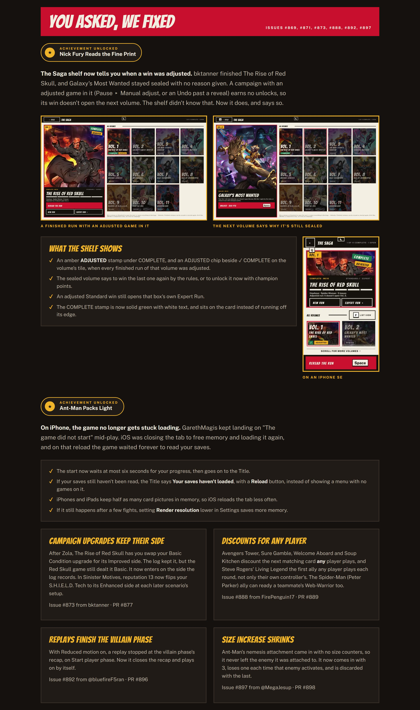
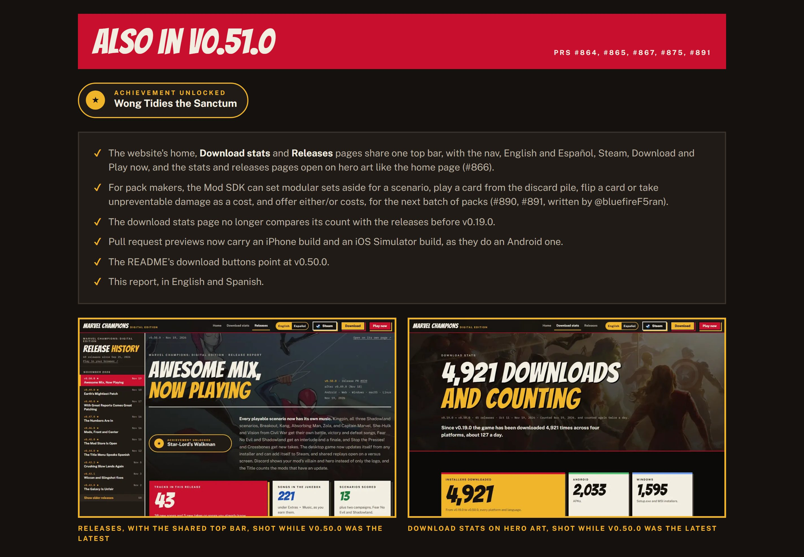
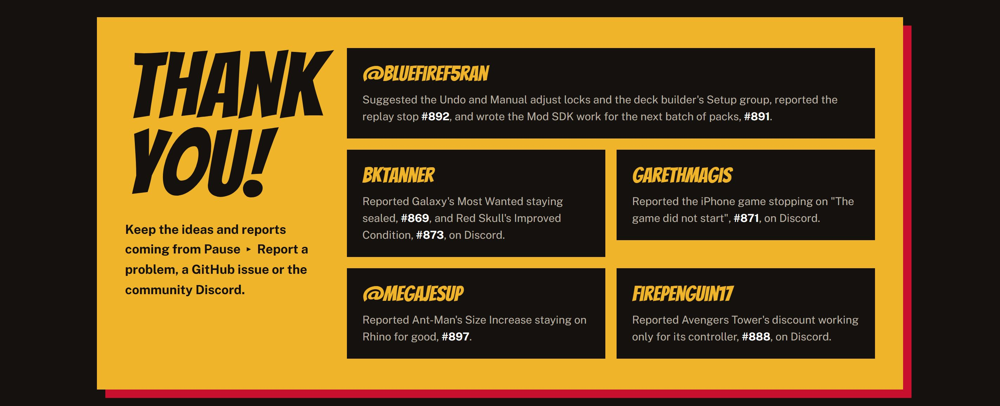
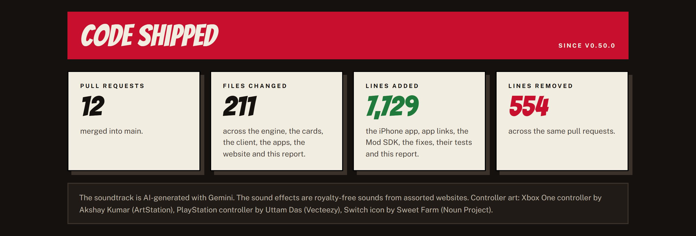

## Straight to the App

Every release now has an iPhone and iPad app, to install yourself with a free Apple ID through SideStore, AltStore or Sideloadly, with step-by-step guides in English and Spanish and an install section on the website (#874, #875). Game links now open the game you have installed: on Android a link to marvel.champions-digital-game.com opens the app, and on a computer the web version's replay loading screen has Open in the desktop app (#862, #863). Undo past your turn is now off by default, Manual adjust waits behind Allow manual adjust, both now sit under Settings ▸ More ▸ Cheats and warn that a game where you use them stops counting, and the deck builder lists setup cards in their own group, all suggested by @bluefireF5ran (#893, #894, #895, #896, #899, #900). The Saga shelf stamps ADJUSTED when a campaign was won with an adjusted game and says why the next volume stays sealed (#869, #870), and Red Skull's Improved Condition now enters on its Improved side (#873, #877), both from bktanner's reports. On iPhone, the game no longer gets stuck loading after iOS reloads the tab, thanks to GarethMagis (#871, #872). Avengers Tower and other "played" discounts now work for any player, thanks to FirePenguin17 (#888, #889), replays play through the villain phase with Reduced motion on (#892), and Ant-Man's Size Increase now loses its size counters, thanks to @MegaJesup (#897, #898). For pack makers, @bluefireF5ran wrote the Mod SDK work for the next batch of packs (#890, #891). Thank you for playing!

**[Read the full v0.51.0 report on the site ↗](https://champions-digital-game.com/releases/v0.51.0/)**: the iPhone and iPad app and how to install it, game links that open the app, Undo and Manual adjust off by default, the deck builder's Setup group, the Saga's ADJUSTED stamp, the iPhone loading fix, campaign upgrades, shared discounts, the replay fix, Size Increase, the Mod SDK, the website's shared top bar and the thank-you wall.

**[Lee el informe completo en español ↗](https://champions-digital-game.com/releases/v0.51.0/index.es.html)**

---

## [v0.51.0] - 2026-11-20

### Added

- Game links open the installed app: Android opens marvel.champions-digital-game.com links in the app (App Links), and the desktop app registers marvelchampions:// links, with "Open in the desktop app" on the web version's replay loading screen (#862).
- An iPhone and iPad app with every release, to sideload with a free Apple ID through SideStore, AltStore or Sideloadly, with step-by-step install guides in English and Spanish; on iOS the update notice links the release page (#874).
- The landing page's download section has an iPhone and iPad install section: on an iPhone or iPad the download button leads to the SideStore steps with the .ipa download beside them, and every other device lists it under Other devices (#874).
- The v0.51.0 release report has its own page on the site, at /releases/v0.51.0/
- A pull request that changes the game posts its unsigned .ipa as a preview pre-release and links it in a PR comment, as the Android APK does; it's deleted when the pull request closes.
- Pull request previews also carry an iOS Simulator build, linked in the same comment, so the game can be checked on a Mac without an iPhone.
- The deck builder lists cards that start the game outside the deck (Permanent and Setup cards, Valkyrie's Death-Glow, Rogue's Touched) in their own Setup group (#895). Suggested by @bluefireF5ran.

### Changed

- The download stats page no longer compares its count with the releases before v0.19.0.
- The landing site's home, download stats and releases pages share one top bar (nav, English/Español, Steam, Download, Play now), and the stats and releases pages open on hero art like the home page.
- Undo past your turn now defaults to Off, and turning it on warns that games where you use it stop counting; Manual adjust leaves Pause until Settings > More > Misc gameplay > Allow manual adjust is on (#893, #894). Suggested by @bluefireF5ran.
- Settings: Undo past your turn and Allow manual adjust, the two settings that stop a game counting toward stats, achievements and champion points, now sit together under Settings > More > Cheats (#899).

### Fixed

- The Saga shelf now stamps ADJUSTED beside COMPLETE and says when a finished campaign was won with an adjusted game (Manual adjust or an Undo past a reveal), which doesn't open the next volume, and the next volume says why it is still sealed (#869).
- The Saga shelf's COMPLETE stamp is solid green with white text, sits on the card, and keeps its text inside the box.
- On iPhone, the game no longer gets stuck on LOADING (and the 'The game did not start' screen) after iOS reloads the tab, and keeps fewer card pictures in memory so the tab is reloaded less often (#871).
- Campaign upgrades now enter play on the side the campaign log records (#873). The Rise of Red Skull: a "Basic" Condition upgrade you replaced with its "Improved" side after Zola enters the Red Skull game on its Improved side. Sinister Motives: once reputation node 13 is marked, each later scenario's setup flips your S.H.I.E.L.D. Tech upgrade to its Enhanced side.
- Avengers Tower, Sure Gamble, Welcome Aboard and Soup Kitchen discount the next matching card any player plays, and Steve Rogers' Living Legend discounts the first ally any player plays each round, not only their own controller's (#888).
- Spider-Man (Peter Parker) ally can ready another player's Web-Warrior character after he attacks or thwarts, not only your own.
- Replays play through the villain phase by themselves with Reduced motion on, instead of stopping on Start player phase (#892). Reported by @bluefireF5ran.
- Ant-Man's nemesis attachment Size Increase now comes in with its 3 size counters, loses one each time the enemy it is attached to activates, and is discarded with the last (#897).

### Engine

- Mod SDK: a pack scenario may set modular sets aside with setAsideModularSetCount (the seat picks them, or they are drawn at random), for a scenario's own cards to call on, such as The Rose's mini-boss set (#890).
- Mod SDK: a resource ability's generatesFor may name an aspect ("generate a [wild] resource for a 'Pool card"), so a pack card can use it (#890).
- An effect can play a card from its player's discard pile, paying its costs (playFromHand from "discard", DSL playFromDiscard), for pack cards such as the Punisher's Warzone; it is not counted as played from the hand (#890).
- Mod SDK: a cost may flip another card you control (AbilityCost.flipCards, DSL flipCardsCost), and an additional cost to play a card may be an either/or choice picked with the play's costSelection, for Sentinel's "exhaust or destroy a Component" (#890).
- Mod SDK: a "take N damage" cost may be unpreventable (AbilityCost.damageSelfUnpreventable, takeDamageCost(n, { unpreventable: true })), so Sentinel's destroy cost is paid through tough, prevention and reduction; legalActions and the cost pickers judge and ask each branch of an either/or cost with that branch's own cards in play, and name an additional cost to play in the branch labels; a pack scenario's set-aside modular sets are checked as its modular picks are (#891 review).

### Special thanks

- @bluefireF5ran reported #890.
- @bluefireF5ran wrote #891.
- @MegaJesup reported #897.
- bktanner reported #869 and #873 on Discord.
- FirePenguin17 reported #888 on Discord.
- GarethMagis reported #871 on Discord.
