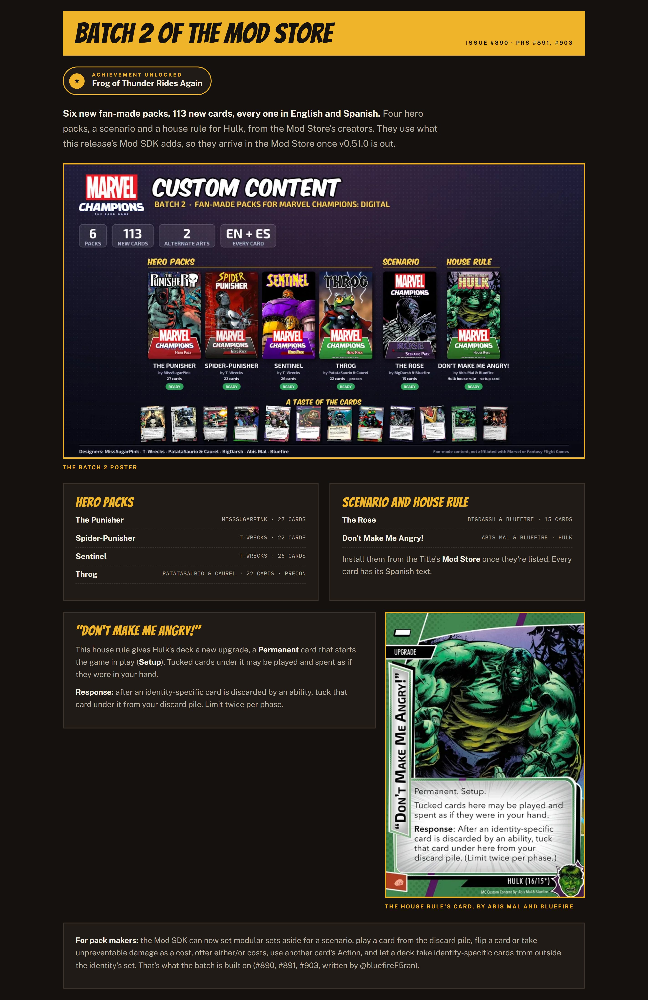
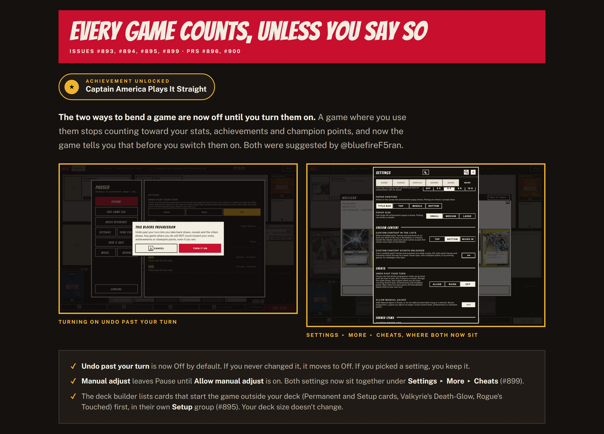

## J.A.R.V.I.S., Put It on My Phone

Every release now has an iPhone and iPad app, to install yourself with a free Apple ID through SideStore, AltStore or Sideloadly, with step-by-step guides in English and Spanish and an install section on the website (#874, #875). Game links now open the game you have installed: on Android a link to marvel.champions-digital-game.com opens the app, and on a computer the web version's replay loading screen has Open in the desktop app (#862, #863). Undo past your turn is now off by default, Manual adjust waits behind Allow manual adjust, both now sit under Settings ▸ More ▸ Cheats and warn that a game where you use them stops counting, and the deck builder lists setup cards in their own group, all suggested by @bluefireF5ran (#893, #894, #895, #896, #899, #900). The Saga shelf stamps ADJUSTED when a campaign was won with an adjusted game and says why the next volume stays sealed (#869, #870), and Red Skull's Improved Condition now enters on its Improved side (#873, #877), both from bktanner's reports. On iPhone, the game no longer gets stuck loading after iOS reloads the tab, thanks to GarethMagis (#871, #872). Avengers Tower and other "played" discounts now work for any player, thanks to FirePenguin17 (#888, #889), replays play through the villain phase with Reduced motion on (#892), and Ant-Man's Size Increase now loses its size counters, thanks to @MegaJesup (#897, #898). Batch 2 of the Mod Store, six fan-made packs with 113 new cards in English and Spanish, arrives once v0.51.0 is out: hero packs The Punisher (MissSugarPink), Spider-Punisher and Sentinel (T-Wrecks) and a Throg precon (PatataSaurio & Caurel), the scenario The Rose (BigDarsh & Bluefire) and the "Don't Make Me Angry!" house rule for Hulk (Abis Mal & Bluefire), built on the Mod SDK work @bluefireF5ran wrote (#890, #891, #903). Thank you for playing!

**[Read the full v0.51.0 report on the site ↗](https://champions-digital-game.com/releases/v0.51.0/)**: the iPhone and iPad app and how to install it, the Mod Store's batch 2 and its Hulk house rule card, game links that open the app, Undo and Manual adjust off by default, the deck builder's Setup group, the Saga's ADJUSTED stamp, the iPhone loading fix, campaign upgrades, shared discounts, the replay fix, Size Increase, the website's shared top bar and the thank-you wall.

**[Lee el informe completo en español ↗](https://champions-digital-game.com/releases/v0.51.0/index.es.html)**

---

## [v0.51.0] - 2026-11-20

### Added

- Game links open the installed app: Android opens marvel.champions-digital-game.com links in the app (App Links), and the desktop app registers marvelchampions:// links, with "Open in the desktop app" on the web version's replay loading screen (#862).
- An iPhone and iPad app with every release, to sideload with a free Apple ID through SideStore, AltStore or Sideloadly, with step-by-step install guides in English and Spanish; on iOS the update notice links the release page (#874).
- The landing page's download section has an iPhone and iPad install section: on an iPhone or iPad the download button leads to the SideStore steps with the .ipa download beside them, and every other device lists it under Other devices (#874).
- The v0.51.0 release report has its own page on the site, at /releases/v0.51.0/
- A pull request that changes the game posts its unsigned .ipa as a preview pre-release and links it in a PR comment, as the Android APK does; it's deleted when the pull request closes.
- Pull request previews also carry an iOS Simulator build, linked in the same comment, so the game can be checked on a Mac without an iPhone.
- The deck builder lists cards that start the game outside the deck (Permanent and Setup cards, Valkyrie's Death-Glow, Rogue's Touched) in their own Setup group (#895). Suggested by @bluefireF5ran.
- Mod Store: a pack's page shows its full description before it is installed (preview.json carries it), where the catalog has only the one-line summary (#890 item 18).
- The landing page's Mod Store section has a tab for each batch's poster, Batch 2 first, and lists the packs under Batch 2 and Batch 1, with batch 2's packs shown from their announcement until the store lists them.

### Changed

- The download stats page no longer compares its count with the releases before v0.19.0.
- The landing site's home, download stats and releases pages share one top bar (nav, English/Español, Steam, Download, Play now), and the stats and releases pages open on hero art like the home page.
- Undo past your turn now defaults to Off, and turning it on warns that games where you use it stop counting; Manual adjust leaves Pause until Settings > More > Misc gameplay > Allow manual adjust is on (#893, #894). Suggested by @bluefireF5ran.
- Settings: Undo past your turn and Allow manual adjust, the two settings that stop a game counting toward stats, achievements and champion points, now sit together under Settings > More > Cheats (#899).

### Fixed

- The Saga shelf now stamps ADJUSTED beside COMPLETE and says when a finished campaign was won with an adjusted game (Manual adjust or an Undo past a reveal), which doesn't open the next volume, and the next volume says why it is still sealed (#869).
- The Saga shelf's COMPLETE stamp is solid green with white text, sits on the card, and keeps its text inside the box.
- On iPhone, the game no longer gets stuck on LOADING (and the 'The game did not start' screen) after iOS reloads the tab, and keeps fewer card pictures in memory so the tab is reloaded less often (#871).
- Campaign upgrades now enter play on the side the campaign log records (#873). The Rise of Red Skull: a "Basic" Condition upgrade you replaced with its "Improved" side after Zola enters the Red Skull game on its Improved side. Sinister Motives: once reputation node 13 is marked, each later scenario's setup flips your S.H.I.E.L.D. Tech upgrade to its Enhanced side.
- Avengers Tower, Sure Gamble, Welcome Aboard and Soup Kitchen discount the next matching card any player plays, and Steve Rogers' Living Legend discounts the first ally any player plays each round, not only their own controller's (#888).
- Spider-Man (Peter Parker) ally can ready another player's Web-Warrior character after he attacks or thwarts, not only your own.
- Replays play through the villain phase by themselves with Reduced motion on, instead of stopping on Start player phase (#892). Reported by @bluefireF5ran.
- Mod SDK importer: a double-sided card's nested back face of another type (an environment that flips to an attachment) is marked as its hidden flip side too, so the normalizer emits both faces as cards naming each other in otherFaceId, as it does Chief Medical Officer / Medical Officer's Aid (#890 item 17).
- Ant-Man's nemesis attachment Size Increase now comes in with its 3 size counters, loses one each time the enemy it is attached to activates, and is discarded with the last (#897).
- The release workflow starts again: its iOS build job grants the pull-requests permission ios-build.yml's preview job asks for, so release-on-merge.yml no longer fails before it runs (since #875).

### Engine

- Mod SDK: a pack scenario may set modular sets aside with setAsideModularSetCount (the seat picks them, or they are drawn at random), for a scenario's own cards to call on, such as The Rose's mini-boss set (#890).
- Mod SDK: a resource ability's generatesFor may name an aspect ("generate a [wild] resource for a 'Pool card"), so a pack card can use it (#890).
- An effect can play a card from its player's discard pile, paying its costs (playFromHand from "discard", DSL playFromDiscard), for pack cards such as the Punisher's Warzone; it is not counted as played from the hand (#890).
- Mod SDK: a cost may flip another card you control (AbilityCost.flipCards, DSL flipCardsCost), and an additional cost to play a card may be an either/or choice picked with the play's costSelection, for Sentinel's "exhaust or destroy a Component" (#890).
- Mod SDK: a "take N damage" cost may be unpreventable (AbilityCost.damageSelfUnpreventable, takeDamageCost(n, { unpreventable: true })), so Sentinel's destroy cost is paid through tough, prevention and reduction; legalActions and the cost pickers judge and ask each branch of an either/or cost with that branch's own cards in play, and name an additional cost to play in the branch labels; a pack scenario's set-aside modular sets are checked as its modular picks are (#891 review).
- Mod SDK: ValueSpec defeatExcessThreat (DSL defeatExcessThreat / overdefeated), the threat a side scheme's defeating removal attempted beyond what it had, for "after a side scheme is overdefeated" (#890 item 8).
- Mod SDK: TargetQuery.keywordNotFromSelf, for "if it already has steady or stalwart" checks that leave out the card's own keyword grant (Rose's Greenhouse, #890 item 9).
- Mod SDK: TriggerEvent endPhaseCardsReadied (DSL on.yourCardsReadiedAtPhaseEnd), each player's cards the end-of-player-phase ready step readied, as slot readied.cards, for "after you ready your cards at the end of the player phase" (Web-Sling, #890 item 1).
- Mod SDK: a resource ability usable only for an ability's cost on a matching card (AbilityDefinition.generatesForAbility, DSL resource(..., { generatesFor, forAbility: true })), for "generate a [wild] resource for an upgrade ability" (With Great Firepower, #890 item 3).
- Mod SDK: EffectSpec useActionAbility (DSL useActionAbility), use an Action ability of a card in play you control at the effect's moment, out of turn, paying its cost, for "resolve an 'Action' ability on a card you control" (War Machine Armor, #890 item 6).
- Mod SDK: a resource ability on a card in hand that pays for that card alone (activeIn: "hand", DSL resource(..., { inHand: true })), what it generated read as paid.ability.<id>; legalActions tries one option per resource ability whose cost picks cards in play, the widest (Enhanced Combat Sense, #890 item 2).
- Mod SDK: PlayerCard.optionalForIdentity, an identity-specific card outside the identity's set that a deck for it may include and none must; a house-rule pack may add such cards for an official hero, with their abilities and starter decks ("Don't Make Me Angry!" for Hulk, #890 item 13).
- Mod SDK: attacksDealExtraDamage.perCounterOnTarget (DSL attacksDealAdditionalDamage(n, { perCounterOnTarget })), n per counter of a type on the attacked character, for Sentinel's Exposed carried as exposed counters; the board shows exposed counters as an Exposed status ("EXPOSED ×N", in its card's red) (#890 item 10).
- Mod SDK: a player card that attaches itself with its own effect (a support moved onto a side scheme, under its player's control) and whose text keeps it when its host is defeated (staysWhenHostLeaves) comes back unattached to its controller's play area, permanent or not; the importer no longer reads "Action: Attach to …" as the card's attach rule (Juston Seyfert, #890 items 12 and 17).
- Mod SDK (PR #903 review): useActionAbility offers only printed Actions (an Action, Hero Action or Alter-Ego Action, each in its form), asks the branch and the in-play cost picks of the chosen Action, and prices its resources as an ability's payment; a resource whose cost picks any number of cards always offers one option of every size, the largest included.
- Mod SDK (PR #903 review): useActionAbility tries each resource ability alone as well when judging an Action usable, and asks how many counters an "up to N" counter cost removes; the end-of-phase readied announcement is prepared for any ability listening for it, whatever its condition, which is then judged with the cards readied.
- Mod SDK (PR #903 review 3): useActionAbility judges an Action with every subset of resource abilities up to its cost, asks the cost's hand discard and its other choices as a regular use would (Captain America's Action), keeps an "including this card" pick's own card (The Elephant's Trunk), and asks the resources again should the engine refuse them.
- Mod SDK (PR #903 review 4): useActionAbility spends a hand card once in a probe (plain, or with its "when spent" ability), builds resource subsets lazily within its bound, judges an either/or branch with that branch's choices, and asks how many cards a "discard X" or "discard 1 or more" cost takes.
- Mod SDK (PR #903 review 5): useActionAbility tries each way a hand card's "when spent" ability may be used (each damage amount Energy Siphon may take) when judging an Action, and asks which cards a combined-value hand discard takes (Advanced Glider), asking again when they fall short.
- Mod SDK (PR #903 review 6): useActionAbility judges an Action with legalActions' own evaluation, as at the player's moment to act (abilityUsableAsTheirMoment), its branches and counter range included; a hand card the cost discards is offered to pay in none of its ways. The shared payment search gains a wallet with one resource ability per card, one with each chosen-amount resource at its largest, and an either/or branch's own hand discard, so Actions those make affordable are offered on the player's own turn too; resourcePickChoices builds its combinations lazily.
- Mod SDK (PR #903 review 7): an optionalForIdentity card is held to the copy rules (three by title, its own deck limit) like any card outside the identity set's required cards, in validateDeck and copiesUpToLimit. useActionAbility on a card whose costs any player may help pay asks who pays each delegable part (CostSelection.paidBy; no question when one player can) and offers the other players' hand cards for a hand-discard cost, as a regular use does; the client titles that question by part.

### Special thanks

- @bluefireF5ran reported #890.
- @bluefireF5ran wrote #891 and #903.
- @MegaJesup reported #897.
- bktanner reported #869 and #873 on Discord.
- FirePenguin17 reported #888 on Discord.
- GarethMagis reported #871 on Discord.
