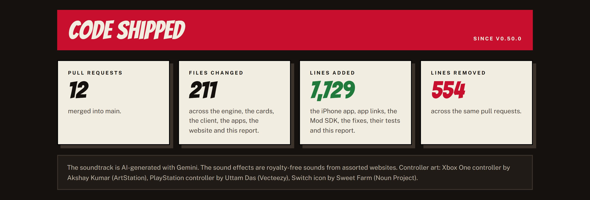

## Straight to the App

Every release now has an iPhone and iPad app, to install yourself with a free Apple ID through SideStore, AltStore, Sideloadly or Scarlet, with step-by-step guides in English and Spanish and an install section on the website (#874, #875). Game links now open the game you have installed: on Android a link to marvel.champions-digital-game.com opens the app, and on a computer the web version's replay loading screen has Open in the desktop app (#862, #863). Undo past your turn is now off by default, Manual adjust waits behind Settings ▸ More ▸ Misc gameplay ▸ Allow manual adjust, both warn that a game where you use them stops counting, and the deck builder lists setup cards in their own group, all suggested by @bluefireF5ran (#893, #894, #895, #896). The Saga shelf stamps ADJUSTED when a campaign was won with an adjusted game and says why the next volume stays sealed (#869, #870), and Red Skull's Improved Condition now enters on its Improved side (#873, #877), both from bktanner's reports. On iPhone, the game no longer gets stuck loading after iOS reloads the tab, thanks to GarethMagis (#871, #872). Avengers Tower and other "played" discounts now work for any player, thanks to FirePenguin17 (#888, #889), and replays play through the villain phase with Reduced motion on (#892). For pack makers, @bluefireF5ran wrote the Mod SDK work for the next batch of packs (#890, #891). Thank you for playing!

**[Read the full v0.51.0 report on the site ↗](https://champions-digital-game.com/releases/v0.51.0/)**: the iPhone and iPad app and how to install it, game links that open the app, Undo and Manual adjust off by default, the deck builder's Setup group, the Saga's ADJUSTED stamp, the iPhone loading fix, campaign upgrades, shared discounts, the replay fix, the Mod SDK, the website's shared top bar and the thank-you wall.

**[Lee el informe completo en español ↗](https://champions-digital-game.com/releases/v0.51.0/index.es.html)**

