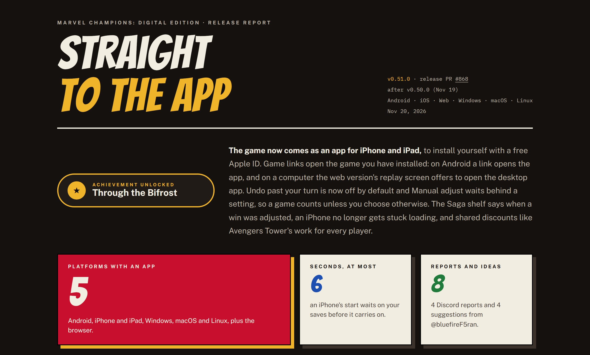
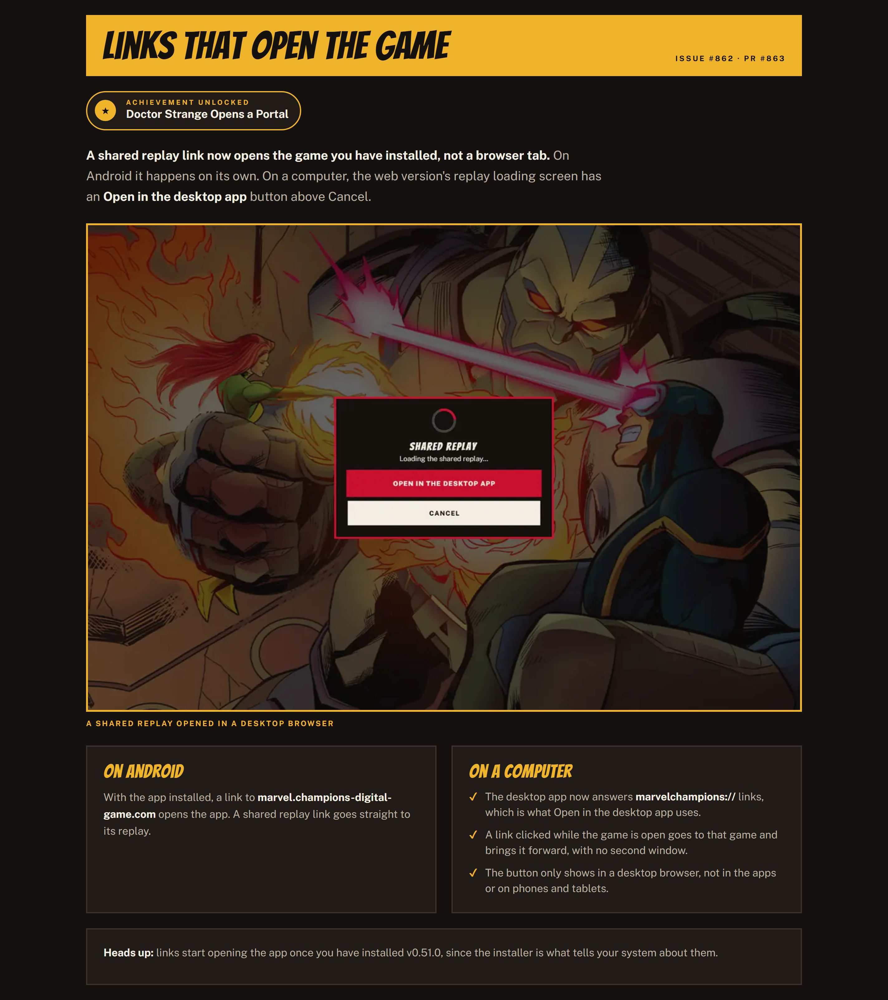
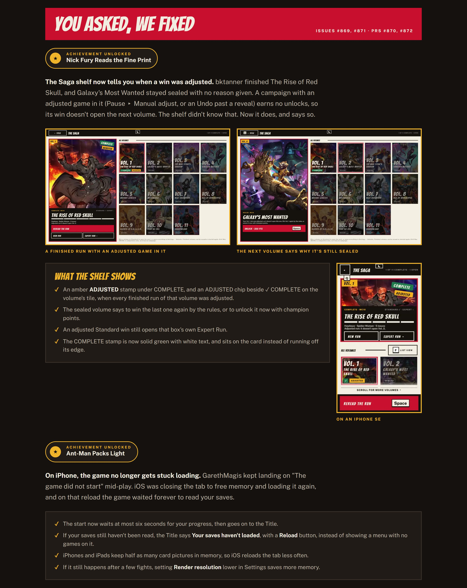
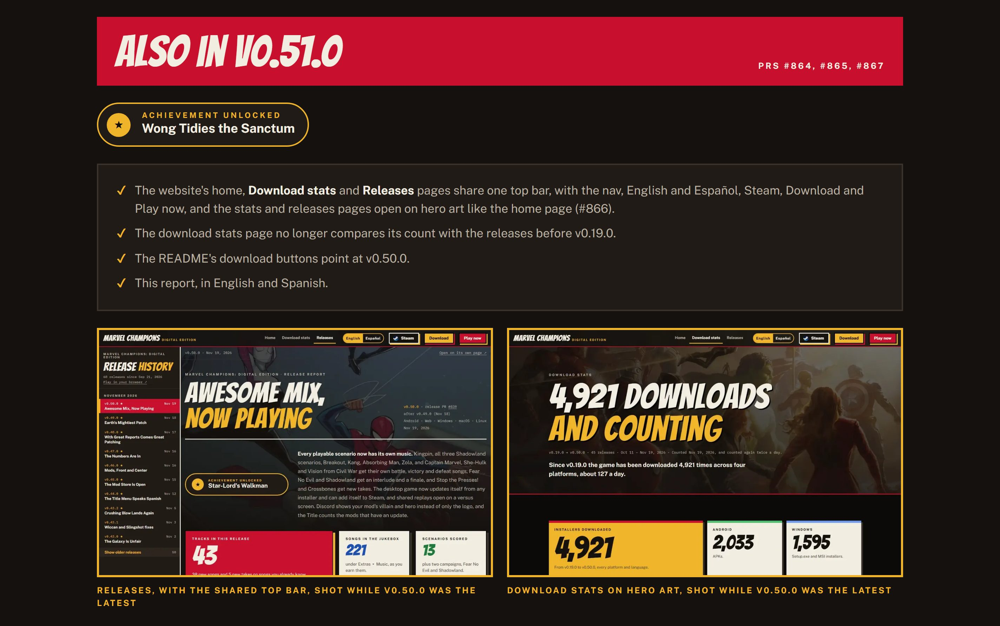
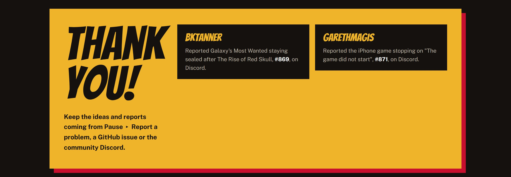
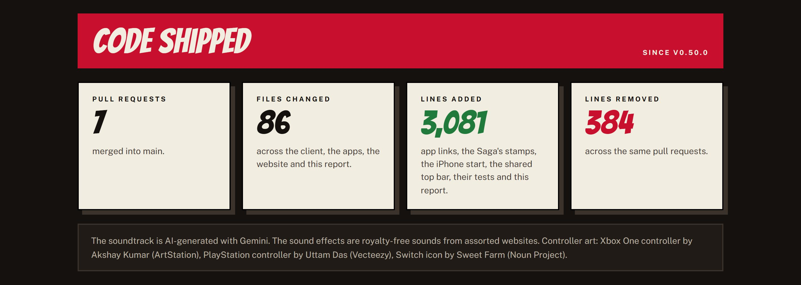

## Straight to the App

Game links now open the game you have installed. On Android, a link to marvel.champions-digital-game.com opens the app instead of the browser, and on a computer the web version's replay loading screen has Open in the desktop app, which opens the desktop game through its new marvelchampions:// links (#862, #863). The Saga shelf now stamps ADJUSTED beside COMPLETE when a campaign was won with an adjusted game, and the next volume says why that keeps it sealed, thanks to bktanner's report (#869, #870). On iPhone, the game no longer gets stuck loading after iOS reloads the tab, and keeps fewer card pictures in memory so that happens less often, thanks to GarethMagis's report (#871, #872). The website's home, download stats and releases pages share one top bar and open on hero art (#866, #867). Thank you for playing!

**[Read the full v0.51.0 report on the site ↗](https://champions-digital-game.com/releases/v0.51.0/)**: game links that open the app on Android and desktop, the Saga's ADJUSTED stamp and sealed-volume note, the iPhone loading fix, the website's shared top bar and the thank-you wall.

**[Lee el informe completo en español ↗](https://champions-digital-game.com/releases/v0.51.0/index.es.html)**

