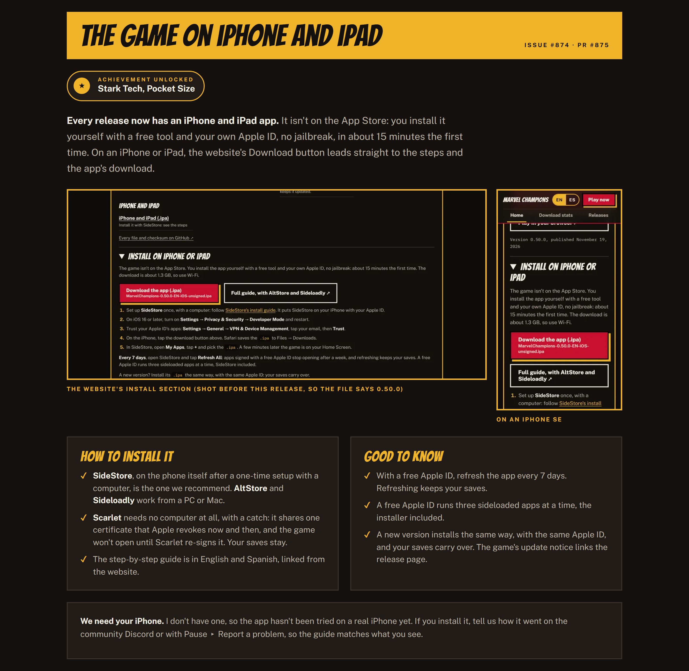
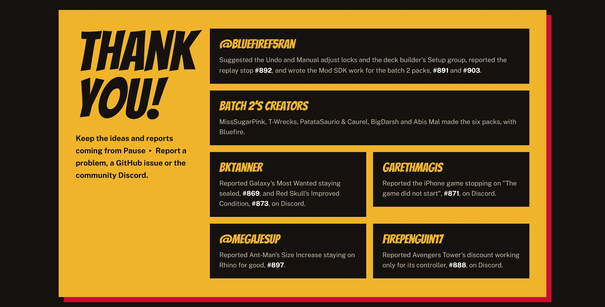

## J.A.R.V.I.S., Put It on My Phone

Every release now has an iPhone and iPad app, to install yourself with a free Apple ID through SideStore, AltStore or Sideloadly, with step-by-step guides in English and Spanish and an install section on the website (#874, #875). Game links now open the game you have installed: on Android a link to marvel.champions-digital-game.com opens the app, and on a computer the web version's replay loading screen has Open in the desktop app (#862, #863). Undo past your turn is now off by default, Manual adjust waits behind Allow manual adjust, both now sit under Settings ▸ More ▸ Cheats and warn that a game where you use them stops counting, and the deck builder lists setup cards in their own group, all suggested by @bluefireF5ran (#893, #894, #895, #896, #899, #900). The Saga shelf stamps ADJUSTED when a campaign was won with an adjusted game and says why the next volume stays sealed (#869, #870), and Red Skull's Improved Condition now enters on its Improved side (#873, #877), both from bktanner's reports. On iPhone, the game no longer gets stuck loading after iOS reloads the tab, thanks to GarethMagis (#871, #872). Avengers Tower and other "played" discounts now work for any player, thanks to FirePenguin17 (#888, #889), replays play through the villain phase with Reduced motion on (#892), and Ant-Man's Size Increase now loses its size counters, thanks to @MegaJesup (#897, #898). Batch 2 of the Mod Store, six fan-made packs with 113 new cards in English and Spanish, arrives once v0.51.0 is out: hero packs The Punisher (MissSugarPink), Spider-Punisher and Sentinel (T-Wrecks) and a Throg precon (PatataSaurio & Caurel), the scenario The Rose (BigDarsh & Bluefire) and the "Don't Make Me Angry!" house rule for Hulk (Abis Mal & Bluefire), built on the Mod SDK work @bluefireF5ran wrote (#890, #891, #903). Thank you for playing!

**[Read the full v0.51.0 report on the site ↗](https://champions-digital-game.com/releases/v0.51.0/)**: the iPhone and iPad app and how to install it, the Mod Store's batch 2 and its Hulk house rule card, game links that open the app, Undo and Manual adjust off by default, the deck builder's Setup group, the Saga's ADJUSTED stamp, the iPhone loading fix, campaign upgrades, shared discounts, the replay fix, Size Increase, the website's shared top bar and the thank-you wall.

**[Lee el informe completo en español ↗](https://champions-digital-game.com/releases/v0.51.0/index.es.html)**

