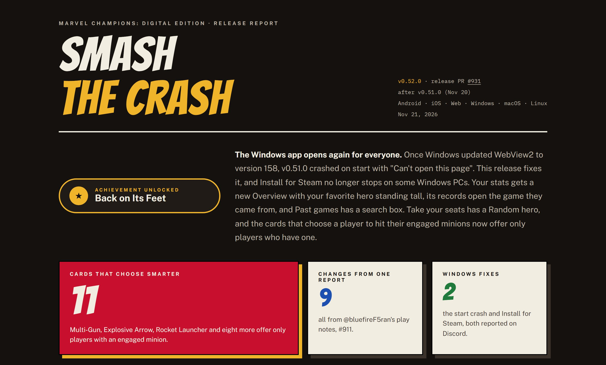
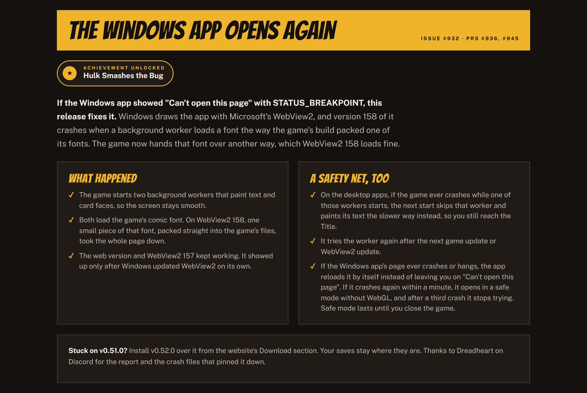
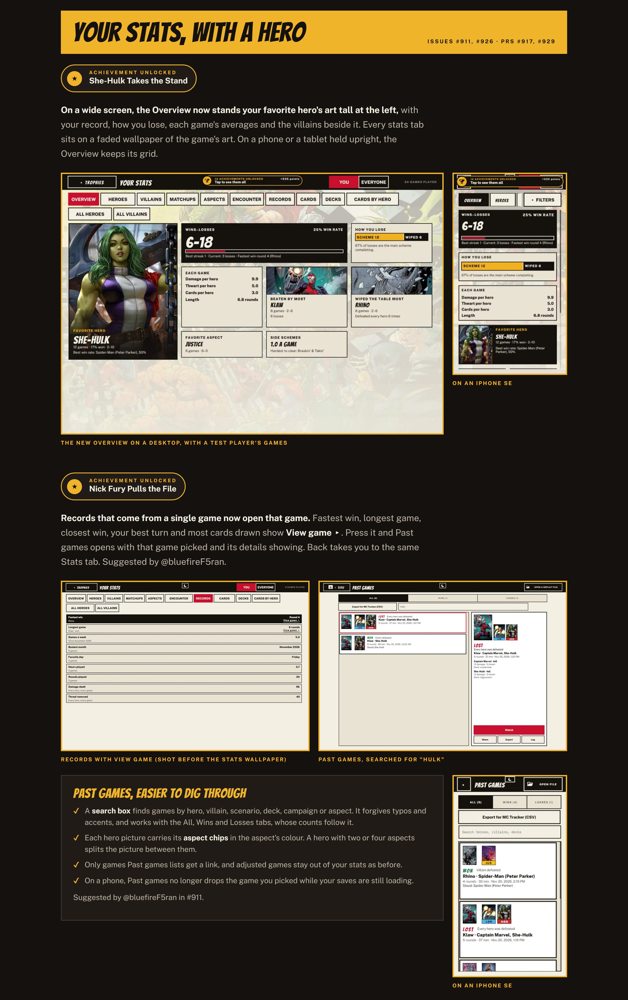
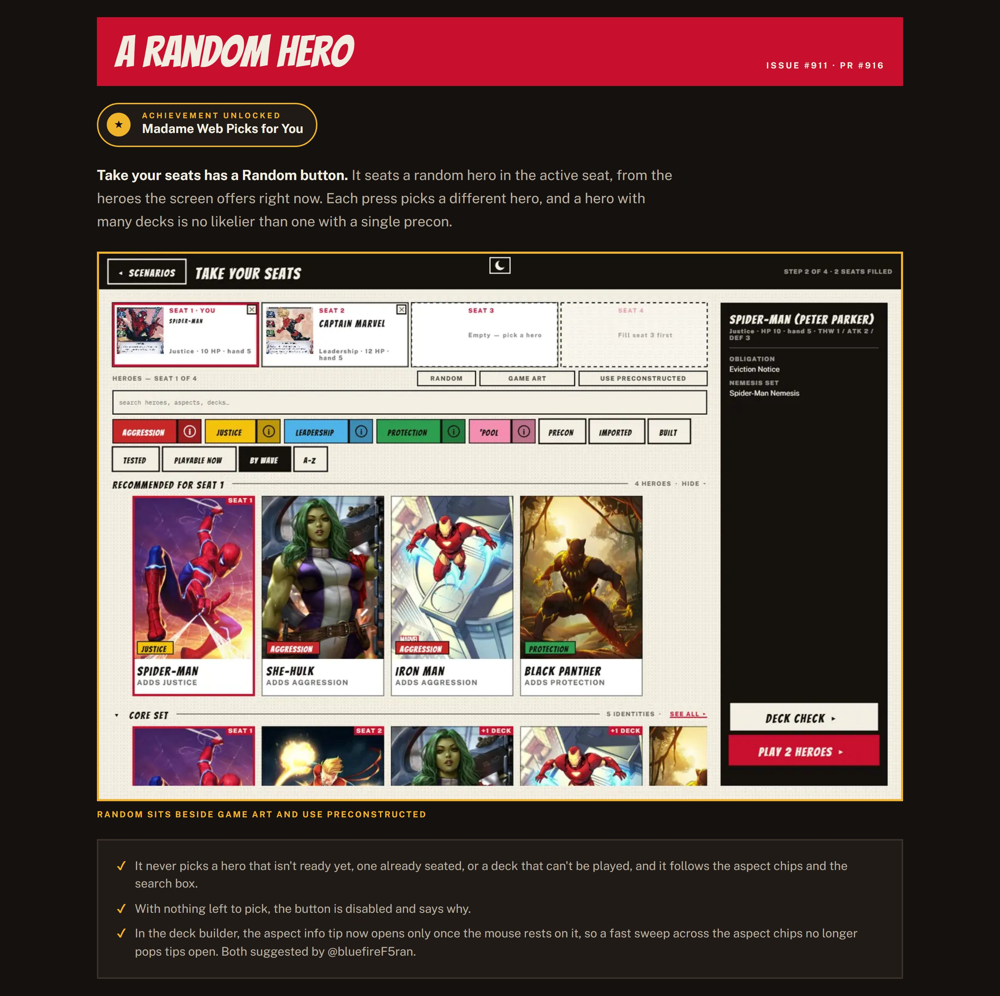
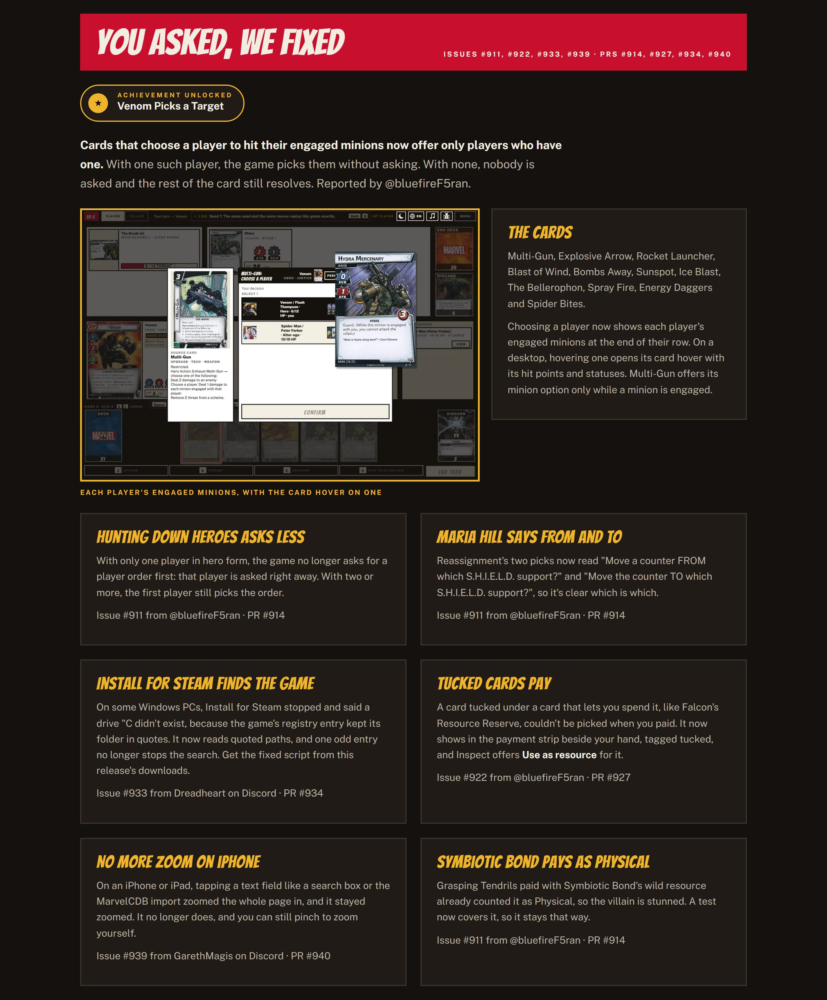
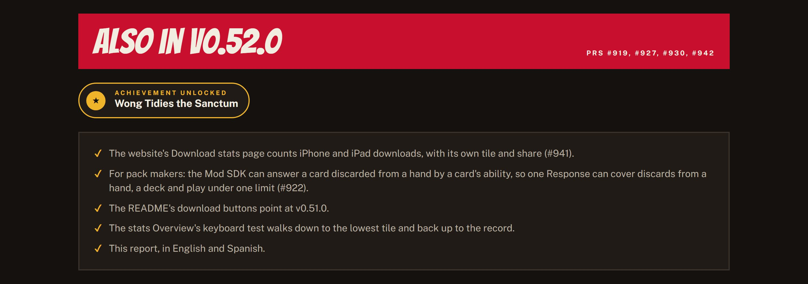
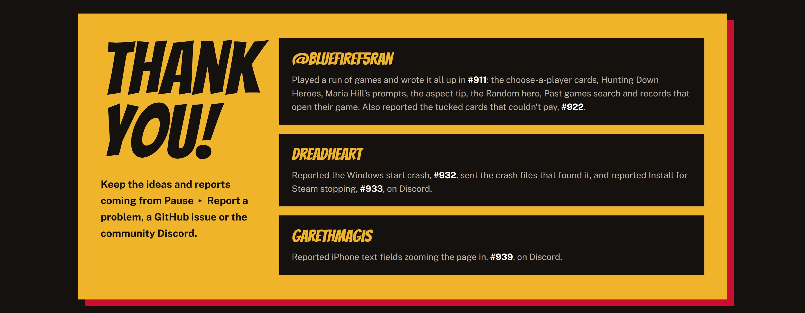
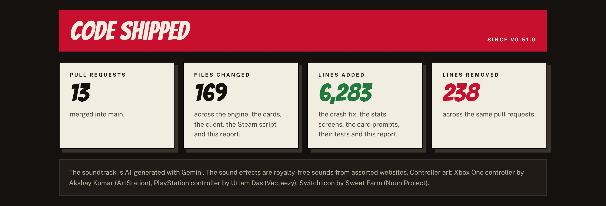

## Smash the Crash

The Windows app opens again: once Windows updated WebView2 to version 158, v0.51.0 crashed on start with "Can't open this page" (STATUS_BREAKPOINT), and this release fixes it, with a safety net that skips a background painter if it ever takes the page down (#932, #936), and if the page does crash, the app reloads it by itself and then tries a safe mode (#945). Install for Steam no longer stops on PCs whose registry keeps the game's folder in quotes (#933, #934), both reported by Dreadheart on Discord. Your stats has a new Overview that stands your favorite hero's art tall on a wide screen, with a faded wallpaper behind every tab (#926, #929). From @bluefireF5ran's play notes in #911: stats records open the game they came from, Past games has a search box and aspect chips, Take your seats has a Random hero, the aspect info tip waits for the mouse to rest, and eleven cards that choose a player to hit their engaged minions now offer only players who have one, with Hunting Down Heroes and Maria Hill's Reassignment asking clearer questions (#914, #916, #917). Cards tucked under Falcon's Resource Reserve can now be spent when you pay, also from @bluefireF5ran's report (#922, #927). On iPhone and iPad, tapping a text field no longer zooms the page in, thanks to GarethMagis (#939, #940). The website's download stats now count iPhone and iPad downloads (#941, #942). Thank you for playing!

**[Read the full v0.52.0 report on the site ↗](https://champions-digital-game.com/releases/v0.52.0/)**: the Windows crash and its fix, the new stats Overview, records that open their game, Past games search, the Random hero, the choose-a-player cards, Hunting Down Heroes, Maria Hill, Install for Steam and the thank-you wall.

**[Lee el informe completo en español ↗](https://champions-digital-game.com/releases/v0.52.0/index.es.html)**

---

## [v0.52.0] - 2026-11-21

### Added

- Choosing a player shows the minions engaged with each player, with the card hover for their hit points and statuses (#911).
- Take your seats has a Random button that seats a random hero in the active seat, from the heroes the roster offers right now (never a hero that isn't ready, one already seated or an illegal deck) (#911).
- Past games has a search box over heroes, villains and decks (fuzzy and accent-free, combined with the All/Won/Lost tabs), and aspect chips on each hero's picture; suggested by @bluefireF5ran (#911).
- Stats records that come from a single game (fastest win, longest game, closest win, best turn, most cards drawn) link to that game in Past games (#911).
- The v0.52.0 release report has its own page on the site, at /releases/v0.52.0/
- The download stats page counts iOS downloads (the unsigned IPAs) and shows iOS in the platform breakdown.

### Changed

- Your stats: on a wide screen the Overview stands your favorite hero's art tall at the left with the other tiles beside it, and every stats tab has a faded wallpaper backdrop (#926).

### Fixed

- Multi-Gun's choose-a-player option is offered only with an engaged minion, and only the players with one can be chosen; reported by @bluefireF5ran (#911).
- Hunting Down Heroes no longer asks for a player order when only one player is in hero form, and Maria Hill's Reassignment asks which support the counter moves FROM, then TO (#911).
- Cards that choose a player to hit the minions engaged with them (Explosive Arrow, Rocket Launcher, Blast of Wind, Bombs Away, Sunspot, Ice Blast, The Bellerophon, Spray Fire, Energy Daggers, Spider Bites, Multi-Gun) offer only players with an engaged minion and choose the only one without asking (#911).
- The deck builder's aspect info tip opens only once the mouse rests on it, so a fast sweep across the chips no longer pops it open; reported by @bluefireF5ran (#911).
- A card tucked under a card that lets you spend it (Resource Reserve, a pack's host) can now be spent when you play a card: it shows in the payment strip beside your hand, and Inspect offers Use as resource for it (#922).
- Install for Steam on Windows no longer stops with 'drive "C does not exist' when the game's registry entry keeps its install path in quotes (#933)
- Windows: the game no longer opens to 'Can't open this page' (STATUS_BREAKPOINT) after WebView2 updates to 158. Its text and card workers now get the inlined font as bytes, and a font worker that ever crashes the page is skipped on the next start (#932)
- On an iPhone or iPad, tapping a text field (a search box, the MarvelCDB import) no longer zooms the page in and leaves it zoomed (#939).
- Windows: if the game's page crashes, the app reloads it by itself, then tries a safe mode without WebGL, instead of leaving you on 'Can't open this page' (#932)

### Engine

- An ordered 'each player' effect skips the first player's order prompt when at most one player's pass can do anything (#911).
- New response event for a card discarded from a hand by a card's ability (cardDiscardedFromHand, with the discarding card's side and effect or cost), and on.cardDiscardedFromHand in the card DSL, so one ability can answer discards from a hand, a deck and play under one limit (#922).
- A card discarded from a player's deck now says which side's card discarded it and whether as an effect or a cost (cardDiscardedFromDeck by and how), as an encounter deck's discard already did (#922).

### Special thanks

- @bluefireF5ran reported #911 and #922.
- Dreadheart reported #932 and #933 on Discord.
- GarethMagis reported #939 on Discord.
