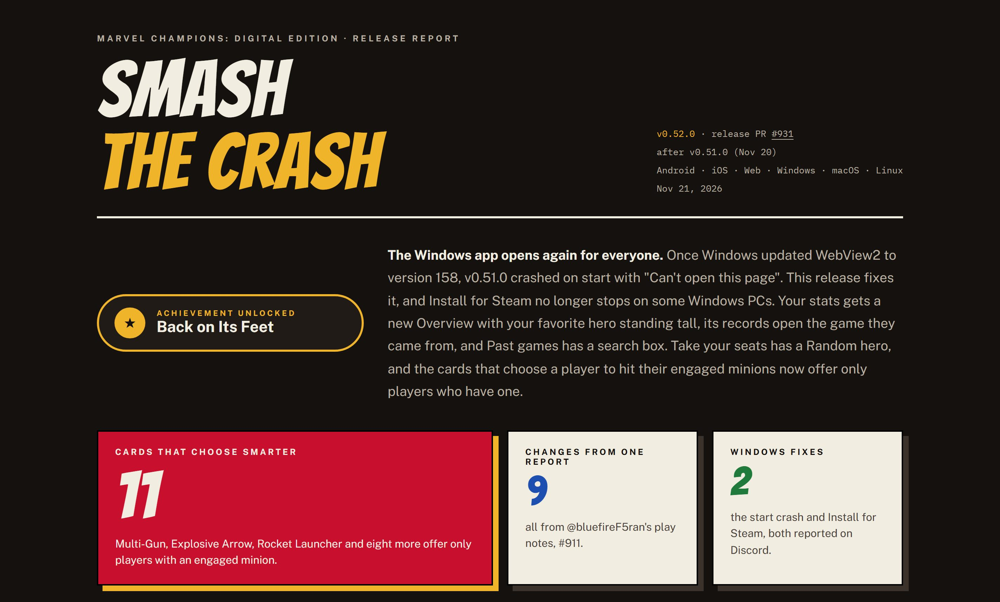
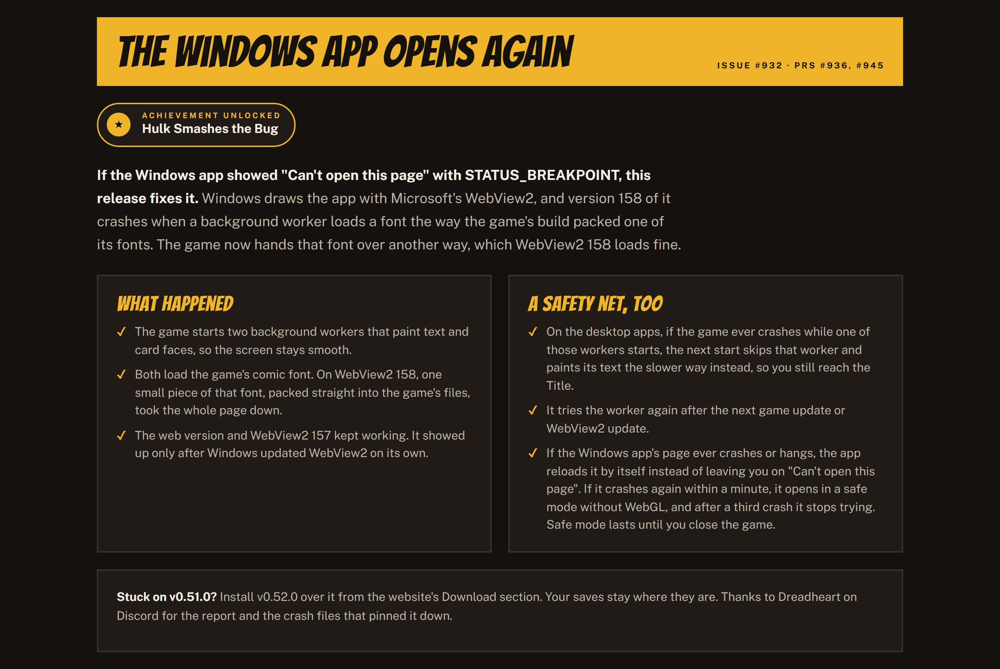
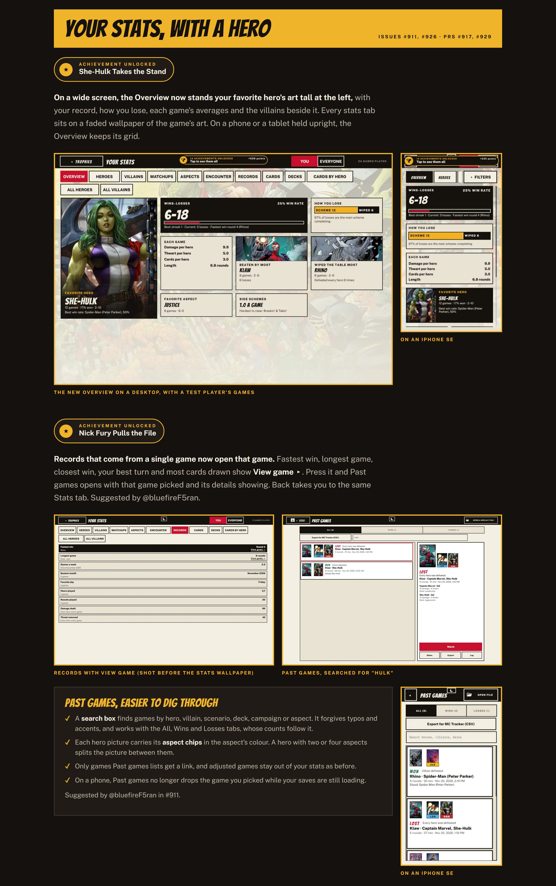
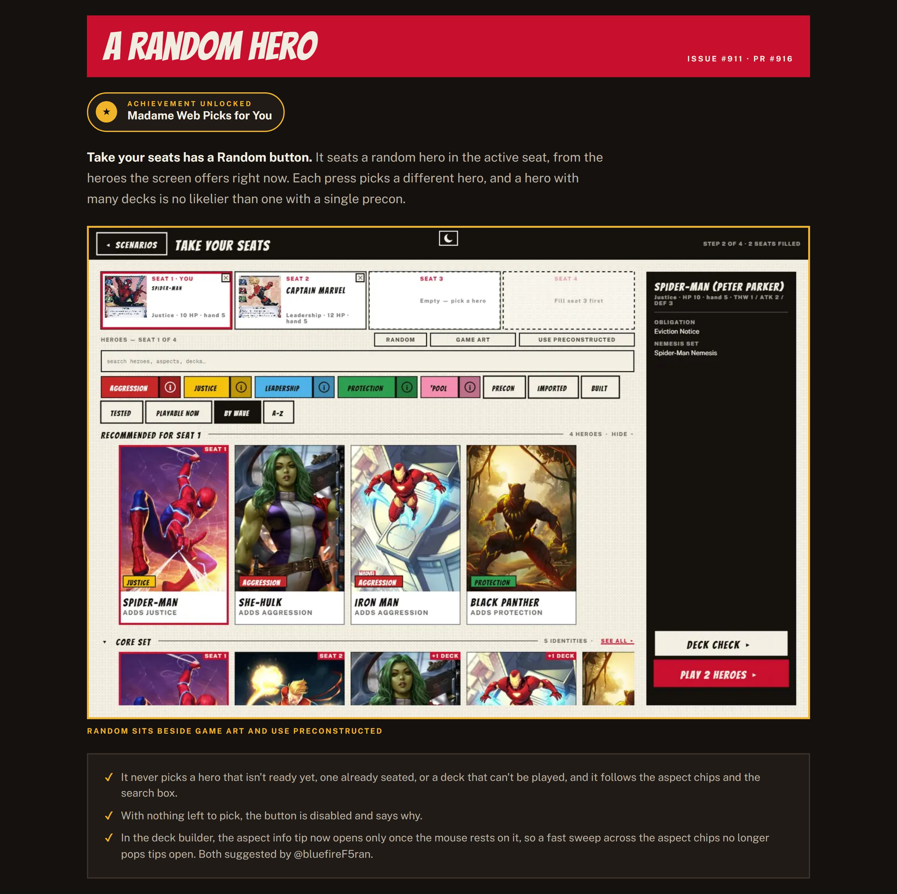
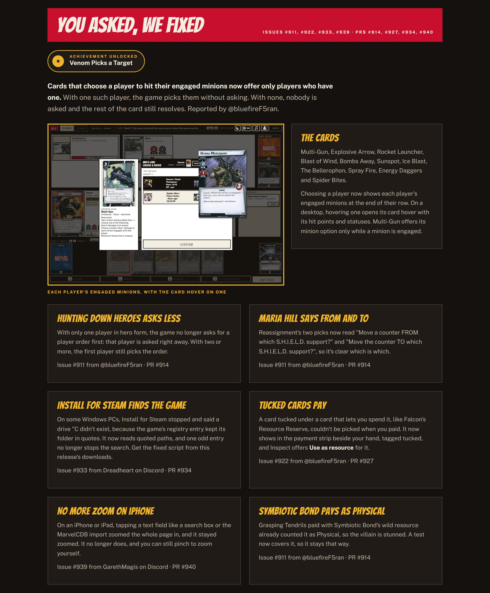
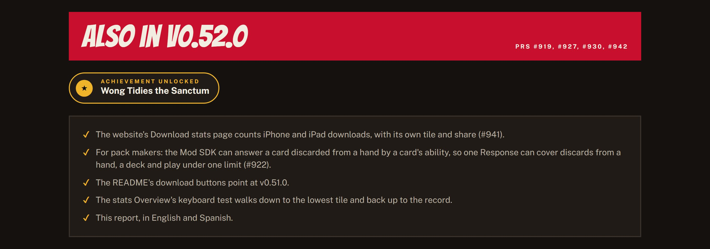
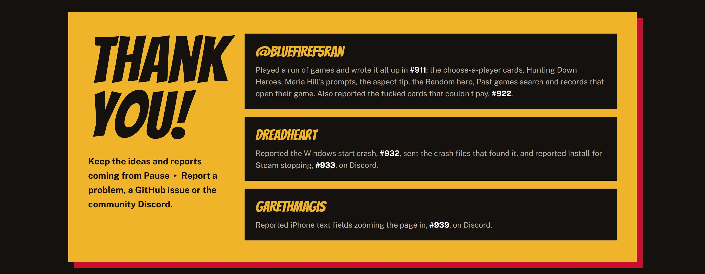
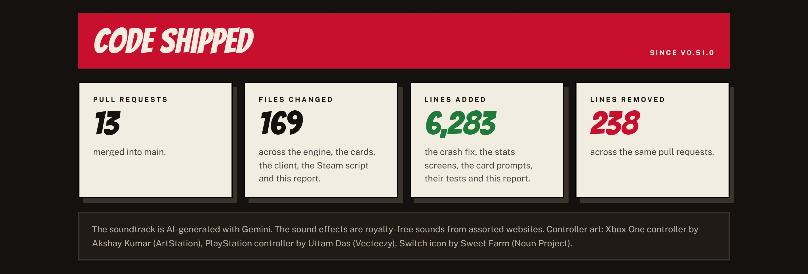

## Smash the Crash

The Windows app opens again: once Windows updated WebView2 to version 158, v0.51.0 crashed on start with "Can't open this page" (STATUS_BREAKPOINT), and this release fixes it, with a safety net that skips a background painter if it ever takes the page down (#932, #936), and if the page does crash, the app reloads it by itself and then tries a safe mode (#945). Install for Steam no longer stops on PCs whose registry keeps the game's folder in quotes (#933, #934), both reported by Dreadheart on Discord. Your stats has a new Overview that stands your favorite hero's art tall on a wide screen, with a faded wallpaper behind every tab (#926, #929). From @bluefireF5ran's play notes in #911: stats records open the game they came from, Past games has a search box and aspect chips, Take your seats has a Random hero, the aspect info tip waits for the mouse to rest, and eleven cards that choose a player to hit their engaged minions now offer only players who have one, with Hunting Down Heroes and Maria Hill's Reassignment asking clearer questions (#914, #916, #917). Cards tucked under Falcon's Resource Reserve can now be spent when you pay, also from @bluefireF5ran's report (#922, #927). On iPhone and iPad, tapping a text field no longer zooms the page in, thanks to GarethMagis (#939, #940). The website's download stats now count iPhone and iPad downloads (#941, #942). Thank you for playing!

**[Read the full v0.52.0 report on the site ↗](https://champions-digital-game.com/releases/v0.52.0/)**: the Windows crash and its fix, the new stats Overview, records that open their game, Past games search, the Random hero, the choose-a-player cards, Hunting Down Heroes, Maria Hill, Install for Steam and the thank-you wall.

**[Lee el informe completo en español ↗](https://champions-digital-game.com/releases/v0.52.0/index.es.html)**

