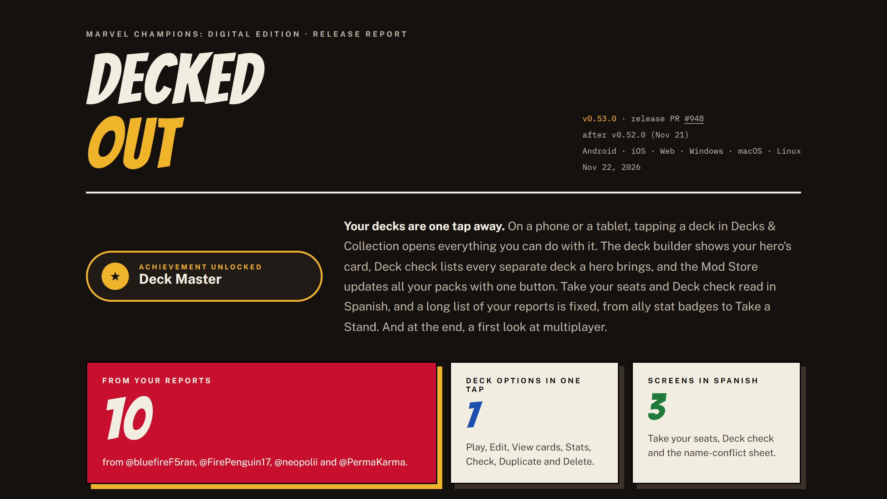
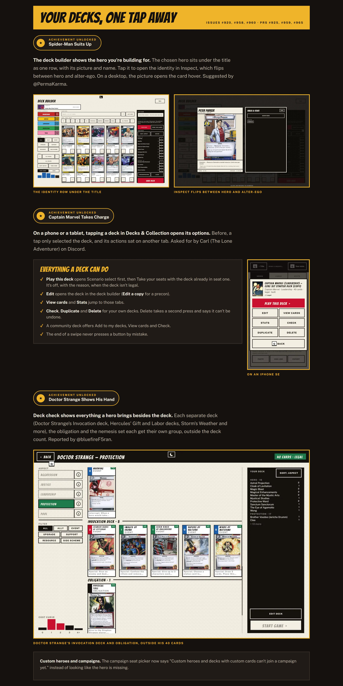
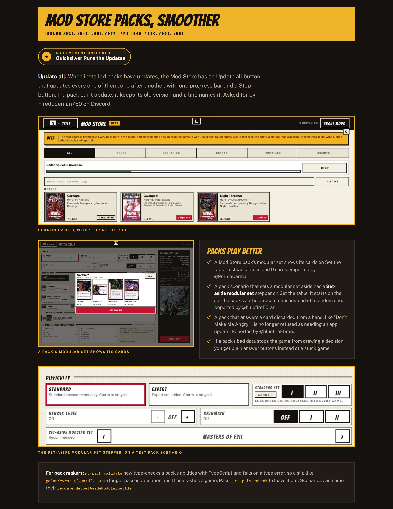
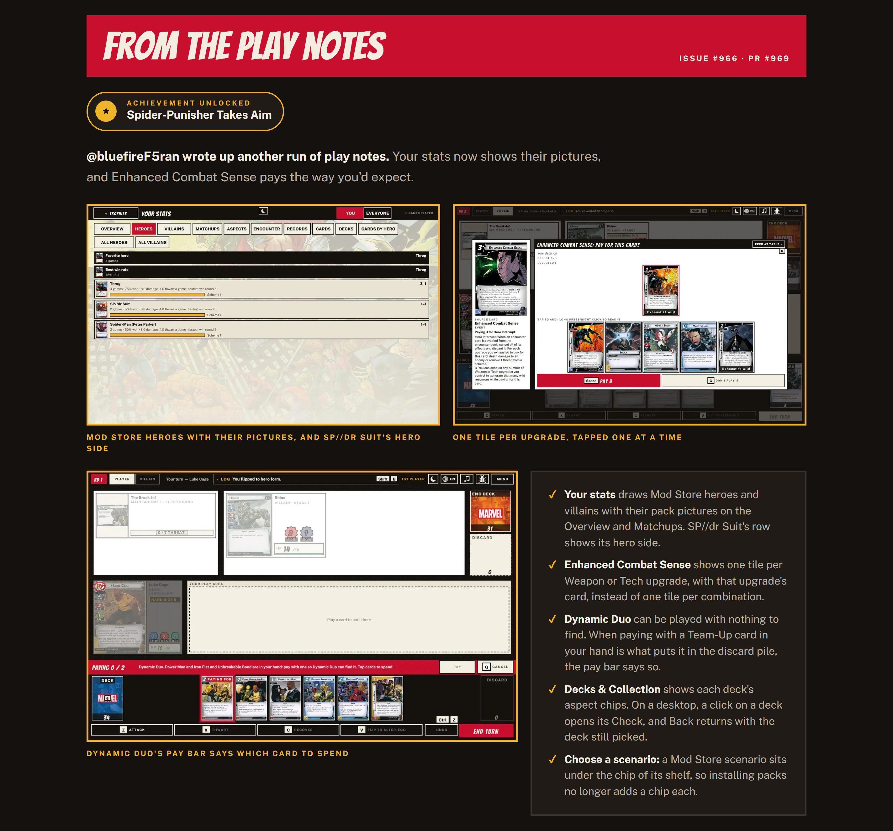
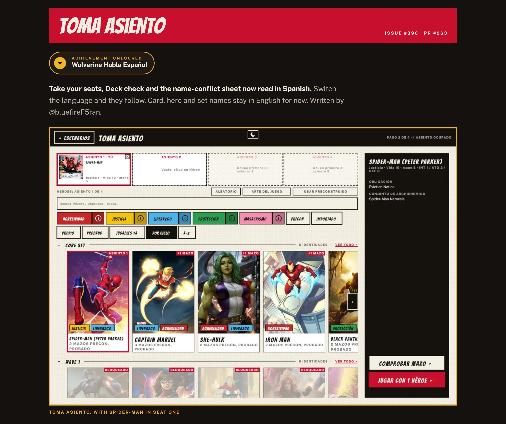
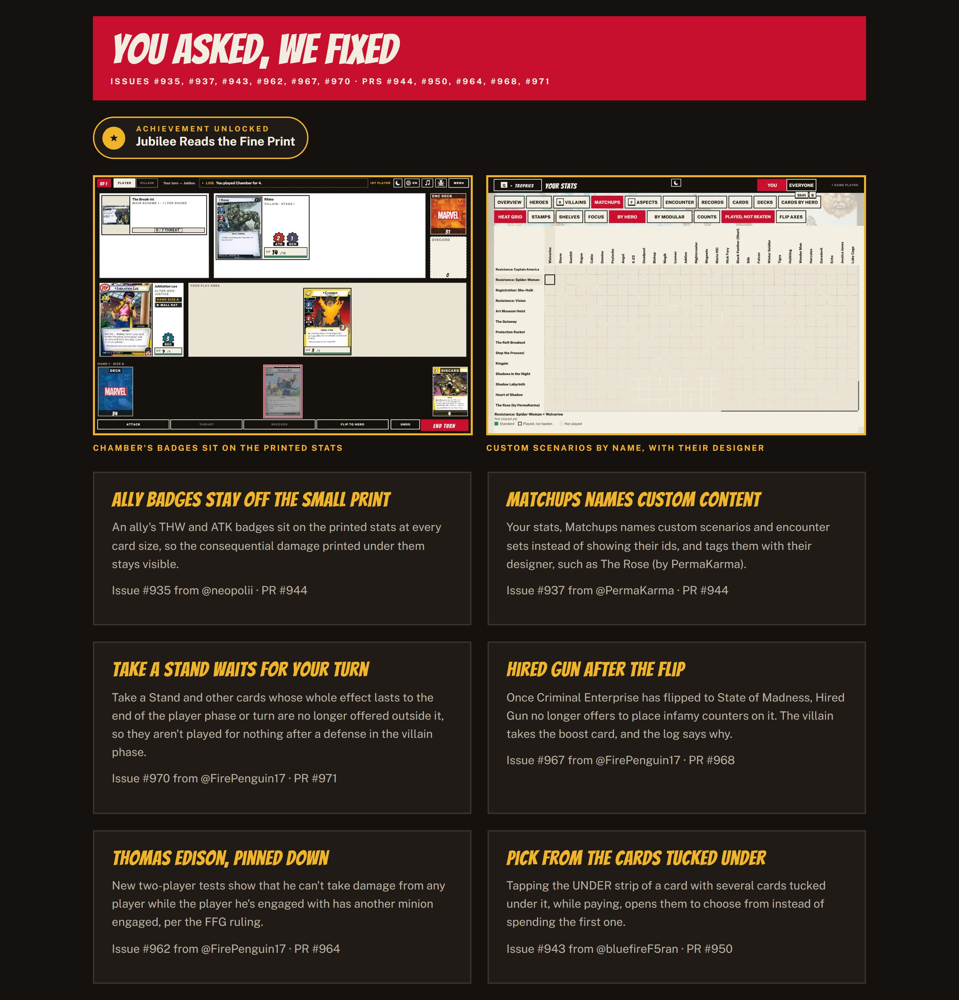
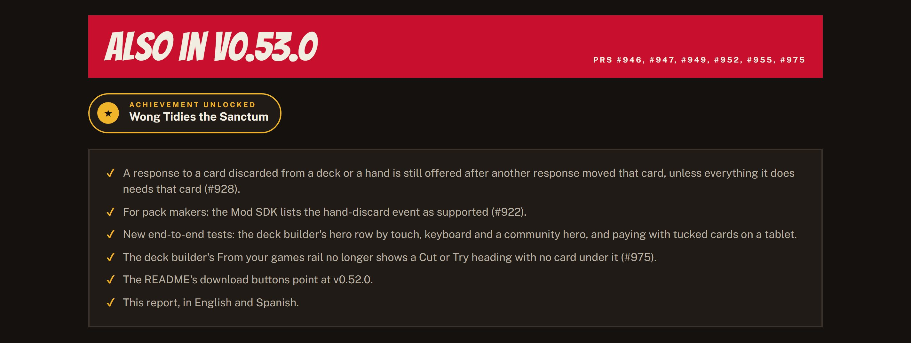
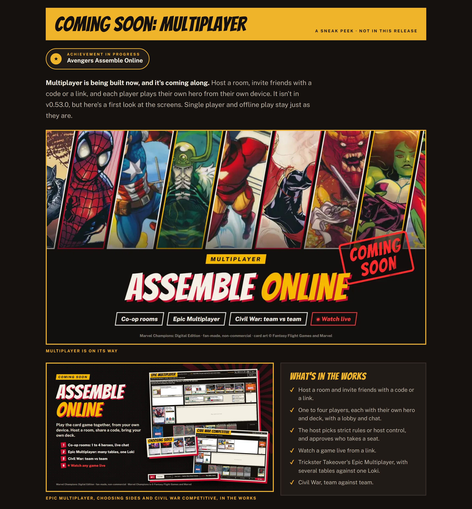
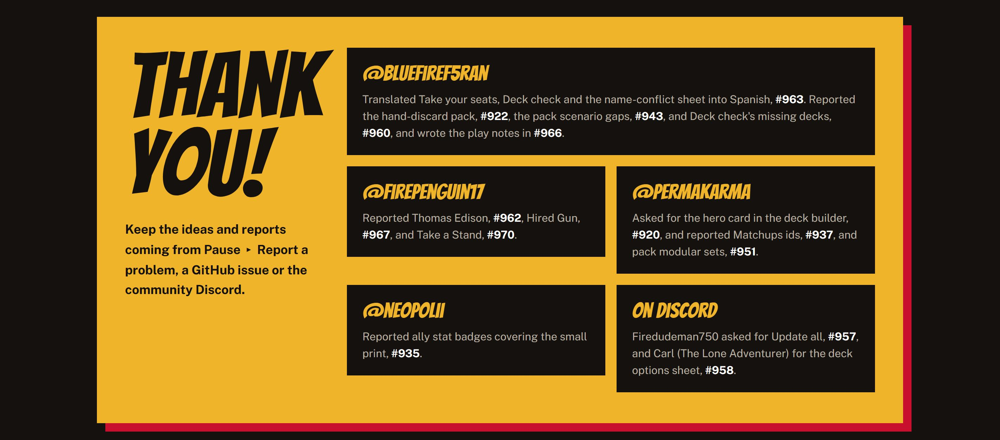
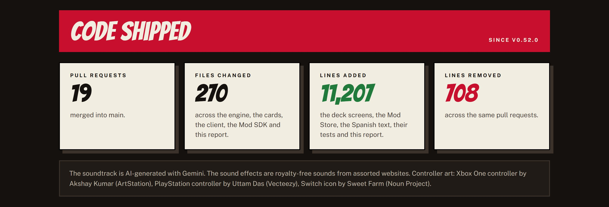

## Decked Out

On a phone or a tablet, tapping a deck in Decks & Collection now opens everything you can do with it, and Play this deck goes to Scenario select first (#958, #959). The deck builder shows your hero's card, as @PermaKarma asked (#920, #925), and Deck check lists each separate deck, obligation and nemesis set a hero brings, from @bluefireF5ran's report (#960, #965). The Mod Store has an Update all button (#957, #961), a pack's modular set shows its cards on Set the table (#951, #953), and pack scenarios get a Set-aside modular set stepper while `mc-pack validate` now type-checks abilities (#943, #950). From @bluefireF5ran's play notes, Your stats shows Mod Store heroes with their pictures, Enhanced Combat Sense pays one upgrade at a time and the deck list has aspect chips (#966, #969). Take your seats and Deck check read in Spanish, translated by @bluefireF5ran (#390, #963). Ally stat badges no longer cover the small print, reported by @neopolii (#935, #944), Matchups names custom content (#937), and Take a Stand, Hired Gun and Thomas Edison follow the rules more closely, all three reported by @FirePenguin17 (#962, #967, #970). And the report ends with a first look at multiplayer, which is being built now. Thank you for playing!

**[Read the full v0.53.0 report on the site ↗](https://champions-digital-game.com/releases/v0.53.0/)**: the deck options sheet, the hero card in the deck builder, Deck check's separate decks, Update all and the Mod Store fixes, the play notes, Take your seats in Spanish, your reports, a multiplayer sneak peek and the thank-you wall.

**[Lee el informe completo en español ↗](https://champions-digital-game.com/releases/v0.53.0/index.es.html)**

