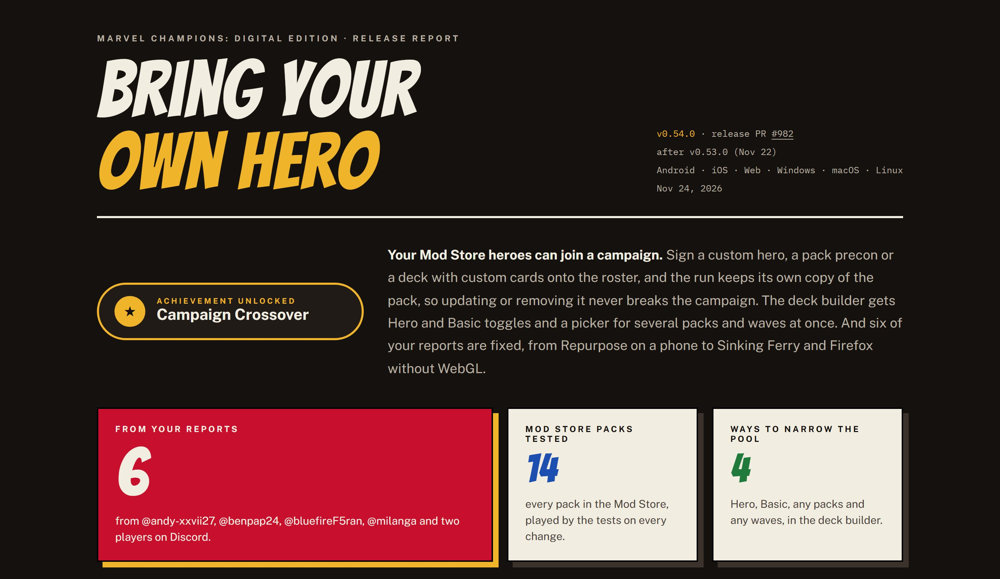
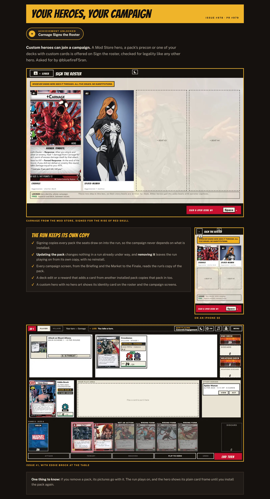
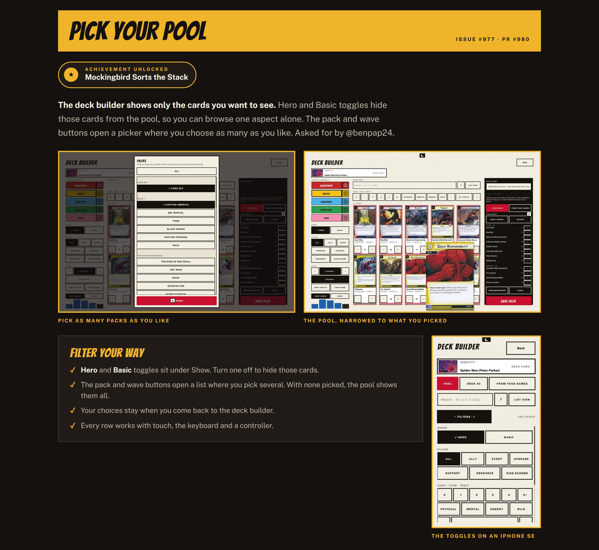
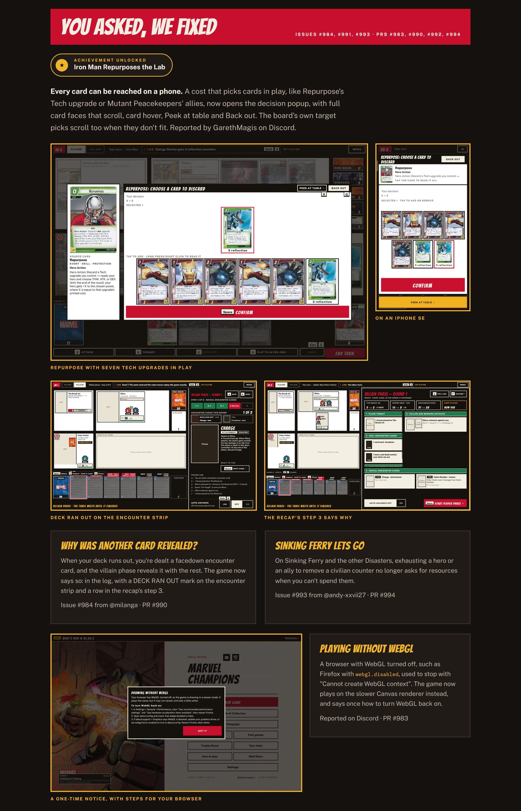
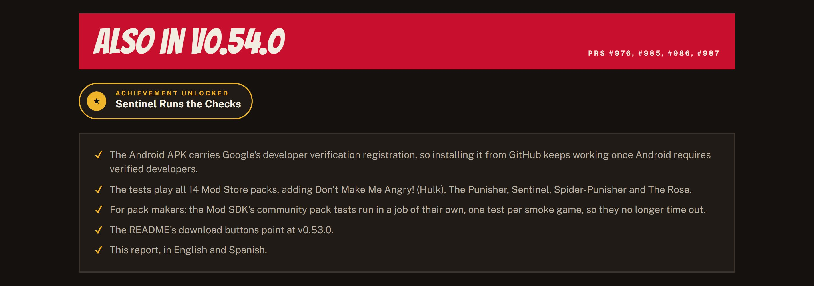
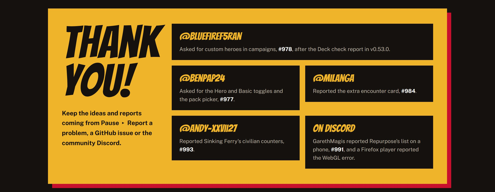
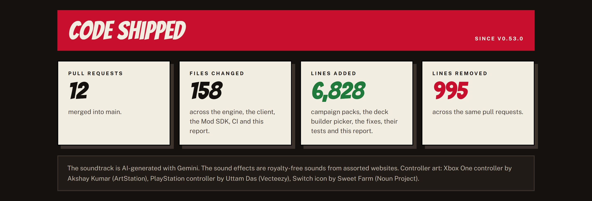

## Bring Your Own Hero

Your Mod Store heroes can join a campaign: a custom hero, a pack's precon or a deck with custom cards signs onto the roster, and the run keeps its own copy of each pack, so updating or removing it never breaks the campaign, as @bluefireF5ran asked (#978, #979). The deck builder has Hero and Basic toggles, and its pack and wave buttons open a picker where you choose several at once, from @benpap24's request (#977, #980). Repurpose and other costs that pick cards in play open the decision popup, so every card can be reached on a phone, reported by GarethMagis on Discord (#991, #992). The villain phase says when a card was dealt because your deck ran out, from @milanga's report (#984, #990), Sinking Ferry's civilian counters come off when you exhaust a character, reported by @andy-xxvii27 (#993, #994), and a browser without WebGL now plays on Canvas instead of stopping (#983). Thank you for playing!

**[Read the full v0.54.0 report on the site ↗](https://champions-digital-game.com/releases/v0.54.0/)**: custom heroes in campaigns, the deck builder's new filters, your reports, the new tests and the thank-you wall.

**[Lee el informe completo en español ↗](https://champions-digital-game.com/releases/v0.54.0/index.es.html)**

---

## [v0.54.0] - 2026-11-24

### Added

- Custom (Mod Store) heroes, pack precons and decks with custom cards can join a campaign. The run keeps its own copy of each pack, so updating or removing the pack never breaks it (#978, reported by @bluefireF5ran).
- Deck builder: Hero and Basic toggles hide those cards from the pool, and the pack and wave buttons open a picker where you choose several at once (#977, thanks benpap24).
- The v0.54.0 release report has its own page on the site, at /releases/v0.54.0/

### Changed

- The Android APK carries Google's developer verification registration, so installs from GitHub keep working once Android requires verified developers.

### Fixed

- A browser with WebGL turned off (such as Firefox with webgl.disabled) now plays on the slower Canvas renderer instead of stopping with "Cannot create WebGL context", and says once how to turn WebGL back on.
- The mod SDK's community pack tests run in a CI job of their own, one test per smoke game with each pack built once per run, so they no longer time out.
- The villain phase now says when an encounter card was dealt because your deck ran out: the log line, a DECK RAN OUT mark on the encounter strip and a row in the recap's step 3 (#984).
- A cost that picks cards in play (Repurpose's Tech upgrade, Mutant Peacekeepers' allies) is asked on the decision popup, with full card faces that scroll, so every card can be reached on a phone; the board's target picks scroll too when they don't fit (#991, reported by GarethMagis on Discord).
- Sinking Ferry and the other Disasters: exhausting a hero or ally to remove a civilian counter no longer asks for resources when you can't spend them (#993)

### Content

- The community pack tests cover all 14 Mod Store packs, adding Don't Make Me Angry! (Hulk), The Punisher, Sentinel, Spider-Punisher and The Rose.

### Special thanks

- @andy-xxvii27 reported #993.
- @benpap24 reported #977.
- @bluefireF5ran asked for #978.
- @milanga reported #984.
- GarethMagis reported #991 on Discord.
