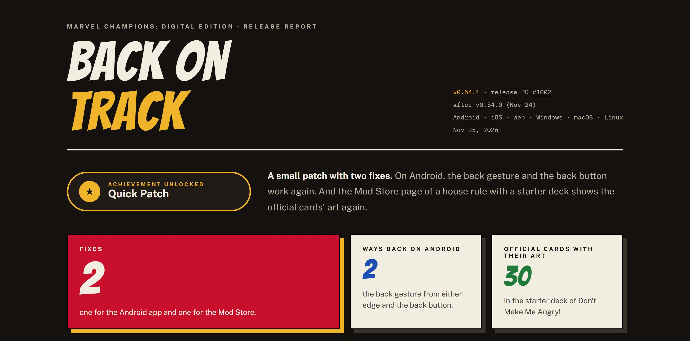
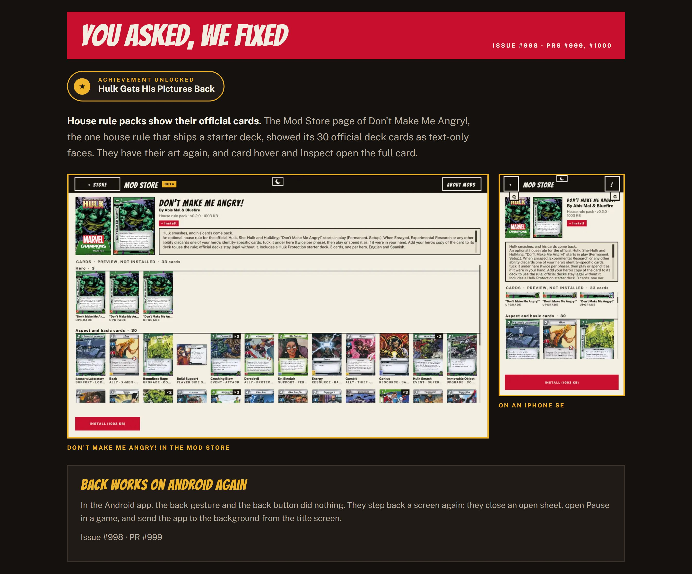
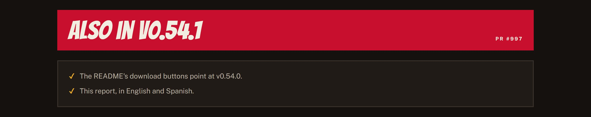
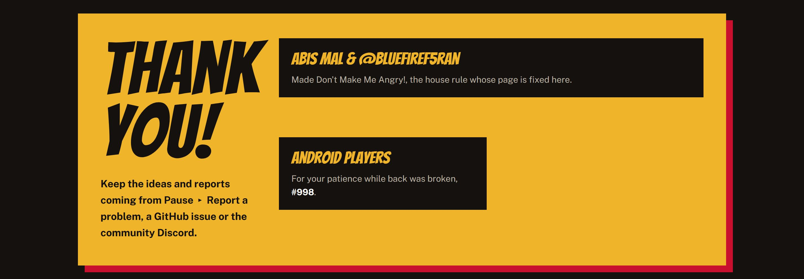
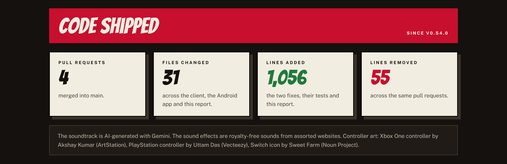

## Back on Track

A small patch with two fixes. On Android, the back gesture and the back button step back a screen again (#998, #999). And the Mod Store page of "Don't Make Me Angry!", the house rule with a starter deck, shows the art of its 30 official cards again (#1000). Thank you, Abis Mal and @bluefireF5ran, for the pack.

**[Read the full v0.54.1 report on the site ↗](https://champions-digital-game.com/releases/v0.54.1/)**: the two fixes and the thank-you wall.

**[Lee el informe completo en español ↗](https://champions-digital-game.com/releases/v0.54.1/index.es.html)**

