## Assemble Online

Marvel Champions is now a game you play together. Host a room or join one with a 6-character code, and every player plays their own hero from their own device, with a lobby, chat and their own decks (#880, #881). Share a link and anyone can watch your game live, with a Watch live button on your Discord card (#876). Trickster Takeover's Epic Multiplayer puts several tables against one Loki (#882), Civil War Competitive pits two teams against each other, leader against leader (#883), and 49 new achievements come with them, with table feats from @bluefireF5ran's list (#909). Online play is brand new, so you will likely find bugs: report them from Pause ▸ Report a problem or a GitHub issue and we'll fix them fast. Thank you to GarethMagis and everyone on Discord who played the previews. This is version 1.0.0!

**[Read the full v1.0.0 report on the site ↗](https://champions-digital-game.com/releases/v1.0.0/)**: playing together, rooms and the lobby, watching live, Epic Multiplayer, Civil War Competitive, the new achievements and the road to 1.0.

**[Lee el informe completo en español ↗](https://champions-digital-game.com/releases/v1.0.0/index.es.html)**

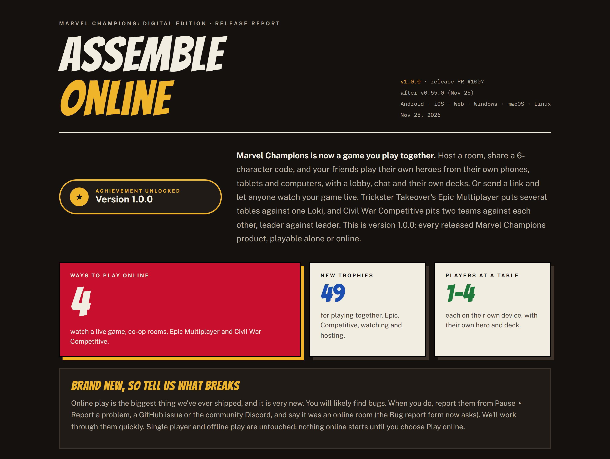

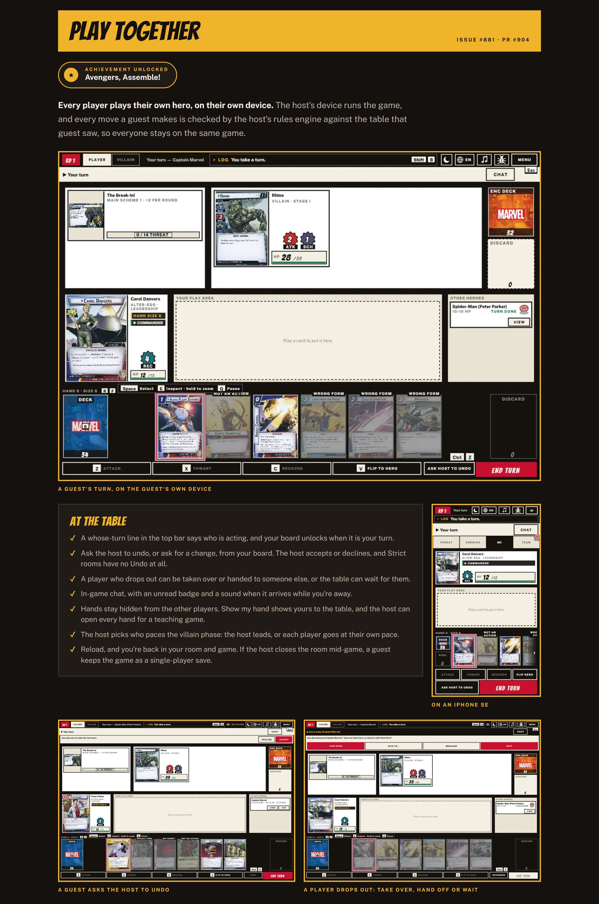

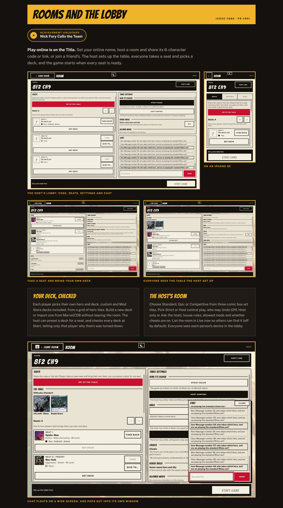

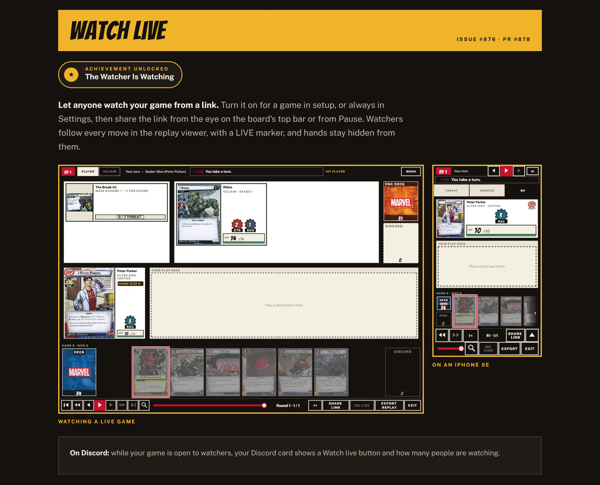

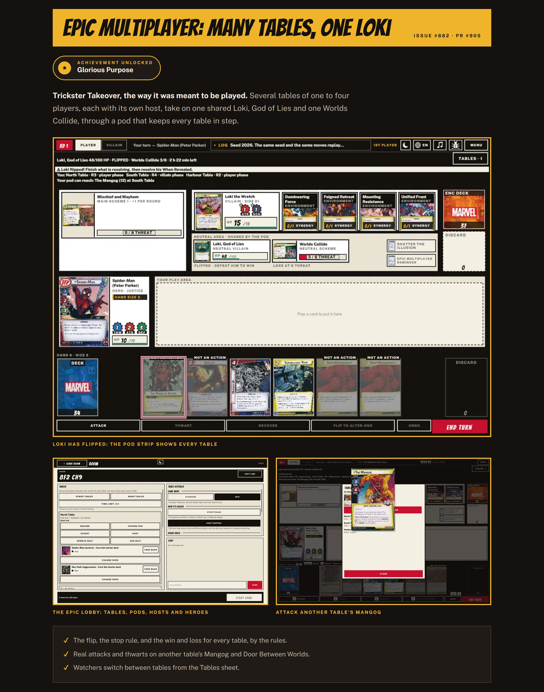

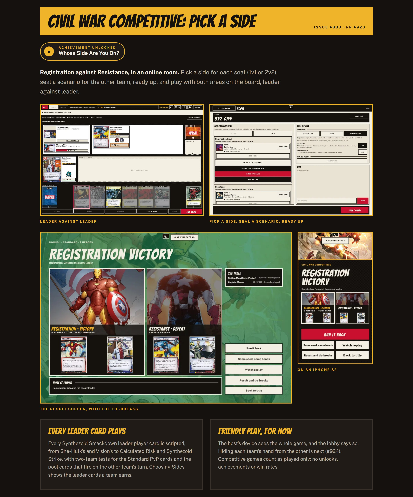

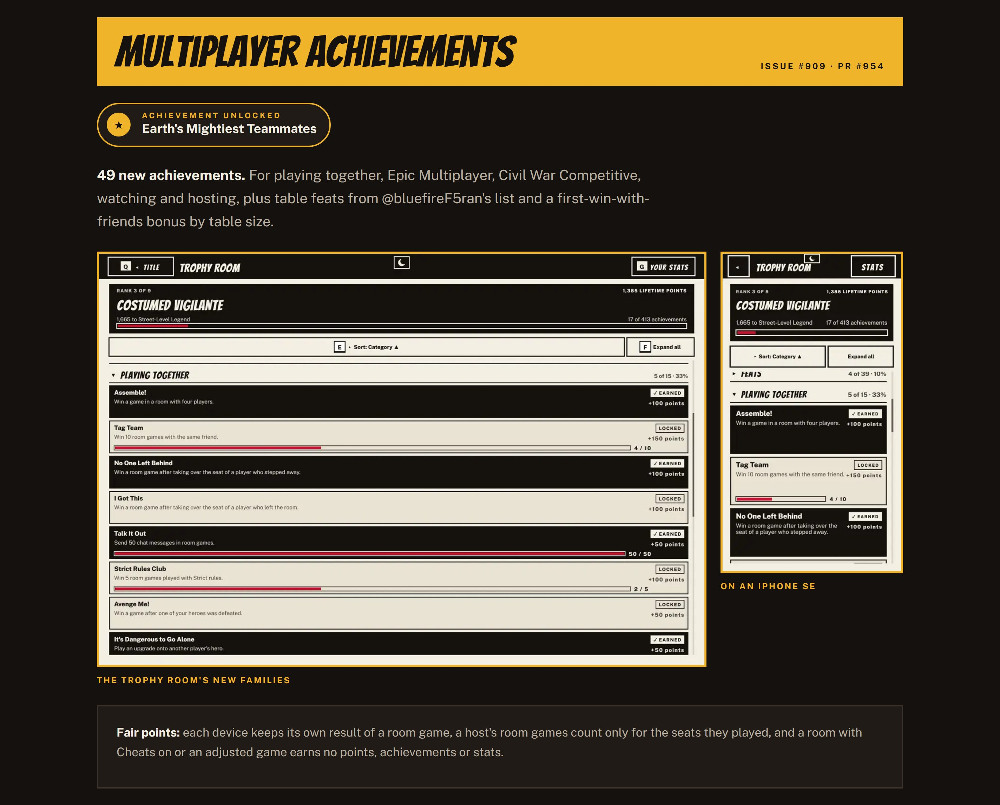

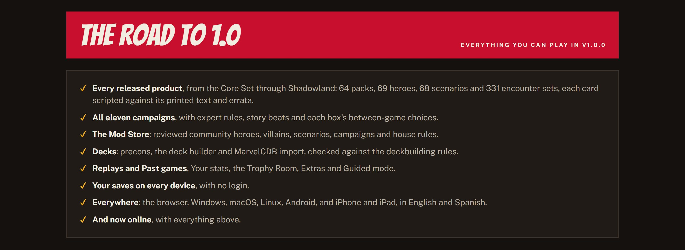

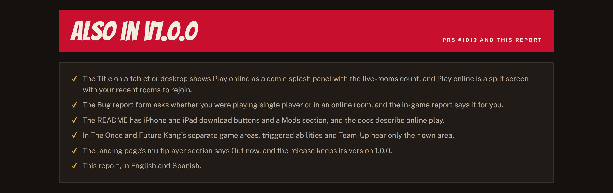

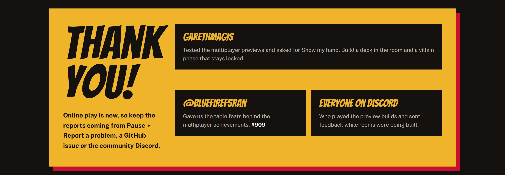

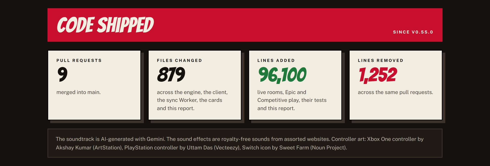

---

## [v1.0.0] - 2026-11-25

### Added

- Let people watch your game live from a link: choose it per game in setup or always allow it in Settings, share the link from the eye on the board's top bar or Pause, and watchers follow every move in the replay viewer with a LIVE marker (#876)
- Your Discord card shows a Watch live button and how many people are watching while a game is open to watchers (#876)
- Play online: host a room or join one with a 6-character code or link, set your online name, and use the lobby (seats, host controls, chat) before a game; nothing online starts until you choose it (#880)
- Rooms show each person's device (platform and phone, tablet or desktop) in the lobby (#880)
- Live game rooms: a Strict room's game has no Undo, Back out or Manual adjust for the host, and the engine refuses them (#880)
- Playing together in a room: a seated guest plays their hero from their own device, with a whose-turn line, requests to the host, take-over or hand-off of absent players, and in-game chat (#881)
- Trickster Takeover Epic Multiplayer online: an Epic lobby for tables, pods, hosts and heroes, a pod strip with Loki, Worlds Collide and every table's status, cross-table Mangog and Door Between Worlds targets, and watchers switching tables (#882)
- Rooms: each player picks their own hero and deck on their device, custom decks included; the host can preset a deck for a seat and checks every deck at Start, telling only that player why theirs was turned down (#880)
- Rooms: the host picks who may Undo (Off, Host only, Ask) and whether cheats are on; a game with cheats counts for no one's stats
- Civil War Competitive in online rooms (#883): pick a side per seat (1v1 or 2v2), seal a scenario for the other team, ready up, and play with both areas on the board; a result sheet shows the tie-breaks, and Concede offers the team or, in a 2v2, leaving alone (a guest's choice goes through the host)
- Civil War Competitive: the Choosing Sides sheet shows the leader cards a team earns, and the result sheet can be reopened from Game over
- Civil War Competitive lobby: says the host's device sees the whole game (friendly play; per-seat hiding is #924)
- Multiplayer achievements: 49 new achievements for playing together, Epic Multiplayer, Civil War Competitive, watching and hosting, and table feats from bluefireF5ran's list, plus a first-win-with-friends bonus by table size (#909)
- Rooms: a dismissable toast and a sound when someone joins your room, and a sound when chat arrives while the window is away (#880)
- Rooms: an unread badge on the lobby's Chat tab, and on a phone the chat stays above the keyboard while you type (#880)
- Rooms: the lobby shows what the host is doing in setup (picking a scenario, setting the table, checking decks), and the room keeps its chat history for late joiners after it sleeps (#880)
- Room deck picker: a grid of hero tiles by default (list remembered as a choice), a details panel with deck stats, card list, Edit deck and Use this deck (slide-out on desktop, sheet on phones), and a faster picker on slow phones (only visible tiles built, hero pictures baked off the main thread, deck checks in a worker, deck worker warmed before Pick)
- Play online: hosts can opt a room in to a public Live now list (off by default), and the Live now panel shows those rooms with Watch and Join
- Room hosts choose the game mode from three comic box-art tiles (Standard, Epic, Competitive) with an info panel on desktop and an info strip on tablet and phone.
- When the host closes a room mid-game, a seated guest's device keeps the game as a single-player save, and the Room closed notice offers Continue in single player (#904)
- Playing together: the host chooses who paces the villain phase on guests' screens (Host leads by default, or each player at their own pace), a guest's screen follows the host's reveal and closes with it, and a guest's button now reads Back to the table (#881)
- Reloading the page keeps your place: a room you're in (host or guest, lobby or game), a live game you're watching, and a single-player game in the browser come straight back, with a Rejoining prompt while it reconnects
- Room games: Show my hand lets a player show their hand to the table, and the host can open every hand for a teaching game
- Room games: the deck picker can build a new deck or import one from MarvelCDB without leaving the room
- The v1.0.0 release report has its own page on the site, at /releases/v1.0.0/

### Changed

- Civil War Competitive rooms use the same deck flow as ordinary and Epic rooms: each player picks their own hero and deck, the host's Start judges them, and a hero sharing a title with its own team's leader is refused to that player alone
- Civil War Competitive games count as played only: no unlocks, achievements, champion points, scenario or hero win rates, or global stats; the competitive result is kept apart for PvP tracking, and Past games lists them under All only
- Civil War Competitive: the result screens now look like the campaign Victory and Defeat screens, with each team's leader art and cards, the winner featured, and the tie-breaks on the screen
- Room games: a guest's device now keeps its own result of a finished room game, a host's room games count only for the seats they played, and Cheats or adjusted room games earn no points, achievements or stats (#909)
- In a room game the host's board and setup screen show other players' hands face down, like a guest's; a Host sees every hand lobby setting turns them back on for the host only, and live watchers never see hands (#887)
- Play online is a split screen on wide displays (recent rooms to rejoin on the left, name, Host and Join on the right) over a faded hero-art backdrop, which the room lobby now shares
- Online rooms: a guest whose host closed the room goes back to Play online with a Room closed notice; the chat keeps focus after Send; the chat input stays above the keyboard in the Android app
- Play online on the title screen of a tablet or desktop is a comic splash panel with Host a room and Join a room, and the live-rooms count, instead of a menu button; phones keep the button
- Room lobby: the host's Show in Live now toggle sits beside Copy link on wider screens, and leads the settings on a phone
- The Bug report form asks how you were playing (single player or an online room, and your part in the room), and the in-game Report an issue log and its Game details say it for you (#1008)
- The release pull request keeps a version bump picked by hand (such as bump=major) when later merges to main regenerate it, instead of falling back to the automatic version
- The landing page's multiplayer section says Out now in v1.0.0, with an OUT NOW stamp on the Assemble online banner instead of Coming soon

### Fixed

- Civil War Competitive: a tie gets a neutral game-over screen, a win plays win music, a hot-seat concession reads as conceded, the scenario builder refuses sets from other products, and a hero sharing a title with its own leader is refused
- Game over: the news ribbon no longer sits under the dark mode button
- A live room keeps the unfinished tail of a replaced log across a wake, and no longer leaves a stale tail row after a batch that ends on a 100-chunk boundary (#876)
- Play online: pressing Enter in the name box continues, as the Continue button does
- A guest in a room game now sets up the table on the same Setting up the table screen as the host, and a refused mulligan answer says why instead of the prompt coming back silently (#881)
- Live rooms: the deck picker no longer sticks on Sending your deck after Esc, the host's status line no longer goes stale, Play online stops offering rooms that are closed, and turning chat off clears its history.
- Live rooms now compare a fingerprint of the rules code as well as the version, so a guest on a different build (a preview against a release) is told to update instead of being let into a seat and refused every move
- Live rooms: a chunk write that fails is no longer counted as saved, and a batch that fills a gap after the end re-announces the end; a fault-injection harness covers reconnects, interrupted writes, new games and dropped final acks
- Civil War competitive setup refuses 1v2 and 2v1 tables everywhere (engine, cards, hot-seat and replay setup), per MC56 p. 14's 1v1 or 2v2.
- A Competitive room saves a team's new sealed scenario and the readiness it clears in one write, so a wake never pairs a new scenario with the old approval.
- Multiplayer achievements: a guest's finished room row is written only on the room's end (with its adjusted flag), and a game the host rewinds and finishes again replaces that row instead of keeping the first result
- Competitive rooms: a team change can no longer land while a game is starting, and a failed save at a reveal, start or game end now refuses cleanly instead of leaving a half-reset room.
- Epic tables recover a coordinator event lost while idle, and the organizer waits out a failed log repair or database open instead of starting over (#882)
- Room games: a guest's result write retries after a storage error, a reopened table stops counting an old win on reconnect, and a room game's record goes only to its own save (#909)
- Room achievements: a failed set-aside of a reopened result is retried, room data never lands on an offline save or another game in the same room, and a seat released before Start doesn't count as played (#909)
- Room games: the table stays locked while the villain phase is open, so a hand card can no longer be played beside it after a decision, a chat message or a seat change
- A reload during the villain phase brings the villain phase back where it was, instead of dropping it (#989)

### Engine

- Live game rooms on the sync Worker: one Durable Object per room relays the host's game log to watchers over WebSockets, stored in frozen chunks, and is shaped for chat, player seats and several tables next (#876)
- Lobby rooms on the sync Worker: 6-character codes, names, seats with seat tokens, host settings, chat and build matching (#880)
- Live game rooms: the host's engine judges each seat's moves against the table the player saw, a seat's Concede leaves the seat, and the host can turn seat handover off (#881)
- Epic Multiplayer: one Loki, God of Lies and one Worlds Collide shared by every group through a pod coordinator, with the flip, the stop rule, win and loss for all, and real attacks and thwarts on another group's Mangog and Door Between Worlds (#882)
- Live rooms can hold several tables, each with its own host and log, and a pod channel from the table hosts to the organizer (#882)
- Civil War Competitive: an empty encounter deck reshuffles with an acceleration token on that team's main scheme, and a team whose encounter deck and discard pile are both empty loses (RRG v1.8 p. 17)
- Civil War Competitive: only the attacked leader's team hears a leader's attack as 'an enemy attacks'; 'when attached enemy would attack' interrupts (Webbed Up) stop a leader's attack; 'any player may trigger' abilities (High-Tech Suit) work for either team in its own hero phase
- A leader-vs-leader attack can carry an ATK bonus and keywords for that attack only, an encounter deck shuffle can name another villain's deck, the enemy team's first player can be referenced, and a query's game-area scope now reaches its alternatives and exclusions
- Civil War Competitive: Now It's Personal goes to the first player when it flips, and a triggered ability ignores an event that happens wholly on the other side of the table, judged by where the event happened (Black Widow no longer cancels a card revealed in the other team's area)
- In The Once and Future Kang's separate game areas, a triggered ability hears only events in its own area
- Civil War Competitive: Team-Up counts only your own team's heroes and allies; (attack/defense) cards can't be used against a leader attacking a leader
- In The Once and Future Kang's separate game areas, Team-Up counts only friendly characters in your own game area
- Game events: a heal names the card that healed, a lethal hit records its excess damage, and Epic Multiplayer records which table defeated Loki and whether a cross-table attack or thwart defeated its target (#909)
- Civil War Competitive: skipping a villain phase, playing a player phase instead of one, and effects that last until the next villain phase begins now belong to the team that made them (#883)
- A skip, replacement or until-the-next-villain-phase effect made as a villain phase begins now applies to the next villain phase, not the one already begun (#883)

### Content

- Civil War Competitive leader cards: Raw Power, Alpha Flight Recruit and Secret Contact find your leader's Energy Channel or Finesse in the other team's area; Energy Channel at 4 counters attacks a leader the way one leader attacks another; every Civil War leader player card now has a two-team test
- Civil War Competitive: She-Hulk and Vision leader player cards (You're Out of Order!, She-Hulk Smash, Make Me Angry, Legal Counsel, Phased Out, Android Assistance) are scripted
- Civil War Competitive: Calculated Risk and Synthezoid Strike are scripted, so every Synthezoid Smackdown leader player card now plays (an Intangible Vision flips to Dense before Synthezoid Strike's attack but gets no extra bonus, per FFG's sentence-by-sentence ruling)
- Civil War Competitive card audit: two-team tests for the Standard PvP cards in all four printings and for twelve pool cards whose responses fire on the other team's turn

### Docs

- README: iPhone and iPad download buttons (English and Spanish) with the sideloading guide, a Mods section on making, submitting and requesting packs, and the roadmap, current status, architecture and PLAN updated for online multiplayer in v1.0.0

### Special thanks

- @bluefireF5ran gave the table feats behind the multiplayer achievements, #909.
- GarethMagis tested the multiplayer previews on Discord.
