## Assemble Online

Marvel Champions is now a game you play together. Host a room or join one with a 6-character code, and every player plays their own hero from their own device, with a lobby, chat and their own decks (#880, #881). Share a link and anyone can watch your game live, with a Watch live button on your Discord card (#876). Trickster Takeover's Epic Multiplayer puts several tables against one Loki (#882), Civil War Competitive pits two teams against each other, leader against leader (#883), and 49 new achievements come with them, with table feats from @bluefireF5ran's list (#909). Online play is brand new, so you will likely find bugs: report them from Pause ▸ Report a problem or a GitHub issue and we'll fix them fast. Thank you to GarethMagis and everyone on Discord who played the previews. This is version 1.0.0!

**[Read the full v1.0.0 report on the site ↗](https://champions-digital-game.com/releases/v1.0.0/)**: playing together, rooms and the lobby, watching live, Epic Multiplayer, Civil War Competitive, the new achievements and the road to 1.0.

**[Lee el informe completo en español ↗](https://champions-digital-game.com/releases/v1.0.0/index.es.html)**

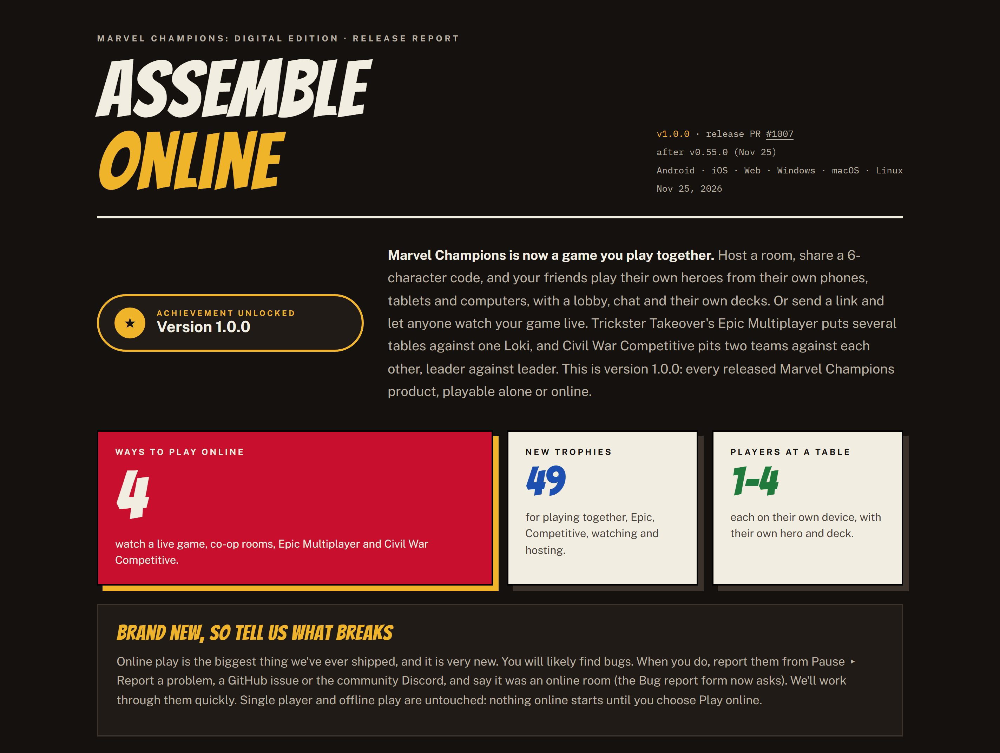

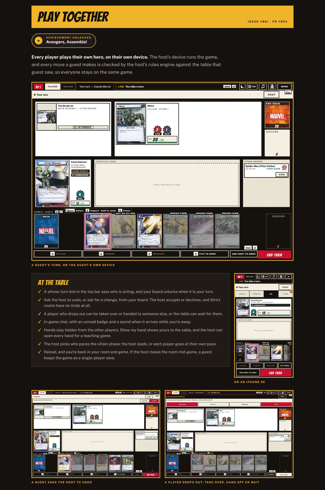

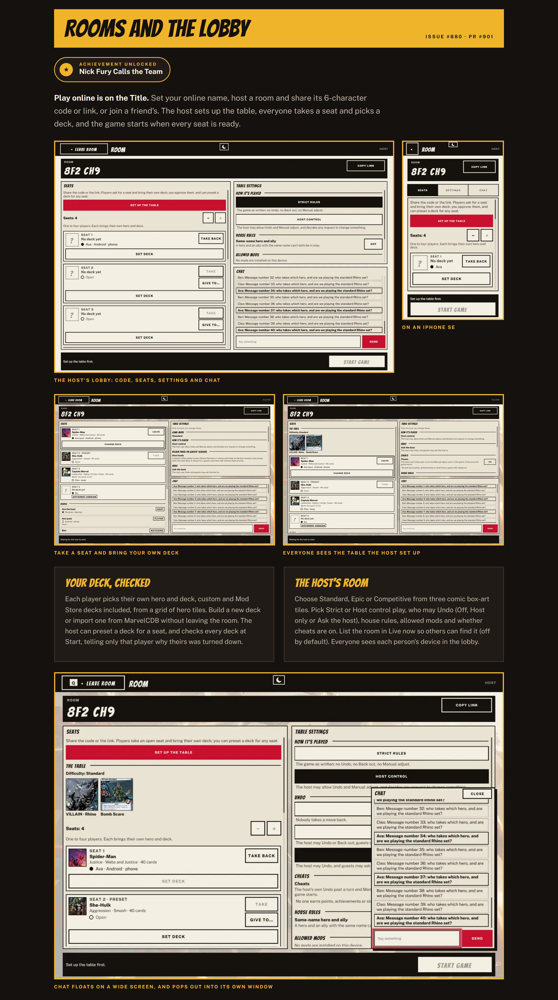

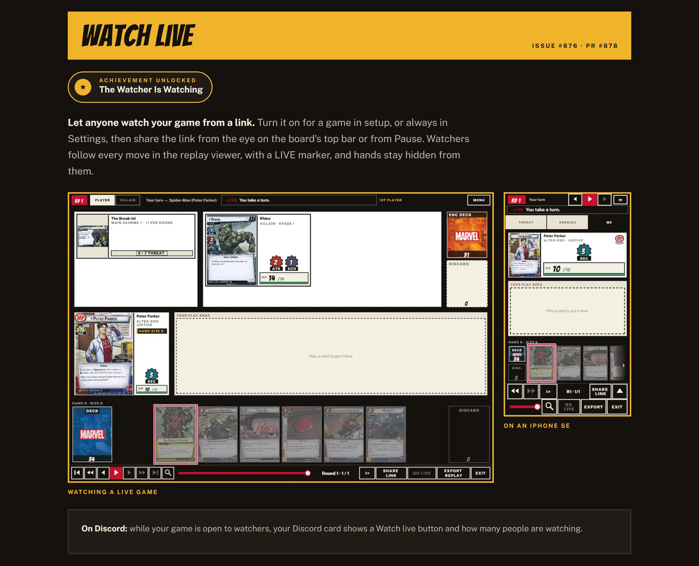

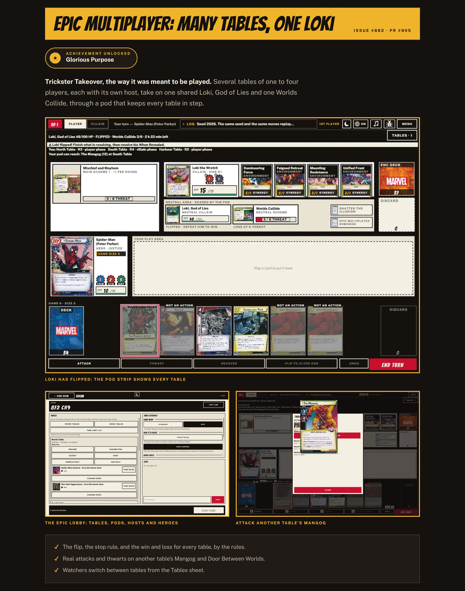

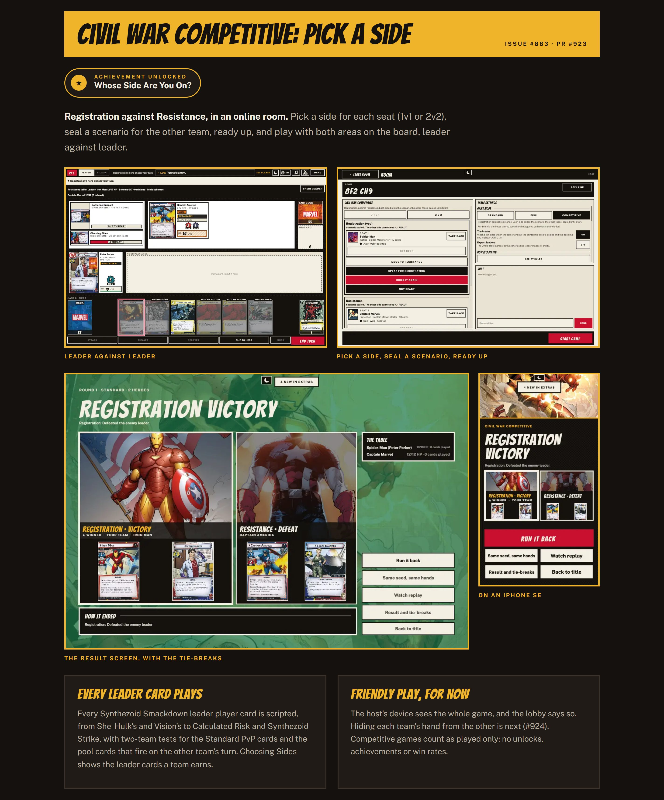

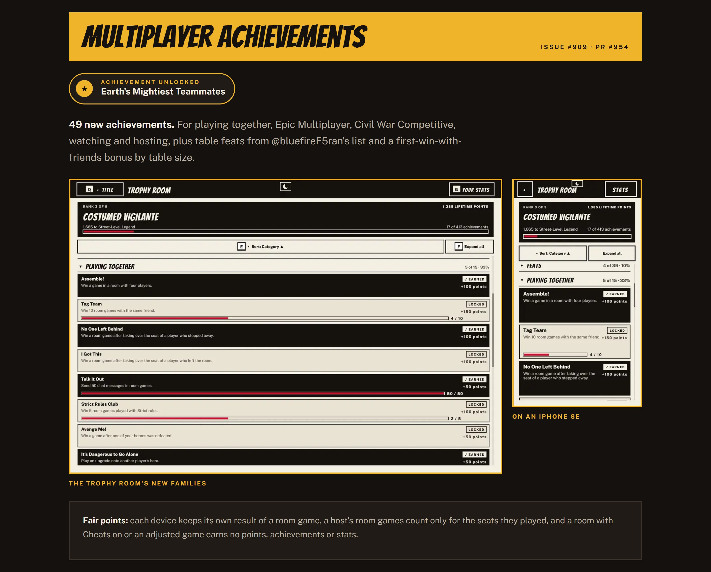

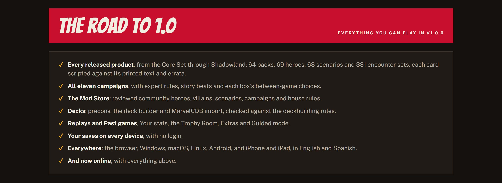

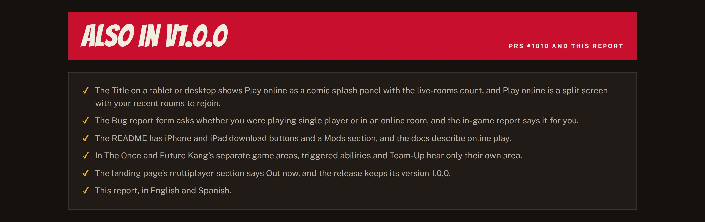

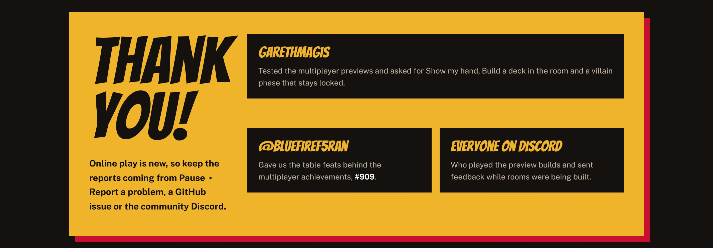

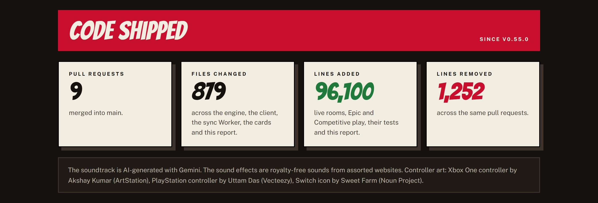
