## Chi Flows Faster

Elektra and Iron Fist are playable, with their precon decks, their obligation and nemesis sets, and English and Spanish card scans from @bluefireF5ran (#699). The menu screens are moving off the game's canvas onto plain web pages drawn over it: the same look, but faster and lighter, and each one reads in Spanish as it moves. Online rooms get Each player Undo, a sound for the host and kept host settings, thanks to GarethMagis; the Fear No Evil scenarios get Skirmish (#995, @andy-xxvii27); long games use much less memory; and your reports are fixed, from @bluefireF5ran's 26-game rules audit (#1012, #1006) to @FirePenguin17's Crushing Blow (#1028) and engaged minions (#1001).

**[Read the full v1.1.0 report on the site ↗](https://champions-digital-game.com/releases/v1.1.0/)**: Elektra and Iron Fist, faster menus with the same look, more of the game in Spanish, smoother online rooms, Skirmish at Fear No Evil, lighter memory and the fixes you asked for.

**[Lee el informe completo en español ↗](https://champions-digital-game.com/releases/v1.1.0/index.es.html)**

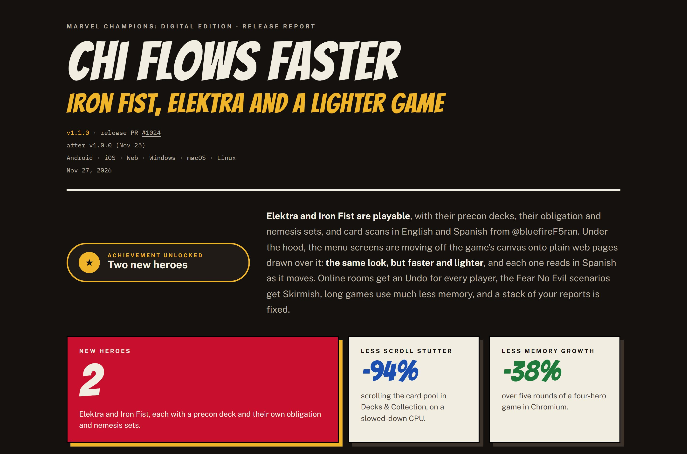

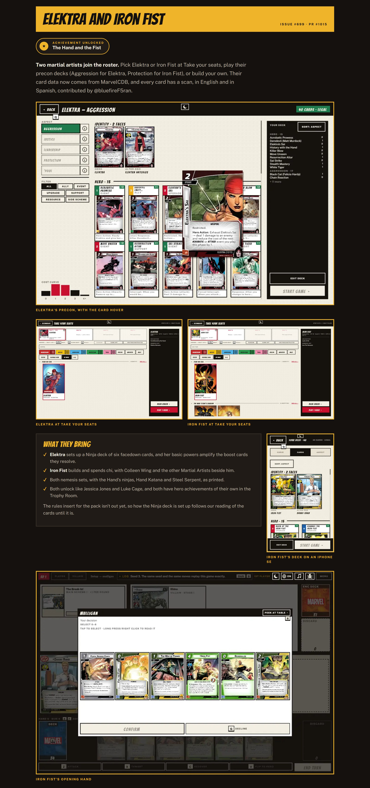

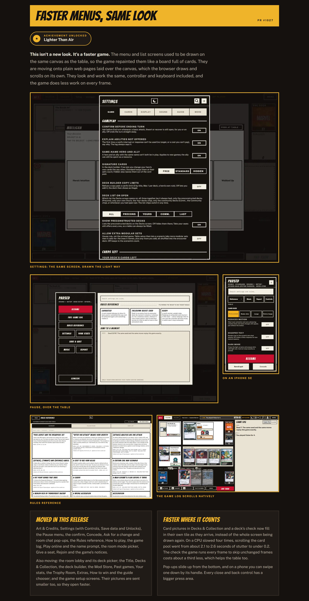

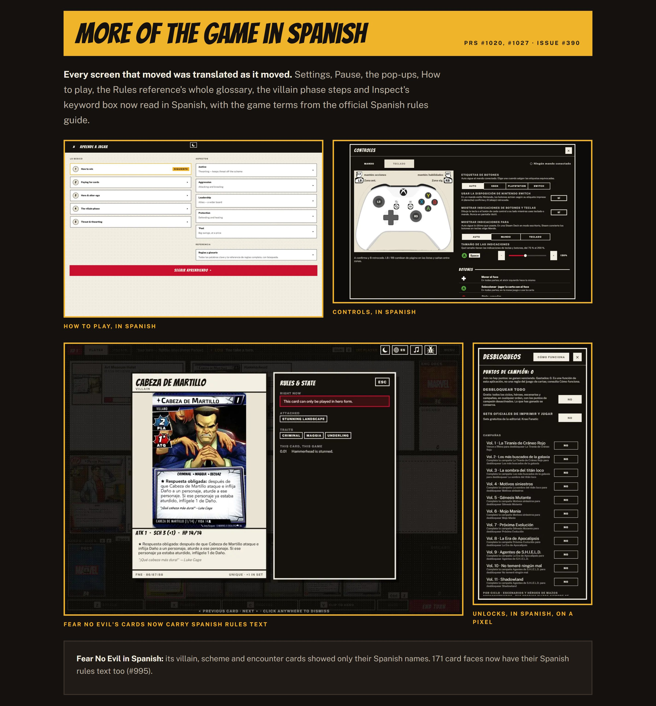

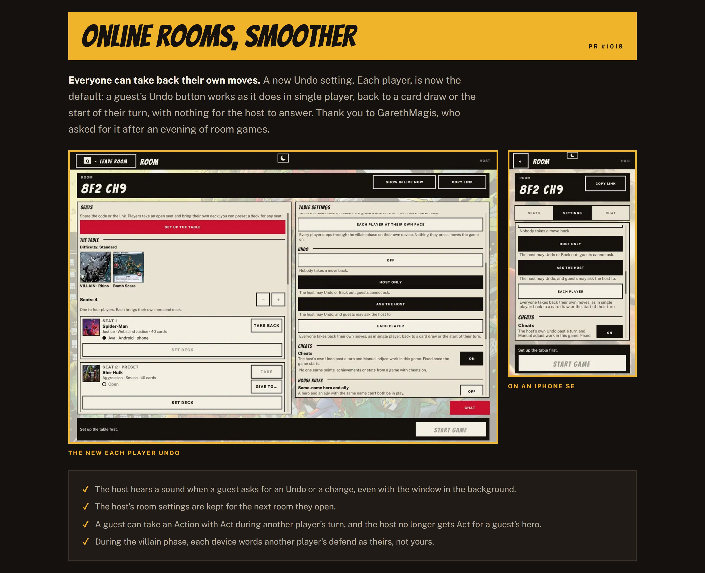

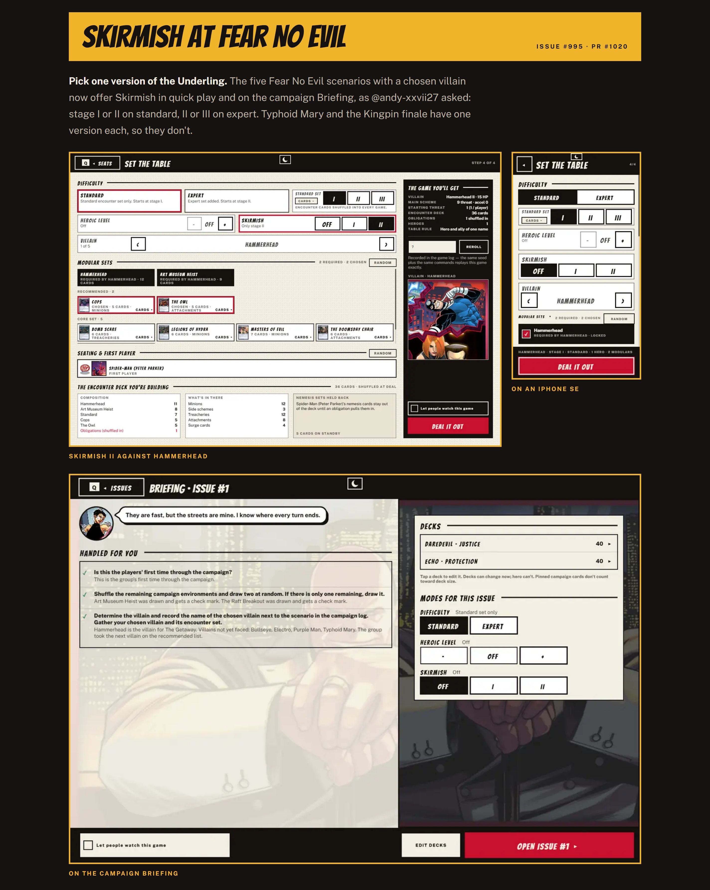

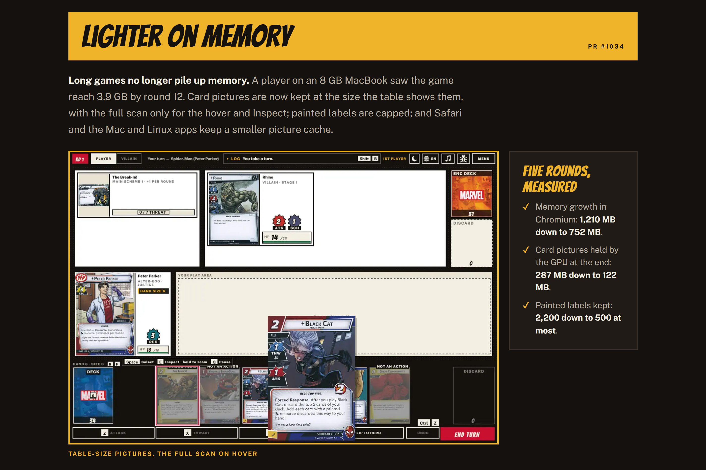

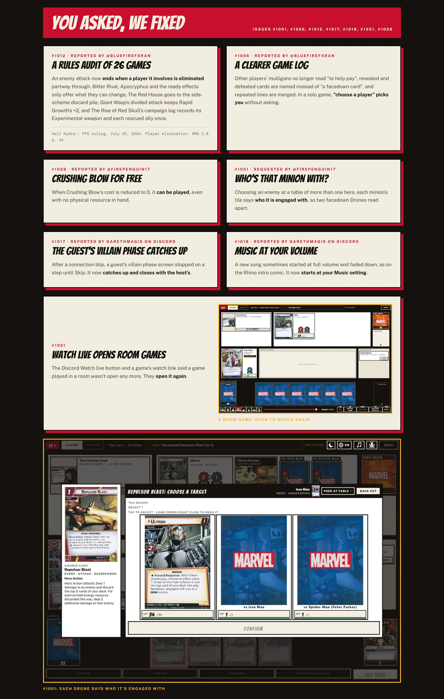

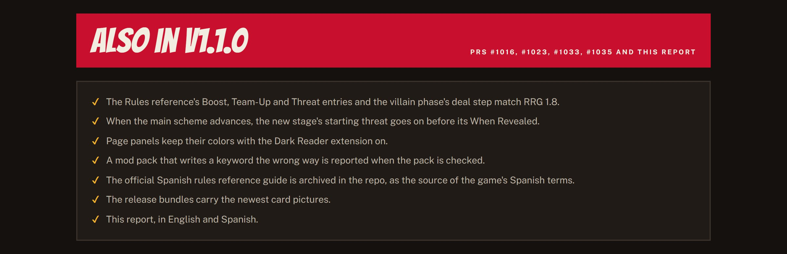

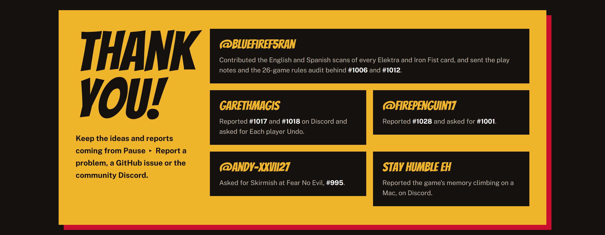

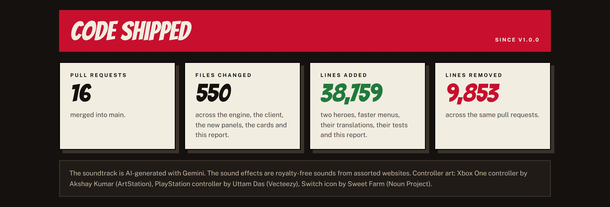

---

## [v1.1.0] - 2026-11-27

### Added

- Choosing an enemy for an effect in a game of more than one seat, each minion's tile says who it is engaged with ("vs Iron Man"), so two facedown Drones read apart (issue #1001, reported by @FirePenguin17).
- Elektra and Iron Fist are playable: both heroes, their precon decks (Aggression and Protection) and their obligation and nemesis sets, with English and Spanish card scans contributed by bluefireF5ran.
- Skirmish mode at the Fear No Evil scenarios, in quick play and on the campaign Briefing: pick one version of the chosen Underling villain (not Typhoid Mary or Kingpin, which have one version) (#995).
- Online rooms: a new default Undo setting, Each player, lets everyone take back their own moves as in single player (back to a card draw or the start of their turn), with nothing for the host to answer (GarethMagis)
- Online rooms: the host hears a sound when a guest asks for an Undo or a change, and the host's room settings are kept for the next room (GarethMagis)
- Controller and keyboard button glyphs on the Lit panels, as one shared component drawn as inline SVG, folding away while the mouse moves as before.
- The v1.1.0 release report has its own page on the site, at /releases/v1.1.0/

### Changed

- A solo game's "choose a player" picks you without asking, and "discard your hand" (Hulk's Enraged) discards without a pick (#1006)
- The game spends less time each frame checking whether the screen changed, most of all on busy menu screens.
- Art & Credits is the first screen drawn with Lit web components over the game table: native text and scrolling, the same look, and it now reads in Spanish.
- Settings is drawn with Lit web components over the table, with the same look, controller and keyboard navigation, and it now reads in Spanish.
- The in-game Pause menu is drawn with Lit web components over the table, with the same look and the same controller and keyboard navigation, and it now reads in Spanish.
- The confirm, concede, ask-for-a-change and room chat pop-ups are drawn with Lit web components, so the Pause menu stays in view under them; their text reads in Spanish.
- Rules reference and How to play are drawn with Lit web components over the table, with the same look, controller and keyboard navigation, and their screen text reads in Spanish.
- The game log is now drawn as a page panel over the table (same look), so it scrolls natively and its header, close button, newer chip and status chips are in Spanish too.
- The Play online screen and the online name prompt are page panels over the canvas (same look); Enter or A on a disabled control while connecting does nothing, as a tap does.
- The room mode picker, Give a seat, Rejoin and the game's notices are page panels over the canvas (same look), and the notices and the reasons an ability isn't available read in Spanish.
- How to play's aspect rows wear the aspect's colored chip, now a shared mc-aspect-chip component
- Controls, Save data and Unlocks (with their sync, transfer and how-it-works text) now show in Spanish
- Settings ▸ Unlocks is now a Lit panel over the canvas, as Pause and Settings are
- Settings ▸ Save data is now a Lit panel over the canvas, with its QR code drawn in the panel
- Settings ▸ Controls is now a Lit panel over the canvas: the controller drawing is an inline SVG and the Hint size slider is a sheet part
- Pop-ups slide up from the bottom and back down on the way out, and on a phone swipe down from their grab handle to dismiss them.
- The room lobby (seats, settings, chat, Start) is a Lit panel over the canvas, same look, with native scrolling lists and the controller and keyboard stops kept
- The room deck picker is a Lit panel over the canvas, with the deck details as a panel that slides in, and its stats and counts now read in Spanish

### Fixed

- An enemy attack now ends when a player it involves is eliminated partway through: it deals no damage and nobody eliminated is asked anything (#1012)
- The Rise of Red Skull's campaign log records an Experimental weapon revealed at setup, and each rescued ally once, including one rescued into hand and never played (#1012)
- Game log: other players' mulligans and effect discards no longer read "to help pay"; revealed and defeated cards are named instead of "a facedown card"; missing lines added, repeated lines (tough, surge, Temporary, counters) merged, and reasons given for blocked damage and effect-dealt encounter cards (#1006)
- Mod packs: an ability that writes a keyword as a bare string ("villainous" instead of { "name": "villainous" }) is now reported when the pack is checked, instead of the grant being ignored (#1012)
- Hail Hydra!: a player who defends another player's Hydra attack was attacked and skips the search; the player it was made against searches (FFG ruling July 25, 2024; #1012)
- Giant Wasp's divided basic attack is split from its final ATK, so Rapid Growth's +2 is no longer lost; a Bombshell even split stays even (#1012)
- Online rooms: a guest's villain phase screen no longer stops on a step until Skip after its connection blips; it catches up, closes with the host's, and words another player's defend as theirs (#1017, reported by GarethMagis)
- Music no longer starts a new song at full volume before fading to your volume setting, as on the Rhino intro comic (#1018, reported by GarethMagis)
- The Spanish version now shows Spanish rules text on Fear No Evil's villain, scheme and encounter cards, not only their Spanish names (#995).
- Online rooms: a guest can take an Action with Act during another player's turn; the host no longer gets Act for a guest's hero (GarethMagis)
- Watch live (the Discord button and a game's watch link) opens a game played in a room again; it said the game wasn't open any more (#1021).
- Scrolling Decks & Collection and a deck's check no longer stutters while card pictures load: each picture fills in its own tile instead of the whole screen being drawn again.
- Reduced memory growth during long games: card pictures are kept at the size the table shows them (full size only for the hover and Inspect), painted labels are capped by count, and Safari and the Mac and Linux apps keep a smaller picture cache.
- Crushing Blow can be played for free when its cost is reduced to 0, even with no [physical] resource in hand (#1028).
- The Rules reference's Boost entry no longer says minions never get boost cards: a Villainous minion is dealt one whenever it uses a basic power.
- The Rules reference's Team-Up and Threat entries and the villain phase's deal step now match RRG 1.8: an ally counts for Team-Up, threat completes a main scheme stage, and hazard icons add one card each in player order.
- Pressing a toggle in the room's Settings, Seats or Chat list no longer scrolls the list back to the top.
- Corner buttons that are hidden on a phone no longer cut transparent holes in panels
- Page panels keep their colors with the Dark Reader extension on (the game opts out of it; use the game's own dark mode).
- The Rules reference closes on its own Escape instead of also leaving How to play, the notice's ring stays on the button it was moved to, and the game log's close button is found on its first draw
- Every Lit sheet's close and back control now has a 44px press area around the drawn control, so the Pause, Settings, Rules reference, How to play, Controls, Save data, Unlocks and game log closes are easy to hit on a phone

### Engine

- When the main scheme advances, the new stage's starting threat is placed before its B side's When Revealed; a choice an encounter card gives to no resolving player goes to the first player (#1012)
- An enemy attack ends when any player is eliminated partway through it, in its interrupt windows, its queued damage, and its indirect or evenly divided damage; an eliminated hero is never asked to divide or assign damage (#1012)

### Content

- Elektra and Iron Fist card data now comes from MarvelCDB: the real obligation and nemesis card numbers, aspect quantities, the new Hand Katana, and the printed text of Hand Blademaster, Hand Archer, Steel Serpent, Crane Daughter and Lack of Chi.
- Bitter Rival and Apocryphus offer only ready characters to exhaust; Friction Resistance and Always Be Running need something to ready; Into the Fray needs a minion; Starhawk's interrupt is offered only when it applies; Tombstone's discard is a real discard (#1012)
- The Red House goes to the side-scheme discard pile; Absorbing Man's environments and Corvus Glaive now resolve after an undefended attack a treachery made (#1012)
- The Rules reference glossary, the villain-phase steps, How to play's lessons, aspects and box pages, and Inspect's keyword box read in Spanish, with the official Spanish game terms.

### Docs

- Remove the Elektra and Iron Fist PR screenshots from the repo.
- The official Spanish rules reference guide (Asmodee España, 2019) is archived in docs/rules/es with a searchable text copy, as the source of the app's Spanish game terms.
- The Spanish rules reference guide's markdown copy is now made with the same PDF-to-markdown script as the English ones.

### Special thanks

- @andy-xxvii27 reported #995.
- @bluefireF5ran contributed the Elektra and Iron Fist card scans.
- @bluefireF5ran reported #1006 and #1012.
- @FirePenguin17 reported #1001 and #1028.
- GarethMagis reported #1017 and #1018 on Discord.
- Stay Humble Eh reported the memory growth on a Mac on Discord.
