## Chi Flows Faster

Elektra and Iron Fist are playable, with their precon decks, their obligation and nemesis sets, and English and Spanish card scans from @bluefireF5ran (#699). The menu screens are moving off the game's canvas onto plain web pages drawn over it: the same look, with less drawing work for the game, and each one reads in Spanish as it moves. Online rooms get Each player Undo, a sound for the host and kept host settings, thanks to GarethMagis; the Fear No Evil scenarios get Skirmish (#995, @andy-xxvii27); memory grows more slowly in long games; and your reports are fixed, from @bluefireF5ran's 26-game rules audit (#1012, #1006) to @FirePenguin17's Crushing Blow (#1028) and engaged minions (#1001) and @VladsEpitaph's Make the Call (#1050).

**[Read the full v1.1.0 report on the site ↗](https://champions-digital-game.com/releases/v1.1.0/)**: Elektra and Iron Fist, faster menus with the same look, more of the game in Spanish, smoother online rooms, Skirmish at Fear No Evil, lighter memory and the fixes you asked for.

**[Lee el informe completo en español ↗](https://champions-digital-game.com/releases/v1.1.0/index.es.html)**

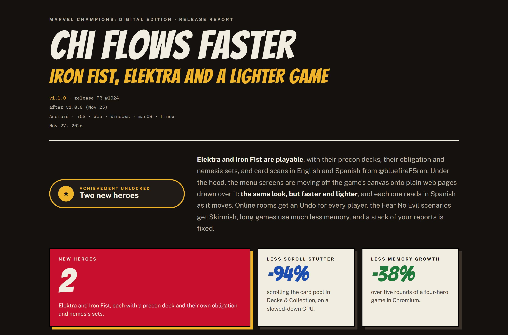

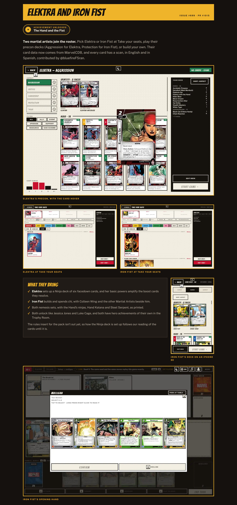

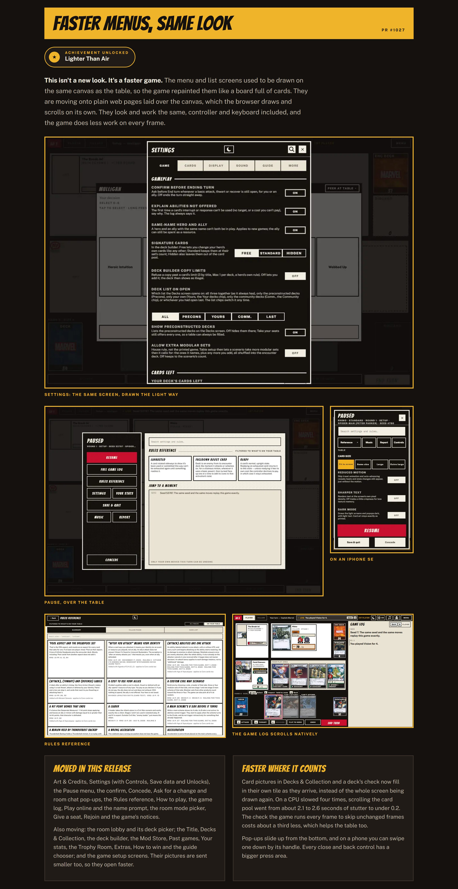

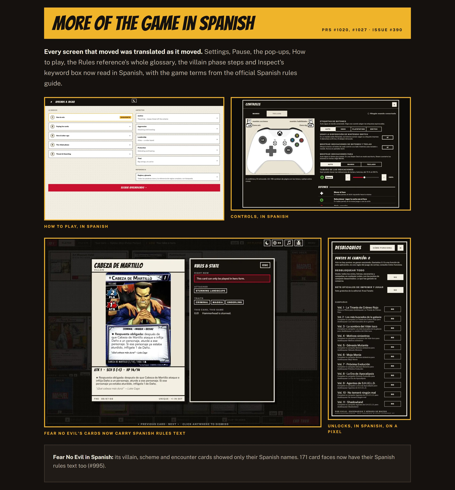

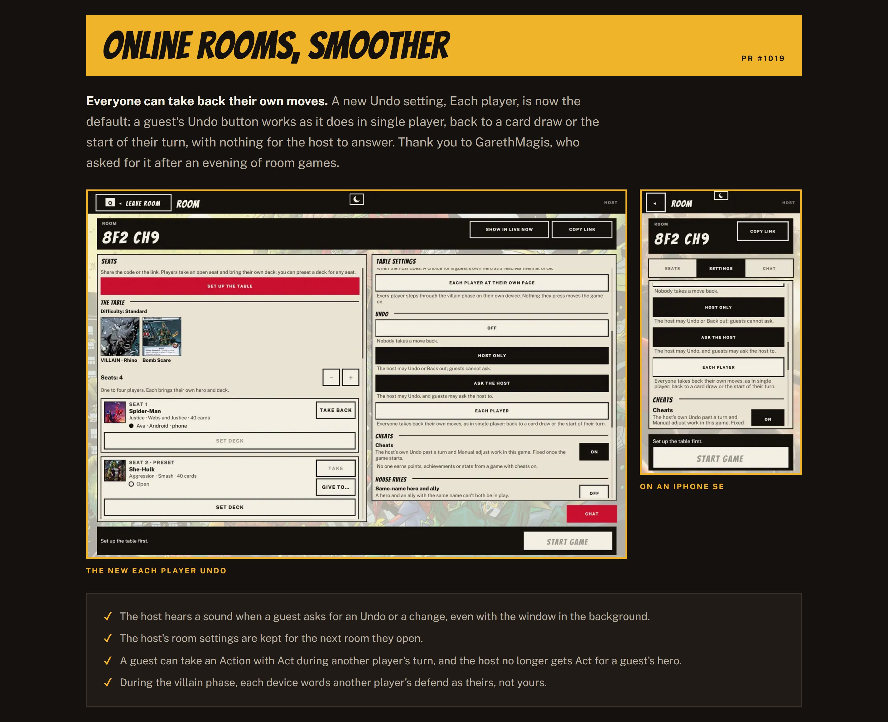

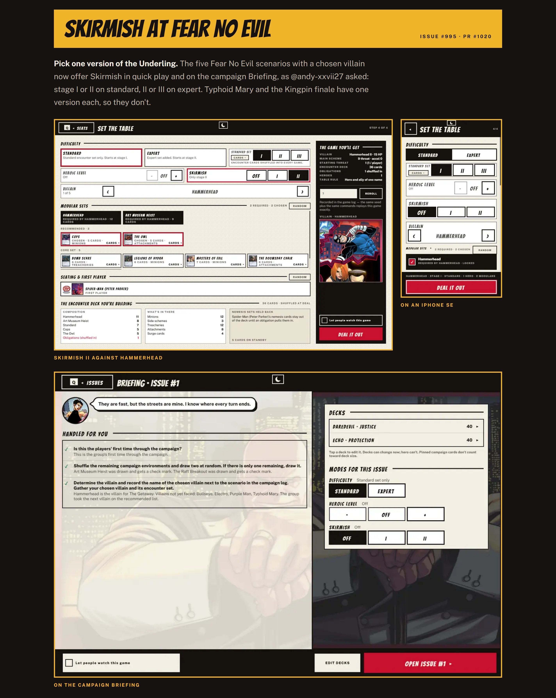

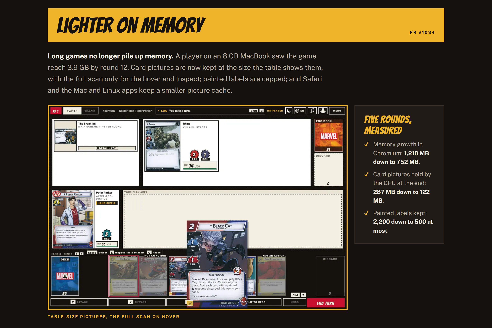

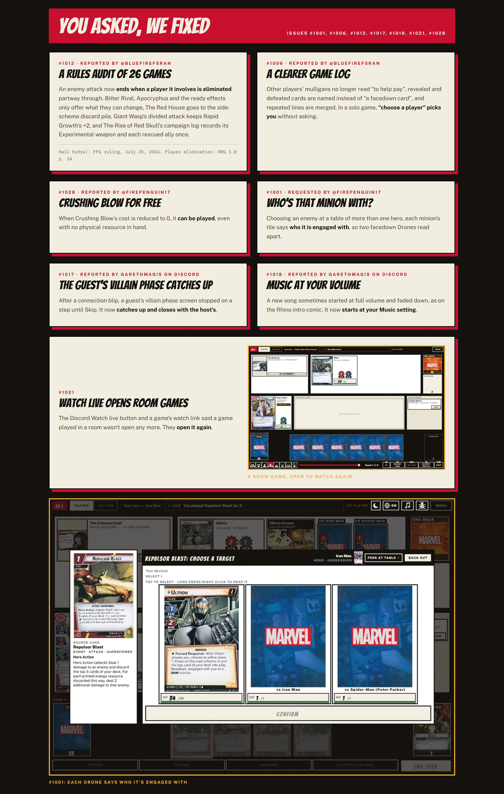

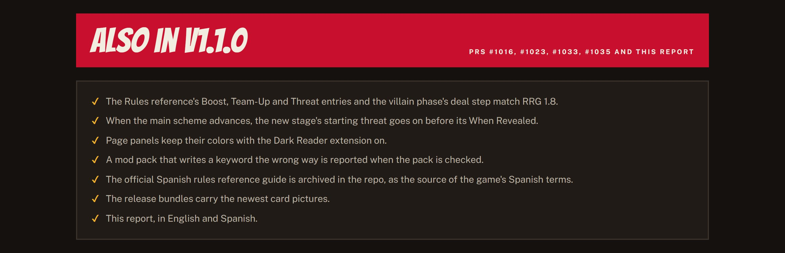

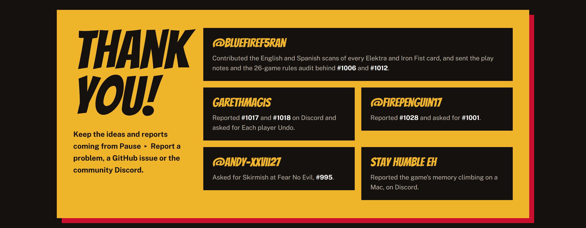

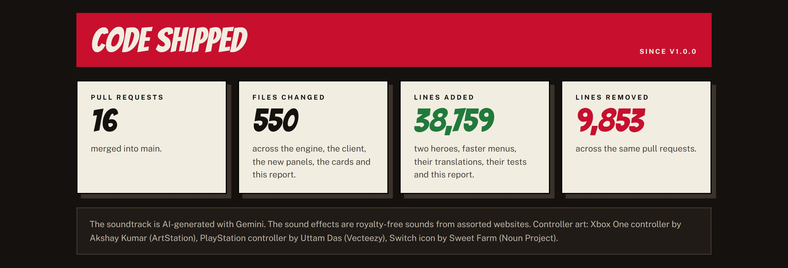
